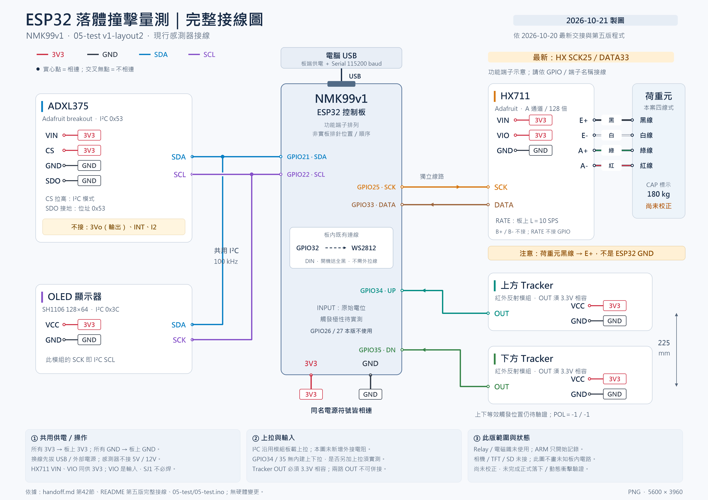

# 落體衝擊量測平台

以 **ESP32／NMK99v1** 為核心，比較 STF、三浦摺疊、EVA 及複合緩衝材料在落下衝擊中的反應。ADXL375 記錄加速度，HX711＋荷重元記錄底座受力原始值，上下兩顆 Tracker 記錄通過時間。

**最近已燒錄版本**：[05-test v1-layout2-fifo-diag1-wifi1-d220-right-optical1](05-test/05-test.ino)　｜　**目前校正狀態**：UNCAL（2026-10-26燒錄重啟後，未重新校正）

> **2026-10-26 最新部署與首筆結果**：獨立光學模式optical1已通過215項主機檢查、編譯／燒錄及實板VERSION核對。DIST220／POL1/1下，首筆讀回DONE／NONE、1153289µs＝1153.289ms、速度0.190759m/s；使用者確認READY、同一標記先上後下，OLED顯示1153.289ms／0.1908m/s，與換算四捨五入相符。[原始SPEED匯出](docs/experiments/manual-speed/20261026-optical1-001.speed.txt)及[本輪紀錄](docs/experiments/manual-speed/2026-10-26-manual-speed-session.md)已保存。單次計時／顯示／換算功能有限通過，光學準確度、重複性及完整QC仍待補；詳見[第七十節](handoff.md#manual-optical-mode-20261026)、[本版QC](docs/quality/reports/2026-10-26-optical1-qc.md)及[操作指南](docs/experiments/manual-speed/manual-optical-guide.md)。手動模式會暫停WiFi。

> **授權範圍與保存**：本輪為已授權的手動標記上→下；兩次原ARM的UPPER_TIMEOUT及首筆獨立SPEED結果均已保存。最新讀回DONE，主代理已關閉COM3；結果尚未CLEAR，未啟動下一輪、重新燒錄／重置、校正或自由落下。帳密僅存Git忽略的獨立檔，建置產物在儲存庫外；使用者後續已要求公開Git封存，範圍與接續順序見[第七十一節](handoff.md#optical1-git-handoff-20261026)。下方10/21～10/22內容保留為當時歷史；RAM校正已因先前燒錄重啟清除。

> **校正砝碼重量更正：20g × 10個＝200g。** 昨天兩輪實際輸入均為`CAL 400`，因此離線修正後的`counts_per_g`為原值2倍，克數為原換算值的一半。舊版／新版修正係數分別為19.95484375／20.46921875 counts/g；原始RAW與零點不變。以下摘要已採修正值，完整逐筆結果見[200g重算報告](docs/calibration/2026-10-21-hx711-correction-200g.md)。修正係數尚未寫入裝置。

**文件更新／最新硬體紀錄**：2026-10-26；本次WiFi部署見上方。以下保存2026-10-21的FIFO診斷版部署與校正歷史（10/22補充照片條件並更正砝碼總重為200g）：當時以本機ESP32 core 3.3.12編譯、燒錄COM3，確認啟動識別及15筆待機STATUS，見[歷史部署紀錄](handoff.md#fifo-diag1-deployment-20261021)。部署前的校正及回零資料來自舊v1-layout2，與新版各依自己的零點及修正係數重算。

使用者已確認新版OLED八行正常、RGB熄滅；新版HX711當時完成TARE及CAL 400，韌體列印offset=-164024.688 counts、原counts_per_g=10.234609375，最後已知為CAL_USER。依實際200g離線修正係數為20.46921875 counts/g：兩次卸載平均+1.27g／+4.89g，後續60秒空載61筆不同RX快照平均+9.88g（+4.53～+13.52g）；200g重放平均203.76g、偏高3.76g／1.88%，基線仍偏移且波動，尚未驗證合格。歷史操作見[校正接續紀錄](handoff.md#hx711-fifo-diag1-calibration-20261021)，修正結果以[200g重算報告](docs/calibration/2026-10-21-hx711-correction-200g.md)為準。

**最新排查狀況**：使用者量得VIN-GND約3.188～3.189V、橋路E+對E−經澄清為約3.164～3.170V。10/22電表照片確認為FLUKE 17B MAX、直流V／Auto，依顯示格式及原廠規格對應6.000V量程、1mV解析度；先前量測設定的連續性及`***`含義仍未明。10/21 23:31起COM3可開啟，但三種接收／監控檢查均無裝置訊息；使用者目視HX RAW仍更新、畫面CAL_USER。沒有重置或重校，**目前不能提供新的COM3重量／ERR／FIFO數值**；前述60秒數據是最後一次成功序列觀察，不當成現在讀回。供電餘裕與序列路徑均待查，詳見[電壓與通訊排查](handoff.md#hx711-voltage-serial-20261021)及[電表核對](handoff.md#hx711-meter-pause-20261022)。

**後續OLED照片（已依200g修正）**：七張均可見`IDLE A:0 H:0`及`HX:OK U0 D0`，可辨識的頂行為CAL_USER；RAW照片判讀範圍−163266～−163090，修正近似換算約+37.06～+45.66g，七張快照平均+40.05g。10/22使用者確認全程空托盤、未動接線或重啟，順序為61571→61577、間隔約10秒；約一分鐘首末由+45.66g到+39.21g，並非持續上升，最後五張約+37.06～+39.36g、平均+38.49g，仍明顯未回零且不足以宣告穩定。沒有精確拍攝時間或新ERR／RX，不能當成完整ADC時間序列或長期漂移率。`A:0 H:0`是試驗緩衝記錄數；[逐張原判讀](handoff.md#hx711-oled-photos-20261021)及[順序澄清](handoff.md#hx711-oled-sequence-20261022)保留歷史，換算結果採[200g修正表](docs/calibration/2026-10-21-hx711-correction-200g.md)。

> **目前為整合測試階段；最後目視CAL_USER對應當時錯輸入400g的RAM比例，200g修正僅在主機離線完成**。新版最後成功的60秒空載修正平均+9.88g，200g重放修正平均203.76g，尚未驗證合格。前次成功待機讀取為`HX=OK`、`ADXL=OK`、`ERR=0`、`AERR=0`、`FIFO_FULL=1`；**現在序列無回應，不沿用舊計數推定當前正常**。計時、原始資料記錄及CSV匯出已實作；正式落下、高速與動態量測仍待驗證。`ARM`只開始記錄，**不控制電磁鐵釋放**。

## 從這裡開始

| 你想做什麼 | 閱讀入口 |
|---|---|
| 了解完成到哪裡 | [1. 目前進度](#status) |
| 查閱10/20的電阻、電壓與讀值 | [2026-10-20 排查量測紀錄](#measurements-20261020) |
| 核對電路或重新接線 | [2. 完整接線圖與接線表](#wiring) |
| 第一次接 USB、查看讀值 | [3. 開機檢查](#first-run) |
| 設定距離、Tracker 極性或荷重係數 | [4. 設定與靜態校正](#setup) |
| 記錄一次試驗、保存 CSV | [5. 記錄與匯出](#recording) |
| 處理異常或理解資料 | [6. 狀態判讀](#troubleshooting) · [7. 資料限制](#data-limits) |
| 查看程式、編譯或追查舊紀錄 | [8. 版本與檔案](#files) · [9. 開發環境](#development) · [10. 後續與歷史](#history) |
| 手動通過兩頭測平均速度 | [獨立光學計時指南](docs/experiments/manual-speed/manual-optical-guide.md) · [本輪紀錄](docs/experiments/manual-speed/2026-10-26-manual-speed-session.md) |
| 查閱燒錄後QC流程與結果 | [QC檢核清單](docs/quality/post-flash-qc.md) · [最新optical1 QC](docs/quality/reports/2026-10-26-optical1-qc.md) · [四位協作規則](AGENTS.md) |

<a id="status"></a>

## 1. 目前進度

以下彙整**截至 2026-10-22 的已知狀態**，硬體證據見[新版接續紀錄](handoff.md#hx711-fifo-diag1-calibration-20261021)、[後續OLED照片](handoff.md#hx711-oled-photos-20261021)及[照片條件澄清](handoff.md#hx711-oled-sequence-20261022)；所有荷重克數以[200g修正紀錄](handoff.md#hx711-mass-correction-200g-20261022)為準。[舊版校正過程](handoff.md#hx711-calibration-20261021)另存歷史，兩輪零點及係數分開計算。

| 項目 | 已確認的結果 | 尚待完成 |
|---|---|---|
| 主板與韌體 | NMK99v1；第五版編譯、COM3 燒錄及 Hash 校驗成功 | 未接相機／TFT／SD；加裝前須重查腳位衝突 |
| HX711＋荷重元 | 依實際200g離線修正：新版重放平均203.76g，60秒空載平均+9.88g；七張OLED空載快照約+37.06～+45.66g，已確認未動接線或重啟、約10秒間隔，畫面HX:OK；修正係數尚未寫入裝置 | 回零偏差、重複性、多點準確度、長期穩定性與供電餘裕；目前串列無回應，最新ERR未知，不沿用歷史計數 |
| ADXL375 | 新版最後成功序列窗口為 `OK`、`AERR=0`、`FIFO_FULL=1`；初始化快取及診斷已保存 | 目前無新序列診斷，FIFO警示根因、校正與動態資料完整性未驗證；不可用舊版FIFO_FULL=0覆蓋新版結果 |
| OLED | SH1106 128×64 設定、位址 `0x3C`；使用者確認八行正常、無缺邊 | 此為驅動與畫面確認，未讀取控制器型號 |
| 板載 WS2812 | GPIO32；使用者確認已熄滅 | 關燈是送全黑資料，板上電源仍存在 |
| 雙 Tracker | 2026-10-17 第三版使用者回報：3V3 下兩路可各自慢速反射切換 | 第五版切換尚未重驗；OUT 電壓、輸出型態、進入極性與高速性能 |

新版當時各執行一次 `TARE`、`CAL 400`，實際砝碼後更正為200g；未執行`POL`、`ARM`或正式釋放。後續照片可見`IDLE`、`CAL_USER`、`HX:OK`，完整照片亦可見225mm及POL=-1/-1；目前串列無回應、最新ERR未知。舊版重放修正平均195.05g、確認間隙後空載修正平均−8.07g及ERR=2屬另一輪歷史資料。校正只存RAM，斷電／重啟後需重新確認；離線修正未更新裝置比例，短時間 `OK` 不代表量測驗證通過。

<a id="measurements-20261020"></a>

### 2026-10-20 排查量測值紀錄

以下依 [handoff.md](handoff.md) 第三十八至四十二節整理。**電阻／電壓來自使用者現場回報；序列數值來自當時 COM3 實際擷取**，本次未重新量測。展開各階段可查看數值。

<details>
<summary>① 供電、完整連接路徑與訊號線檢查</summary>

電阻為拔除 USB 與全部外部電源後量得；直流電壓是在確認接線並通電後量得，兩者不是同時量測。

| 檢查階段 | 量測點 | 2026-10-20 回報值 |
|---|---|---|
| 完整供電路徑 | HX711 VIN ↔ ESP32 3V3 | 0 Ω |
| 完整供電路徑 | HX711 VIO ↔ ESP32 3V3 | 0 Ω |
| 完整接地路徑 | HX711 GND ↔ ESP32 GND | 0 Ω |
| SCK／DATA 尚未接時 | ESP32 3V3 對 GND | 3.29 V |
| SCK／DATA 尚未接時 | HX711 VIN 對 GND | 3.20 V |
| SCK／DATA 尚未接時 | HX711 VIO 對 GND | 3.20 V |
| 第四版完整訊號路徑 | HX711 SCK ↔ GPIO32、DATA ↔ GPIO33 | 兩路曾回報 18.2 MΩ／16.3 MΩ；後續重測均為 0 Ω |

訊號線的 0 Ω 已確認是接好後、板端到板端的完整路徑，不只是拆下跳線量本體。先前 MΩ 值的具體接觸／測點原因，以及供電兩端約 0.09 V 差異的原因未定位；不能據此宣告長期接觸與供電瞬態均合格。

**此處 GPIO32／33 是當時第四版的歷史測點**；現行第五版 SCK 已改 GPIO25、DATA 保持 GPIO33。

</details>

<details>
<summary>② 荷重元四線分離後的六組電阻</summary>

量測條件為完全斷電、四條荷重元線全數與 HX711 分離，使用電阻檔；數值依現場回報記錄，未另取得這一輪電表照片。

| 線色配對 | 電阻 |
|---|---:|
| 紅 ↔ 黑 | 312.6 Ω |
| 綠 ↔ 白 | 263.6 Ω |
| 紅 ↔ 綠 | 351 Ω |
| 紅 ↔ 白 | 263.3 Ω |
| 黑 ↔ 綠 | 313 Ω |
| 黑 ↔ 白 | 400.4 Ω |

六組阻值與後續電壓／UART 對照支持以黑／白作激勵對、綠／紅作訊號對的診斷配置；不是只取最大阻值指定線色，也不是已取得原廠通用線色定義。

</details>

<details>
<summary>③ 荷重元改線前後的直流電壓</summary>

**舊配對（歷史）**：紅 E+、黑 E-、綠 A+、白 A-。**更正後配對**：黑 E+、白 E-、綠 A+、紅 A-。兩次分階段量測，改線均先斷電；表中「甲／乙」表示紅表筆接甲、黑表筆接乙。

| 量測點（紅表筆／黑表筆） | 舊配對 | 更正後配對 |
|---|---:|---:|
| E+／E- | 2.77 V | 約 3 V |
| A+／E- | 1.20 V | 約 1.36 V |
| A-／E- | 2.00 V | 約 1.35 V |
| A+／A-，直接差動量測 | **-0.81 V** | **電表顯示 0 V** |

直接差動的單位已由使用者後續確認為 V，但電表檔位與解析度未確認。**0 V 不能寫成精確零差動或 0 mV**；也不能用分時、粗略小數位的 1.36 與 1.35 V 相減，宣稱精準量得 10 mV。

舊配對的 -0.81 V 遠超 A128 的約毫伏級差動量程，支持負 SAT 與橋路配對有關；這不證明 HX711／荷重元損壞，也不代表已完成荷重校正。

</details>

<details>
<summary>④ 各階段序列讀值與第五版 FIFO 警示</summary>

以下均為當時 115200 baud 擷取的快照；RX 是接收框累計，ERR 是程式檢查到的 HX 讀後握手錯誤，AGE 是最近一框年齡。各段起點與韌體不同，不能把 RX 接續合併。

| 階段／當時版本 | 觀察窗與狀態 | HX RAW | RX／ERR／AGE |
|---|---|---|---|
| HX711 完全空接基準／第四版 | 約8秒、8筆均 TIMEOUT；DOUT=1 | 無資料 | RX=0、ERR=0；AGE 無資料 |
| 接回訊號後初次觀察／第四版 | 約15秒仍 TIMEOUT；DOUT=1 | 無資料 | RX=0、ERR=0 |
| 訊號路徑確認、荷重元仍為舊配對／第四版 | 約15秒、15筆均 SAT | **-8388608**，HEX=800000 | 230→362／0／2～17 ms |
| 荷重元更正配對／第四版 | 約15秒、15筆均 OK | **-161472～-161287** | 1748→1879／0／9～13 ms |
| 距離225mm初版／第五版 SCK32 | 約12秒、13筆 HX 均 OK；ADXL MISSING | -161681～-161513 | 152→258／0／1～45 ms |
| 相同程式重新上傳／第五版 SCK32 | 約10秒、11筆 HX 均 OK；ADXL 仍 MISSING | -160523～-160439 | 241→331／0／1～72 ms |
| NMK99 layout2／第五版 SCK25 | 約12秒、13筆 HX 與 ADXL 近期狀態均 OK | **-159032～-158862** | 10→116／0／10～208 ms |

第四版更正配對後的15筆時間戳為 `186003～200003 ms`，未見 SAT／STALE／TIMEOUT。前後使用同一第四版韌體與模組，未因改配對而重燒、去皮或濾波；結果支持原配對是負 SAT 的重要原因，仍不能證明所有歷史異常只有同一原因。

第五版 NMK99 layout2 的補充紀錄：

| 項目 | 2026-10-20 最新一段結果 |
|---|---|
| ADXL 狀態 | 13筆近期狀態均 OK，AERR=0；未獨立記錄本輪三軸數值或完成校正 |
| FIFO_FULL | **首筆即1、整段維持1**；是累計警示觀察，不是目前深度或精確遺失筆數 |
| 設定與電位 | IDLE、UNCAL、225mm、POL=-1/-1、UP=0、DN=0 |
| OLED／WS2812 | 位址0x3C；使用者確認「八行正常，無缺邊」與「WS2812已熄滅」 |

**所有 RAW 均為未校正原始計數，不是公斤或牛頓**。短時間快照不能取代長時間、全部中間資料框、已知荷重及正式動態驗證；Tracker 極性與第五版切換也未在這段確認。

</details>

<a id="wiring"></a>

## 2. 完整接線圖與接線表

> **換線前先拔除 USB 及所有外部電源，固定落體並隔離電磁鐵外部電源**。現行 HX711 是 **SCK25／DATA33**；GPIO32 專供板載 WS2812。舊版接腳不同，不可直接燒回舊韌體。



[下載原尺寸 PNG（5600 × 3960）](圖片/完整線路圖_NMK99_05-layout2_20261021.png)

圖中是**功能端子示意，不是實板排針位置或順序**；同名 `3V3`／`GND` 符號各自相連。接線以模組絲印及 GPIO 編號為準。

### 供電與訊號

| 模組 | 模組端子 → NMK99v1 | 說明 |
|---|---|---|
| ADXL375 | `VIN`、`CS` → **3V3**；`GND`、`SDO` → **GND** | I²C 模式，位址 `0x53`；`3Vo` 是輸出，保持不接 |
| ADXL375 | `SDA` → **GPIO21**；`SCL` → **GPIO22** | 本版讀 FIFO，`INT`／`I2` 不需接 |
| OLED | `VCC` → **3V3**；`GND` → **GND** | SH1106 128×64 設定，實測位址 `0x3C` |
| OLED | `SDA` → **GPIO21**；`SCK` → **GPIO22** | 此處 `SCK` 即 I²C SCL，與 ADXL375 共用匯流排 |
| HX711 | **`VIN`、`VIO` 都 → 同一個 3V3**；`GND` → **GND** | `VIO` 是數位供電輸入，不懸空、不接 5V；不必焊 SJ1 |
| HX711 | **`SCK` → GPIO25；`DATA` → GPIO33** | A 通道、增益 128；GPIO32 不再接 HX711 |
| 上方 Tracker | `VCC` → **3V3**；`GND` → **GND**；`OUT` → **GPIO34** | 反射進入電位需實測 |
| 下方 Tracker | `VCC` → **3V3**；`GND` → **GND**；`OUT` → **GPIO35** | 兩路 OUT 不可併接 |
| 板載 WS2812 | DIN 使用 **GPIO32**，板內已接 | 不需外拉線；開機送全黑，之後保持 LOW |
| Relay／電磁鐵／按鈕 | **本版不使用 GPIO26／27** | 不自動釋放，也不接管外部繼電器狀態 |

**HX711 RATE 是板上開關**：目前回報為 `L = 10 SPS`，`H = 80 SPS`；不接 GPIO，程式不能讀知開關位置，改開關先斷電。`B+`／`B-` 保持不接。

### 荷重元四條線

| 本案實測線色 | HX711 端子 | 功能 |
|---|---|---|
| **黑** | **E+** | 激勵正端；**不是 ESP32 GND** |
| **白** | **E-** | 激勵負端 |
| **綠** | **A+** | A 通道正輸入 |
| **紅** | **A-** | A 通道負輸入 |

這是本案經排查後的實測配對，不能套用到其他荷重元。銘牌可讀到 `CAP: 180 kg`，原廠型號與完整額定規格仍待確認。本次實際200g靜態加載得到正比例係數（當時錯輸入CAL 400，已離線修正），但尚未確認準確度；RAW不能直接當作公斤或牛頓。

### 安裝與電氣注意

- 全部現行低壓模組使用 3V3 並共地；5V OUT 不可直入 ESP32。
- GPIO34／35 **沒有內建上拉／下拉**。Tracker 是否另加上拉須依輸出型態與板載電路確認；圖中未假設已加外接電阻，也不沿用舊 OS25B10 的電阻網路。
- I²C 沿用 Adafruit 模組既有上拉，先核對其拉高電源，不任意再並聯電阻。
- 兩顆 Tracker 朝向同一掉落物上的固定反射標記；不是互相對射。2026-10-26使用者將新安裝後有效觸發間距更正為 **220 mm**，並確認安裝時斷電、時間差由OLED讀取，回報欄位單位為ms；實際時間差數字尚未提供。量測方法、不確定度、角度與環境光影響仍待驗證，詳見[安裝補充](handoff.md#tracker-spacing-update-20261026)。
- ADXL375 固定在掉落平台並靠近重心；荷重元採一端固定、一端受力與剛性上壓板，避免整支樑完全夾死。

<a id="first-run"></a>

## 3. 開機檢查

1. 固定落體、隔離外部電磁鐵電源，確認接線符合上圖；目前不進行落下試驗。
2. 接上 USB，以序列監控工具開啟**實際辨識到的 ESP32 埠**。設定 **115200 baud、全大寫命令、送出換行**；COM3 是歷史記錄，不保證每次相同。
3. 先依序送出下列兩個查詢命令：

   ```text
   HELP
   STATUS
   ```

4. 確認版次、接腳與設定，再看感測器近期狀態：

   | 檢查欄位 | 如何判讀 |
   |---|---|
   | 啟動識別／`LAYOUT` | `05-test NMK99 ... v1-layout2-fifo-diag1-wifi1-d220-right`／`LAYOUT=2` |
   | `SCK`／`DATA`／`RGB` | `25`／`33`／`32:OFF_REQ`；RGB 熄滅另以目視確認 |
   | `phase`／`CAL`／`POL` | 初始為 `IDLE`／`UNCAL`／`-1/-1` |
   | `HX`／`ADXL` | 近期應有有效資料；`OK` 不表示已校正 |
   | `AERR`／`ERR`／`FIFO_FULL` | 保留異常證據；既有 `FIFO_FULL=1` 尚待排查 |

5. 目視確認 OLED 八行資料及 WS2812 熄滅；再固定裝置，緩慢讓反射標記靠近／移開各 Tracker，確認上方只改 UP、下方只改 DN，記下**標記進入時**各自為 0 或 1。

目前只能依既有證據做接線、通訊與靜態檢查。進入正式落下前，先完成[待辦與驗證](#history)。

<a id="setup"></a>

## 4. 設定與靜態校正

以下是操作方式。本案2026-10-21舊版與部署後新版均各執行一次TARE與CAL 400；10/22使用者更正兩輪實際砝碼為20g×10個＝200g，已按各自零點離線重算。新版修正係數為20.46921875 counts/g，200g重放修正平均203.76g；回零及穩定性仍有偏差，硬體排查維持暫停，裝置尚未更新修正係數。詳見[200g更正紀錄](handoff.md#hx711-mass-correction-200g-20261022)。參數只能在 `IDLE` 且未收集校正資料時更改；若保留上一筆 DONE／FAULT 資料，先匯出保存，再 `CLEAR`。

本輪歷史輸出已補存為 [200筆 STATUS／RAW CSV](docs/calibration/2026-10-21-hx711-status.csv)，附[原始文字輸出](docs/calibration/2026-10-21-hx711-source.log)及[欄位／缺值／重複回報說明](docs/calibration/README.md)。保留4筆同RX重複快照，未填造逐筆時間或TARE／CAL內部32框；這不是重新讀取裝置或新的校正結果。

新版fifo-diag1的TARE／CAL 400、回零／重放及後續排查另存[新版原始紀錄](docs/calibration/2026-10-21-hx711-fifo-diag1-source.log)：134筆歷史STATUS及7筆獨立標示的OLED照片觀察，並附電壓回報、COM3無回應檢查與暫停註記；沒有把照片或無回應補成序列資料，也未混入舊版CSV。詳見[新版封存索引](docs/calibration/README.md#fifo-diag1-session)。

**更正後分析入口**：[200g重算報告](docs/calibration/2026-10-21-hx711-correction-200g.md) · [舊版200筆修正CSV](docs/calibration/2026-10-21-hx711-status-corrected-200g.csv) · [新版134筆修正CSV](docs/calibration/2026-10-21-hx711-fifo-diag1-status-corrected-200g.csv) · [七張照片修正CSV](docs/calibration/2026-10-21-hx711-oled-corrected-200g.csv)。原始CSV與log保存當時錯誤重量及換算值，後續分析請採修正版。

### 距離與 Tracker 極性

| 命令格式 | 要填的內容 |
|---|---|
| `DIST 毫米數` | 0～10000。預設 220（2026-10-26使用者更正）；應依上下等效觸發位置的實測距離調整。`DIST 0` 可記時間，但速度輸出 `NA` |
| `POL 上方 下方` | 各填實測的 `0` 或 `1`，表示同一反射標記**進入**該感測頭時的電位；兩路可不同，不能猜測 |

上表的「毫米數／上方／下方」是參數說明，送出時須換成實際數值。`POL=-1/-1` 表示未設定，不能 `ARM`。

### 荷重靜態校正

1. 確認 HX 狀態為 `OK`、安裝固定，保留正式使用的托盤／治具，移除外加荷重並保持靜止，送出 `TARE`；等待成功回報。
2. 放上**真實已知且安全的小重量**，保持靜止，再送出 `CAL 克數`，把「克數」換成該物體的實際重量；等待成功回報。
3. 成功後標示 `CAL_USER`，僅代表建立使用者靜態係數；還要驗證方向、多點荷重、重複性與準確度。

`TARE` 成功會使舊比例失效；`UNCAL` 清除去皮與比例。未校正仍可記錄 RAW，`mass_g_static` 會保留 `NA`。**`CAL_USER` 不代表動態力校正合格。**

<details>
<summary>校正收集與拒絕條件</summary>

每次收集 32 筆新有效框，最長 8 秒。SAT、握手錯誤、STALE、讀值跨度大於 2000 counts 或校正訊號差小於 100 counts 時會拒絕；失敗不套用新係數。這些是初版防呆門檻，不是校正品質認證。可送 `STOP` 取消收集。

</details>

<a id="recording"></a>

## 5. 單次記錄與匯出

程式已提供下列流程；實體觸發與動態量測仍待驗證。**`ARM` 不釋放落體，`STOP` 也不是物理急停。**

| 步驟 | 操作 | 程式行為 |
|---|---|---|
| 1. 準備 | 確認距離、極性；兩路標記均移開 | `IDLE`，ADXL 近期有資料、HX 為 `OK` 才能開始 |
| 2. 開始 | `ARM` | 開始記錄，等上方觸發最多 10 秒 |
| 3. 通過 | 依序上方 → 下方 | 上方後等下方最多 2 秒；下方後繼續記錄 2 秒 |
| 4. 結束 | 等待 `DONE` 或 `FAULT` | 保留本次資料；故障也不覆寫 |
| 5. 匯出 | `DUMP`，在電腦端保存輸出 | 輸出設定、品質旗標、摘要與原始 CSV；**不自動存成電腦檔案** |
| 6. 下一次 | 確認已保存，再送 `CLEAR` | 清除本次 RAM 記錄，回到 `IDLE` |

記錄期間 OLED 停在提示頁、一般序列快照暫停，只有 `STOP` 可執行，其他命令被忽略。下方先觸發、兩點間隔不足 200 µs、逾時或緩衝滿會進入 `FAULT`。

**斷電／重啟會遺失 RAM 記錄、極性與校正**，新版距離回到 220 mm。`CLEAR` 只清試驗資料，距離、極性與校正保留至斷電；DONE／FAULT 保留期間不能修改這些設定。

<details>
<summary>全部序列命令速查</summary>

| 命令 | 用途 |
|---|---|
| `HELP`／`STATUS` | 查命令／目前讀值、設定與異常 |
| `ADXL_DIAG` | 已燒錄的fifo-diag1新增：列出已保存的 FIFO 來源、時間與 OLED 耗時；只印快取，不清警示 |
| `DIST 毫米數`／`POL 上方 下方` | 設定距離／兩路觸發進入電位 |
| `TARE`／`CAL 克數`／`UNCAL` | 去皮／使用已知荷重建立靜態係數／清除係數 |
| `ARM`／`STOP` | 開始記錄／取消校正或中止記錄 |
| `DUMP`／`CLEAR` | 匯出保留的試驗／明確清除試驗 RAM |

命令為全大寫、以換行結尾。完整數值才會接受；NaN、無窮、額外字尾及過長命令會被拒絕。

</details>

<a id="troubleshooting"></a>

## 6. 狀態判讀與常見問題

| 看到的狀態 | 意義與下一步 |
|---|---|
| `HX=OK` | 近期收到完整且未滿量程的資料；仍須校正與穩定性驗證。負 RAW 本身不代表負飽和 |
| `WAIT`／`TIMEOUT` | 尚無首筆完整資料／等待超時；先斷電核對 VIN、VIO、共地及 SCK25／DATA33 |
| `STALE` | 曾有資料但超過 1 秒未更新；顯示值可能是舊快取 |
| `SAT` | 到達正負滿量程；保留原始值，檢查橋路、激勵與輸入，不用去皮或濾波掩蓋 |
| `LINK_ERR`／`ERR` 增加 | HX 讀後 DATA 握手異常；核對數位供電、接線與時序 |
| `ADXL=MISSING` | 近期無有效三軸資料；檢查 3V3、SDA21、SCL22、CS 高、SDO 地及初始化診斷 |
| `FIFO_FULL`／`AERR` 增加 | 前者是開機以來警示觀察次數，後者是原加速度讀取／FIFO 檢查錯誤；固定 `1` 不表示目前持續滿載，也不等於只漏一筆 |
| `POL=-1/-1` 或不能 `ARM` | 先量測進入極性、設定 POL；再確認 IDLE、兩路未觸發、HX OK、ADXL 近期有資料 |
| OLED 有 ACK 但畫面不正常 | ACK 不等於顯示成功；核對 SH1106 設定、3V3 供電及八行畫面 |
| COM3可開但無STATUS，OLED的RAW仍更新 | 先保留RAM、不按EN／BOOT或拔USB；核對OLED phase、UART／USB路徑，不能把零接收字元當成0g或ERR=0；見最新排查紀錄 |
| 記錄時 OLED／STATUS 不更新 | 記錄期間刻意暫停；完成後恢復。需要中止時送 `STOP` |

完整排查數據與各階段接法保留在[歷史 README](docs/archive/README-before-redesign-20261021.md)及[交接紀錄](handoff.md)，請用日期區分，不把舊電壓或舊照片當成現況。

<details>
<summary>2026-10-21：FIFO_FULL＝1 的程式排查、診斷版部署與首次待機結果</summary>

原程式遇到 `entries >= 32` **或** `INT_SOURCE` 的 D0 Overrun 位元時，就把同一個 `FIFO_FULL` 加一；兩種情況原本無法區分。歷史 13 筆 STATUS 均為 1，僅表示那段快照未再看到增加，不能反推首次警示原因或精確漏樣量。

已安裝的 ADXL375 驅動會先啟用量測，再由本案設定 ODR 與 FIFO。依[原廠資料表第14、23頁](https://www.analog.com/media/en/technical-documentation/data-sheets/ADXL375.pdf)，Overrun 在 bypass 也可能產生，讀 INT_SOURCE 本身不清除該資料旗標；因此啟動前後帶入舊旗標是**待驗證假說**，尚未證實。100 kHz 傳送一幀 1024 bytes 的 OLED，資料部分約92 ms；100 Hz 下 FIFO 容量約320 ms，單靠一幀傳輸不足以判定必滿，仍須實測整體阻塞時間。

`v1-layout2-fifo-diag1` 保留原警示、100 Hz、100 kHz、既有 FIFO 重設與所有接腳；新增以下證據，不用清零或降低取樣率製造「正常」：

| 診斷輸出 | 如何使用 |
|---|---|
| `DEPTH_OBS`／`OVR_OBS` | 分開保存深度滿載與 D0 的觀察次數；可同時成立，不能相加當作漏樣數 |
| `FIFO_PRE`／`FIFO_POST` | 深度、原始來源位元與各自主機時間；POST 僅在非記錄時更新，並非同時快照 |
| `FIFO_EVENT` | 保留首次與最近警示的主機觀察時間、深度、來源及階段；不是硬體事件精準時刻，無警示時為 NONE |
| `FIFO_DEPTH_MAX`／`FIFO_POLL_GAP_MAX` | 最大已觀察深度／poll 開始到開始的最大間隔；無有效觀察或尚無兩次 poll 時為 NA |
| `ACC_RX`／`DIAG_ERR` | 成功完整三軸交易總數／選用診斷交易錯誤；後者不混入原 AERR |
| `FIFO_INIT`／初始化快照 | 保存驅動與重設前後狀態；有效旗標與 NA 必須連同數值閱讀 |
| `OLED_TIMING` | 最近／最長 `sendBuffer()` 主機呼叫耗時，包含一般畫面與 ARM 前提示；不是示波器脈寬 |

`FIRST_PHASE`／`LAST_PHASE` 的數字對應：0＝IDLE、1＝ARMED、2＝WAIT_DN、3＝CAPTURE、4＝DONE、5＝FAULT。

本次已由使用者確認落體固定、電磁鐵外部電源隔離及USB供電，再按其要求燒錄，保存啟動輸出並在待機送`STATUS`、`HELP`及兩次`ADXL_DIAG`。15筆STATUS的FIFO_FULL均為1；兩次診斷均為`FULL_OBS=1 DEPTH_OBS=0 OVR_OBS=1 DIAG_ERR=0`，首次／最近事件同為`US=505194 N=3 SRC=0x81 PHASE=0`，已觀察最大深度14。初始化前`N=32 SRC=0x83`、重設後`N=0 SRC=0x81`；這些是非同時快照，尚不能據此確定舊旗標、首次事件根因或漏樣量。OLED主機呼叫最大118341µs，poll開始間隔最大140533µs；僅屬本次短期待機實測，不代表活動記錄或舊版耗時。

命令只印快取，不讀I²C、不重設FIFO；記錄期間仍只允許STOP。新增非記錄期快照與文字輸出也會占用時間。先前只編譯未燒錄的歷史另見handoff第四十五、四十六及四十八節；本次部署見[第四十九節](handoff.md#fifo-diag1-deployment-20261021)與[原始序列紀錄](docs/deployment/2026-10-21-fifo-diag1-serial.log)。使用者其後已確認新版OLED八行正常、RGB熄滅。**已完成燒錄及基本待機驗證，但根因、精度及正式落下仍未驗證，沒有清除警示或宣告修復。**

</details>

<a id="data-limits"></a>

## 7. CSV 與量測限制

`DUMP` 先輸出 `#` 開頭的設定與品質資訊，再輸出以下欄位。分析前保留設定與警示，不要只留下數值列。

```text
kind,t_read_us,x_raw,y_raw,z_raw,x_g,y_g,z_g,mag_g,hx_raw,hx_status,mass_g_static
```

| 欄位／結果 | 正確讀法 |
|---|---|
| `kind` | `ACC` 與 `HX` 分組輸出；不同感測器沒有假同步或補點 |
| `t_read_us` | 相對 ARM 的**主機讀出時間**；FIFO 樣本可能更早形成，不能當作精準採樣時間 |
| `x_raw`～`mag_g` | 加速度原始計數及名義 g 值；合成峰值**包含重力**，視窗為整次 ARM，尚未自動辨識撞擊段 |
| `hx_raw`／`hx_status` | HX 原始計數及狀態；SAT 保留於 CSV，但不當成可信受力極值 |
| `mass_g_static` | 未校正或 SAT 時為 `NA`；即使完成 CAL_USER，仍只是靜態等效克數 |
| `speed_mps` 摘要 | 僅 DONE 且距離已知時輸出兩點間平均速度；不是撞擊瞬間速度 |

**使用資料前，先確認這些限制：**

- ADXL375 目前為 **100 Hz**，HX711 為 **10／80 SPS**，都可能漏掉快速衝擊峰值；不宣稱毫秒級真實瞬時峰值力或精確吸能量。
- 加速度緩衝 2048 筆、HX 緩衝 1536 筆，滿載即中止，不覆寫。FIFO 滿、STALE、握手及 I²C 錯誤都應保留為品質旗標。
- 缺值為 `NA`，不補成 0；加速度近 190 g 的 `NEAR_RANGE` 僅是警示，不是精準硬體飽和判據。
- Tracker 的反射表面、側向距離、角度、環境光及延遲會影響時間；正式比較材料前，先完成低高度、低重量與重複性驗證。

<a id="files"></a>

## 8. 程式版本與檔案

### 哪個版本對應目前接線？

| 版本 | 用途 | HX711 SCK／DATA | 使用狀態 |
|---|---|---|---|
| **[05-test](05-test/05-test.ino)** | **整合感測、Tracker 中斷計時、手動校正與 CSV；含 FIFO 診斷與待機WiFi** | **25／33** | 已燒錄wifi1-d220-right，圖示移右上；版本／距離220mm／IP已讀回，UNCAL與FIFO警示待驗，未正式落下 |
| 初版 05（歷史） | 早期整合版本 | 32／33 | 已由同檔新版取代，詳見歷史紀錄 |
| [04-HX711-test](04-HX711-test/04-HX711-test.ino) | HX711＋OLED 獨立排查 | 32／33 | 保留歷史來源 |
| [03-irt_tracker](03-irt_tracker/03-irt_tracker.ino) | 感測器＋OLED＋雙 Tracker 電位 | 33／32 | 保留歷史來源 |
| [02-irt_oled](02-irt_oled/02-irt_oled.ino) | 感測器＋OLED＋OS25B10 | 33／32 | 保留歷史來源 |
| [01-irt](01-irt/01-irt.ino) | 基本通訊＋OS25B10 | 33／32 | 保留歷史來源 |

舊版不是目前配線的替代燒錄選項。尤其舊 SCK33 會接到目前 HX711 DATA33，切換版本前必須先斷電、核對來源常數及實線；NodeMCU-32S 腳位圖也不能當作 NMK99 實板排針圖。

### 文件與資料入口

| 檔案／資料夾 | 內容 |
|---|---|
| [README.md](README.md) | 現行接線與使用指南 |
| [handoff.md](handoff.md) | 按日期追加的完整驗證證據、歷史更正與未完成事項 |
| [完整線路圖 PNG](圖片/完整線路圖_NMK99_05-layout2_20261021.png) | 現行接線，含電源、荷重元與板內 RGB |
| [圖片/](圖片/) | 元件、麵包板與機構照片；舊照片需對照日期 |
| [tests/05-test.test.cjs](tests/05-test.test.cjs) | 從實際來源轉譯的主機邏輯模擬，非硬體時序測試 |
| [tests/05-fifo-diag.test.cjs](tests/05-fifo-diag.test.cjs) | 新增 FIFO 來源、時間及診斷防護的主機檢查 |
| [docs/archive/](docs/archive/) | 本次改版前 README 的完整歷史快照 |
| [docs/calibration/](docs/calibration/) | 2026-10-21 HX711逐筆STATUS／RAW、原始輸出與欄位說明 |
| [docs/deployment/](docs/deployment/) | fifo-diag1燒錄、目標身分、啟動與待機診斷原始紀錄 |

`auto-git-watch.ps1` 為本機限定同步工具，已被 `.gitignore` 排除，不屬於硬體操作流程。

<a id="development"></a>

## 9. 開發環境與編譯

已先封存HX711歷史快照，再依使用者要求將**目前本機** ESP32 core 從 **3.3.11 更新到指定的 3.3.12**。其後收到燒錄指示，以同一份FIFO診斷來源再次編譯成功並部署COM3。版本由[Espressif 官方索引](https://espressif.github.io/arduino-esp32/package_esp32_index.json)與[官方發布頁](https://github.com/espressif/arduino-esp32/releases/tag/3.3.12)核對；沒有更新Arduino CLI或應用函式庫。

| 項目 | 2026-10-20 交接記錄 | 本輪本機2026-10-21更新後實際讀回／結果 |
|---|---|---|
| Arduino CLI／ESP32 core | 1.5.1／3.3.11 | CLI **1.5.1**（01f3d4f2b）；core **3.3.12**，core list及實際目錄均確認 |
| U8g2／Adafruit ADXL375 | 2.36.19／1.1.2 | 2.36.19／1.1.2，應用函式庫未升級；核心所需工具由套件管理器安裝 |
| FQBN | `esp32:esp32:nodemcu-32s:UploadSpeed=115200,FlashFreq=40` | 相同 FQBN；`build.options.json`確認實際核心為3.3.12 |
| 編譯結果 | 舊已燒錄版：Flash 349629 bytes、RAM 69340 bytes | 本次重新編譯／已燒錄版：Flash **351921 bytes（26%）**、RAM **69428 bytes（21%）**，編譯及上傳均結束碼0 |
| 主機檢查 | 當時18組通過 | 原18組＋新增19組＝**37組通過**；非硬體時序驗證 |

同步文件中另有nightly-20260918／189327e、core3.1.1→3.3.12的歷史建置，保留於handoff第四十五、四十六節；不能據此推定目前本機狀態。**本輪**更新前即時讀回為CLI1.5.1／core3.3.11，更新後為1.5.1／3.3.12；新產物與驗證詳見[第四十八節](handoff.md#hx711-archive-local-build-20261021)。各輪環境、產物及雜湊分別記錄，不互相代用。

本次重新編譯並實際燒錄的bin SHA256（先前只編譯的產物另保留於第四十八節）：

```text
B62CDBCB2FF2DB21DB86AA96C1751AC1AEAA5533B40B216CFA2890FE71C750E1
```

建置產物留在系統暫存目錄，未納入Git。本次上傳的bootloader、partitions、boot_app0及主程式均通過Hash校驗，新啟動識別及待機命令已確認；見[第四十九節部署紀錄](handoff.md#fifo-diag1-deployment-20261021)。**基本啟動通過不等於FIFO根因、感測精度或動態驗證通過，重燒後需重新建立並驗證校正。**

FQBN 是沿用的 ESP32 編譯設定，**不表示已完整對應 NMK99 所有板載周邊**；現行 GPIO25 配置以未接相機／TFT／SD 為前提。

在專案根目錄執行 PowerShell，將產物留在系統暫存目錄：

```powershell
$irtCli = 'C:\Program Files\Arduino CLI\arduino-cli.exe'
$irtBoard = 'esp32:esp32:nodemcu-32s:UploadSpeed=115200,FlashFreq=40'
$irtBuild = Join-Path $env:TEMP 'irt-05-build'

& $irtCli compile --jobs 2 --fqbn $irtBoard --build-path $irtBuild .\05-test
if ($LASTEXITCODE -ne 0) { throw '編譯失敗，停止後續作業' }
```

主機邏輯檢查使用 `node tests/05-test.test.cjs` 及 `node tests/05-fifo-diag.test.cjs`。通過只表示所涵蓋的邏輯模擬通過，不等同中斷延遲、波形、感測精度或完整 ESP32 排程驗證。

<details>
<summary>需要重新燒錄時：確認接線與裝置後，再單獨執行</summary>

先固定落體、隔離電磁鐵外部電源，核對 SCK25／DATA33 與實板身分，關閉占用埠的序列監控；使用剛才成功編譯的同一個產物目錄。下方 `COMx` 必須換成已確認的目標埠，不能把未知的 COM1 當作 ESP32。

```powershell
& $irtCli board list
$irtPort = 'COMx' # 換成已確認身分的實際 ESP32 埠
if ($irtPort -eq 'COMx') { throw '尚未指定已確認的目標埠' }

& $irtCli upload --port $irtPort --fqbn $irtBoard --input-dir $irtBuild .\05-test
if ($LASTEXITCODE -ne 0) { throw '燒錄失敗，保留診斷輸出' }
& $irtCli monitor --port $irtPort --config baudrate=115200
```

上傳成功後仍須檢查啟動識別、STATUS、OLED 與燈號；Flash Hash 校驗不能代替感測器與畫面驗證。

</details>

<a id="history"></a>

## 10. 後續工作與歷史紀錄

依現行整合版本，下一階段按以下順序驗證：

1. 排查 `FIFO_FULL`，確認 ADXL375 固定、方向、資料完整性及加速度校正。
2. 補查 Tracker 型號、額定供電、OUT 電壓與輸出電路；確認進入極性、等效間距、延遲及高速重複性。
3. 新版TARE及CAL 400當時成功，砝碼實際總重後更正為200g；離線修正後兩次卸載均值+1.27g／+4.89g、60秒空載平均+9.88g、200g重放平均203.76g，仍有偏差及波動。VIN-GND約3.188～3.189V、E+對E−約3.164～3.170V；FLUKE 17B MAX照片為直流V／Auto，對應6.000V量程及1mV解析度，先前設定連續性與`***`含義仍待釐清，不能憑6mV跨度確診根因或自行改5V。COM3無回應後取得七張OLED空托盤照片，修正克數約+37.06～+45.66g；已確認未動接線或重啟、依檔號約每10秒一張，先降後波動，不代表長期穩定。**硬體維持暫停，離線修正未寫入裝置；恢復後需先確認現況，再安排序列路徑與供電餘裕排查**。先前懸空間隙約5mm、紙張可自由穿過為使用者回報。
4. 驗證第五版既有計時、緩衝與 CSV 流程；先低高度、低重量，再進入材料比較。
5. 若要加入電磁鐵自動釋放，另行確認 Relay 額定電源、觸發邏輯、飛輪二極體與機械安全；此功能尚未啟用。

**追查紀錄：**[完整交接 handoff.md](handoff.md) · [改版前 README 歷史快照](docs/archive/README-before-redesign-20261021.md)

歷史快照保留原有各版接線、排查數據、編譯／燒錄指令及參考資料；其中舊 GPIO、線色、NodeMCU-32S 與 OS25B10 描述須依日期閱讀。**現行操作以本頁接線與第五版來源為準。**

<details>
<summary>主要原廠參考資料</summary>

- [ADXL375 資料表](https://www.analog.com/media/en/technical-documentation/data-sheets/ADXL375.pdf)
- [Adafruit ADXL375 端子](https://learn.adafruit.com/adafruit-adxl375/pinouts)
- [HX711 資料表](https://cdn.sparkfun.com/datasheets/Sensors/ForceFlex/hx711_english.pdf)
- [Adafruit HX711 端子與 VIO 焊橋](https://learn.adafruit.com/adafruit-hx711-24-bit-adc/pinouts)
- [Espressif ESP32 資料表](https://www.espressif.com/sites/default/files/documentation/esp32_datasheet_en.pdf)
- [U8g2 API 與 OLED 設定](https://github.com/olikraus/u8g2/wiki/u8g2reference)

</details>
