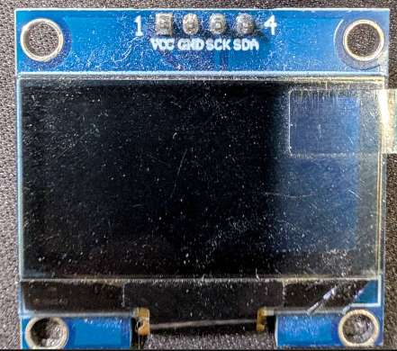

# 落體衝擊量測平台（Impact_Resistance_Test）

本專案是以 NodeMCU-32S（ESP32-WROOM-32）為核心的垂直落體衝擊量測平台，用來比較 STF、三浦摺疊、EVA 及複合緩衝結構的衝擊反應。

系統目前規劃以三類感測資料互相對照：

- Adafruit ADXL375：量測掉落平台的三軸高 G 加速度。
- HX711 搭配四線式 Load Cell：量測底部相對受力。
- 上、下兩顆 Tracker Sensor：規劃取代 OS25B10，以同一掉落物反射標記通過兩個偵測點的時間差估算兩點間平均速度；尚未完成換裝與驗證。

四腳 I²C OLED 顯示上述感測器讀值；`02-irt_oled` 與新版 `03-irt_tracker` 使用 SH1106 128×64 設定，使用者已分別確認兩版八行資料正常且無缺邊。第三版已編譯、燒錄到 COM3，改讀兩顆 Tracker Sensor；模組實際反射切換仍待驗證。程式自動檢查 `0x3C`／`0x3D`，本機實測位址為 `0x3C`。

## 目前狀態

> **最新實機燒錄驗證日期：2026-10-17**
>
> `03-irt_tracker/03-irt_tracker.ino` 已成功編譯、燒錄到 COM3 並通過寫入校驗；使用者確認第三版 OLED 八行資料正常且無缺邊。啟動後確認 OLED `0x3C`、ADXL375 `0x53` 與三軸數值；兩路 Tracker 皆讀到 LOW，尚未確認反射切換。HX711 先 WAIT、之後多次讀到正滿量程 `8388607 [SAT]`，期間一筆為 `-2049 [OK]`；與較早固定負滿量程不同，但不能認定已修復，仍待供電、橋路與類比端量測。
>
> **2026-10-17 硬體規劃更新：**使用者已決定以 Tracker Sensor 取代 OS25B10，並確認已購買兩顆相同模組。新模組規劃沿用上方 GPIO34、下方 GPIO35；目前僅確認照片中的 GND／VCC／OUT 標示，實際供電範圍、OUT 電位與觸發極性仍待確認。這不是已完成換裝或驗證的紀錄，現有 `01-irt`／`02-irt_oled` 保留舊版 OS25B10 命名與韌體。
>
> **2026-10-17 第三版程式：**由 `02-irt_oled` 另存，保留 OLED、ADXL375、HX711 並改讀兩路 Tracker Sensor 原始 HIGH／LOW。初次僅編譯，之後依使用者新的要求完成自動編譯及燒錄；Flash 312,612 bytes（23%）、RAM 24,924 bytes（7%）。燒錄與 OLED 畫面已驗證，不等同 Tracker 模組接線、供電或實際反射偵測已驗證。

目前完成：

- ADXL375、HX711、舊版 OS25B10 接線，以及新版 Tracker Sensor 的待驗證接線規劃已記錄。
- `01-irt` 簡易程式已成功編譯、燒錄並以 115200 baud 讀取序列輸出。
- ADXL375 已讀到 X／Y／Z 加速度，HX711 已讀到 A128 原始值。
- 兩顆 Tracker Sensor 已由使用者確認購入，規劃沿用上方 GPIO34、下方 GPIO35。
- `02-irt_oled` 已加入 OLED 同頁讀值、逐行正體中文註解與資料狀態，並完成編譯、燒錄與序列埠檢查。
- 使用者已目視確認 `02-irt_oled` 完整版的八行資料、底部狀態列均正常顯示且無缺邊。
- `03-irt_tracker` 已逐行附正體中文註解，完成編譯、COM3 燒錄、啟動輸出與 OLED 八行目視驗證；上方 OUT 使用 GPIO34，下方 OUT 使用 GPIO35，保留實際 HIGH／LOW、不預設反射極性。

尚待完成：

- 確認 Tracker Sensor 的供電範圍、輸出形式、OUT 電位與反射觸發極性，再完成兩路換裝；不沿用 OS25B10 裸元件的接法。
- 排查 HX711 飽和與不穩定讀值：曾固定為負滿量程 `-8388608`，第三版啟動後又出現 WAIT、正滿量程 `8388607` 及一筆非飽和值；仍未修復，確認後再進行荷重校正。
- 上、下反射偵測點的安裝、觸發順序、重複性與兩點時間差正式測試。
- Load Cell 線色、額定容量與 HX711 靜態校正的確認。
- Relay、12 V 電磁鐵與釋放按鈕的實機安全測試。
- 正式低高度、低重量測試，以及後續資料記錄程式。

## 目錄

1. [專案目的](#專案目的)
2. [檔案結構](#檔案結構)
3. [系統架構](#系統架構)
4. [硬體清單與狀態](#硬體清單與狀態)
5. [NodeMCU-32S 接腳配置表](#nodemcu-32s-接腳配置表)
6. [電源與接地](#電源與接地)
7. [ADXL375 接線](#adxl375-接線)
8. [HX711 與 Load Cell 接線](#hx711-與-load-cell-接線)
9. [Tracker Sensor 雙偵測點](#tracker-sensor-雙偵測點)
10. [Relay、電磁鐵與釋放按鈕](#relay電磁鐵與釋放按鈕)
11. [量測設計與限制](#量測設計與限制)
12. [01-irt 通訊測試程式](#01-irt-通訊測試程式)
13. [02-irt_oled OLED 簡易測試程式](#02-irt_oled-oled-簡易測試程式)
14. [03-irt_tracker Tracker Sensor 簡易測試程式](#03-irt_tracker-tracker-sensor-簡易測試程式)
15. [後續工作](#後續工作)
16. [參考資料](#參考資料)

## 專案目的

建立可重複的垂直落下衝擊量測系統，比較不同緩衝結構對下列指標的影響：

- 掉落物通過上下偵測點的平均速度。
- ADXL375 的峰值加速度與撞擊作用時間。
- Load Cell 傳遞至底座的相對受力。
- 緩衝材料的壓縮與永久變形。

預計比較的組別包括無緩衝、EVA、PP 三浦摺疊、STF，以及 STF＋三浦摺疊＋EVA 複合結構。

## 檔案結構

```text
Impact_Resistance_Test/
├── 01-irt/
│   └── 01-irt.ino                         # ESP32 感測器通訊測試程式
├── 02-irt_oled/
│   └── 02-irt_oled.ino                    # OLED 與序列埠感測器讀值測試程式
├── 03-irt_tracker/
│   └── 03-irt_tracker.ino                 # 已燒錄；雙 Tracker Sensor 反射功能仍待驗證
├── 圖片/
│   ├── OS25B10-紅外線對射光電開關.png       # OS25B10 元件參考圖
│   ├── Snipaste_2026-10-16_22-30-35.png     # 四腳 I²C OLED 實物照片
│   ├── Snipaste_2026-10-17_22-18-33.png     # Tracker Sensor 接腳標示面
│   ├── Snipaste_2026-10-17_22-18-47.png     # Tracker Sensor 元件面
│   ├── PXL_*.jpg                           # 元件、麵包板與機構照片
│   └── PXL_*.MP.jpg                        # 元件、麵包板與機構照片
├── .gitignore                               # Git 忽略規則；排除本機自動同步腳本
├── README.md                               # 專案入口說明、接線與操作方式
├── handoff.md                              # 依日期追加的完整交接與驗證紀錄
├── auto-git-watch.ps1                      # 本機限定；不納入 GitHub
├── 零件1.stp                               # 機構 STEP 模型
└── 零件1.stl                               # 機構 STL 網格模型
```

### 檔案使用原則

- `README.md`：閱讀專案目前架構、接線、測試指令與已知限制的入口文件。
- `handoff.md`：保留時間順序與歷史狀態；新的量測、燒錄或接線結果應追加在檔案末端，不覆寫舊紀錄。
- `01-irt/01-irt.ino`：目前只用於確認感測器與 ESP32 的基本通訊，不是正式落下試驗程式。
- `02-irt_oled/02-irt_oled.ino`：以 `01-irt` 為基礎另存的 OLED 簡易測試程式，同時顯示 ADXL375、HX711 與兩路 OS25B10；每個非空程式碼行均附正體中文註解。
- `03-irt_tracker/03-irt_tracker.ino`：由 `02-irt_oled` 另存，保留其他感測器與 OLED 功能，改為兩顆 Tracker Sensor；每個非空行均有正體中文註解。已完成燒錄與 OLED 目視驗證，Tracker 反射功能仍待測試；原 `01`、`02` 保留不動。
- `auto-git-watch.ps1`：僅供本機自動同步使用，已加入 `.gitignore`，不應提交到 GitHub。
- `圖片/`：保存目前取得的實物與機構照片；照片不能取代電表量測或資料表確認。
- `零件1.stp`、`零件1.stl`：保存機構設計模型，與 ESP32 韌體分開管理。

## 系統架構

```text
USB 供電／序列埠
        │
        ▼
NodeMCU-32S（ESP32）
   ├─ I²C GPIO21／GPIO22 ── ADXL375、OLED
   ├─ GPIO32／GPIO33 ─────── HX711 ── Load Cell
   ├─ GPIO34 ─────────────── 上方 Tracker Sensor OUT（待電氣確認與換裝）
   ├─ GPIO35 ─────────────── 下方 Tracker Sensor OUT（待電氣確認與換裝）
   ├─ GPIO26（預留）──────── Relay ── 獨立 12 V 電磁鐵
   └─ GPIO27（預留）──────── 釋放按鈕
```

資料可由 ESP32 透過 USB Serial 輸出；`02-irt_oled` 與新版 `03-irt_tracker` 另提供 OLED 畫面，裝置目前已燒錄第三版。三版皆為簡易通訊測試，尚未控制 Relay、執行正式落下計時或完成校正。

## 硬體清單與狀態

| 元件 | 用途 | 目前狀態 |
|---|---|---|
| NodeMCU-32S／ESP32-WROOM-32 | 主控制器、時間戳與 USB Serial | 2026-10-17 已以 COM3 成功燒錄 `03-irt_tracker` |
| Adafruit ADXL375 | ±200 g 三軸加速度計，I²C | 已初始化成功並讀到 X／Y／Z |
| 四腳 I²C OLED | 顯示三軸加速度、荷重原始值與雙偵測點 | VCC 接 3V3，位址 `0x3C`；使用者確認第二、第三版 SH1106 128×64 八行資料正常且無缺邊 |
| Adafruit HX711 24-bit ADC | 讀取 Load Cell | 舊對照測試為負滿量程；第三版啟動後多次為正滿量程，仍需核對類比供電與荷重元接線 |
| 四線式 Load Cell | 底部相對受力 | 照片可讀到 `CAP: 180 kg`，額定容量與線色仍待確認 |
| Tracker Sensor × 2 | 新版上、下反射偵測點 | 已購入兩顆相同模組；第三版已燒錄並讀到兩路 LOW，供電、OUT 電位與反射切換仍待確認 |
| OS25B10 × 2（舊版） | 舊版上、下光閘 | 保留歷史接線與程式；曾讀到兩路 LOW，不等於 Tracker Sensor 已通過測試 |
| Relay＋12 V 電磁鐵 | 釋放掉落平台 | 接線與觸發邏輯尚待依實物確認 |
| 釋放按鈕 | 啟動釋放流程 | 預留 GPIO27，尚未納入 `01-irt` |

## NodeMCU-32S 接腳配置表

下表整合既有接線及 2026-10-17 Tracker Sensor 換裝規劃。新模組相關列屬待驗證規劃，並非已接妥；新 `03-irt_tracker` 已採用 Tracker 命名，舊 `01`、`02` 仍保留 OS25B10 名稱。ADXL375、HX711 與 OLED 的配置不變；換裝前須先完成新模組的電氣確認。

| NodeMCU-32S | 對應元件端子 | 線材顏色／接線 | 方向 | 用途與備註 |
|---|---|---|---|---|
| 3V3 | ADXL375 VCC、OLED VCC、HX711 VIN；Tracker Sensor VCC 為條件式規劃 | ADXL375 黑：VCC；新模組線色未指定 | 電源輸出 | Tracker Sensor 僅在確認支援 3.3 V 後才接此電源；不可接 12 V |
| GND | ADXL375 GND、SDO、OLED GND、HX711 GND、兩顆 Tracker Sensor GND | ADXL375 白：GND；綠：SDO；新模組線色未指定 | 電源回路 | 新模組規劃共地；SDO 接低電位時，程式預期 I²C 位址為 `0x53` |
| GPIO21 | ADXL375 SDA、OLED SDA | ADXL375 橘：SDA；OLED：— | I/O | I²C SDA，共用匯流排 |
| GPIO22 | ADXL375 SCL、OLED SCK | ADXL375 棕：SCL；OLED：— | I/O | I²C SCL；OLED 實物端子標示為 SCK |
| GPIO16 | ADXL375 INT | ADXL375 淡咖啡：INT | 輸入（選配） | Data Ready／FIFO／事件中斷；目前程式使用輪詢 |
| GPIO17 | ADXL375 I2 | — | 輸入（選配） | 第二組中斷；目前不接 |
| GPIO32 | HX711 DATA | 紫：HX711 DATA | 輸入 | HX711 serial data output；HX711 直接插在麵包板 |
| GPIO33 | HX711 SCK | 紫：HX711 SCK | 輸出 | HX711 serial clock；HX711 直接插在麵包板 |
| GPIO34 | 上方 Tracker Sensor OUT（規劃） | 新線色未指定；舊版 OS25B10 為紫線 | 輸入 | 確認 OUT 為 3.3 V 相容數位訊號後接入；沒有內建上拉 |
| GPIO35 | 下方 Tracker Sensor OUT（規劃） | 新線色未指定；舊版 OS25B10 為橘線 | 輸入 | 確認 OUT 為 3.3 V 相容數位訊號後接入；沒有內建上拉 |
| GPIO26 | Relay IN | — | 輸出（預留） | 電磁鐵釋放控制；觸發高低電位尚待確認 |
| GPIO27 | 釋放按鈕另一端 | — | 輸入（預留） | 按鈕另一端接 GND，規劃使用 `INPUT_PULLUP` |

### NodeMCU-32S 腳位圖


## 電源與接地

- NodeMCU-32S 目前由 USB 供電；既有 ADXL375、OLED、HX711 使用 NodeMCU-32S 的 3V3。新 Tracker Sensor 須先確認支援 3.3 V，不能直接套用其他型號規格。
- ADXL375、OLED、HX711、Tracker Sensor、按鈕與 Relay 邏輯側應共用 GND。
- 本次已由使用者確認 OLED VCC 接 3V3、GND 共地；更換模組前仍須確認其實際供電範圍。
- 電磁鐵使用獨立 12 V 電源，不可由 ESP32 GPIO、USB 或 3V3 直接供電。
- Relay 的 VCC 必須依實物標示接額定電源；非隔離模組才需要依模組電路與 ESP32 共地。
- 12 V 高電流線、Relay 線與 Load Cell／I²C 線分開走線，降低衝擊雜訊。
- GPIO34、GPIO35 沒有內建上拉／下拉。新模組是否需要外接上拉，取決於 OUT 電路；若確認為開集極且無板載合適上拉，才加上拉到 3V3。不可沿用舊版電阻網路而未核對。

## ADXL375 接線

ADXL375 使用 I²C。程式目前以 `0x53` 初始化，這代表 SDO 應為低電位；若 SDO 接 3V3，位址會變成 `0x1D`，需同步修改程式或接線。

| ADXL375 端子 | NodeMCU-32S | 說明 |
|---|---|---|
| VIN | 3V3 | 供電；依板面標示使用 `VIN`，不是 `3Vo` |
| GND | GND | 共地；線色為白 |
| SDA | GPIO21 | I²C 資料；線色為橘 |
| SCL | GPIO22 | I²C 時脈；線色為棕 |
| CS | 3V3 | 選擇 I²C 模式；實物接法仍應確認 |
| SDO | GND | 使用 I²C 位址 `0x53`；線色為綠 |
| INT | GPIO16（選配） | Data Ready／FIFO／事件中斷；線色為淡咖啡 |
| I2 | GPIO17（選配） | 第二組中斷，目前不接 |
| 3Vo | 不接 | 板上穩壓器的 3.3 V 輸出，不作為電源輸入 |

ADXL375 應牢固固定在掉落平台上，盡量靠近重心。正式上電前，應以 I²C scanner 或目前測試程式確認 `0x53` 有回應。

## OLED 顯示模組（I²C，規格待確認）

新增實物照片：[Snipaste_2026-10-16_22-30-35.png](圖片/Snipaste_2026-10-16_22-30-35.png)。



照片可辨識四個端子標示為 `1 VCC`、`2 GND`、`3 SCK`、`4 SDA`。此處將 `SCK` 視為 I²C SCL 時脈腳位；目前不能只由照片確認 OLED 控制器、尺寸、解析度、供電範圍或 I²C 位址。

| OLED 端子 | NodeMCU-32S | 備註 |
|---|---|---|
| `VCC` | `3V3` | 使用者已確認改接，SH1106 完整版八行畫面正常 |
| `GND` | `GND` | 與 ESP32、ADXL375、HX711 共地 |
| `SCK` | GPIO22 | 視為 I²C SCL，與 ADXL375 共用 |
| `SDA` | GPIO21 | I²C SDA，與 ADXL375 共用 |

OLED 與 ADXL375 共用 GPIO21／GPIO22 的 I²C 匯流排。`02-irt_oled` 會列出回應位址，並在 `0x3C`／`0x3D` 中選擇 OLED 候選位址（兩者都有回應時優先 `0x3C`）；ADXL375 維持 `0x53`。I²C 回應不會識別 OLED 控制器或解析度，實際畫面仍須目視確認。原有 `01-irt` 保留感測器測試功能，沒有 OLED 驅動。

本次排查時，使用者確認 SDA 接 GPIO21、SCK 接 GPIO22、GND 共地，並已斷電將 VCC 從 5V 改接 3V3；之後確認 SH1106 專用診斷畫面正常且無缺邊。供電、斷電重啟與驅動設定均有變化，尚不能判定最初黑畫面的單一根因。模組完整規格與板上上拉接法仍未知，不可只因模組可由 5V 供電就推定其 I²C 訊號適合直連 ESP32。ESP32 輸入高電位規格上限為所屬電源域的 `VDD + 0.3 V`，詳見 [Espressif 電氣特性表](https://www.espressif.com/sites/default/files/documentation/esp32-wroom-32_datasheet_en.pdf)。

## HX711 與 Load Cell 接線

HX711 模組目前直接插在麵包板，DATA 與 SCK 使用兩條紫線接到 ESP32。程式使用 A 通道增益 128 讀取原始值，不進行重量換算。

### HX711 與 NodeMCU-32S

| HX711 端子 | NodeMCU-32S | 說明 |
|---|---|---|
| VIN | 3V3 | 供電；依實物標示使用 `VIN` |
| GND | GND | 共地 |
| DATA | GPIO32 | 資料輸出；紫線 |
| SCK | GPIO33 | 時脈輸入；紫線 |
| RATE | 不接 GPIO | 使用板上開關；`H` 為 80 SPS、`L` 為 10 SPS |
| VIO（若有引出） | 不接 | 板上數位電源輸出，不作為 NodeMCU 電源輸入 |

### Load Cell 與 HX711 端子

| Load Cell 功能／目前照片線色 | HX711 端子 | 備註 |
|---|---|---|
| 激勵正／紅線（暫定） | E+ | 需以資料表或電阻量測確認 |
| 激勵負／黑線（暫定） | E- | 需以資料表或電阻量測確認 |
| 訊號正／綠線（暫定） | A+ | HX711 A 通道 |
| 訊號負／白線（暫定） | A- | HX711 A 通道 |
| B 通道 | B+、B- | 單一荷重元先不接 |

照片銘牌可讀到 `CAP: 180 kg`，但在完成規格與線色確認前，只能視為待確認資料。Load Cell 機械上應一端固定、一端受力，上方配置剛性壓板，不可將整支樑完全夾死。

### HX711 固定負滿量程的排查結果（2026-10-16）

本次近照：[HX711-接線近照-20261016.png](圖片/HX711-接線近照-20261016.png)。使用者已確認荷重元四條線接入 HX711，因此不能沿用舊照片認定目前端子未接。照片未清楚顯示的接點，使用者於 2026-10-16 補充確認為 VIN → ESP32 3V3、GND → ESP32 GND、E− → 黑線、A− → 白線，與目前接線規劃一致。這是接點回報，不代表已量測供電電壓或確認荷重元內部線色功能；具體故障原因仍未查明。

`-8388608` 是 24-bit 補數 `0x800000`。依 [HX711 原廠資料表](https://cdn.sparkfun.com/datasheets/Sensors/ForceFlex/hx711_english.pdf)，這是最小飽和值；本程式直接讀取原始值，未進行去皮或重量係數換算。

已暫時燒錄獨立診斷程式，以明確的 2 µs 高／低脈衝與另一個補數轉換算式核對，結果如下：

| 讀取方法 | A 通道增益 | 原始位元／數值 | 讀完後 DATA |
|---|---:|---|---|
| Adafruit HX711 1.0.2 | 128 | `0x800000`／`-8388608` | HIGH |
| 獨立逐位元讀取 | 128 | `0x800000`／`-8388608` | HIGH |
| 獨立逐位元讀取 | 64 | `0x800000`／`-8388608` | HIGH |

後續資料約每 11–12 ms 就緒，沒有觀察到 DATA 逾時。原讀取方式與獨立實作結果一致，降低增益也未解除飽和；目前證據將疑點集中在 HX711 類比輸入、橋路接法、激勵供電或模組本體，尚不能僅憑數位握手判定類比電源正常。未發現需要修改原始值解碼的程式錯誤，已重新編譯並恢復原有 `02-irt_oled` 完整程式，保留真實原始值與 `SAT` 提示。

接線核對以板上絲印為準；此照片六位端子由上至下是 `E−、A−、A+、B+、B−、E+`。黑線接 E−、白線接 A− 已獲使用者確認；綠線接 A+、紅線接 E+ 仍依目前規劃與照片記錄。實際荷重元的線色功能仍須由其規格或斷電、與模組分離後的電阻量測確認，不可僅憑常見配色斷定。

下一步需在裝置安全固定、無外加荷重且通電的狀態，使用萬用表直流電壓檔量測下列四項；避免表筆短接相鄰端子。改接線前須斷電，通電時不得使用電阻／導通檔。

| 紅表筆／黑表筆 | 要記錄的資料 |
|---|---|
| VIN／GND | HX711 模組實際輸入電源；目前規劃為約 3.3 V |
| E+／E− | 實際橋路激勵電壓，不能只以 VIN 值代替 |
| A+／E− | 正輸入對類比地電壓 |
| A−／E− | 負輸入對類比地電壓 |

原廠規範的共模範圍為 `AGND + 1.2 V` 至 `AVDD − 1.3 V`，差動滿量程為 `±0.5 × AVDD / gain`；Adafruit 板的 E+ 來自類比電源輸出。取得上述電壓後，才能分辨失去激勵、輸入共模不合法、差動過大或其他類比故障。這些量測目前尚未完成，SAT 尚未宣告排除。供電與端子定義見 [Adafruit HX711 Pinouts](https://learn.adafruit.com/adafruit-hx711-24-bit-adc/pinouts)。

## Tracker Sensor 雙偵測點

2026-10-17，使用者決定以兩顆相同的 Tracker Sensor 取代 OS25B10，兩顆均已購入。照片為 [接腳標示面](圖片/Snipaste_2026-10-17_22-18-33.png)及[元件面](圖片/Snipaste_2026-10-17_22-18-47.png)，可辨識 `GND`、`VCC`、`OUT`。依發射與接收頭並列的外觀，初步判斷為單路紅外反射式循跡模組，不是槽型對射光閘；尚未確認廠牌、料號、內部比較器或輸出型式。

同類原理可參考 [Joy-IT SEN-KY033LT](https://joy-it.net/en/products/SEN-KY033LT)：利用表面對紅外光的反射差異輸出狀態。但這只是原理參考，不能據此認定本案模組就是 KY-033，亦不能直接套用其供電、偵測距離或極性。

### 待電氣確認後採用的接線

| 模組位置／端子 | NodeMCU-32S 對應 | 接線條件 |
|---|---|---|
| 上、下兩顆 GND | GND | 與 ESP32 共地 |
| 上、下兩顆 VCC | 3V3（條件式規劃） | 僅在確認實物支援 3.3 V 後使用；不經舊版 180 Ω LED 電阻 |
| 上方 OUT | GPIO34 | 先確認數位輸出及 HIGH／LOW 電壓符合 ESP32 規格 |
| 下方 OUT | GPIO35 | 同上；兩路 OUT 不可併接 |

- 換裝先斷開 USB 與其他電源，將舊 OS25B10 及其專用電阻網路與 GPIO34／35 斷開，不必刪除舊照片或歷史程式。
- 先查實物規格；OUT 尚未接 ESP32 前，以模組額定電源供電並量測無目標／有反射目標時的 OUT–GND 電壓。3.3 V 系統的設計目標為 LOW 接近 0 V、HIGH 接近 3.3 V，不是只確認「不超過 5 V」。
- ESP32 的輸入高電位上限為所屬電源域的 `VDD + 0.3 V`，不可將 5 V OUT 直接接入。若實物必須用 5 V，應先確認輸出電路，再設計電平轉換；僅增加到 3V3 的上拉並不能消除模組內部既有的 5 V 上拉。依據：[Espressif ESP32 資料表](https://www.espressif.com/sites/default/files/documentation/esp32_datasheet_en.pdf)。
- GPIO34／35 使用 `INPUT`；這兩腳沒有內建上拉／下拉，不能靠 `INPUT_PULLUP` 解決懸空。推挽輸出或已有合適板載上拉時，不任意追加電阻；確認開集極且無上拉時，才依電路加到 3V3 的外接上拉。
- 不預設「反射即 LOW」或「遮擋即 HIGH」。先分別記錄兩顆的空閒／觸發電位、反應延遲及是否抖動，再決定正式計時邊緣。

### 安裝與測試限制

兩顆感測頭應朝向同一掉落物上的固定反射標記，兩處採用一致的側向間距與角度，並量測實際等效觸發位置的間距。不能把兩顆互相對射，或沿用「物體遮斷光束」的槽型光閘安裝方式。先慢速移動反射標記驗證穩定切換，再評估正式落下速度下的脈衝寬度、漏偵測與環境光影響；未完成重複性測試前，不宣稱能等效取代原光閘的計時精度。

新 `03-irt_tracker` 由 `02-irt_oled` 另存，已將 GPIO34／35 的命名、接線註解及序列輸出改為 Tracker Sensor，仍只回報實際 HIGH／LOW；原 `01-irt`／`02-irt_oled` 保留不動。第三版已完成燒錄與畫面確認，但目前只觀察到兩路 LOW，仍須完成 Tracker 電氣確認及反射切換測試。`02-irt_oled` 與 `03-irt_tracker` 都約每 250 ms 更新一次偵測點快照，可能漏掉快速通過；正式計時需另行實作事件擷取，不可用 OLED／序列埠更新時間作為通過時間。

### 舊版 OS25B10 接線（歷史參考）

OS25B10 是四腳槽型光電開關／光遮斷器，不是具有 `VCC/GND/OUT` 標示的數位模組。實物參考圖：[OS25B10-紅外線對射光電開關.png](圖片/OS25B10-紅外線對射光電開關.png)。

換裝決定前，整組雙光閘已拉出 4 條線，均接於麵包板；下列不是 Tracker Sensor 的接法：

| 線色 | 目前記錄的接線／用途 |
|---|---|
| 紅 | 接 180 Ω 電阻，色環為棕灰棕 |
| 黑 | GND |
| 紫 | 接 6.8 kΩ 電阻，色環為藍灰紅；對應上方 OS25B10 |
| 橘 | 接 6.8 kΩ 電阻，色環為藍灰紅；對應下方 OS25B10 |

### 掉落測試計時概念

1. 同一掉落物標記觸發上方偵測點時記錄 `t_upper`，開始計時。
2. 該標記觸發下方偵測點時記錄 `t_lower`，停止計時。
3. 兩點間時間為 `Δt = t_lower - t_upper`。
4. 若上下等效觸發位置距離為 `d`，兩點間平均速度可估算為 `v = d / Δt`。

目前三版測試程式都只讀取 GPIO34／GPIO35 的 HIGH／LOW，尚未實作上述計時。舊 OS25B10 的電阻另一端接法與遮光極性未完成確認，不應視為 Tracker Sensor 的驗證依據。

## Relay、電磁鐵與釋放按鈕

這一部分目前是預留設計，尚未納入 `01-irt` 通訊測試程式。

### Relay 與 12 V 電磁鐵

| Relay 端子 | NodeMCU-32S／電源 | 說明 |
|---|---|---|
| IN | GPIO26 | 釋放控制；HIGH／LOW 觸發需依實物確認 |
| GND | GND | 非隔離模組需依電路確認共地 |
| VCC | 模組額定電源 | 依 Relay 實物標示，不由 GPIO 供電 |

```text
獨立 12 V+ ── Relay COM
Relay NO ── 電磁鐵正極
電磁鐵負極 ── 獨立 12 V−
```

電磁鐵兩端應並聯飛輪二極體：陰極（有色環端）接正極，陽極接負極。電磁鐵應固定於上方支架，不裝在移動掉落平台上。

### 釋放按鈕

```text
GPIO27 ── 釋放按鈕 ── GND
```

按鈕規劃使用 `INPUT_PULLUP`，按下時讀值為 LOW，並應加入去彈跳。

## 量測設計與限制

- 雙偵測點得到的是兩點間平均速度，不能直接視為撞擊瞬間速度。
- 雙偵測點應盡量靠近撞擊面；第二偵測點到撞擊面的距離需固定或做修正。反射式觸發位置還須驗證表面、角度與環境光造成的偏移。
- HX711 取樣率有限，主要適合不同材料組別的相對受力比較，不應直接宣稱為毫秒級瞬時峰值力。
- ADXL375 應固定牢靠，避免感測器本體晃動造成假峰值。
- Load Cell 線與 I²C 線應遠離 USB、Relay 及電磁鐵高電流線路。
- ADXL375、HX711 與光閘電源附近可配置 0.1 µF 去耦電容；HX711 電源可再加 10 µF。
- 正式試驗前應先做低高度、低重量、單一變因測試，確認訊號極性、機構安全與資料格式。

## 01-irt 通訊測試程式

程式位置：`01-irt/01-irt.ino`。

### 測試範圍

| 測試對象 | 程式行為 |
|---|---|
| ADXL375 | 以 GPIO21／GPIO22 的 I²C 位址 `0x53` 初始化，週期性輸出 X／Y／Z 加速度 |
| HX711 | 以 GPIO32／GPIO33 讀取 A 通道增益 128 的原始值，不換算重量 |
| 上方 OS25B10 | 讀取 GPIO34 的 HIGH／LOW |
| 下方 OS25B10 | 讀取 GPIO35 的 HIGH／LOW |

程式不包含正式落下計時、速度計算、校正、Relay 控制或資料記錄；所有非空程式碼行均附正體中文註解。

`01-irt` 保留原版感測器通訊測試；舊 OS25B10 搭配 OLED 使用下述 `02-irt_oled`，新版 Tracker Sensor 搭配 OLED 使用已燒錄的 `03-irt_tracker`，但新模組電氣條件與反射功能仍須確認。

### Arduino CLI 編譯與燒錄

本專案使用：

```text
C:\Program Files\Arduino CLI\arduino-cli.exe
```

目前使用的 Arduino CLI 設定目錄與 ESP32 核心：

```text
設定目錄：C:\Users\tseng\AppData\Local\Arduino15
ESP32 核心：esp32:esp32 3.1.1
FQBN：esp32:esp32:nodemcu-32s
```

PowerShell 指令如下，`COMx` 請替換成 `board list` 顯示的實際埠號：

```powershell
$cli = 'C:\Program Files\Arduino CLI\arduino-cli.exe'
$cfg = 'C:\Users\tseng\AppData\Local\Arduino15'

& $cli --config-dir $cfg board list
& $cli --config-dir $cfg lib install 'Adafruit ADXL375' 'Adafruit HX711'
& $cli --config-dir $cfg compile --fqbn esp32:esp32:nodemcu-32s .\01-irt
& $cli --config-dir $cfg upload --port COMx --fqbn 'esp32:esp32:nodemcu-32s:UploadSpeed=115200,FlashFreq=40' .\01-irt
& $cli --config-dir $cfg monitor --port COMx --config baudrate=115200
```

### 最近一次編譯與燒錄結果

- 2026-09-18 編譯成功：Flash 使用 324,564 bytes（24%），RAM 使用 20,544 bytes（6%）。
- 使用 COM5、`UploadSpeed=115200`、`FlashFreq=40` 上傳成功。
- 所有寫入區段均回報 `Hash of data verified`。
- 重置後序列輸出確認 `[ADXL375] 通訊成功`。
- HX711 已讀到例如 `A128_RAW=3048`、`3775`、`3791`、`4051` 的原始值。
- 當次測試中，上方與下方 OS25B10 均讀到 `LOW`。

這些結果證明程式可編譯、韌體已寫入且基本通訊路徑可執行；不代表 OS25B10 的遮光極性、正式計時精度或落體試驗結果已完成驗證。

## 02-irt_oled OLED 簡易測試程式

程式位置：`02-irt_oled/02-irt_oled.ino`。原有 `01-irt/01-irt.ino` 保留不動。新檔與資料夾同名，以符合 Arduino sketch 規則；每個非空程式碼行均有正體中文註解。

畫面每 250 毫秒更新一次，序列埠以 115200 baud 每秒回報一次。畫面使用英數字型，顯示內容如下（僅為格式示意）：

```text
02-irt OLED TEST
ADXL375 m/s^2
X:     0.00
Y:     0.00
Z:     9.81
HX RAW:3048
UP:LOW DN:LOW
HX:OK OLED:3C
```

| 欄位／狀態 | 意義 |
|---|---|
| X／Y／Z | ADXL375 三軸加速度（m/s²）；讀取失敗時顯示 `ERROR` 與 `--` |
| HX RAW | HX711 A 通道增益 128 最近一筆原始值，未去皮或換算 kg／N |
| HX:WAIT | 開機後尚未收到 HX711 資料 |
| HX:STALE | 超過 1 秒沒有新 HX711 資料；畫面上的原始值為最後一筆快取 |
| HX:SAT | HX711 原始值到達 24-bit 正負極限，須檢查輸入或荷重元接線 |
| HX:OK | 最近 1 秒收到未達正負極限的原始值，不代表校正或類比接線已驗證 |
| UP／DN | 上方 GPIO34／下方 GPIO35 的實際 HIGH／LOW；遮光極性仍待量測 |
| OLED | 七位元 I²C 位址；序列埠另輸出畫面傳送次數 `frames` |

以 OLED 專用程式交替比較兩種驅動後，使用者最終更正為「SH1106 才正常顯示，無缺邊」，因此正式設定為 `OLED_USE_SH1106 = 1`，使用 U8g2 的 `SH1106 128×64` 驅動。若日後更換為 SSD1306 模組，再將此選項改為 `0`。初始化時明確開啟面板並設定對比度 255，與成功診斷的設定一致。`0x3C`／`0x3D` 的 ACK 本身不代表畫面正常；本次 SH1106 設定另有使用者目視確認。OLED 未回應時每 3 秒重試，感測器與序列埠仍持續運作。

HX711 在主迴圈中僅於 DATA 就緒時讀取，短暫保護讀取時脈以避免 ESP32 中斷拉長脈衝；ADXL375 以單次交易讀取三軸並檢查交易結果。此程式為接線與顯示測試，畫面更新會占用 I²C 時間，不適用於正式撞擊峰值或高速光閘計時。

### 編譯與自動燒錄指令

使用 `C:\Program Files\Arduino CLI\arduino-cli.exe`。下列指令使用本機目前的預設設定與已安裝函式庫，`COM3` 是本次辨識到的 ESP32；再次執行前可用 `board list` 確認埠號。

```powershell
$cli = 'C:\Program Files\Arduino CLI\arduino-cli.exe'
$board = 'esp32:esp32:nodemcu-32s:UploadSpeed=115200,FlashFreq=40'
& $cli board list
& $cli lib install 'Adafruit ADXL375' 'Adafruit HX711' 'U8g2'
& $cli compile --jobs 2 --fqbn $board .\02-irt_oled
if ($LASTEXITCODE -eq 0) {
    & $cli upload --port COM3 --fqbn $board .\02-irt_oled
}
& $cli monitor --port COM3 --config baudrate=115200
```

### 本次驗證（2026-10-16）

- 已確認 COM3 的 CH340 裝置連接同一塊 ESP32-D0WD-V3（MAC `e0:8c:fe:a8:42:bc`）。
- 本次使用 Arduino CLI 1.5.1、ESP32 core 3.3.11、U8g2 2.36.19、Adafruit ADXL375 1.1.2 與 Adafruit HX711 1.0.2。
- 最終 SH1106 完整版編譯通過：Flash 312,468 bytes（23%），RAM 24,924 bytes（7%）。
- 已以 COM3、`UploadSpeed=115200`、`FlashFreq=40` 燒錄成功，各寫入區段皆回報 `Hash of data verified`。
- 已恢復感測器完整版，重置後讀取約 10 秒序列輸出，確認新版標題、SH1106 驅動、I²C `0x3C`／`0x53` 回應與 `frames=1` 增至 `34`。
- 使用者已確認完整版的 `02-irt OLED TEST`、X／Y／Z、HX RAW、UP／DN 與底部狀態列皆正常顯示，八行資料完整且無缺邊，OLED 顯示驗證通過。
- ADXL375 持續輸出三軸數值，例如 `X=1.44 Y=1.44 Z=-1.44 m/s^2`；上、下 OS25B10 皆為 LOW，尚未測試遮擋變化。
- HX711 每次讀到 `A128_RAW=-8388608 [SAT]`，表示負滿量程；本次尚未確認其原因，不能視為有效荷重讀值。

## 03-irt_tracker Tracker Sensor 簡易測試程式

程式位置：`03-irt_tracker/03-irt_tracker.ino`。此檔由 `02-irt_oled/02-irt_oled.ino` 另存，資料夾與 sketch 同名以符合 Arduino 規則；原版 `01`、`02` 均未修改。本版為**簡易測試程式**，初次依要求只編譯；同日後續使用者已改為要求燒錄，現已完成 COM3 寫入校驗、啟動輸出與 OLED 八行目視確認。Tracker 實際反射切換與 HX711 正常荷重讀值尚未通過驗證。

### 保留功能與 Tracker Sensor 對應

| 項目 | 第三版行為 |
|---|---|
| OLED | 沿用 SH1106 128×64、GPIO21／22、候選位址 `0x3C`／`0x3D`、八行顯示與斷線重試；本版八行畫面已由使用者確認 |
| ADXL375 | 保留 `0x53` 初始化、100 Hz 設定、三軸換算與讀取失敗提示 |
| HX711 | 保留 GPIO32／33、A128 原始值、非忙碌才讀取、時脈保護與 WAIT／STALE／SAT／OK 狀態 |
| 上方 Tracker Sensor | `TRACKER_UPPER_PIN = 34`，以 `INPUT` 讀取 OUT 原始 HIGH／LOW |
| 下方 Tracker Sensor | `TRACKER_LOWER_PIN = 35`，以 `INPUT` 讀取 OUT 原始 HIGH／LOW |
| 更新週期 | 保留 250 ms 快照／OLED 更新、115200 baud 每秒序列輸出；不是高速計時程式 |

Tracker Sensor 不需要另加通訊函式庫；接線電位與外接上拉需求仍依[雙偵測點接線條件](#tracker-sensor-雙偵測點)確認。本版不反轉讀值、不預設 HIGH 或 LOW 等於「偵測到物體」，也不新增自動校正、落下計時或 Relay 控制。每個非空行均有正體中文註解。

### 03-irt_tracker 完整接線對應表

此表依第三版程式常數與本案實物端子標示整理，所有電源地共接 ESP32 GND；**Tracker Sensor 的 3.3 V 供電能力及 OUT 電位仍待實物確認，條件式接法不是已完成量測的宣告**。換線前先拔除 USB 與其他電源，對照模組絲印接線，不以照片方向或常見線色代替端子標示。

| 元件 | 元件端子 | NodeMCU-32S 對應 | 供電／訊號與注意事項 |
|---|---|---|---|
| 上方 Tracker Sensor | VCC | 3V3（條件式） | 先確認模組支援 3.3 V；不經舊 OS25B10 的 LED 電阻 |
| 上方 Tracker Sensor | GND | GND | 共地 |
| 上方 Tracker Sensor | OUT | GPIO34 | 程式為 `INPUT`；只接 3.3 V 相容數位訊號 |
| 下方 Tracker Sensor | VCC | 3V3（條件式） | 供電條件同上方模組 |
| 下方 Tracker Sensor | GND | GND | 共地 |
| 下方 Tracker Sensor | OUT | GPIO35 | 程式為 `INPUT`；不得與上方 OUT 併接 |
| OLED | VCC | 3V3 | 沿用本案已正常顯示的供電接法，不改接 5 V |
| OLED | GND | GND | 與 ADXL375、HX711、Tracker Sensor 共地 |
| OLED | SDA | GPIO21 | 與 ADXL375 SDA 共用 I²C |
| OLED | SCK（即 SCL） | GPIO22 | 與 ADXL375 SCL 共用 I²C；不是 HX711 SCK |
| Adafruit ADXL375 | VIN | 3V3 | 電源輸入，依板面標示接 VIN，不接 3Vo |
| Adafruit ADXL375 | GND | GND | 共地 |
| Adafruit ADXL375 | SDA | GPIO21 | I²C 資料；既有線色為橘 |
| Adafruit ADXL375 | SCL | GPIO22 | I²C 時脈；既有線色為棕 |
| Adafruit ADXL375 | CS | 3V3 | 維持 HIGH 選 I²C；此板亦有預設上拉 |
| Adafruit ADXL375 | SDO | GND | 配合程式使用 `0x53`；既有線色為綠 |
| Adafruit ADXL375 | 3Vo | 不接 | 板上穩壓器輸出，不當電源輸入 |
| Adafruit ADXL375 | INT／I2 | 不必接 | 第三版採輪詢；既有 GPIO16／17 選配線不被本程式使用 |
| Adafruit HX711 | VIN | 3V3 | 模組供電輸入，使用者已確認此接點 |
| Adafruit HX711 | GND | GND | 使用者已確認與 ESP32 共地 |
| Adafruit HX711 | DATA | GPIO32 | HX711 輸出至 ESP32，既有為紫線 |
| Adafruit HX711 | SCK | GPIO33 | ESP32 輸出至 HX711，既有為另一條紫線 |
| Adafruit HX711 | RATE | 不接 GPIO | 使用板上開關，H＝80 SPS、L＝10 SPS |
| Adafruit HX711 | VIO | 不接 | 板上電源輸出，不接 ESP32 3V3 或 5 V 作外部輸入 |

ADXL375 的 VIN、CS 與板載 I²C 上拉依據：[Adafruit ADXL375 Pinouts](https://learn.adafruit.com/adafruit-adxl375/pinouts)。HX711 的 VIN、VIO、DATA／SCK 與荷重元端子依據：[Adafruit HX711 Pinouts](https://learn.adafruit.com/adafruit-hx711-24-bit-adc/pinouts)。

HX711 另一側接荷重元，不接 ESP32 GPIO：

| HX711 端子 | 本案荷重元接線 | 確認程度 |
|---|---|---|
| E+ | 紅線（激勵正，暫定） | 依既有規劃；實際荷重元線色功能仍待規格確認 |
| E− | 黑線（激勵負，暫定） | 黑線接點已由使用者確認，功能仍待荷重元規格確認 |
| A+ | 綠線（訊號正，暫定） | 依既有規劃 |
| A− | 白線（訊號負，暫定） | 白線接點已由使用者確認，功能仍待荷重元規格確認 |
| B+／B− | 不接 | 程式只讀 A 通道增益 128 |

### 供電與上拉電阻注意事項

1. ESP32 由 USB 供電，既有 OLED、ADXL375、HX711 沿用板上 3V3；感測器不由 GPIO 腳供電。Tracker 僅在確認支援 3.3 V 後接 3V3，供電能力也須涵蓋 ESP32 與各模組負載，不以 USB 的 5 V 直接取代感測器邏輯電源。
2. GPIO34／35 沒有內建上拉／下拉，程式的 `INPUT` 不會自行固定未連接腳位。若 Tracker OUT 確認為開集極、且板上沒有合適上拉，可從每路 OUT **各接一顆 10 kΩ 到 3V3**作低速測試起點，再依波形調整；已有板載上拉或推挽輸出時，不預設必須另加。這是條件式建議，不表示已確認本案輸出電路。
3. Tracker 供電若必須為 5 V，須先核對 OUT 電路並使用適當電平轉換，不能把 5 V OUT 接 ESP32，也不能靠加一顆 3V3 上拉來抵消內部 5 V 上拉。接 GPIO 前先量測 OUT–GND，LOW 目標接近 0 V、HIGH 目標接近 3.3 V；GPIO 電氣限制見 [Espressif ESP32 資料表](https://www.espressif.com/sites/default/files/documentation/esp32_datasheet_en.pdf)。
4. I²C 的 SDA、SCL 應各有拉至相容電源的上拉，不是在 SDA 與 SCL 之間接電阻。Adafruit ADXL375 板上 SDA／SCL 各有 10 kΩ 上拉，本案 VIN 使用 3V3；OLED 也可能已有上拉，因此先沿用既有正常匯流排，不任意再並聯 4.7 kΩ。核對所有板載上拉供電及空閒電位，避免拉至 5 V；多組並聯會降低等效阻值。
5. HX711 DATA／SCK 不是 I²C，正常接法不需另套用 I²C 上拉；舊 OS25B10 的 180 Ω LED 限流與 6.8 kΩ 訊號網路不直接沿用到新 Tracker 模組。未接 Tracker 時讀到 HIGH／LOW 可能是懸空，不代表有偵測到反射。

OLED 格式如下，僅為示意，**不是本版實機截圖或讀值**：

```text
03-irt TRACK TEST
ADXL375 m/s^2
X:     0.00
Y:     0.00
Z:     9.81
HX RAW:3048
UP:LOW DN:LOW
HX:OK OLED:3C
```

`UP`／`DN` 改代表兩顆 Tracker Sensor 的 OUT；HX 狀態意義與第二版相同。序列輸出識別為 `03-irt_tracker`，資料列使用 `TRACKER UP=... DOWN=...`，開機時另提醒本版待實機驗證及 OUT 電壓條件。

### 僅編譯指令（不燒錄）

```powershell
$cli = 'C:\Program Files\Arduino CLI\arduino-cli.exe'
$board = 'esp32:esp32:nodemcu-32s:UploadSpeed=115200,FlashFreq=40'
& $cli compile --jobs 2 --fqbn $board .\03-irt_tracker
if ($LASTEXITCODE -ne 0) { throw '03-irt_tracker 編譯失敗' }
```

本節刻意不包含 upload 或 monitor 指令。本版編譯通過也不代表 Tracker Sensor 供電、接線、極性或第三版 OLED 畫面已驗證；HX711 已知的 `-8388608 [SAT]` 原因仍未解決。

### 首次編譯紀錄（2026-10-17，當時未燒錄）

- 使用 Arduino CLI 1.5.1、ESP32 core 3.3.11，FQBN 為 `esp32:esp32:nodemcu-32s:UploadSpeed=115200,FlashFreq=40`。
- 沿用 Adafruit ADXL375 1.1.2、Adafruit HX711 1.0.2、U8g2 2.36.19 及既有相依函式庫。
- 編譯成功：Flash 312,612／1,310,720 bytes（23%），RAM 24,924／327,680 bytes（7%）。產物保存在系統暫存目錄，未提交二進位檔。
- 232 行中的 216 個非空行均含中文註解；Tracker 腳位、`INPUT` 模式、版本識別及 OLED 八行座標檢查通過。除 Tracker 命名與識別文字外，八個既有輔助函式的程式邏輯與第二版一致。
- 原 `01-irt`、`02-irt_oled` 未修改；本次沒有執行 upload、monitor、序列埠讀取或裝置重置。第三版的供電、接線、讀值及畫面仍為**尚未實際燒錄驗證**。

### 編譯後燒錄指令（同日後續要求）

使用者後續已明確要求自動編譯後燒錄，取代前一輪「先不要燒錄」的限制。下列 COM3 為本案目前連接埠，執行前應先確認板子身分與接線安全；供電及 OUT 電位未知的 Tracker 不應接入 ESP32。

```powershell
$cli = 'C:\Program Files\Arduino CLI\arduino-cli.exe'
$board = 'esp32:esp32:nodemcu-32s:UploadSpeed=115200,FlashFreq=40'
& $cli compile --jobs 2 --fqbn $board .\03-irt_tracker
if ($LASTEXITCODE -ne 0) { throw '編譯失敗，不執行燒錄' }
& $cli upload --port COM3 --fqbn $board .\03-irt_tracker
if ($LASTEXITCODE -ne 0) { throw '燒錄失敗，請保留診斷輸出' }
```

### 後續燒錄與實機確認（2026-10-17）

- 已確認 COM3 為原 ESP32-D0WD-V3，MAC `e0:8c:fe:a8:42:bc`；重新編譯成功，Flash 312,612 bytes、RAM 24,924 bytes。
- 使用同一編譯產物以 115200 baud 燒錄，bootloader、分割表、boot_app0 與程式各區段均通過 `Hash of data verified`，最後重置啟動。
- 以 115200 baud 擷取重置後約 9 秒資料，確認啟動識別為 `03-irt_tracker`、OLED `0x3C`／SH1106、ADXL375 `0x53`，`frames` 由 1 增至 30，三軸數值持續更新。
- 使用者回覆第三版「八行正常且無缺邊」，確認標題、X／Y／Z、HX RAW、UP／DN 與底部狀態列皆正常。
- 兩路 Tracker 均讀到 LOW；尚未取得實際供電、OUT 電壓及反射切換結果，不宣稱模組已正常工作。
- HX711 開機先為 WAIT，之後多次為 `8388607 [SAT]`，中間一筆 `-2049 [OK]`。雖與較早負滿量程不同，單筆未飽和值不代表接線、橋路或校正已正常，仍待類比端排查。

本次實際序列輸出節錄（不是上述畫面示意值）：

```text
=== 03-irt_tracker Tracker Sensor OLED 簡易測試程式 ===
[OLED] I2C_ACK 0x3C，驅動 SH1106 128x64；畫面待目視確認
[ADXL375] 通訊成功，位址 0x53
[資料] t=3248 ms | ADXL375: X=1.92 Y=1.92 Z=-1.92 m/s^2 | HX711 A128_RAW=8388607 [SAT] | TRACKER UP=LOW DOWN=LOW | OLED=0x3C frames=10
[資料] t=5248 ms | ADXL375: X=0.96 Y=2.40 Z=-1.92 m/s^2 | HX711 A128_RAW=-2049 [OK] | TRACKER UP=LOW DOWN=LOW | OLED=0x3C frames=18
```

## 後續工作

1. 確認兩顆 Tracker Sensor 的型號、3.3 V 相容性、OUT 電路與反射觸發極性，再依規劃換裝到 GPIO34／35。
2. 固定兩個反射偵測點及掉落物標記，量測輸出波形、延遲與重複性，評估是否需要訊號整形及能否用於預定速度。
3. 確認 ADXL375 的 CS、SDO 實際接法，並完成單獨 I²C 讀值測試。
4. 依 Load Cell 資料表確認線色、額定容量，完成 HX711 靜態校正。
5. 確認 Relay 額定電壓與觸發邏輯，完成電磁鐵空載釋放測試。
6. 第三版燒錄及 OLED 畫面已通過確認，接著完成電氣檢查與兩路反射測試，再另行實作事件擷取、觸發時間、時間差與資料記錄；保留舊版驗證紀錄。
7. 先完成低高度、低重量測試，再進入緩衝材料比較實驗。

## 參考資料

- [Adafruit HX711 24-bit ADC](https://learn.adafruit.com/adafruit-hx711-24-bit-adc)
- [Adafruit HX711 Pinouts](https://learn.adafruit.com/adafruit-hx711-24-bit-adc/pinouts)
- [Adafruit ADXL375 Pinouts](https://learn.adafruit.com/adafruit-adxl375/pinouts)
- [Seeed Studio OS25B10 Photo Interrupter](https://wiki.seeedstudio.com/ja/Photo_interrupter_OS25B10/)
- [Joy-IT 紅外反射循跡模組原理參考（非本案型號認定）](https://joy-it.net/en/products/SEN-KY033LT)
- [Espressif ESP32 資料表：GPIO34／35 與電氣特性](https://www.espressif.com/sites/default/files/documentation/esp32_datasheet_en.pdf)
- [Espressif Arduino-ESP32 NodeMCU-32S variant](https://github.com/espressif/arduino-esp32/blob/master/variants/nodemcu-32s/pins_arduino.h)
- [Espressif ESP32-WROOM-32 datasheet](https://documentation.espressif.com/esp32-wroom-32_datasheet_en.html)
- [U8g2 OLED 控制器與建構子設定](https://github.com/olikraus/u8g2/wiki/u8g2setupcpp)
- [U8g2 API（含 I²C 位址與畫面緩衝）](https://github.com/olikraus/u8g2/wiki/u8g2reference)

