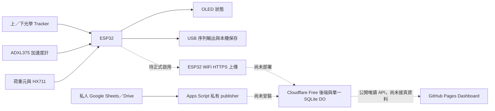

# 落體衝擊量測平台

本專案以 ESP32／NMK99v1、光學感測器、ADXL375 加速度計及 HX711 荷重元介面，建立落下撞擊研究平台，未來用來比較 EVA、STF、三浦摺疊及其他緩衝配置。資料可用於研究材料損傷、傳遞負荷、變形與受保護物的反應；正式比較仍需完成量測鏈驗證與試驗規格。

> **目前階段：診斷、分階段 Dashboard 建置與燒錄前驗證。** 最近實板證據截至 2026-10-28 19:50（台北）；HX 異常原因未明，366 g 校正未完成，量測品質尚未通過。2026-10-31 的 `gateiram1` 韌體已完成本機與燒錄前 QC，但尚未燒錄；Cloudflare、Apps Script、ESP32 Wi‑Fi 真資料仍未部署或接通。任何已部署或測得的結果都不代表材料或保護效果已驗收。

## 從哪裡開始

| 想了解的內容 | 閱讀位置 |
|---|---|
| 現在能做什麼、還有哪些問題 | [目前狀態](#目前狀態) · [量測結果如何解讀](#量測結果如何解讀) |
| 檢查接線與感測器 | [硬體與接線](#硬體與接線) · [唯讀檢查](#唯讀檢查) |
| 手動量測兩光閘間的平均速度 | [獨立光學計時指南](docs/experiments/manual-speed/manual-optical-guide.md) · [已保存結果](docs/experiments/manual-speed/2026-10-26-manual-speed-session.md) |
| 規劃材料試驗與記錄欄位 | [試驗規格範本](docs/experiments/trial-spec-template.md) · [試驗紀錄範本](docs/experiments/trial-record-template.md) · [交接紀錄最新研究](handoff.md) |
| 查看實板證據與 QC | [RMT2 獨立 QC](docs/quality/reports/2026-10-28-rmt2-qc.md) · [RMT2 原始證據入口](docs/calibration/2026-10-28-rmt2-proof-session.md) · [QC 清單](docs/quality/post-flash-qc.md) |
| 開發、建置或追查歷史 | [開發與建置](#開發與建置) · [文件與資料](#文件與資料) |

<a id="status"></a><a id="calibration-review"></a>

## 目前狀態

| 項目 | 已確認的範圍 | 尚待處理 |
|---|---|---|
| 韌體與 QC | 2026-10-28 RMT2 版完成編譯及目標裝置四區寫入校驗；部署、首次啟動、限定唯讀及封存匯出子項通過 | 診斷用途僅條件通過，GOOD RMT 形狀一致性子項及量測品質未通過；[完整 QC](docs/quality/reports/2026-10-28-rmt2-qc.md) 分列未測與限制 |
| HX711 與校正 | 可保存 RAW 與診斷資料；已有異常讀值、ERR 與逐框觀察證據 | 根因未定位；本次診斷 boot 為 `UNCAL`，366 g 校正、回零及獨立準確度尚未完成。歷次 RAM 校正不可跨重啟套用 |
| ADXL375 | 近期資料更新及部分診斷可讀 | FIFO 累計警示、取樣完整性與動態響應尚待驗證；累計警示不是已知遺失筆數 |
| 光學 | 使用者回報間距 220 mm；單次手動上、下通過結果為 1,153.289 ms，換算約 0.1908 m/s，與顯示一致；`gateiram1` 的中斷註冊失敗會先拒絕量測 | 沒有邏輯分析儀或雙通道示波器；距離不確定度、實際 dt 誤差、短脈衝漏接、近同時事件順序及 Wi‑Fi 時序影響未驗證；光學 P1 未解除 |
| WiFi、Dashboard 與雲端 | GitHub Pages 已有公開 synthetic 示範；Cloudflare Free 的 source-off、history、live 及同 SQLite 升版候選已完成本機測試；Google Sheets／Drive 來源維持私人 | Cloudflare 尚未部署，Apps Script publisher 尚未安裝／授權，ESP32 真 Wi‑Fi endpoint、裝置註冊與量測期間持續連線尚未完成；正式網站仍未接真資料 |

已部署完整版本為 `v1-layout2-fifo-diag1-wifi1-d220-right-optical1-hxread1-hxfail5-pcnt2m1-rmt2`，首 boot session `437B6829`。先前 PCNT2 連結因 DRAM 超額失敗，後續調整記憶體配置並部署 RMT2；各階段不能混為同一結果。2026-10-31 的 `gateiram1` 是後續燒錄前候選：OFF 與完整假設定 ON 均可編譯，主機／native／live／upload 檢查通過，但假設定映像禁止燒錄，尚無新版實板 QC。來源、編譯及部署紀錄見 [RMT2 證據](docs/calibration/2026-10-28-rmt2-proof-session.md) 與 [交接紀錄](handoff.md)。

最後一次擷取完成後 COM3 已關閉並釋放，USB 當時保持連接；這是歷史紀錄，實際現況須另行確認。本次文件整理不操作裝置。

## Dashboard 與資料流程



公開頁面目前是 [GitHub Pages synthetic 示範](https://chiangyih.github.io/impact-dashboard-web/)，不是實測資料看板。GitHub Pages 只負責靜態 HTML／CSS／JavaScript；Cloudflare 才負責未來的裝置接收、歷史公開投影、讀取額度與匿名 API。私人試算表不需公開分享，Apps Script 只會發布核准的公開欄位與摘要。Cloudflare 的本機候選已驗證 signed live、歷史重送、同 SQLite 升版及額度保留，但尚未驗證真雲部署、IAM、PITR、跨 isolate 或實際成本。

目前的序列輸出仍需要由主機保存；輸出完成不等於已自動寫入檔案。資料欄位、保存／重傳規則與分階段部署界線見 [handoff](handoff.md) 頂部最新章節。公開 API 未設定時，正式前端不會發出真資料請求；即時資料仍保持關閉。

<a id="wiring"></a>

## 硬體與接線

接線圖為功能端子示意，並非 NMK99 實板排針排列；依模組絲印、GPIO 與實線核對。改線前應固定落體，拔除 USB 和全部外部電源，並隔離電磁鐵外部電源。


| 模組 | 連接至 ESP32／NMK99v1 | 說明 |
|---|---|---|
| ADXL375 | VIN、CS → 3V3；GND、SDO → GND；SDA → GPIO21；SCL → GPIO22 | I²C，位址 `0x53`；3Vo 為輸出，不接 |
| OLED | VCC → 3V3；GND → GND；SDA → GPIO21；SCK → GPIO22 | SH1106 128×64，與加速度計共用 I²C；曾讀到 `0x3C` |
| HX711 | VIN、VIO → 3V3；GND → GND；SCK → GPIO25；DATA → GPIO33 | A 通道、增益 128；VIO 不接 5V、不懸空 |
| 上／下 Tracker | 各接 3V3、GND；OUT 分別 → GPIO34／GPIO35 | 輸出不可併接；GPIO34／35 無內建上拉或下拉，依實際模組電路核對 |
| 板載 WS2812 | GPIO32，板內連接 | 韌體要求熄燈；是否熄滅需目視確認 |
| 繼電器／電磁鐵 | 本版不控制 GPIO26／27 | `ARM` 不會自動釋放落體，`STOP` 不是物理煞停 |

本案荷重元配對為**黑 E+、白 E−、綠 A+、紅 A−**，只適用於此顆實測荷重元，不能泛用其他產品。HX711 `RATE` 由板上開關選擇 10／80 SPS，程式無法讀回開關位置；切換前應斷電。舊版程式與線路使用不同接腳，切換前須重新核對。早期量測見 [歷史校正資料索引](docs/calibration/README.md)，新診斷見 [RMT2 證據](docs/calibration/2026-10-28-rmt2-proof-session.md)。

<a id="first-run"></a><a id="troubleshooting"></a>

## 唯讀檢查

序列通訊設定為 **115200 baud、大寫命令、換行結尾**。先辨識實際裝置與目前狀態；COM3 是上次紀錄，不保證每次相同。每次只由一人持有序列埠，以不切換 DTR／RTS 的方式開啟，不為取得啟動畫面額外重置。

| 命令 | 用途 |
|---|---|
| `HELP`、`VERSION`、`STATUS` | 查詢命令、版本及目前快取狀態 |
| `WIFI STATUS` | 查詢待機網路狀態 |
| `ADXL_DIAG` | 查看已保存的 FIFO 診斷快取 |
| `HX_DIAG STATUS` | 查看 HX 診斷狀態與封存進度 |

若裝置正在記錄、校正或狀態不明，先保留現況，不自行停止或清除。`HX_DIAG DUMP` 可匯出已封存診斷資料，但同步輸出會占用時間並影響輪詢，應依該次證據與 QC 程序安排。完成檢查後關閉並釋放序列埠。

`HX=OK` 表示近期有被程式接受的讀值，不能單獨證明 RAW 正確；`ERR` 增加、`SAT`、`STALE`、`FIFO_FULL` 等應連同時間、版本及原始資料保留。OLED ACK 與 RGB 控制回報不能代替目視檢查。[QC 清單](docs/quality/post-flash-qc.md) 說明燒錄後各項檢查及未測項記錄方式。

<a id="setup"></a><a id="recording"></a>

## 操作與資料保存

韌體提供 `DIST`／`POL`、`TARE`／`CAL`／`UNCAL`、`ARM`／`STOP`、`DUMP`／`CLEAR` 及獨立 `SPEED` 命令。這些命令會改變設定、校正、量測或保留狀態，應依當次試驗授權與條件操作；目前 HX 原因未釐清，不進行 366 g 校正或正式落下材料驗收。

- 手動速度測試的條件、步驟及保存方式見 [SPEED 指南](docs/experiments/manual-speed/manual-optical-guide.md)。它不記錄 ACC／HX 試驗資料，不控制落體釋放。
- 現場沒有雙通道時間參考時，仍可依授權做慢速同一標記上→下 SPEED，保存 `SPEED DUMP` 並核對順序、狀態與 220 mm 換算；這只能驗功能與算術，不能驗光學 dt 精度或 WiFi 負載影響。
- 一般 `ARM` 試驗結束後，`DUMP` 輸出包含設定、品質旗標和 CSV；先完整保存，再考慮 `CLEAR`。`CLEAR` 會清除試驗 RAM 資料。
- 重啟或斷電會失去 RAM 中的記錄、極性和校正；不要拿歷史係數套用新的 boot。保留資料時避免重置或拔除 USB。
- 編譯、寫入校驗、實板功能 QC、靜態校正與動態量測驗證須分開判定。每次成功燒錄後依 [QC 清單](docs/quality/post-flash-qc.md) 檢核並建立該版報告。

<a id="data-limits"></a>

## 量測結果如何解讀

| 資料 | 可以描述什麼 | 目前限制 |
|---|---|---|
| 光閘時間差與速度 | 同一標記通過上下觸發位置的時間差、兩點間平均速度 | 不是接觸瞬間速度；觸發距離與延遲仍需驗證 |
| ADXL375 三軸及名義 g 值 | 感測器所在位置的保存樣本與整次記錄摘要，名義合成值含重力 | 目前設定 100 Hz，FIFO 時間戳為 ESP32 讀出時間；方向／個體校準未驗，不能直接換算峰力，也不能視為真峰的嚴格下界 |
| HX711 RAW 與狀態 | 已接受的原始計數，以及 SAT、ERR 等品質資訊 | 一般 trial CSV 不含所有讀取嘗試，拒收資料僅可能見於有限診斷附件；RAW 不是牛頓或克，短時撞擊峰力尚不可用 |
| `mass_g_static` | 程式具有校正比例時輸出的靜態等效質量 | 未校正或 SAT 為 `NA`；量測有效性須獨立驗證，靜態校正不能證明動態力準確 |
| 損傷、壓縮、回彈與物件功能 | 材料與配置的觀察、受保護物是否達到指定用途 | 需另有合適量具、事件／同步與事前判準；不能僅靠單一峰值聲稱吸能率或保護率 |

CSV 的 `t_read_us` 是相對 ARM 的讀出時間，ACC 與 HX 分別輸出，不表示兩者同步。缺值保留 `NA`；HX 診斷匯出的 CRC 只能支持資料形成後的保存／傳輸完整性，不保證感測真值，一般 trial CSV 沒有裝置端 CRC。詳細量測項目、比較條件與方法界線見 [handoff 最新研究](handoff.md) 及 [試驗規格範本](docs/experiments/trial-spec-template.md)。

<a id="development"></a>

## 開發與建置

現行來源入口為 [05-test/05-test.ino](05-test/05-test.ino)。上次部署使用 Arduino CLI 1.5.1、ESP32 core 3.3.12／IDF 5.5.5，以及：

```text
esp32:esp32:nodemcu-32s:UploadSpeed=115200,FlashFreq=40
```

在已安裝所需核心及函式庫的 Windows 環境，從專案根目錄執行；以下範例只編譯，不燒錄：

```powershell
$irtCli = 'C:\Program Files\Arduino CLI\arduino-cli.exe'
$irtBoard = 'esp32:esp32:nodemcu-32s:UploadSpeed=115200,FlashFreq=40'
$irtBuild = Join-Path $env:TEMP 'irt-05-build'
& $irtCli compile --jobs 2 --fqbn $irtBoard --build-path $irtBuild .\05-test
if ($LASTEXITCODE -ne 0) { throw '編譯失敗，停止後續作業' }
```

上次正式編譯、測試、來源雜湊與寫入結果見 [RMT2 QC](docs/quality/reports/2026-10-28-rmt2-qc.md)；`gateiram1` 燒錄前證據與限制見 [交接紀錄](handoff.md)。主機測試與編譯通過不能取代實板 QC。WiFi 帳密只存本機 Git 忽略的 `05-test/wifi_secrets.h`；沒有私密設定時公開來源仍可編譯，但 WiFi 預設停用。編譯產物可能含憑證，須留在儲存庫外。目標核對流程、各版差異和歷史命令可查 [整理前文件快照](docs/archive/README-before-20261029-reorganization.md) 與 [交接紀錄](handoff.md)，快照中的舊版本狀態不可當成現況。

<a id="calibration-next"></a>

## 下一步

1. 補足 HX 異常發生當下的可信同步與供電／電氣證據，區分假說並定位原因；保留異常 RAW 和時間範圍。
2. 釐清並修復後，依既有授權及驗證條件完成 366 g 靜態校正、回零與獨立檢核；不要把歷史校正當作本次結果。
3. 分開驗證 ADXL FIFO、光學距離與時間、感測器安裝及動態量測鏈；正式設計材料比較前訂好試片、條件與失效判準。
4. 依 [handoff](handoff.md) 的分階段契約，先完成 Cloudflare source-off 部署與私人 Apps Script 授權，再核對 v3→history→live 的同一 DO／資料保留與公開 allowlist；任何真資料發布前，保留 GitHub Pages synthetic 版本。
5. 在沒有獨立雙通道時間參考的限制下，先以授權的手動 SPEED 保存功能證據；取得正式 WiFi endpoint、裝置 boot／capture registry、正確 build 後，才考慮 gateiram1 燒錄並立即做新版 post-flash QC。

<a id="files"></a><a id="history"></a><a id="measurements-20261020"></a>

## 文件與資料

| 位置 | 內容 |
|---|---|
| [handoff.md](handoff.md) | 最新研究、設計提案、裝置工作紀錄、限制及歷史證據；先讀頂部最新章節 |
| [docs/quality/](docs/quality/) | 燒錄後 QC 清單、各版本報告與部署證據 |
| [docs/calibration/](docs/calibration/) | HX 原始紀錄、校正分析及逐次診斷證據 |
| [docs/experiments/](docs/experiments/) | 試驗規格、紀錄範本及手動光學計時資料 |
| [tests/](tests/) · [tools/](tools/) | 主機邏輯檢查、解析與診斷工具；不替代硬體與動態驗證 |
| [docs/archive/](docs/archive/) | 早期說明與整理前 README 快照；內容按日期閱讀 |
| [AGENTS.md](AGENTS.md) | 四位協作角色、裝置操作及燒錄後 QC 規則 |

元件參考：[ADXL375 資料表](https://www.analog.com/media/en/technical-documentation/data-sheets/ADXL375.pdf) · [HX711 資料表](https://cdn.sparkfun.com/assets/b/f/5/a/e/hx711F_EN.pdf) · [ESP32 資料表](https://www.espressif.com/sites/default/files/documentation/esp32_datasheet_en.pdf)。
