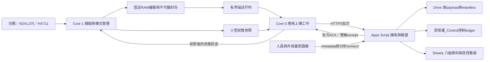

# handoff.md

## 2026-10-29 README 整理與公開資料封存

使用者要求四位代理人討論整理 README，使整份文件更容易理解，並 commit／push。Kierkegaard 核量測／校正界線，Gibbs 核公開韌體、建置及命令，Planck 核結構／導覽，Ampere 獨立核 QC 與操作界線；主代理整合 [README](README.md)，將舊版本矛盾、詳細排查及過時數據留在標註歷史的[整理前快照](docs/archive/README-before-20261029-reorganization.md)，保留原本章節錨點供其他文件使用。

README 的現況、接線、唯讀檢查、資料解讀、建置與後續工作分層；RMT2 為最後已部署版，DRAM 失敗屬較早候選歷史，WiFi／Google Sheets 上傳仍為提案。詳細資料與時間界線仍以下方研究、架構章及原始 QC 為準。此次只整理文件，未修改韌體、操作 COM、變更供電、重啟、燒錄、校正或執行撞擊；最新硬體證據仍截至 2026-10-28 19:50，USB 當時保持連接，COM3 已釋放。RMT2 診斷用途條件通過、量測品質未通過，HX 根因、FIFO 警示及 366 g 校正仍未解。

公開來源 manifest 的 12 個檔案雜湊已核對；README 與快照的本機連結及敏感資料檢查於提交前複核。因 Git 換行轉換會破壞既有來源雜湊與混合換行的原始序列證據，已在 `.gitattributes` 指定本次 manifest 來源／主機檔與新增診斷證據逐位元保留，並核對 36 個 manifest 檔及 198 個診斷證據的 Git 取出內容與本機一致。使用者此次要求封存並推送，納入既有公開韌體、測試、診斷證據與本輪文件；WiFi 私密檔及儲存庫外建置產物不納入。提交與推送結果以 Git 紀錄及工作流程回報為準。

## 2026-10-29 落下撞擊可量資料與材料評估研究（最新，未執行實驗）

使用者希望研究落下撞擊可量哪些資料，以評估材料耐衝擊、吸震與保護效果；已由Kierkegaard、Gibbs、Planck、Ampere交叉研究。**本節為量測目標／方法建議，不是新增實測、標準符合性或材料合格結論。** 本輪僅root整理handoff，未操作落下、撞擊、物件載卸、接線／供電、COM3、韌體／燒錄、校正或Google資料，未commit／push。舊架構／欄位提案仍未實作；HX根因、FIFO與366g未完成維持，不能以本輪研究放行。最後實板證據仍依2026-10-28後文窗口，不是10/29新讀回。

### 五類目的與量測對象

1. **抗破壞／穿透**：材料、結構或配置能否抵抗裂紋、凹痕、穿透、分層及殘餘承載下降。
2. **緩衝／傳遞負載**：在指定位置與方向，受保護等效物承受的比力、傳遞力、負荷時程與行程利用。
3. **物件保護**：真正受保護物或關鍵部件的響應、結構／功能是否符合事前規格；台架低峰不能替代物件檢查。
4. **能量／回彈／變形**：入射與回彈運動、力—位移做功、可回復部分與耗散、最大壓縮及觸底。
5. **恢復／耐久**：卸載後恢復、殘餘變形、同片第k撞性能退化與失效歷程。

一次性犧牲壓潰與可重用緩衝應事前分profile。塑性變形／材料破壞對不同用途可有不同意義；保留既定失效判準，不在看到結果後改成功定義。研究材料、完整配置與成品保護是不同層次，不用一個「吸震力」或總分代替。

### 建議量測矩陣

| 量測資料／指標 | 單位／可重現定義 | 需要的資料／設備與解釋界線 |
|---|---|---|
| 輸入條件 | 完整移動總質量kg、接觸前速度m/s、有效落距m、頭型／面積／位置及支承 | 含平台、頭、配重、感測器與固定件；用可信接觸前運動量測。相同動能但不同質量／速度仍有不同動量、載入速率與響應。 |
| 入射動能 | `E_in=0.5*m*v_contact^2`，J | 控制量，不直接叫材料吸能；mgh只在合適自由落下／能量模型及損失處理下使用。220mm區間均速不能直接代入接觸速度。 |
| 指定位置signed軸向比力波形／峰值 | m/s²或明確標acc-g；固定軸、正向、基線、窗口與幅度規則 | 動態合格ACC、安裝、完整DAQ與接觸事件證據。感測器在落體、底座、物件不同位置代表不同反應；名義合成幅度不能直接乘質量當峰力。 |
| 界面力／底座傳遞力 | N；指定位置與方向的`F(t)`與峰值 | 動態荷重感測器、調理及同步DAQ；底座反力與撞擊頭／材料界面力不能未經模型互代，須驗治具與慣性影響。 |
| 局部壓力／接觸分布 | Pa、接觸面積與空間分布 | 適用且經驗證的壓力陣列／媒介，記空間與時間響應；`F/A`只是名義平均，不是局部峰壓。印記型媒介不自動產生動態壓力波形。 |
| 接觸時間／脈衝寬度 | ms；接觸—分離事件與訊號閾值／FWHM等規則分開 | 接觸需獨立事件／影像／位移證據；ACC或力波形持續時間不自動是接觸時間，不能拿ARM長度替代。 |
| 接觸衝量 | `J=integral(F_contact dt)`，N·s；完整接觸窗、signed方向與基線 | 可靠力波形與時基。和動量差核對需計入重力及其他外力；不是能量，亦非普遍越小越好。 |
| 最大壓縮／剩餘行程 | mm；材料上下邊界相對位移、初始厚度及可用行程 | 位移感測或經校準同步影像，分離材料與治具變形。折疊結構的整體壓縮比不直接當紙材本體應變。 |
| 觸底／硬接觸／穿透／破壞 | 分型、發生／充分觀察下未發生／未知；損傷深度mm、面積mm²等 | 事前判準及影像／位移／檢查證據；第二峰、FAULT或單一高峰不能自行判定。內部損傷可能需另檢查，外觀完整不證無損。 |
| 回彈速度／高度／係數 | m/s、mm、`e=abs(v_out/v_in)`；同一移動體與法向、合適參考位置 | 同步運動量測及模型。低回彈可能來自治具、摩擦、物體損壞等，不直接叫材料吸能率。 |
| 力—位移載入功／回復功／耗散 | J；指定邊界與窗口的功，完整循環損失另列 | 同步動態力與材料相對變形或完整進出能量帳；載入功含可回復儲能。兩界面力不同或均移動時，單一F乘相對位移不必然是材料功；須處理機構／慣性／摩擦。 |
| 卸載殘餘變形／恢復 | mm、%及恢復時間；同對象、位置、基準之H0、H1與卸載等待時間 | 量具／位移／影像及條件紀錄；可報`(H0-H1)/H0`。等待時間不同不能直接比，也不能未看恢復就宣稱永久。 |
| 受保護物功能／結構結果 | 功能保持、損傷型態與範圍、殘餘承載等事前判定 | 感測器放在真正關心的位置，另有試前／試後功能與損傷檢查。低台架峰值仍可能伴隨功能失效。 |
| 後續振動／頻率相關反應（進階） | 固定窗RMS、頻譜、穩定時間或模型SRS等 | 完整且頻寬合格的物件響應；要有窗口／頻帶／阻尼／模型定義，不把振動總分當能量或通用保護保證。 |
| 重撞退化／耐久 | 第k撞之比力／力／壓縮／損傷／功能、首次失效撞次或截至k撞尚未見失效 | 每撞記恢復時間、試前幾何與損傷；同片是一條重複觀測序列，不增加獨立試片n，也不外推無限壽命。 |
| 新片能級—失效特性 | 指定m／v／頭型／幾何／環境下之失效比例／機率與區間 | 各能級用獨立新片；同片逐級加高含累積損傷，不能當未受撞材料的首破壞能。單次未破壞不證該能級普遍安全。 |

### 易混淆的公式與相對比較

- 同一移動體若速度變化受限，可藉延長減速降低峰值，而衝量近似不變；不能把較小衝量普遍解讀為較好緩衝。
- `W_load=integral(F dδ)`只稱指定邊界載入功；完整載卸循環損失仍要核適當邊界及機構影響。`1-e^2`只在合適質量／法向／能量模型下描述某些未回復運動能比例，不直接稱純材料耗散率。
- 比吸能`W/m`（J/kg）需明示分母是材料淨質量或整配置質量；不能混用流體、封裝、膠、摺疊與固定件的包含範圍。
- 若用峰值降低率，先定同工況且可量化的非負峰值幅度A與有意義的參考`A_ref>0`，再報`R_A=100%*(1-A_test/A_ref)`，保留負值／不確定度及參考ID。名稱只指所選測點／方向／窗口的峰值降低率，不改叫吸能率或整體保護率。
- 表面抗破壞、低峰、長脈衝、低回彈、小殘餘變形、高載入功都非普遍優劣箭頭；以應用profile、受保護物結果及所有失效共同判定，保存後續峰與完整觀察窗。

### 比較條件、兩種protocol與報告

沿現有[試驗規格](docs/experiments/trial-spec-template.md)及[紀錄表](docs/experiments/trial-record-template.md)，第一比較框架為等可用厚度、等面積及固定入射條件；等材料質量是另一研究。固定完整移動質量、實際接觸速度、頭／支承／位置、安裝／線材、剩餘行程與環境；厚度變化會改變相對底板固定釋放高度的有效落距，不能把較小輸入造成的低峰歸為材料改善。裸硬板不是自動成立的等厚對照，須明示比較所問問題。

新片能級研究以獨立試片分能級估條件失效機率；耐久研究才以同片固定條件與恢復規則連續撞擊。參考組交錯，依日期／材料批次／環境／治具作適當區組；獨立n依試片與配置實驗單位，不依ACC點數、重DUMP或同片撞次。報全部點、原波形、參考／輸入、eligible／invalid／unknown及物理失效各分母；SAT、觸底或缺資料不能刪掉後只比較漂亮平均。0/n不等失效機率為0，均值信賴區間與個別試片離散也分開。

本輪未訂數值合格門檻、固定樣本數、人體／成品保護保證或標準認證。正式樣本數與門檻依用途、預期變異、要求精度／效果與適用方法另定，不因測到結果再放寬。

### 本平台能做與尚缺的量測鏈

| 層級 | 可報告／應做內容 | 目前界線 |
|---|---|---|
| 已有工程紀錄 | two-gate dt與條件均速；ACC三軸counts／讀出stamp／whole_ARM保存樣本名義極值；HX accepted RAW／SAT／ERR／STALE及有限診斷附件 | 不回稱接觸真峰、瞬時力、能量或材料改善。現場幾何／損傷／功能資料只按實際另附證據。 |
| 正式緩衝比較目標 | 可信近接觸速度與移動總質量、指定受保護位置signed軸比力、完整事件窗、觸底／破壞／功能結果、壓縮與恢復 | 先完成方向／校準／動態響應、量程、時基、完整性與參考鏈。不是目前已放行的能力。 |
| 力／能量進階 | 動態合格力感測鏈、調理及同步DAQ；材料／治具相對位移或足以辨識事件的影像；必要時增加測點 | 依目標脈寬／頻帶、允許幅度低估／相位誤差決定設備與取樣，未指定採購、改線或直接提高ODR。 |

ADXL375現100Hz：名義間隔10ms、原廠−3dB頻寬ODR/2約50Hz；FIFO是32層，現時間戳是讀出，不是精確取樣時刻。±200g是量測級別，10,000g shock survival不是量測範圍。不能只升ODR：原廠介面建議、FIFO服務期限、資料格式及2048筆容量都須重核；100kHz I²C的建議ODR上限與高率SPI條件應按原廠表及實測設計。[ADXL375資料表](https://www.analog.com/media/en/technical-documentation/data-sheets/ADXL375.pdf)。shock IRQ內部處理與低ODR保存資料可不同，不能用IRQ當保存真峰或接觸時間證明。[ADI AN-1266](https://www.analog.com/en/resources/app-notes/an-1266.html)。

HX711原廠10／80SPS的名義間隔為100／12.5ms，24bit／DOUT-ready／靜態比例不驗短時動態峰力；本板HX根因未解、366g未CAL。即使未來完成靜態CAL，也仍需動態荷重鏈及組裝響應驗證。[HX711資料表](https://cdn.sparkfun.com/assets/b/f/5/a/e/hx711F_EN.pdf)、[NIST衝擊力動態校準](https://www.nist.gov/programs-projects/dynamic-mechanical-metrology-acceleration-force-and-acoustics/impact-force)。WiFi、雙核與Sheets改善資料保存／觀測，不補足頻寬、同步或校準。

### 研究來源與適用範圍

| 官方／primary來源 | 本輪使用範圍與限制 |
|---|---|
| [NIST落塔報告公開頁（TN2381，2026）](https://www.nist.gov/publications/instrumented-drop-tower-impact-and-stab-testing) | 公開摘要列加速度、力／力分布、撞速、變形及可換質量／幾何／治具；全文PDF約36MB超web讀取上限，本輪不冒稱已讀完整報告。 |
| [ASTM D1596公開摘要](https://store.astm.org/standards/d1596) | 包材受導引落下壓板的動態緩衝；材料結果不必等於完整包件，面積／厚度／速率等影響比較。未讀付費全文，不宣稱按標準通過。 |
| [ISO 4651官方頁](https://www.iso.org/standard/10617.html) | 泡孔橡塑材料的落下質量峰減速度；1988版仍published但正在修訂，本輪僅核公開適用範圍，不當作全部摺疊／複合配置通則。 |
| [ISO 6603-2官方頁](https://www.iso.org/standard/82175.html) | 硬塑膠平板儀器化穿刺與力／撓度；厚度／工況影響，不能直接套成EVA／STF／成品保護判準。 |
| [ASTM D3332公開頁](https://store.astm.org/standards/d3332) | 產品脆弱度分速度變化與加速度研究，支持物體功能／自身脆弱度需另驗；未讀完整條文。 |
| [NIST實驗單位](https://itl.nist.gov/div898/handbook/pri/section7/pri7.htm)、[區組](https://www.itl.nist.gov/div898/handbook/pri/section3/pri332.htm)、[均值CI](https://www.itl.nist.gov/div898/handbook/eda/section3/eda352.htm)、[二項區間](https://www.itl.nist.gov/div898/handbook/prc/section2/prc241.htm) | 實驗／統計設計參照，不以資料點或同片重撞增獨立n，不以零觀察失效保證零機率。 |

### 與八組資料及架構的銜接

輸入／幾何／校正引用仍放Setup及Runs，試片／層序／受撞歷史放Specimens，RAW維持ACC／HX／Optical，事件／損傷／功能／條件指標及資格放Observations，原檔、分析版本／窗口／輸入hash可追溯。新增指標不要求每sample複製大量metadata，也不在裝置端硬算未驗峰力或吸能。首次研究建議主目標仍是合格的指定位置軸比力＋觸底／損傷／功能，壓縮／恢復輔助；力／衝量／材料耗散另作進階量測鏈，待驗收後才啟用metric。

四角色分工：Kierkegaard統整量測定義與條件；Gibbs核硬體頻寬／時基／DAQ缺口；Planck核比較protocol、欄位與統計；Ampere核低峰漏樣、假接觸窗、錯能量／衝量、同片增n及事後改判準反例。既有[RMT2 QC](docs/quality/reports/2026-10-28-rmt2-qc.md)的診斷用途條件通過／量測未過維持；本輪無新實板測試、校正或撞擊結果。下方架構與欄位為前輪提案，標「最新」者依此處時序看待。

## 2026-10-28 系統架構第二輪討論（最新，建議基線／未實作）

使用者要求在資料欄位初步確認後，由所有代理人再討論整體架構。Gibbs、Kierkegaard、Planck、Ampere已以前節八組資料為本輪基線交叉核對；主案為**ESP32直接WiFi／HTTPS → Apps Script → Drive原始payload＋Google Sheets完整八組資料／受控看板**，不以PC作必要資料中繼。以下皆為待實作架構，不代表現版已支援WiFi量測、HTTPS、雙工作分流或雲端保存。本輪僅root更新handoff；未改韌體、建表／部署Apps Script、連Google私有資料、開COM3、燒錄、重啟、校正或物理試驗；未commit／push。最後實板證據仍如後文19:50窗口，HX／FIFO未解及366g未完成不變。

### 建議MVP與資料流

MVP採單一run的固定RAW緩衝、封存後分批傳送；小型狀態摘要走獨立通道。保持STA連線、擷取中允許低頻摘要、以及擷取時重疊HTTPS，是不同待驗profile，不能因Core 0／1分工而自動放行。現版ARM／CAL的WiFi OFF守衛目前仍在，不能只刪除守衛冒稱新架構完成。



圖中人員／外部證據是資料輸入，不是雲端釋放或量測控制；第一版看板不提供遠端ARM／TARE／CAL／CLEAR或釋放機構操作。現有USB可保留維護／本地命令角色，不是主資料傳送路徑；STOP只停止記錄，不是物理煞停。

### 模組責任與單一擁有者

| 模組 | 擁有者／責任 | 跨界限制 |
|---|---|---|
| 感測與模式管理 | Core 1的acquisition domain（owner task＋明定的有界ISR）統一管理HX／I²C服務、RAW寫入、校正、run／phase及buffer釋放；光閘ISR只做有界時間／狀態更新 | 這不是宣稱只有單一task會動狀態。ISR不做HTTPS、Serial、I²C或物理分析；中斷配置與實際核心仍須驗證。 |
| 狀態發布 | Core 1發布小型快照，含boot／run、clock、seen／age、狀態與品質scope | 可以latest-only合併並記略過計數；此策略只用於摘要，不得用於RAW或保存／釋放控制訊息。 |
| RAW保存與封存 | Core 1維持既有有界陣列；SEAL固定筆數、時間語義、設定引用、run／snapshot generation及manifest | Core 0不讀正在修改的陣列；描述佇列只傳穩定引用／範圍，不複製整run JSON或另建大陣列。 |
| 應用網路與上傳 | Core 0單一worker統一呼叫應用層WiFi策略、HTTPS、批次序列化、轉址／ACK解析及有界重試；SDK背景task仍由SDK管理 | 不直接改phase、校正、RAW或CLEAR；不得持有感測／gate鎖做TLS。網路慢不能阻塞擷取。 |
| Google接收服務 | 中央Apps Script writer處理裝置認證、schema／型別／範圍／hash驗證、去重、固定寫入區段及恢復 | 同一writer協調範圍；不讓第二獨立script或人工排序繞過控制ledger。 |
| 量測與分析 | 以不可變RAW及明確metadata／事件／驗證版本進行後處理，產生新analysis revision | 不在上傳成功時自動計量放行；不改寫歷史UNCAL、FAULT或原RAW。 |

PREPARING取得或確認當輪Setup／Specimen／校正／profile／窗口規則的typed不可變引用，無證據則明列unknown並依required-if限制相關指標。擷取開始後不追著雲端改表換參數；後補證據另建association revision，後分析另建analysis revision。校正適用性除boot外仍需符合時段、位置、荷重及已驗範圍，後來CAL不自動綠化舊UNCAL。

### 三個獨立狀態域

| 狀態域 | 建議狀態／意義 |
|---|---|
| Acquisition | `IDLE → PREPARING → CAPTURING → SEALING → SEALED → RETAINED`；CAPTURING內保留原ARMED／WAIT_DN／CAPTURE等子狀態，原DONE／FAULT與reason作不可變擷取結果保存。 |
| Network | `OFF / CONNECTING / CONNECTED / DISCONNECTED / FAILED`；網路狀態不代表感測器狀態或雲端保存成功。 |
| Upload | `NONE / PENDING / SENDING / RETRY_WAIT / VERIFYING / VERIFIED / CONFLICT`；不靠將量測phase偽裝成IDLE來啟用WiFi。 |

PREPARING在正式時間原點前，以有界方式確認worker無衝突中的序列化／POST、舊診斷job及RMT pending的seq／token／處置。不能直接stop／free可能仍回呼的RMT buffer，也不能把unknown當已drain。準備不成立則回報原因，不假裝量測已開始。

DONE／FAULT只表示擷取結束原因，不等SEALED。SEALING須先完成當前producer寫入及有界ISR狀態收尾，凍結logical counts／品質scope／設定引用後才發布manifest與descriptor。worker只序列化已初始化的`[0,count)`白名單欄位，不將未用capacity、struct padding或仍可能改變的狀態記憶體當原始payload／hash輸入。

新profile可先驗「保持STA、擷取時暫停應用傳送」，再驗「保持STA、允許受限摘要」。完整RAW在MVP只於SEALED後傳；擷取中掉線只留事件，維持既定擷取策略，不啟動掃描／重連／大批HTTPS，不自動換成另一profile或把網路錯當感測故障。封存後才有界重連／補傳。無線driver、中斷、記憶體與供電仍可能影響擷取，分核不等物理／時序隔離。

### 單run保存、背壓與釋放條件

MVP同時只保留一輪RAW。未取得可驗的整輪保存確認時拒絕覆寫／下一輪，明示待傳或失敗原因；不能丟舊保新、無限重試或先CLEAR恢復網路。摘要可合併，RAW與可靠控制訊息不可合併掉。控制queue滿時保持RAM／未確認狀態，後續以status查回，不提前標saved。

Core 0回覆經Core 1核對同一`boot/run/snapshot generation/manifest`。**只有VERIFIED、該代全部reader lease／serializer／retry／queued descriptor已結束，以及明確本地釋放策略三者同時成立，才可reuse buffer。** VERIFIED不自動CLEAR；舊ACK或舊quiescent通知不能解除下一代buffer。若要明確丟棄未保存資料，需另有可追溯操作及worker收尾契約，不能在仍被讀取時釋放記憶體。

只有RAM時，重啟／掉電仍可遺失待傳run；未register至雲端者也可能完全沒有雲端痕跡，不補造為已保存或已知遺失筆數。若需要多輪離線排隊／重啟續傳，另設持久spool及完整寫入標記／boot恢復／容量與回收驗證；不無限擴充RAM。此為MVP取捨，尚未選用或寫入任何flash／SD儲存。

### Google端：資料真源、控制ledger與協定

| 保存層 | 責任 |
|---|---|
| Drive普通JSON／manifest | 不可變canonical measurement payload與資料snapshot真源，保存原bytes／hash；不是serial capture，不含驗證秘密。 |
| 受保護內部`_Control`頁 | reservation、預留Drive file ID、Sheet固定range、attempt／恢復與commit receipt的持久控制真源；不能只從measurement JSON重建此歷史。這是內部頁，並非第九組量測資料。 |
| 八組Sheets頁 | Runs／ACC／HX／Optical／Setup／Specimens／Observations／Uploads完整typed資料與可驗投影；Uploads可讀歷程由控制ledger產生。可重建的是量測投影，不是任意覆寫_Control。 |
| 人員metadata與分析revision | 草稿發布後建立新revision及證據關聯，保留作者／時間／來源；不直接改RAW、ledger或舊分析。 |

建議採單一協定順序（名稱為草案，不是已部署URL）：

1. `begin-run`：裝置SEAL後，以穩定run／snapshot manifest冪等登記預期streams、批次、index space、範圍／筆數及hash版本；回穩定接收generation。
2. `put-batch`：同key同內容重試恢復／確認，同key異內容轉CONFLICT；attempt ID、retry與server UTC不進canonical measurement內容鍵。
3. `finalize`：核唯一batch集合、無缺批／重疊、各流範圍／筆數與hash、Drive archive及Sheets投影一致性，才發布穩定receipt。
4. `status/recovery`：ACK遺失或重送時查回同run／manifest／generation的缺批／衝突／receipt，不新建run或盲目append。

半寫恢復建議選用Apps Script進階Drive服務／Drive API預生成普通JSON的file ID，先將ID、batch key及固定Sheet range寫入_Control、flush及讀回，再建立該ID的檔案。已成功的同ID重試可能回409，仍須GET驗bytes／hash；檔名不是唯一鍵。Sheet半寫只在已驗anchor的同range重寫相同內容；被移動或佔用則REPAIR_REQUIRED／CONFLICT，不盲覆蓋。[Drive預生成ID](https://developers.google.com/workspace/drive/api/guides/manage-uploads#use_a_pre-generated_id_to_upload_files)、[進階Drive服務](https://developers.google.com/apps-script/advanced/drive)。

每批依`RESERVED → ARCHIVE_VERIFIED → PROJECTION_VERIFIED → COMMITTED`恢復。Lock只處理並行，不能推成跨Drive／Sheets ACID；釋鎖前flush，批次讀寫而非逐sample POST／逐cell寫入。[Lock](https://developers.google.com/apps-script/reference/lock/lock)、[批次實務](https://developers.google.com/apps-script/guides/support/best-practices)。`ArchiveSaved/ProjectionPending`只是部分保存，不能回完整ACK或讓裝置reuse。原payload hash與typed projection hash各有演算法／schema／範圍，不混稱同一hash。

### 認證、看板與操作平面

裝置入口使用TLS憑證驗證及專用每device認證；建議HMAC涵蓋操作、run／snapshot／batch與payload hash，canonical bytes規格需在實作前凍結。`key_id/trust_config_id`可記錄，金鑰、Google OAuth token與密碼不進公開來源、Sheet或原payload封存。Google授權留Apps Script端，固定允許的Sheet／資料夾／欄位；部署帳號需支援裝置無互動呼叫。ContentService會轉址，ESP32須驗預期Google轉址及JSON receipt，登入HTML／HTTP200不算ACK。[Web App](https://developers.google.com/apps-script/guides/web)、[轉址](https://developers.google.com/apps-script/guides/content#redirects)。

MVP以Google登入／分享權限控制的Sheets檢視與圖表作儀表；RAW與_Control範圍受保護、不能人工排序／修改，隱藏頁不等權限控制。裝置ingest入口不兼作匿名讀取私人Sheet的公開doGet。後續若做自訂網頁，再建立獨立登入／讀取邊界；訪客刷新只讀Google投影，不逐人輪詢ESP32或新增裝置負載。

看板分開顯示：最後可證的裝置／感測狀態與sensor age、Google收件age、傳輸進度／缺批、已封存歷史、storage／export／metric／experiment資格。正式圖表只讀已發布commit的固定manifest，未完成／半寫資料只進進度視圖。補傳舊run只更新backfill／傳輸歷程，不能把感測器標live；沒有可證的新telemetry就不顯示即時綠燈。網路連線、ACK及保存完整均不代表HX量測有效。

### 物理／分析層與實施順序

Optical保留ISR時間／均速界線；ACC保留FIFO讀出stamp／名義saved-sample統計界線；HX保留RAW／靜態質量／動態力分層。外部可信SCK／DOUT／HX端供電、影像／位移另以原檔附件、儀器設定、coverage、clock mapping及同步不確定度接入；不能以最近時間硬配同步。正式signed比力峰、力／衝量／吸能及材料比較仍依G2／G3及試驗規格驗收，傳輸功能不代替它們。

| 階段 | 建議工作／驗收 | 狀態 |
|---|---|---|
| A：契約與模擬 | 凍結canonical bytes／hash scope、snapshot／ID與API錯誤語義；synthetic fixtures驗register／batch／finalize／recovery及八組資料映射 | 本輪只完成討論，未新增測試／服務。 |
| B：Google接收與受控看板 | 先驗固定range／Drive ID／半寫恢復、published receipt、metadata revisions與權限；看板不讀未完成列 | 尚未建表／部署。 |
| C：裝置封存後直傳 | Core 1／0所有權、固定buffer／小描述queue、一run保留、TLS／redirect／ACK及late訊息；沿原設定build／flash成功後立即新版QC | 尚未改韌體；現有WiFi OFF守衛保留。 |
| D：保持連線profile | 同條件比較radio off、connected idle、受控摘要TX，核HX時序／供電、ACC／FIFO、光閘延遲、heap／stack／queue／最壞服務時間 | 待profile／門檻及外部證據，不能因雙核先放行。 |
| E：量測鏈與材料 | HX根因與366g條件成立後校正／獨驗，各鏈時間／動態與事件窗口，最後流程先導及正式材料比較 | HX／FIFO未解及366g未完成維持；無撞擊新授權／實測。 |

資源基準仍是現版static124,080 bytes與既有since-boot INTERNAL最低heap54,520 bytes；不能將靜態remaining當heap、或將boot minimum當run minimum。新worker stack／TLS／queue／metadata需逐項預算與實測，不複製整run、不盲升ODR。Apps Script配額、Sheet容量及每run cells／檔案量在部署帳號實測並按實驗區組／期間輪替；本輪未建立定時任務或常駐監看。

MVP需再凍結的實作細節：canonical編碼與hash／HMAC範圍、batch bytes／timeout／queue／stack預算、_Control持久記錄與恢復測例、網路profile量測門檻、buffer lease／釋放握手、reset前未register資料遺失的呈現。這些待決項不改變主資料路徑，也不冒充已解根因。

四角色分工：Gibbs負責裝置所有權／狀態／資源；Planck負責協定、Google保存／投影、metadata／看板；Kierkegaard負責時間／物理模型、事件／校正與指標資格；Ampere獨立核斷線、半寫、ACK遺失、late ACK、buffer reuse、重複／衝突／缺批及舊資料假live。既有[RMT2 QC](docs/quality/reports/2026-10-28-rmt2-qc.md)診斷用途條件通過／量測未過不變；本輪沒有新增實板、校正或材料通過。下方是前輪欄位及更早紀錄，其中「最新」均為當時歷史。

## 2026-10-28 量測資料欄位討論草案（最新，尚未實作／凍結）

使用者要求代理人先討論需詳細記錄的資料欄位；目前目標為ESP32直接WiFi／HTTPS上傳至Apps Script及Google Sheets，並評估保持連線、Core 1量測／Core 0應用上傳的分工。四角色已盤點原始資料、物理metadata、品質及上傳確認契約；**以下為討論草案，並非現版已具備全部欄位或已驗證連線量測。** 本輪不改韌體、不建表、不連Google私有資料、不開COM3、不燒錄／重啟／校正／實驗；僅root整理本文件。最後實板證據仍是後文19:50窗口，沒有本次即時讀回；未commit／push。既有HX／FIFO未解及366g未完成不變。

### 欄位字典與資料來源規則

欄位字典本身保存`field_key、table/record_kind、grain、key_role、type、unit、clock_origin、scope、provenance_origin、availability、required_if、value_basis、evidence_ref、missing_reason_rule`，不把這些說明重複塞進每個sample。`provenance_origin`分`device / server / operator / derived`；既有工具的`source_kind=historical/new/synthetic`保留原意，不能重用此名代表新來源分類。設定值與實測值也分開，設定Core 0／1不是每筆資料實際核心的量測。

- **E（既有）**：值可從指定現有輸出取得；不代表普通trial CSV或新上傳協定已自動包含它。VERSION／SPEED／HX_DIAG、STATUS與TRIAL各有不同欄位，須附來源。
- **D（有據補充／衍生）**：從可證建置、操作紀錄或原始資料產生，保留方法及輸入證據；不得補造缺少的boot或時刻。
- **N（需新增）**：需新韌體、服務端或現場量測；能力未實作與值未知分開。未知用`null + missing_reason`，例如`not_recorded / not_instrumented / not_measured / not_reported / not_applicable / source_unlinked / insufficient_evidence`。
- 原始RAW的真0、拒收字、模型差與警示均保留；metric無效不能抹掉原數值。觀察不足的物理事件不填false；不確定度未知不填0。
- ID、hex與hash作文字；counts為整數；現有短窗µs為u32整數；單位在欄名或字典固定。加速度的`acc_g_nominal`與質量的`mass_g_static`分開，不共用含糊的`g`欄。未來u64需固定傳輸編碼，不能任由試算表轉型造成精度／前導零遺失。

必要程度另分M（第一版契約須有欄位或明確未知）、O（可選觀測）、F（未來新增採集），與E／D／N分開。`required_if`由profile／metric決定：缺接觸、幾何或校正證據只擋依賴它的metric；匯入原始附件／RAW仍可先完成，run／boot關聯未知不強迫補ID，也不拒收既有原始值。現場／試片／環境欄位可在正式材料比較前依規格升為必填。

### 第一版建議八組資料／分頁

| 分頁 | 粒度與主鍵 | 主要責任 |
|---|---|---|
| Runs | 每次擷取一筆，`run_id` | 狀態、版本、來源、模式與metadata引用；不是每次HTTP一筆，也不等每次物理撞擊。 |
| ACC | 每筆保存紀錄，run／stream／record index | 三軸RAW及裝置讀出時刻；不重複所有run設定。 |
| HX | 每筆保存紀錄，run／stream／record index | 已保存RAW／SAT與profile；普通trial accepted與診斷attempt不可混。 |
| Optical | 每個光學事件／輪次，run／event index | 原始閘緣、時基、有效旗標與dt；SPEED獨立no_ADC_records。 |
| Setup | typed `PROFILE / GEOMETRY / CALIBRATION / VALIDATION`紀錄，ID＋不可變revision | 規格、接線／核心設定、幾何、校正與驗證明細。引用須檢查record_type；修正另建revision，不改寫舊run引用。 |
| Specimens | typed試片／配置／層／履歷紀錄，specimen／config revision | 材料、層序、幾何、安裝、新片／重撞與實際受撞證據。 |
| Observations | typed `QUALITY / EVENT / METRIC / RESULT / EVIDENCE_LINK`紀錄 | 品質scope、事件與窗口、條件衍生指標、材料失效及證據連結。 |
| Uploads | batch與request attempt分粒度記錄 | 預期批次、穩定鍵、內容hash、實收範圍、重試、ACK及整輪確認。 |

原始附件／匯出區段索引可放Drive manifest，再由Runs／Observations引用；不把整份serial、RMT symbols或長JSON硬塞試算表單格。八組為建議分頁，邏輯typed record與人員填寫視圖仍可在實作前調整；不得因合併分頁而混淆粒度或單位。

### Runs：身份、狀態、版本與來源

| 欄位群 | 型別／單位及可取得性 | 必要界線 |
|---|---|---|
| `run_id、run_mode、required_channels、profile_id/revision` | text／enum／引用；N，現模式可D辨識 | run代表擷取輪次。相同封存資料重傳不生新run；CLEAR後新ARM／SPEED重試須新run。 |
| `device_id、boot_id、boot_evidence_ref` | text；現可D從部署／boot證據連結，原生新欄N | COM3不當device ID；無可靠boot關聯為null。 |
| `native_trial_id、native_optical_id、hx_diag_session` | text（原u32計數）／text／hex8；E依原格式 | 分屬不同namespace，僅boot局部；HX診斷隨機標籤不作全球run ID，缺適用值為null。 |
| `firmware_version、public_source_manifest_hash、core_version、fqbn、native_schema、upload_schema_version` | text／enum；E或D，upload schema N | 普通trial無明確版本／boot欄，不憑距離或LAYOUT猜版本；公開來源hash不冒稱實板映像hash；原格式與上傳schema分開。 |
| `trial_state、end_reason、cal_state_fw、expected_acc_records、expected_hx_records` | enum／u16；E | DONE／FAULT及保存筆數原樣保留；expected是封存匯出紀錄數，不是ADC轉換總數。 |
| `spec_id/revision、geometry_id/revision、calibration_id/revision、specimen_id、config_revision、window_definition_id` | text引用；D／N／operator | 物理metadata不由ESP32捏造，當輪實際值缺證仍未知。 |
| `artifact_instance_id、artifact_kind、artifact_hash/bytes、export_segment_ref、import_id、evidence_refs` | text／u32；D或server N | 保存來源實例、byte身份、匯出區段、匯入動作與擷取／物理受撞身份分開。同run可多附件／匯出／匯入；同hash也不能自動合併兩次真新試驗。 |
| `capture_state、export_integrity_state、server_storage_state、metric_eligibility、experiment_result_state` | enum＋理由；原值E、各層判定D／server N | 擷取結果、匯出完整、服務端保存、量測資格及實驗結果不可合成一個pass。 |

既有來源觀察鍵建議為`artifact_instance_id + export_segment_ref + stream + export_record_index`；SHA只驗bytes，不當物理試驗身份。內容相同可共用原始bytes物件，但兩次有證據的真新run／來源實例不合併；同run多匯出也不能重複增加樣本或撞次。不能只用timestamp，也不能漏掉同serial多次DUMP的區段。現普通parser多BEGIN會拒收；未來若支援分段，保留原bytes與BEGIN／END邊界，不自行把新區段當新撞擊。原生`stream_seq`若新增，只是裝置紀錄序號，未經證明不稱ADC硬體樣本序號。

### ACC／HX／Optical：每列必要RAW與時間

| 資料 | 首版欄位、型別／單位 | 來源及限制 |
|---|---|---|
| 共用列鍵 | `run_id、source_segment_ref、record_index、stream_kind`；text／u32／enum | 現有index可D由驗證區段列序產生；原生stream seq N，時間不能當唯一鍵。 |
| 共用時間 | `t_read_us` u32 µs、`clock_id/origin`引用；E | 普通ACC／HX是相對ARM的ESP32讀出時刻，非PC或精準ADC時間。`arm_origin_boot_us`目前RAM有但未匯出，新增傳輸為N。 |
| ACC RAW | `x_raw、y_raw、z_raw` i16 counts；E | 保存原三軸；`x/y/z_nominal_acc_g、mag_nominal_acc_g`為現有名義輸出或D換算，另標scale來源／含重力／未驗個體校準。 |
| ACC批次／品質 | `fifo_batch_id、record_in_batch、read_begin/end_us、depth_before/after、sample_time_estimate_state`；N | 目前沒有完整批次契約。100Hz是設定值，不能將FIFO列倒推成精確取樣時間；whole_ARM near_range不當每sample已驗SAT。 |
| HX普通trial | `hx_raw` i32 counts、`hx_sat` bool、`hx_status` enum；E | 只保存已接受框；`accepted=true`可D由來源契約標註，但拒收數／字／時刻未提供不等0。 |
| HX診斷附件 | `record_kind、attempt_seq、bits24、accepted、postcheck、start/end_us、rx/err_before_after、flags`；E依HX_DIAG | 保留診斷profile／窗口／slot及seq；只屬被保留的attempt，不冒稱trial完整attempt流。PCNT／RMT原symbols、reason512、安全旗標及CRC保留附件引用。 |
| Optical原值 | `optical_mode、native_optical_id、state/reason、upper/lower_seen、upper/lower_time_us、dt_us、clock_origin`；E依SPEED／TRANSIT，部分FAULT未匯出值為未知 | SPEED為boot micros，trial TRANSIT為相對ARM；零時刻也可能有效，須依有效旗標。未觸發、不輸出或不適用不填假0。 |
| Optical設定／換算 | `configured_distance_mm` number mm、`polarity_up/down` i8（-1／0／1）E；`effective_spacing_mm、spacing_uncertainty、geometry_evidence_ref` operator／N；`gate_mean_speed_mps` E／D | 配置距離與有效觸發間距的實測分開。未知極性不能壓成false。均速標明距離來源及換算方法，不升格為contact velocity。 |

SPEED的A／H欄為既有trial計數，不是SPEED的ADC資料量；SPEED必記`adc_capture_enabled=false/no_ADC_records`，不借舊ACC／HX列冒充同步資料。`adc_sample_time_us、sample_utc、contact_relative_sample_us`缺少取樣／同步證據時為null；WiFi直傳只有device時刻與server處理時間，不生成不存在的USB逐行主機時間。若有既存PC JSONL附件，主機UTC／monotonic時間只按該附件粒度保存。直傳附件標`artifact_kind=DEVICE_JSON`或實際格式，PC serial行數、byte tail及BEGIN／END欄依該格式可為not_applicable，不假造串列擷取。

### Setup／Specimens：校正、幾何與實驗條件

| 類別 | 詳細欄位群與單位 | 取得與必填條件 |
|---|---|---|
| profile／安裝 | `spec_version、required_channels、allowed_metrics、sampling_config、hx_rate_source、pinmap_revision、axis/sign_definition、sensor_mount、profile/core_config、wifi_policy、diag_profile` | 設定E／D、當次快照N；100Hz不當實測ODR，HX RATE未由程式讀回時不得標detected，設定核心不當每列實測核心。 |
| 幾何／機構 | `total_moving_mass_kg`及含件清單；頭／支承／撞擊位置／偏心；有效閘距、下閘至接觸剩餘行程mm；量具、方法、不確定度、照片與接線／供電revision | operator／現場。模板已有欄≠本次有值；名義／實測及各revision分開。 |
| 校正建立 | `calibration_id、sensor_chain、applicable_boot、cal_valid_fw、calibration_completed、tare_offset_counts、counts_per_g、reference_nominal_mass_g、reference_measured_mass_g、reference_uncertainty、sample_count、establishment_evidence、valid_range/environment/position` | 程式旗標／trial參數E，其餘D／N／現場。366g僅當計畫／標稱參考，本次未CAL，不填已完成。新的TARE或重啟需重新判適用性。 |
| 獨立驗證 | `validation_id、calibration_ref、independent_data_ref、tested_range、bias、repeatability、return_zero、drift、uncertainty_type/value、coverage_factor/probability、decision_rule/version、validation_state、valid_for_metrics` | 條件／數值待實測；未驗不填0或預設k／信賴水準。靜態完成不等動態峰力通過。 |
| 試片／層序 | `specimen_id、material_batch、config_revision、layer_index、material、orientation、thickness_mm、area_mm2、mass_g、fixation、pre_photo、initial_height_mm` | operator／現場；STF製備／封裝、摺疊幾何及EVA材質等依適用配置補，不適用附原因。 |
| 受撞履歷／操作 | `new_or_reused、physical_exposure_id、exposure_state、previous_run/evidence、prior_damage、confirmed_hit_count、unresolved_exposure_count、planned/actual_order、operator、temperature_C、humidity_pct、supply/mount_changes` | operator／事件證據。擷取FAULT不證未撞；已確認撞數與未知暴露分開，未知時不能宣稱精確受撞總數。 |

### Observations：品質、事件與衍生結果

每筆觀察帶`record_kind、run/chain_ref、observed_scope/window、coverage_state、value/time、unit、validity/eligibility、reason_codes、source/evidence、rule/analysis_revision`。可得RAW與判定資格分欄；已知失敗不能藏成未測。

| 類別 | 欄位群 | scope／使用限制 |
|---|---|---|
| trial品質 | `acc/hx_saved_count、hx/acc_error_delta、fifo_warning_delta、hx_sat_count、hx/acc_stale_seen、ignored_gate_edges、buffer_full、state/reason`；E | frozen trial delta／保留筆數。拒收事件未有當框資料不補造sample，後來STATUS不能替代試驗起終。 |
| boot／快照品質 | `rx/err/aerr/fifo_total、fifo_depth/poll_gap_max、oled_send_last/max、heap_free/largest/min_since_boot、heap_first_connected_*、snapshot_time`；E依輸出 | boot累計／boot最大值／查詢瞬間分開；不能相減成run最大。FIFO／OVR／overflow次數不當唯一故障數或精確漏樣數。 |
| 新增run／網路觀測 | `heap_run_min、stack_min_free_bytes、loop_gap_run_max_us、queue_capacity/high_water/overrun、core_observed、mode_epoch、pending_diag_seq/token/disposition、wifi_state_start/end、rssi_dbm、disconnect_reason/reconnect_count`；N | 明確窗口、單位及取值方法；現有54,520-byte heap minimum屬boot，不是run minimum；unknown pending不填drained。 |
| 新鮮度 | `sensor_seen、sensor_age_ms、sensor_state、server_received_utc、server_received_age_ms`；前者E／新快照N，後者server N／D | WAIT且RAW=NA時AGE0不證新資料；伺服器收到新封包與感測器更新分開，不能將UTC與boot µs直接相減。 |
| 物理事件／窗口 | `event_type/state、detector_state、time或time_bounds、clock_id、frame_ref、sync_uncertainty、contact/separation/window_definition_id、evidence_ref`；多為operator／N | detector未觸發不證物理未發生；接觸／分離／觸底／穿透／破壞需獨立證據，不憑第二峰、FAULT或DUMP狀態自動填false。 |
| 條件衍生metric | `metric_key、value、unit、input_refs、window_id、axis/sign/gravity/filter/peak_rule、cal/validation_refs、algorithm_version、uncertainty、eligibility/reasons`；D | 均速、靜態等效質量、名義saved-sample最大值與真接觸峰／力／衝量／吸能分開。UNCAL不算假重量；m×mag不當峰值力，入射動能不當材料吸能。 |
| 材料結果／統計 | `failure_type/state/evidence、H0/H1及位置／基準／等待時間、permanent_deformation、group/block、included_run/specimen_refs、independent_n、quantifiable/failed/unknown_counts、exclusion_rule、effect/interval_method/spec_revision`；operator／D | 新片首撞與同片重撞分開；各指標可獨立無效，保留所有資料。門檻及樣本數不由裝置捏造，不刪壞結果後比較。 |

### Uploads：批次、嘗試與整輪保存

以下均為N，現版沒有Apps Script上傳端點、TLS／queue／ACK欄位。裝置保持WiFi與Core 0上傳也仍是待驗證profile，不能用新欄位名稱宣稱已實作。

此處`sealed_manifest_revision`專指不可變資料snapshot的manifest；metadata及analysis revision另列，不因重新分析或註記修正就重生run／批次內容身份。直傳DEVICE_JSON的資料鍵為`run_id + sealed_manifest_revision + stream + record_index`，並保留`index_space`。同一來源重匯入沿用可證的`artifact_instance_id`；關聯未知時不強合、不自動計新撞，也不拒收RAW。

| 粒度 | 必要欄位群／型別 | 確認規則 |
|---|---|---|
| sealed run manifest | `run_id、sealed_manifest_revision/hash、source_schema、upload_schema、expected_stream_counts、expected_batch_set、expected_ranges、archive_refs` | 傳送前固定各流範圍／筆數及hash規則；metadata修訂另revision，原始RAW不覆寫。 |
| stable batch | `batch_id、run/manifest_ref、stream、index_space、batch_seq、first/last_record_index、record_count、payload_bytes、payload_hash、canonicalization_version、reserved_range、commit/recovery_state` | `index_space`區分export ordinal與未來device seq，均不冒稱ADC序號。相同key／同內容重送可恢復；同key異內容拒收。Lock僅防並行，append與ledger不當跨表ACID；用穩定範圍及可恢復寫入契約。 |
| upload attempt | `request_attempt_id、batch_ref、attempt_no、device_begin/end/time_origin、TLS_verified/trust_config_id/error、HTTP_status、redirect_count、timeout/backoff/result、server_received_utc` | 每HTTP嘗試可新ID，但不進穩定payload hash。逾時不代表服務端未寫；RTT只從同一裝置clock界定起終，不能用server UTC－device µs算單向延遲。 |
| batch ACK | `ack_run/manifest/batch/hash、ack_committed_unique_count/range、ack_status、server_committed_utc、error_code` | 裝置逐項核對，HTTP200或JSON本身不算成功。原資料保留至完整確認，不先CLEAR。 |
| run commit | `received_unique_batch_set、missing/conflicting_batches、received_stream_counts/ranges/hashes、server_storage_state、run_commit_state、archive_verified_state` | 核缺批、唯一範圍、筆數及hash後才能完整；數量相同但重複／缺段不過。上傳完成不改FAULT／UNCAL／metric資格。 |

不得上傳WiFi密碼、Google權杖、裝置上傳金鑰、私鑰或含憑證本文；需要追蹤驗證設定時只存非秘密`key_id/trust_config_id`。只有RAM待傳不能承諾抗斷電；是否增加持久化需另設計及QC。原始上傳payload可由Google端封存，標`structured_device_payload`，不冒稱不存在的完整serial capture。

### 首版必要程度、反例與分工

首版必要的是各run／stream身份、原RAW／讀出clock、模式／封存結果、校正與幾何引用或明確未知、完整性／品質scope、sealed manifest與去重／ACK；物理metadata依該run用途必填或明列缺證。網路／heap／核心／mode boundary等屬新profile驗證必需觀測，但N欄不能回填成歷史已測。RMT完整symbols、擴充診斷及高階動態／材料統計為條件附件／分析，不重複每sample。

驗收反例：不同boot的trial1；同一serial多DUMP；同t_read_us多列；ACK遺失重傳；新run恰有相同RAW；UNCAL／DATA模型差但完整匯出；FIFO舊樣本下閘後才讀；FAULT但物理受撞未知；SPEED帶舊A／H；AGE0但未曾收到資料；heap scope錯用；已寫入但ACK失聯／批次亂序／衝突；server收件時間冒充取樣時刻。這是待執行的schema負測，不是本輪測試已通過。

Gibbs負責來源欄位／記憶體與時序映射；Kierkegaard負責物理定義、單位、校正／事件與指標條件；Planck負責字典、版本關聯、分表與追溯；Ampere獨立核反例、必填層級及未知／失敗界線。來源：[公開韌體](05-test/05-test.ino)、[trial規格](docs/experiments/trial-spec-template.md)、[逐項紀錄模板](docs/experiments/trial-record-template.md)、[既有RMT2 QC](docs/quality/reports/2026-10-28-rmt2-qc.md)。舊QC的診斷用途條件通過／量測未過維持；本輪沒有新增實板、校正或材料通過。

## 2026-10-28 四位子代理人討論：整合撞擊測試量測系統（最新）

使用者要求「請所有子代理人開始討論整合撞擊測試量測系統」。已恢復Gibbs、Kierkegaard、Planck、Ampere四角色，依本檔、公開來源、既有試驗範本及RMT2 QC進行唯讀盤點與交叉討論。**本節是整合提案與驗收契約，尚未實作／部署，也不是新的實板、校正或材料通過報告。** 本輪只由root更新本文件，未開COM3、改韌體、燒錄、重啟、TARE／CAL、移動物件或撞擊；USB保持連接。最後實板證據仍是下方19:50的IDLE／UNCAL、ERR1／AERR0／FIFO5，不能把討論時間當新的實測時間。未commit／push。

### 已有能力與已確認限制

- 現有`SPEED`是獨立光學模式，明示`no_ADC_records`；一般`ARM`則保存ACC三軸counts及HX已接受RAW，並以相對ARM的ESP32讀出時間匯出。[來源](05-test/05-test.ino)、[獨立SPEED證據](docs/experiments/manual-speed/2026-10-26-manual-speed-session.md)。兩種模式的不同輪資料不能直接拼成同步撞擊。
- 光學為ISR處理時刻，ACC為FIFO讀出時刻，HX為讀框／接受時刻；共用`micros()`不足以證明ADC同步或相對接觸事件的取樣先後。`host_readout_us_from_ARM`現指ESP32讀出，不能誤當PC時間；主機UTC、monotonic接收時間另列。短窗無號模差可用，長缺口不能猜微秒計數回繞次數。
- 現版活動ARM期間已只允許STOP，大型查詢／DUMP會被攔；DONE／FAULT也已有DIST／POL／TARE／CAL／UNCAL守衛，沒有已確認的設定漂移缺陷。普通DUMP的HX_ERR／ACC_ERR／FIFO_FULL是凍結trial差值，不能拿後來開機累計取代。
- 同步匯出在IDLE診斷及DONE／FAULT會阻塞背景輪詢；RMT2診斷DUMP已有7.642秒證據。須記EXPORT區間與前後警示，不把這些時段當連續取樣。現有診斷schema6／CRC屬HX_DIAG bundle，一般trial CSV尚無相同身份／schema／CRC契約。
- `eligible=false`只阻止PCNT／RMT新的硬體觀測；ARM／CAL若診斷窗仍開，RAW摘要仍追加。SPEED雖停ADC輪詢，早退前仍服務舊RMT工作及診斷截止。RMT模式入口未明確拒絕pending或證明自然收尾，舊job／callback可能跨模式；這是待驗證邊界，**不是已證干擾原因**，不能直接stop／free仍可能回呼的buffer。PCNT在pollHx同步讀回後才處理命令，也不足以證明所有晚到ISR均已排空。

### 四角色共識與分工

| 角色 | 整合責任／已提出的關鍵反例 |
|---|---|
| Gibbs：ESP32 | 盤點時間、模式、記憶體、FIFO／HX排程、WiFi／OLED及匯出。先host manifest，再評估最小device schema；不增加資料陣列或盲升ODR。未來模式切換需可追溯原job seq／token、pending／完成／timeout及歸屬，不冒稱零診斷開銷。 |
| Kierkegaard：物理 | 區分兩點均速／接觸速度、比力／界面力／底座反力／吸能。先定目標波形及允許峰值低估、相位誤差與不確定度，再驗感測／結構／排程整鏈；不同物理量不可互代。 |
| Planck：資料 | 定義run／boot／local trial／校正／幾何與時間契約，保留RAW與衍生值分流、逐指標資格。反例：不同boot各有trial1、FIFO舊樣本下閘後才讀出、同RX重印／雙槽重複；不以近鄰時間配對把一筆HX複製成多筆同步荷重。 |
| Ampere：QC | 以分階段必要證據與反例檢查整合，區分匯出完整、工程功能、量測及材料判定；已知失敗不能藏成未測。HX故障、UNCAL、FIFO缺口或CRC通過，均不能自動產生完整撞擊量測通過。 |

### 建議的分階段整合

| 層級 | 工作與必要條件 | 本輪狀態 |
|---|---|---|
| G0：離線資料整合 | 用既有資料建立host evidence manifest、時間語義、完整性與逐metric資格；保留既有SPEED獨立分析。 | 可繼續離線工作；本輪完成討論，尚未新增manifest工具。 |
| G1：獨立工程記錄 | 如需光學＋ACC工程模式，明列required channels、模式邊界、診斷profile及禁止產生的指標；驗互斥、buffer滿、缺資料、時間回繞及匯出負載，修改韌體須正式build／flash及新版QC。 | 尚未實作／部署；不繞過現有ARM的HX守衛，不重標完整撞擊通過。 |
| G2：正式軸向比力量測 | 事前固定signed軸、正向、基線與首次接觸至分離窗口；完成校準、時基／同步、完整性、量程與參考動態響應驗證。 | 未具備；目前只能描述已保存樣本的名義三軸或whole_ARM最大值，不能稱真接觸峰或嚴格下界。 |
| G3：力／衝量／材料吸能 | 另驗荷重鏈動態傳遞、接觸事件、同步相對壓縮量或完整入出能量帳，區分治具／導軌／回彈與材料。 | 未具備；HX根因未解，366g尚未校正，不能由靜態比例或m×mag產生峰值力／吸能。 |

材料比較另沿用[一頁式規格](docs/experiments/trial-spec-template.md)及[紀錄範本](docs/experiments/trial-record-template.md)：建議維持等厚、等面積、固定入射條件的框架，以軸向比力與觸底／穿透／破壞為主、永久變形為次。各指標須先有合格量測鏈，並凍結窗口、容差、效果門檻、排除規則及統計設計。新片首撞與同片重撞分開，後者不增加獨立試片n；未知條件、樣本數及數值門檻不自行補填。G2或G3成立也不自動等於材料效果成立。

### G0最小資料契約（提案）

每輪包裝host產生的`run_id`及其來源、device local trial／optical ID、可證boot與診斷session、實板版本讀回／公開source hash／建置與目標識別、校正ID及適用boot／參數精度、geometry版本／距離與不確定度／POL／安裝方向，以及試片／受撞履歷／環境／現場影像索引。缺證保留unknown，host ID與檔案row ID不冒充裝置原生ID／sample seq；沒有boot或ARM原點不得猜回。

最小輸出包為manifest、原serial／DUMP／SPEED、逐行主機時間／control／host、BEGIN-END與列數／CRC（僅格式已有時）／file SHA／尾片、完整性及逐metric品質報告、帶演算法版本與輸入hash的衍生分析。**主機收集完整、裝置匯出完整、逐指標可用、實驗結果四種判定獨立保存。** 普通DUMP的legacy parser只按END前綴判斷，尾敘述截斷但仍留`# END`時可能被判complete，需另核bytes、完整行／換行、尾片及END全文。SHA只識別已收bytes，不等裝置端CRC或ADC正確；已有完整948 ACC／109 HX的[trial2](docs/experiments/manual-speed/20261026-trial-002-upper-timeout.dump.csv)仍為UPPER_TIMEOUT／FAULT。`accepted_by_firmware`與`valid_for_metric`分開；每個metric列eligible／invalid／unknown／not_applicable及理由／假設／證據，不能用一個整輪pass取代。原始NA不改成0，原始檔不重寫，儀器不確定度與試片變異分估。

若日後增加device schema，優先小型run／batch metadata：boot／ARM原點、每流seq、ACC batch與排讀括弧／FIFO前後狀態、counter起終／scope、instrumentation profile與mode epoch／pending disposition。現有host `mode_epoch`只能標觀察到的命令／快照區段，不能冒稱裝置原生epoch或精確切換時刻；job seq／token僅引用實際封存證據，pending缺證仍unknown。先核DRAM、setup heap、callback生命週期、FIFO排空期限、stack／DMA／WiFi、最長執行耗時與匯出預算。容量至少滿足`N >= ceil(fs_max * T_capture_max) + N_residual + N_guard`，並驗FIFO的`32/fs`名義容量時長及實際服務裕量；不能只改ODR或以compile成功替代吞吐驗證。目前靜態124,080 bytes及WiFi後minimum heap54,520 bytes不能當新增容量已足夠的保證。

未來完整試驗profile若將HX列為required channel，故障後不得自動降成工程profile再繼續宣告完整impact／力／能量有效；保留RAW及可獨立判定的光學dt，依事前規則中止或標無效。校正或適用boot不明，不能由舊比例升格eligible。現有STOP只停止資料記錄，不是物理煞停或釋放機構控制。

最小反例驗收由Gibbs提供介面／狀態與資源測例、Planck核完整性與身份、Kierkegaard核物理指標、Ampere獨立覆核：跨boot重複trial1；重複STATUS／DUMP及ANY-LINK重疊；保留END前綴但截尾；CRC通卻UNCAL／DATA模型差／trial FAULT；FIFO舊樣本晚於光閘才讀出；時鐘回繞／長缺口；RMT pending跨模式；buffer滿／分配失敗；required HX失效時錯誤fallback。這些是待執行的整合負測，不冒充本輪新測試已通過。

### 保留的量測界線與未解項

220mm是使用者回報距離；首筆1153289µs支持條件換算約0.190759m/s的兩點均速，尚非光學精度或接觸速度驗收。手動通過不能假設自由落下加速度；接觸速度需另有幾何／運動模型。ADXL現為100Hz，原廠名義帶寬為ODR/2；本機動態峰值能力仍待驗證。[ADXL375原廠資料表](https://www.analog.com/media/en/technical-documentation/data-sheets/ADXL375.pdf)。HX原廠10／80 SPS及靜態366g比例均不能直接認證動態峰力。[HX711原廠資料表](https://cdn.sparkfun.com/assets/b/f/5/a/e/hx711F_EN.pdf)。入射動能不等材料吸能，ACC合成幅度不可直接乘質量當峰值力。

HX未解不自動抹除有獨立證據的光學dt；受影響的峰值、同步或積分指標分別無效／未知，所有原資料仍保留。FIFO_FULL／OVR／PCNT overflow次數按各自scope保存，不當唯一故障數或精確缺樣量。若只有整輪警示delta而無事件定位，不能刪任意一小段後判接觸指標合格。RMT2的4筆accepted DATA多2、GOOD reason512格式限制、FIFO警示及新增ERR缺口均維持[原QC結論](docs/quality/reports/2026-10-28-rmt2-qc.md)，本輪討論沒有關閉缺陷或補做目視／真BAD／LINK／載卸驗證。

本輪只核對公開來源；12韌體及24工具／測試hash仍與RMT2部署manifest相符，HEAD未變。下方交接與20:02:57稽核是更早快照，其handoff SHA不涵蓋本節；舊檔及原始證據保留。第一個建議落地項目為G0的host manifest與逐metric資格報告，實板、HX校正及撞擊操作仍各依既有條件安排，本次不執行。

## 2026-10-28 交接補記與接手順序

本次依使用者「請寫handoff.md」補齊接手資訊，僅更新本文件，未重新開COM3、燒錄、重啟或校正。實板數值以最後保存的19:50被動窗為準，不代表文件更新時重新量測。USB保持連接；COM3已關閉釋放；最後實測為IDLE／UNCAL、ERR1／AERR0／FIFO5。DRAM修正與部署已完成，診斷用途僅條件通過，量測品質未過，HX根因與366g校正尚未完成；細節及證據見下方本輪收尾摘要。

接手依下列順序進行：

1. 先讀[RMT2最終QC](docs/quality/reports/2026-10-28-rmt2-qc.md)及[完整session](docs/calibration/2026-10-28-rmt2-proof-session.md)，核對最後已驗證版本`hxfail5-pcnt2m1-rmt2`／session`437B6829`；不要將下方歷史exec編號當成仍在執行的程序。
2. 原RAW ring、proof及RMT已自然封存，無法補回19:45:00.079～19:48:44.853新增ERR的當框資料。先分析既有證據，缺項保留未知；不為湊BAD、改reason512、清警示或取得啟動畫面重啟。若後續依既有授權擷取，先核對目標及非記錄／校正狀態，COM3只由一人操作，保存資料後關閉釋放，不清除舊證據。
3. 下一個能區分根因的證據是異常當框可信同步PD_SCK／DOUT及HX端VCC／GND量測。現有MCU端計數／有限duration不能替代，不能把DATA模型多2直接判成漏位／毛刺，也不盲改取樣或修RAW。只有確認軟體原因後才修改；韌體若有變更，依原設定檢查、編譯、正確目標寫入校驗，成功後立即交Ampere做該版獨立QC。
4. 使用者已授權釐清原因後完成366g校正，不重複索取操作同意；但目前根因未解，當下載重與空載／砝碼放穩沒有新的現場證據。條件成立後才建立該boot的新TARE／CAL366及載卸驗證；校正僅存RAM，不沿用舊比例，不以CAL ACK當精度通過。

本輪由Gibbs、Kierkegaard、Planck、Ampere協作並已完成各自分析／文件工作，COM3始終由root統一操作。續接仍用collaboration子代理角色，勿以側欄聊天取代；本次沒有啟動新的監看、定時自動化或實驗。

[前輪最終主機稽核](docs/calibration/20261028-rmt2-final-audit.json)時間為2026-10-28 20:02:57台北：12韌體及24工具／測試hash相符，811個公開檔掃描未命中實際WiFi私密值，私密header受Git忽略，未見公開BIN／ELF等建置產物，`git diff --check`通過，未見serial-monitor／esptool程序。**該JSON保留當時快照，其handoff SHA是本次補記之前的版本**，不覆寫為本次新增文字已經過舊稽核。尚未commit／push，HEAD仍`24ef5cd58f68a2e3795de147af87db37a88c0368`。

## 本輪完整收尾摘要

> **2026-10-28 本輪收尾：DRAM已修正／RMT2已部署並完成獨立QC；HX根因未解、366g仍未校正（最新）**。本輪使用者已授權「修正逐框DRAM，成功編譯後自動燒錄與QC，USB保持，繼續RAW／時間取證，釐清HX原因後完成CAL366，不再詢問」；校正授權仍有先釐清原因的條件。現行實板／repo為 `v1-layout2-fifo-diag1-wifi1-d220-right-optical1-hxread1-hxfail5-pcnt2m1-rmt2`、session `437B6829`、outer schema6／RMT schema2，**所有本輪capture均已結束、COM3關閉釋放，USB保持連接，沒有仍在執行的監看或定時自動化**。下方各工作中檢查點、exec編號及「最新」都是歷史，不可當目前持埠狀態。

> **修正、驗證與部署**：40,960-byte逐框sidecar從靜態DRAM改setup-only INTERNAL_8BIT heap全有或全無配置，保留原RAW／trial容量、25pulse及postcheck；配置失敗有明確degraded匯出，不重試／不冒充正常。原FQBN `esp32:esp32:nodemcu-32s:UploadSpeed=115200,FlashFreq=40`／core3.3.12正式compile成功，程式1,026,873 bytes、全域124,080 bytes，193 Node／148 native通；目標MAC `e0:8c:fe:a8:42:bc`與四區Hash校驗成功，首boot完整留存。[12檔來源](docs/calibration/20261028-rmt2-source.json)、[24工具／測試manifest](docs/calibration/20261028-rmt2-host-manifest.json)、[compile](docs/calibration/20261028-rmt2-compile.log)、[deployment](docs/calibration/20261028-rmt2-deployment.json)相符；最後peer manifest SHA `170596D375CB5C23861C2A6699824B39459D87E3EB71BA0D136B3CD5F7A00AB9`。每次成功寫入後均立即交Ampere新版QC，PCNT2m1、RMT1、RMT2各版報告獨立；RMT1的7good1bad／ready0失敗沒有清除或用新boot抵銷。

> **最終QC與RAW證據**：[RMT2獨立QC](docs/quality/reports/2026-10-28-rmt2-qc.md) SHA `DFF0449DFD4D9A250069DD3DF1F34C48DAA74C9075C333824E4CB6CD9F85E521`：部署、首boot、限定唯讀、自然封存及全部CRC追溯通過；診斷用途僅條件通過，GOOD RMT形狀一致性未過，量測品質未過／CAL未放行。自然600秒窗[原文](docs/calibration/20261028-hx711-rmt2-continuous-observe-194500.serial.log)249,588 bytes／1,568完整行／0尾片、[逐行時間](docs/calibration/20261028-hx711-rmt2-continuous-observe-194500.lines.jsonl)及[v6](docs/calibration/20261028-hx711-rmt2-continuous-observe-194500.analysis-v6.json)均獨核，兩RAW槽完全重疊只有127唯一框，不能當5,419個attempt均已保留。原proof只前4筆good0bad後停止；seq5305／5313／5410／5414被接受但DATA比條件模型多2，沒有這4框RMT。LINK／BAD本窗未觸發，不能宣稱真故障路徑已測。GOOD seq1符合嚴格proof對接，但DATA word5 `0x00B08000`首half是0-period marker，upper176為marker後未定義payload；原reason512／formatfalse保留，prefix在首0停止，不能把upper當波形或HX故障根因。本輪不再為改旗標或湊BAD重燒／重啟。

> **最後狀態與下一個證據缺口**：[最後90秒純被動窗](docs/calibration/20261028-hx711-postdump-passive-195015.serial.log)29,732 bytes／180完整行＋32-byte尾片，90個STATUS、ERR1／AERR0／FIFO5持平、IDLE／UNCAL；close／QUIT／exit0與[host](docs/calibration/20261028-hx711-postdump-passive-195015.host.json)皆留。上一窗19:45:00.079 ERR0至後窗首19:48:44.853 ERR1是224.774秒未擷取缺口，新增錯誤當框／時刻未知，不以後來accepted快取冒充故障字。FIFO啟動、查詢後DUMP前及同步DUMP後新增分列，不推成已知根因／漏樣量。Gibbs與Kierkegaard已核：現有數位計數、有限RMT duration及CRC不足以定位HX原因，仍需異常當框可信同步PD_SCK／DOUT及HX端VCC／GND證據，才能區分接收／時序／線路與供電假說。**未送TARE／CAL366、未宣稱HX修復／校正完成**；目視OLED／RGB、真BAD／LINK RMT、實體校正載卸／精度等未測。公開整理見[RMT2 session](docs/calibration/2026-10-28-rmt2-proof-session.md)與[README](README.md)。本輪沒有清警示／NVS、WiFi失聯注入、撞擊或commit／push；Git HEAD仍 `24ef5cd58f68a2e3795de147af87db37a88c0368`，公開更動尚未提交。秘密留在ignored header、BIN／ELF與含憑證build留儲存庫外。

> **2026-10-28 19:36 RMT2已部署／本版QC與自然捕獲進行中（最新）**：`hxfail5-pcnt2m1-rmt2` 已完成原FQBN/core3.3.12正式compile（1,026,873／124,080 bytes）、193 Node／148 native及HOST READY；12韌體hash與正式build一致、24工具/tests已同步，MAC正確且四區Hash寫入exit0。自然首boot已留，[版本／session437B6829／schema6](docs/calibration/20261028-rmt2-first-boot.host.json)；RMT schema2/setup1／4032 bytes／兩driver10MHz，PCNT首QC4good0bad／ready1、guard0，WiFi後min heap54520 bytes。這只屬本boot限定診斷前提，不撤銷RMT1的7good1bad失敗／既有HX量測品質問題，366g尚未CAL。[首QC原文](docs/calibration/20261028-hx711-rmt2-postflash-qc-193544.serial.log)110完整行、全部只讀命令及正常close已留；Ampere已在寫入成功後立即接手[新報告](docs/quality/reports/2026-10-28-rmt2-qc.md)，完整新role／GPIO／symbols／634word CRC仍待自然封存bundle，不能先宣稱全項通過。root正唯一持COM3觀察同boot（exec **81122**，`irt-serialmonitor-rmt2-observe-20261028.cjs`，預期session437B6829，620秒上限，封存通知後才DUMP並等外層END）；其他人不開埠，勿為湊BAD或good重啟。RMT2保留firstLINK／firstBAD_PROOF／firstGOOD_PROOF，原proof失敗黏性／RAW／clock／校正guard不變；未觸發角色只能未測。資料及後續結論見[RMT2 session](docs/calibration/2026-10-28-rmt2-proof-session.md)。最新主機preflight解除版本另存[final](docs/calibration/20261028-rmt2-preflight-final.json)，較早preflight copy為歷史，不覆寫其host-release hash。USB保持／UNCAL，未TARE/CAL、清警示／NVS、WiFi注入、撞擊或commit/push；下面均為舊階段。

> **2026-10-28 19:14 工作中檢查點：RMT2編譯已成功、尚未部署（最新）**：實板仍RMT1／session8FE7B3DC，UNCAL／USB保持，RMT1功能QC未通過及366g未校正不變。repo的RMT2候選12韌體檔已正式含本機設定compile成功（program1,026,873／static124,080 bytes，exit0），[source](docs/calibration/20261028-rmt2-source.json)與[compile](docs/calibration/20261028-rmt2-compile.log)固定；原25pulse+postcheck SHA08DFA…BA8E32不變。**尚未HOST READY／未燒錄／未RMT2實板QC**：Gibbs在專案外rmt2-wip完成主韌體freeze，工具／actual exporter／negative／legacy最後收尾；Ampere查得proof已新增但RAW因read_start跨期限被正確omit的合法缺口，parser窄分支仍在驗證，C源不需改。root不可沿用舊QC放行新版本。原20min RMT1窗已存[190518](docs/calibration/20261028-hx711-rmt2-design-long-190518.host.json)，ERR1→2／2→3時間與128-byte尾片有證據。root目前另持COM3單次20min零TX窗：exec **14516**，起點19:07:14.838（台北）；helper `C:/Users/tseng/AppData/Local/Temp/irt-serialmonitor-rmt2-design-long-20261028.cjs`，建立Temp的 `irt-rmt2-passive-stop-20261028-1845.signal` 可正常存檔／CLOSE／QUIT，勿另開埠或直接殺程序。下一步僅HOST READY後核最終manifest與已編譯12hash、同步tools/tests、正常關埠、fresh guard／MAC、四區Hash成功後即刻Ampere新報告QC及首boot擷取。root已備 `irt-rmt2-build-deploy.cjs`、first-boot／publish-boot／qc／observe／failed-proof-evidence主機腳本於Temp；不得重跑已完成compile覆寫舊證據。詳[RMT2 session](docs/calibration/2026-10-28-rmt2-proof-session.md)。沒有TARE/CAL、重湊proof、清警示／NVS、WiFi注入、撞擊或commit/push。其下均為歷史階段。

> **2026-10-28 18:55 RMT2公開韌體已整合／正式編譯中（工作中最新）**：實板仍是RMT1／8FE7B3DC／UNCAL／USB保持，RMT1功能QC未過的歷史結論不變。repo公開主韌體12檔現已整合成 `hxfail5-pcnt2m1-rmt2` 候選，**未燒錄**；原FQBN／core3.3.12正式compile進行中，候選新角色／旗標actual native69 cases通但完整host/exporter/parser尚待HOST READY。見[整合manifest](docs/calibration/20261028-rmt2-firmware-integration.json)。本版只保留firstLINK／firstBAD_PROOF／firstGOOD_PROOF、修正未實際啟動proof的來源旗標；不改原proof失敗黏性、ready／RAW／clock／校正守衛或4KiB容量。RMT1已部署公開來源仍完整封存在專案外rmt1-wip含manifest，不能以RMT2候選冒稱實板。root繼續唯一持COM3的20分鐘零TX窗（exec1218，1845 stop marker），已觀察ERR1→2；未CAL366、未commit/push。後續僅HOST READY、固定來源正式build及正目標校驗成功才可燒錄並立即跑新版QC。

> **2026-10-28 18:45 RMT1實板QC未過／同boot證據已封存／RMT2保留策略候選（最新）**：實板與repo來源目前為已完整四區Hash燒錄的 `hxfail5-pcnt2m1-rmt1`，自然boot／session `8FE7B3DC`已保存，USB保持／UNCAL；正式compile1,026,845程式／124,080全域bytes、192 Node／138 native通，公開來源12檔及23工具tests對應。**新版QC未通過**：[報告](docs/quality/reports/2026-10-28-rmt1-qc.md)，PCNT8筆為7good／1bad、ready0，未重啟重湊。隔離取證在同boot自然封存後完整匯出：[raw](docs/calibration/20261028-hx711-rmt1-failed-proof-evidence-183516.serial.log)、[時間](docs/calibration/20261028-hx711-rmt1-failed-proof-evidence-183516.lines.jsonl)、[v5分析](docs/calibration/20261028-hx711-rmt1-failed-proof-evidence-183516.analysis-v5.json)。bad是seq3 accepted FD7D56／−164522、DATA17≠條件模型15；SCK50／API／overflow／窗等已報子項符合，seq4同bits卻DATA15，仍不能定根因。因ready0，後256唯一框PCNT皆NO_PROOF／NA；firstLINK2827拒收FFFAFB／−1285，RMT安全保存SCK25symbols／49正duration（HIGH2.7–10.5µs）及DATA5symbols／9runs（含1.6µs LOW），不證全輸入無漏失／HX端訊號或供電；原badproof波形未保存。全部RAW／sidecar／HXF／PCNT／RMT634word CRC與seq由Ampere獨立核通，不解除QC失敗。依持續診斷授權，Gibbs只在專案外 `C:/Users/tseng/Documents/Codex/rmt2-wip-20261028` 開發單次新profile：沿用3槽改保firstLINK／firstBAD_PROOF／firstGOOD_PROOF，原bad黏性／ready0／RAW／clock／校正守衛不變，另修8筆後未真正開始proof卻誤標PROOF_SOURCE的bookkeeping；**RMT2尚未READY／正式編譯／燒錄／QC**。root正持COM3單次最多20分鐘零TX被動窗（exec1218、10:45:17Z起；主機helper `irt-serialmonitor-rmt2-design-long-20261028.cjs`，控制結束marker為Temp的`irt-rmt2-passive-stop-20261028-1845.signal`）；不要另開埠。詳[RMT工作紀錄](docs/calibration/2026-10-28-rmt-diagnostic-session.md)。未TARE／CAL、未切WiFi／清警示／撞擊、未commit／push；366g校正仍未完成。舊段落皆為歷史，不能以舊QC關閉新問題。

> **2026-10-28 18:17 RMT候選正式建置中（工作中最新）**：實板仍為已QC的 `hxfail4-pcnt2m1`／session71F2BE52，USB供電保持、UNCAL、366g未校正；root正以單次有界零TX記錄COM3，18:10起窗目前已觀察ERR4→5。公開主韌體12檔已從專案外RMT候選整合為 `hxfail5-pcnt2m1-rmt1`，**此刻只是候選，尚未燒錄**；正進原FQBN／core3.3.12含本機設定正式編譯，工具／失敗匯出回歸及最後peer review尚未完成，不可把前版QC當新版已通。見[整合manifest](docs/calibration/20261028-rmt1-firmware-integration.json)、[RMT工作紀錄](docs/calibration/2026-10-28-rmt-diagnostic-session.md)。已部署PCNT2m1完整公開來源備份在 `C:/Users/tseng/Documents/Codex/pcnt2m1-deployed-20261028`，含manifest、不含秘密或build。COM3由root唯一持有；長窗控制與正常關閉方法在RMT工作紀錄，不可另開埠。後續僅待所有檢查與正式編譯成功才依授權核對MAC、燒錄、保存首boot並立即喚回Ampere新版QC。沒有TARE/CAL、清警示、WiFi切換、新實驗或commit/push。

> **2026-10-28 17:43 DRAM修正已部署／RMT時序候選進行中（最新）**：依使用者本輪「修正逐框DRAM、編譯後自動燒錄QC、保持供電繼續診斷、原因釐清後CAL366，不用再詢問」授權，已部署 `hxfail4-pcnt2m1`，將40,960-byte逐框sidecar改為setup一次INTERNAL_8BIT heap全有或全無配置，原RAW／trial容量及25pulse迴圈不變。190 Node／111 native通；原FQBN／core3.3.12正式編譯成功（程式1,018,545、全域124,072 bytes），COM3正MAC與四區Hash校驗成功，保留download後單次RTS首次啟動並完整捕獲版本／session `71F2BE52`。配置ready1／40960 bytes、首連線後heap62912／largest59380／minimum59072；詳[來源與編譯](docs/calibration/20261028-pcnt2m1-source.json)、[部署](docs/calibration/20261028-pcnt2m1-deployment.json)、[session](docs/calibration/2026-10-28-pcnt2-memory-session.md)、[新版獨立QC](docs/quality/reports/2026-10-28-pcnt2m1-qc.md)。QC為**診斷用途條件通過，量測品質未通過**：真事件seq2376拒收FFFD7E／RAW−642／ERR0→1，當框有效SCK50／DATA8（條件模型6），hold有效SCK0／DATA2；另3個accepted框亦DATA+2，不能定根因或濾除RAW。兩RAW及兩sidecar各256列完全重疊，只有256唯一框，完整CRC與seq通。後續ERR1→2在缺口、17:36:06.396～07.404新增ERR2→3／LINK_ERR；17:38:59.058下一窗首筆已ERR4，相對17:36:07.404 ERR3屬未擷取缺口新增，ring已封存而無這些新事件逐框；未TARE／CAL。USB保持，COM3此刻由root執行有界零TX被動窗（勿同時開埠）；最新已完成窗174028正常關閉，正在收RMT設計期間資料。Gibbs／Kierkegaard／Ampere正於專案外 `C:/Users/tseng/Documents/Codex/rmt1-wip-20261028` 設計小型雙RMT RX duration候選，**尚未READY／正式編譯／燒錄／實板QC**，repo維持已部署PCNT2m1源碼。原四位ID均恢復失敗，已重建角色 `/root/gibbs`、`/root/kierkegaard`、`/root/planck`、`/root/ampere`；以collaboration子代理協作、非側欄聊天。尚未commit／push；秘密及建置產物仍不公開。下方較早「最新」均為歷史。

> **2026-10-28 校正分析與 Git 交接（最新）**：實板仍為已燒錄並獨立 QC 的 `hxfail3-pcnt1`，維持 USB 供電、UNCAL、COM3 已釋放；366 g 校正未完成，HX 異常原因及量測品質仍未解。14:46 被動快照捕獲 RAW −1282；15:04–15:09 約 1 Hz 被動記錄中 ERR 由 3 變 5，兩次增量分別位於 15:06:02.629–03.635 與 15:06:36.764–37.767（台北），已封存的 ring 無這兩次逐框資料，不能推定原因。詳見[原文](docs/calibration/20261028-hx711-pcnt-frame-design-passive-150900.serial.log)、[逐行時間](docs/calibration/20261028-hx711-pcnt-frame-design-passive-150900.lines.jsonl)及[校正整理](README.md)。每框候選 `hxfail4-pcnt2` 主機測試後正式連結因靜態 DRAM 超出 40,400 bytes 失敗，[公開編譯紀錄](docs/calibration/20261028-pcnt2-compile-failed.log)；未燒錄、未實板 QC，不能當成部署版。候選來源與測試已備份到本機專案外 `C:/Users/tseng/Documents/Codex/pcnt2-wip-20261028`，含雜湊清單；主程式及兩個 PCNT header 已按部署來源 SHA-256 恢復 PCNT1。 恢復版以原 FQBN 重新[編譯成功](docs/calibration/20261028-pcnt1-restored-compile.log)：程式 1,013,665 bytes、靜態記憶體 123,928 bytes；本輪未重燒。後續先釐清異常、驗證記憶體與完整 QC，再安排新 boot 的 TARE／CAL 及載卸驗證；勿套用先前 RAM 校正。依使用者要求封存公開資料，實際 commit／push 結果以 Git 紀錄與本次回覆為準；私密帳密與建置產物不提交。下方較早標「最新」的段落均為當時歷史。

> **2026-10-28 14:46 新RAW尖峰（最新）**：每讀框PCNT設計期間，主代理在原PCNT1、ring已封存、保持UNCAL/USB供電下做5分鐘零TX被動快照：[原文](docs/calibration/20261028-hx711-pcnt-frame-design-passive-145034.serial.log)、[逐行時間](docs/calibration/20261028-hx711-pcnt-frame-design-passive-145034.lines.jsonl)、[host](docs/calibration/20261028-hx711-pcnt-frame-design-passive-145034.host.json)。14:46:30.283 RAW−164000/RX26491→14:46:31.285 −1282/RX26498→14:46:32.285 −164028/RX26508，ERR3/HX OK；兩鄰算術右移7位皆−1282僅候選，不能定根因/還原原字。ring已封存，該筆沒有逐框或PCNT資料；299快照／ERR3/FIFO3持平不代表全框正常。獨立QC及文件正核對；每框sidecar仍未READY/編譯/燒錄，後續須依AGENTS完成主機測試、正式編譯、正確目標燒錄及立刻新版QC。裝置UNCAL、COM3已釋放、USB持續供電，366g校正未完成，未commit/push。


> **2026-10-28 PCNT捕獲HX失敗後數位變化（最新）**：使用者授權持續自動診斷直至捕獲失敗後DATA、釐清後完成366g。先前A1C20320捕獲HXF 9 LOW離散點/3NA；為查未取樣盲區，已依既有程式修改燒錄授權部署pcnt1，正確目標四區Hash驗證並立即QC。PCNT續錄02 DF497E3D捕獲ANY seq2430 RAW−641 accepted/ERR0及LINK seq3449 −529408拒收/ERR0→1；HXF 8 LOW/4NA；MCU端PCNT有效DATA 4 edge、SCK 0 edge且SCK窗包含DATA窗，4組原既有clock正對照通。這支持該數位接收窗內有DATA變化，不能推邊緣時刻/脈寬、HX端類比電壓/有效clock/供電根因，也不能只憑兩次無故障恢復校正；root及量測品質仍未解、UNCAL／366g尚未校正。捕獲後停止循環重啟，COM已釋放、USB未拔，未commit/push。因觀察窗不含異常讀框的25pulse，Gibbs/Kierkegaard正在設計每讀框PCNT sidecar；未READY/編譯/燒錄，需按AGENTS依序驗證並立即新版QC。詳[PCNT session](docs/calibration/2026-10-28-hxpcnt-diagnostic-session.md)、[真事件QC](docs/quality/reports/2026-10-28-pcnt1-continuous02-qc.md)。


> **2026-10-28 已捕獲HX失敗後DATA（最新）**：使用者要求保持供電、持續有界重啟雙槽直到捕獲HX失敗後DATA、釐清後完成366g、不再詢問；續錄01無LINK，續錄02 session A1C20320捕獲ANY seq3277 accepted RAW−320/ERR0（鄰值右移9位相容），約58.711秒後LINK seq3804拒絕 FFFF60/−160、RX不增ERR0→1；HXF 9有效離散點均LOW、3點missed/NA，anchor後最末273810µs、resume seq3805為−163363（hold改後續時序）。兩槽完整各256／無重疊共512唯一，512×19word及HXF103word CRC和原文/QC通；未取點之間不能斷言連續LOW。受限固定殘字/無自主恢復模型與下一字不符，其他時序/電氣/供電假說未排除；舊−80/本次−320均被接受，根因仍未定、量測品質未通過，尚未TARE/CAL366。目標捕獲後已停止循環reset並保留資料/供電/UNCAL、COM3已關；本輪未commit/push。無外部儀器下，Gibbs/Kierkegaard正在設計使用ESP32 PCNT觀察既有DATA/SCK數位邊緣以縮小離散盲區；尚未READY/編譯/燒錄，須保留SCK輸出及原接線，內建數位觀察不等於HX端波形或供電測試。詳見[續錄session](docs/calibration/2026-10-28-hxdual-until-link-session.md)、[捕獲QC](docs/quality/reports/2026-10-28-hxfail2-continuous02-qc.md)。


> **2026-10-28 已授權雙槽重啟兩輪（最新）**：使用者要求USB持續供電下重啟雙記錄區、記錄RAW與時間、捕獲HX失敗後DATA，釐清後完成366g、不再詢問。主代理保留舊bundle並各以DTR=false、單次RTS assert/release重啟，兩次未拔USB；均成功捕獲hxfail2自然boot，新session C7B7BD64及99C7AFD6分開、UNCAL，ROM POWERON_RESET不證外部USB斷電。第一輪600秒5476完成attempt無trigger；第二輪封存5487=5359覆寫＋127保留＋1逾期未分類，僅前5486按既定規則未觸發；每輪兩槽127列重疊僅127獨立attempt。兩輪DATA均CLOSED_NO_LINK／12NA、無hold；不能判原−80／−317／極端字已修或完成366g校正。第一輪FIFO啟動1→2及DUMP後2→3分開，第二輪DUMP後1→2另列；資料、時間及獨立檢核詳見[重啟session](docs/calibration/2026-10-28-hxdual-restart-session.md)、[第一輪QC](docs/quality/reports/2026-10-28-hxfail2-restart1-qc.md)、[第二輪QC](docs/quality/reports/2026-10-28-hxfail2-restart2-qc.md)。現保持供電／UNCAL、COM3各段已釋放；未新燒錄、未TARE/CAL、未commit/push。


> **2026-10-28 失敗後DATA／雙槽診斷（最新）**：使用者授權保持USB供電自動設計、重啟燒錄失敗後DATA診斷，待釐清原因完成366g校正。hxfail1正式燒錄與QC後，新epoch捕獲seq2347 RAW−80、被接受且ERR0，鄰−162826／−162813皆算術右移11位相容但非根因證明；ANY槽先因JUMP封存使DATA未觸發。為完成診斷改用hxfail2獨立ANY/LINK雙槽；core3.3.12原FQBN正式編譯成功、目標MAC e0:8c:fe:a8:42:bc一致、四區寫入Hash校驗成功並立即新版QC。session B17323B9兩槽600秒到期封存，5473完成attempt無LINK/SAT/相鄰accepted跳≥1000觸發，兩槽同127個保留框不重複計數；DATA 12點未觸發/NA，不證先前異常已修。QC判部署及到期封存/匯出通過，真LINK與先ANY後LINK路徑未測，量測品質及366g校正待解；現UNCAL、USB供電保持、COM3已釋放，未commit/push。詳見[本輪session](docs/calibration/2026-10-28-hx711-post-failure-data-diagnostic-session.md)、[hxfail1 QC](docs/quality/reports/2026-10-28-hxfail1-qc.md)、[hxfail2 QC](docs/quality/reports/2026-10-28-hxfail2-qc.md)。


> **2026-10-28 逐框診斷燒錄與HX異常重現（最新）**：使用者已授權保持USB供電下重啟並燒錄逐框診斷；core 3.3.12、既有FQBN正式編譯成功，目標MAC e0:8c:fe:a8:42:bc相符，4區寫入及Hash校驗成功，新版hxread1實板版本與session 238002AF已讀回，自然啟動橫幅未捕獲。逐框127前＋觸發＋128後共256列／CRC與完整性通過：seq1922 FFFEC3/−317拒收、ERR0→1；1923 B7FFFF/−4718593被接受，1924回−162172，顯示後檢HIGH無法保證資料正常。時序錯位模型相容但非已證明根因，不得修RAW或判舊−594/−156同因。新版QC結論部署及限定唯讀／匯出子項通過、量測資料品質未通過；啟動附近FIFO警示與DUMP後阻塞另列。新boot UNCAL，未送TARE/CAL，366g校正尚未完成；DUMP後90秒窗末ERR1、後續09:30首筆ERR2，兩窗間未監看，增加時間與原因未知；09:31:38–09:33:07被動快照ERR2/FIFO2持平；空托盤最近為使用者確認，COM3各窗均正常釋放、供電保持，未commit/push。詳見[本輪session](docs/calibration/2026-10-28-hx711-per-read-diagnostic-session.md)、[QC](docs/quality/reports/2026-10-28-hxread1-qc.md)。


> **2026-10-28 保持現況之成對STATUS診斷**：使用者要求保持供電及目前狀態，繼續自動取得RAW/HX，釐清原因後完成366g、不再詢問。一次有界成對只讀STATUS：[serial](docs/calibration/20261028-hx711-uncal-paired-status-aba-082438.serial.log)、[逐行](docs/calibration/20261028-hx711-uncal-paired-status-aba-082438.lines.jsonl)、[host](docs/calibration/20261028-hx711-uncal-paired-status-aba-082438.host.json)。B段ERR36→37後按護欄停止排入新查詢，實際19批/38條STATUS，後續被動保留；277 STATUS/253不同RX，同RX未見不同RAW。前窗末ERR33至本窗首ERR36間未擷取，增加時刻/原因未知；本窗ERR36→37於08:21:47.866～48.382台北主機接收時間內首次觀察，不推因果。持續UNCAL，既有-156/漂移原因未解，尚不可CAL；無RESET/燒錄，COM3釋放，未commit/push。詳見文末及[逐框診斷離線設計](docs/calibration/2026-10-28-hx711-per-read-diagnostic-design.md)。

> **2026-10-28 保持UNCAL的被動及密集只讀診斷**：使用者要求保持供電/目前狀態、持續自動排查並待原因釐清後完成366g，不再詢問。10分鐘無TX被動新窗[serial](docs/calibration/20261028-hx711-uncal-fault-continuous-074914.serial.log)出現ERR32→33（07:41:17.977～18.981主機收行），10個60秒RAW均值逐箱由-160296.7至-160575.6167counts、無≥1000跳；原-156故障仍未解。隨後有界A1被動60s→B約200ms唯讀STATUS240s→A2被動60s，[serial](docs/calibration/20261028-hx711-uncal-dense-status-aba-075717.serial.log)、[逐行](docs/calibration/20261028-hx711-uncal-dense-status-aba-075717.lines.jsonl)、[host](docs/calibration/20261028-hx711-uncal-dense-status-aba-075717.host.json)；B送1110次STATUS，看到1284個不同RX、接收計數跨度2149，約59.75%只指已接受RX被快照看到，不是ADC轉換覆蓋率；無尖峰/ERR增，不足定根因或解除校正暫停。維持UNCAL，未TARE/CAL/RESET/WiFi切換/燒錄，COM3已關閉，未commit/push。詳見文末。

> **2026-10-28 STATUS速率對照與離線位元模型**：空載UNCAL且−156/ERR31→32前檢失敗，繼續保留供電與異常，停止TARE/CAL。一次單連線A1被動60s→B每約500ms唯讀STATUS 60s→A2被動60s，[serial](docs/calibration/20261028-hx711-366g-status-rate-aba-072939.serial.log)、[逐行](docs/calibration/20261028-hx711-366g-status-rate-aba-072939.lines.jsonl)、[host](docs/calibration/20261028-hx711-366g-status-rate-aba-072939.host.json)。111次STATUS，B共171行/165不同RX，與A1 59/59及A2 60/60分開；AGE中位173/41/168ms（A2 171為上中位）可見查詢/快取相位影響，不能當ADC週期或定位-156根因；ERR32/AERR2/FIFO0未增。Gibbs純主機確定性模型覆核16777216個24-bit往返/1302斷言，[結果](docs/calibration/20261028-hx711-bit-alignment-host-model.json)，僅排除部分特定假設，不是實際波形或已確認根因。COM3已釋放，未新TARE/CAL/RESET/燒錄/commit/push；自動校正授權仍有效但前檢失敗。詳見文末。

> **2026-10-28 07:12 空載新尖峰、校正暫停**：使用者確認取下366g；近時空載前檢120個不同RX，07:12:18.520 RAW=-156，前後-159114/-159122、該筆AGE250／ΔRX7、HXOK/ERR31；07:12:20.524～21.529首次觀察ERR31→32。前後值右移10位得到-156僅事後候選、不能定因/反推正確RAW，異常並非主機解析。依Ampere QC停止新TARE/CAL，保留UNCAL與供電，不以「事後無錯」抹除或重試；後5分鐘299筆未再見大跳/ERR增、RAW五段平均持續上移，不能判已修復。另VERSION/ADXL_DIAG唯讀窗取得版本與開機累計快取，不能定HX時序根因；COM3已關閉，無重啟/燒錄/commit/push。自動校正授權仍有效但本輪前檢資料品質失敗，詳見文末及[授權校正紀錄](docs/calibration/2026-10-27-hx711-authorized-auto-calibration.md)。

> **2026-10-28 跨夜CAL前檢及新近時去皮計畫**：使用者確認366g放穩且既有自動校正授權持續。距10/27 23:51:26.800 TARE約7小時14分，07:05前檢30筆IDLE/UNCAL/HXOK，ERR31/AERR2/FIFO0，相對昨晚ERR9/AERR1增加22/1只知跨未擷取缺口；舊硬編計數守衛阻止CAL，確無CAL TX。07:07兩分鐘載重觀察119筆ERR31/AERR2未增、RAW mean -151591.1933；過長時間及已知零點漂移會混入比例，故不直接用昨晚零點計算最終比例。依既有授權安排使用者卸載、記錄近時空載並重新TARE，待實際放穩366g後單次CAL；未重問權限。COM3已釋放、無重置/燒錄/commit/push；詳見文末。

> **2026-10-27 自動校正授權與新TARE**：使用者明確指示「後續授權自動完成校正工作，不用再詢問」，軟體TARE/CAL已授權，現場放置仍需人實際操作。主代理選同一已知366g物件建立新比例、241g作額外重量點。被動3分鐘前檢179筆RAW分段均值-160036.85/-160103.0667/-160139.339 counts，ERR9/AERR1/FIFO0無新增，HX OK；空載仍有負向變化，不能稱穩定。依授權已送一次TARE，收到TARE_START→TARE_OK offset=-160216.281，裝置UNCAL，舊比例已失效；目前等待用戶實際放穩366g後才可CAL，不使用歷史負載猜測。記錄詳見文末；未重置或燒錄，COM3已關，未commit/push。

> **2026-10-27 RAW -594/HX延長20分鐘**：使用者要求維持校正與供電並延長自動記錄。單次COM3無TX被動23:22:49.994～23:42:50.203（台北），1196個不同RX、RAW mean-159574.7216、範圍-159812～-159412；未見RAW -594或|ΔRAW|≥1000 counts，ERR9/AERR1/FIFO0全窗未增，但約1Hz快照非全部ADC框，不能宣稱故障消失。最後3個60秒均值-159635.3333/-159673.1167/-159724.3729，仍有負向變化；已詢問用戶23:39～23:42是否碰觸或環境變化、待回覆。128-byte尾片保留未統計，Ampere核對資料與關埠；未TARE/CAL/RESET/WiFi切換/燒錄/commit/push。詳見文末及[RAW -594排查紀錄](docs/calibration/2026-10-27-hx711-raw594-passive-investigation.md)。

> **2026-10-27 RAW -594與HX被動續查**：使用者要求保留校正及供電，自動記錄RAW/時間；主代理同一COM3空載無設備TX被動10分鐘。22:49:46.626～22:59:47.361台北，598筆不同RX RAW平均-159600.6639、範圍-159758～-159461，最大相鄰差176 counts；未見-594或預設|ΔRAW|≥1000 counts篩選，ERR9/AERR1/FIFO0全窗不增。按中心與前後差至少1000 counts的所有算術右移k=1..23候選篩選無匹配；該規則由先前異常啟發，並非全部ADC框的故障率。尾160-byte片段保留不統計，Ampere核對SHA／逐行／關埠，COM3已釋放；限約1Hz STATUS，不能排除未見框或確定原尖峰/錯誤原因。未TARE/CAL/RESET/WiFi切換/燒錄/commit/push。詳見[被動排查紀錄](docs/calibration/2026-10-27-hx711-raw594-passive-investigation.md)及文末。

> **2026-10-27 第二輪366g加卸載與異常**：使用者要求保持供電及RAM校正、重複載卸366g，已單次連續記錄且無設備TX。預定前空載/載重/後空載各60筆RAW均值-159458.7/-151842.4/-159384.3167 counts；載重減前空載7616.3、減後空載7541.9167，後減前74.3833 counts（第一輪分別7622.9667/7395.3833/227.5833），本次前後空載差較小，不能認證精度或重複性。HX ERR8→9發現於22:31:48.558～49.562，位於放置通知與回覆間、物理動作時間未知。22:34:38.188卸載通知與回覆間出現單筆RAW -594、前後約-151878/-151829，HX仍OK/ERR9，原文確認，原因未明；前後數值算術右移8位恰為-594僅候選、不能定因或修值。使用者回報除取下366g物品外無其他按壓/移動/碰線，動作相對異常時刻未知。原參數未變、COM3已釋放；未TARE/CAL/RESET/燒錄/commit/push。詳見文末及[第二輪實驗紀錄](docs/calibration/2026-10-27-hx711-366g-repeat-load-unload.md)。

> **2026-10-27 22:16 卸載後空載與HX續查**：使用者要求保留校正、供電並繼續自動RAW。主代理無TX單次5分鐘被動記錄，[serial](docs/calibration/20261027-hx711-366g-unload-observe-222159.serial.log)、[逐行時間](docs/calibration/20261027-hx711-366g-unload-observe-222159.lines.jsonl)、[host](docs/calibration/20261027-hx711-366g-unload-observe-222159.host.json)；299筆RAW平均-159380.7391 counts，五個1分鐘均值-159377.0167／-159381.8667／-159384.5593／-159371.05／-159389.2667，非單調；ERR8/AERR1/FIFO0全窗不增加。與先前366g卸載B1平均-159578.75比較高198.0109 counts，中間約12分鐘未擷取，不能定原因或連續變化。無TARE/CAL/RESET、WiFi切換，COM3已關閉；詳見文末及[排查紀錄](docs/calibration/2026-10-27-hx711-negative-drift-investigation.md)，未燒錄、commit/push。

> **2026-10-27 366g連續加卸載完成**：使用者提供物品實際總重366g、重量依據標準磅秤、可原位置穩放，要求保留校正。主代理無設備TX單次連續串列保存載入前／放穩後／卸載後各60秒，RAW均值-159806.3333／-152183.3667／-159578.75 counts；載重減前空載+7622.9667、減後空載+7395.3833，後空載較前高227.5833 counts；按先前列印比例有條件換算約370.455／359.396g及零點差11.060g，不得將其當合格精度或平均消除漂移。ERR7→8觀察於22:03:24.658～25.661，物理卸載時刻未記、原因未知。未重校／去皮／重置，WiFi未切，COM3已關；獨立QC通訊及原文一致，記錄詳見文末與[366g實驗紀錄](docs/calibration/2026-10-27-hx711-366g-continuous-load-unload.md)。未燒錄、commit／push。

> **2026-10-27 新已知重量物評估**：使用者詢問是否可用其他已知重量校正，後續確認自上次記錄後空托盤、裝置、線材不動且ESP32持續供電；新物品總重量及量測依據待回覆，尚未放置。主代理保留RAM參數、無TX被動記錄1分鐘，[serial](docs/calibration/20261027-hx711-241g-newmass-empty-212358.serial.log)及[逐行時間](docs/calibration/20261027-hx711-241g-newmass-empty-212358.lines.jsonl)有60筆空載RAW均值-161718.5833 counts，HX ERR7／AERR1／FIFO0，ERR6→7發現於未擷取間隔，不定時刻原因。未TARE／CAL／重置，COM3已釋放；先以已知物作加卸載比較，避免把漂移直接混入比例；如欲覆寫校正須先確認新物總重及條件。未燒錄、commit／push。

> **2026-10-27 20:14 無儀器持續RAW及HX排查**：使用者要求保持供電與校正，不用儀器繼續自動記錄。COM3無TX被動5分鐘，299筆不同RX的RAW均值-160178.3645 counts，真實60秒分段均值由-160069.7833變至-160273.2167 counts；依前輪列印係數條件換算約-91.554g（精確RAM參數與1小時供電連續性待用戶確認）。ERR本窗始終6，前19:16末為2，+4只知在未擷取間隔中發現；AERR1/FIFO0。64-byte不完整尾行原樣保存、未統計。一次獨立雙STATUS唯讀對照後，同RX67589三次RAW相同-160336而AGE65／88／245ms，表現符合快取年齡增加，不能解讀ADC週期或SCK波形；無TARE／CAL／重置，COM3已關閉。已詢問用戶空載/供電是否持續待回覆。詳見[排查紀錄](docs/calibration/2026-10-27-hx711-negative-drift-investigation.md)及文末，未燒錄、commit／push。

> **2026-10-27 WiFi A-B-A已完成**：使用者已授權，主代理於19:06:50～19:16:15台北時間在同一串列連線下記錄WiFi開啟→關閉→再開啟各3分鐘及轉態；恢復CONNECTED已確認，COM3已關閉。各階段RAW均值約-158722.711／-158713.173／-158734.408 counts，依本輪先前列印參數條件換算約-20.813／-20.349／-21.381g；未見可使空載回零的明顯WiFi開關效果，但不能排除細小或延遲效應，也不能指定根因。ERR2／AERR1／FIFO_FULL0，各階段未變；HX AGE由A1全15ms變為B 124～217ms及A2 124～215ms，原因待查；Ampere及Gibbs已獨立核對執行、證據和關埠；資料與時序詳見文末。未重新TARE／CAL、重置或燒錄，未commit／push。

> **2026-10-27 18:52 空載持續排查**：使用者回報托盤／荷重元沒有碰觸外物、沒有熱風吹、最近未移動或改室溫，亦無萬用表／示波器或不確定（均為使用者回報，非同步實測）。3分鐘180筆新串列RAW的三段1分鐘均值-158629.983／-158641.917／-158654.683 counts，依本輪先前列印參數條件換算約-16.307／-16.887／-17.507g，仍向負變化；HX ERR全窗2，ADXL AERR全窗1，較前窗0增加發現於未擷取間隔，原因未知。保持校正、未TARE／CAL／重置，COM3已釋放；已根據AGENTS向使用者詢問WiFi開→關→開各3分鐘對照的授權，使用者已明確同意；測試腳本預檢與獨立審核中，尚未切換。詳見[負向排查紀錄](docs/calibration/2026-10-27-hx711-negative-drift-investigation.md)，未燒錄或commit／push。

> **2026-10-27 空載負向變化續查**：使用者要求保持現有校正並自動記錄RAW／時間。主代理被動記錄3分鐘180筆不同RX，18:35:53.681～18:38:53.313（台北）連續STATUS均IDLE／CAL_USER／HX OK、ERR／AERR／FIFO_FULL=0、WiFi CONNECTED；三個1分鐘RAW均值-158557.35／-158573.50／-158582.1167 counts，按本輪已保存係數條件換算-12.777／-13.562／-13.980g，空載位置仍慢變；係數未從RAM重新讀回，僅CAL_USER不足證明精確參數。另一次唯讀VERSION和ADXL_DIAG確認目前版本及開機累計診斷，診斷窗口後段HX握手ERR 0→1，後來一分鐘窗已為ERR2並保持，增加發現於未擷取間隔、原因及時間未定位；未去皮／校正／重置，COM3已釋放；環境接觸與風流條件已詢問，待使用者回覆。詳見[本輪排查文件](docs/calibration/2026-10-27-hx711-negative-drift-investigation.md)及文末；未燒錄或commit／push。

> **2026-10-27 serial-monitor明確開埠但仍零接收**：使用者確認USB直接接電腦、TX0／RX0無另接線，並回報OLED為IDLE且沒有CAL收集提示。主代理以serial-monitor 0.15.0在OPEN前核對115200／8N1、DTR／RTS off，OPEN ACK及本機TCP通道成功，18:11:26.035～18:11:36.043被動接收仍0位元組；無裝置命令，CLOSE／QUIT成功且已關埠。Ampere獨立QC確認ACK是監控工具回應，不是ESP32回應；WiFi公開版本無遠端係數查詢、歷史IP／MAC的本機鄰居快取無匹配也不證明離線。串列原因、精確RAM係數、正式回零與精度仍待驗；未重置、重新TARE／CAL或改韌體，未commit／push。已保存資料；若要進一步以重接USB測試，因可能斷電失去RAM校正，先取得使用者授權，詳見[第七十五節](#hx711-oled-replay-continue-20261027)第11小節。

> **2026-10-27 第二次卸載後CAL_USER及USB目視**：使用者回報目前OLED第一行為CAL_USER；沒有回報第二次載重時的HX／CAL，不能將目前旗標回填成載重或先前三筆同期狀態。另回「ESP32的USB線是直接接電腦，無另接線」，依提問指TX0／GPIO1及RX0／GPIO3沒有額外接線；為使用者目視，未改接線。Windows父節點Generic USB Hub不必然代表外接集線器；串列零接收根因仍未知。Gibbs正離線核對可預設DTR／RTS off並取得OPEN ACK的serial-monitor候選診斷，尚未再開COM3；主代理已問目前OLED是否IDLE且未在CAL收集中，等待回覆後才安排有界唯讀檢查。TARE／CAL241程序曾成功，正式回零、精確RAM係數連續性與精度仍待驗；未重置、重校、改韌體或commit／push。詳見[第七十五節](#hx711-oled-replay-continue-20261027)第10小節。

> **2026-10-27 第二次241g加卸載OLED資料完成**：T1空載、L2載重、U3再卸載三筆均值分別為-158388.6667／-153538.6667／-158500.3333 counts；L2−T1＝+4850、U3−T1＝-111.6667 counts。若僅將先前保存比例作參考，前後空載差約-5.4703g；目前RAM係數及供電連續性未確認，不是正式回零誤差。使用者回報U3的HX:OK，正詢問目前CAL及是否記得載重階段HX／CAL；兩組基線／載重並非同期，不由此判長期漂移、準確度或重複性合格。原TARE／CAL程序成功、串列根因未解；COM3已關閉，未重新TARE／CAL或重置，未commit／push。詳見[第七十五節](#hx711-oled-replay-continue-20261027)第9小節。

> **2026-10-27 241g校正後OLED空載觀察**：本輪TARE／CAL 241各一次成功，保存offset=-157326.312 counts、counts_per_g=20.413381743。使用者後報OLED RAW為-157785／-157622／-157642、IDLE、A0H0；數值有變化，A／H是試驗記錄筆數，HX健康未另提供。若仍用保存係數，三筆條件性換算平均-17.4732g，有未回零跡象；但供電連續性答「不確定」，目前精確RAM係數未核實，不能列正式同輪回零結果。新一次8.127秒唯讀嘗試雖可開COM3並送VERSION／STATUS／SPEED STATUS，仍0字元，交付未確認且已關埠。QC為校正程序成功、回零／重放與精度未驗，先保留參數與偏移證據，不反覆TARE；詳見[第七十四節](#hx711-241g-calibration-20261027)第6小節。本輪未重置、重校、改韌體或commit／push。

> **2026-10-27 重新重量校正前檢**：使用者已要求重新開始重量校正，本輪恢復必要的重量校正工作；空托盤、實際砝碼重量與斷電／安裝歷程已詢問、尚待回覆。COM3唯讀前檢可見normal IDLE／UNCAL／HX=OK及新RX，未送TARE／CAL；嘗試VERSION／SPEED查詢未取得可識別回應，版本與命令交付仍待補。ADXL雖近期OK，AERR與FIFO_FULL本窗增加，保留待查。Ampere判定前檢部分通過、校正待執行；已關閉COM3。新證據與接續界線見[第七十三節](#hx711-restart-precheck-20261027)，本輪未改韌體、燒錄或commit／push。

> **2026-10-26 光學速度離線複核**：依使用者「確認光學反射量測速度」要求，四位角色核對已保存首筆原文、來源公式及QC，220mm／1153289µs得到平均速度0.1907587777m/s，OLED0.1908m/s（約19.08cm/s）取位一致。單次功能仍為有限通過，獨立準確度及完整QC仍待補。本輪未開COM3或取得新量測；既有四位識別失效後已重建，對照及本輪界線見[第七十二節](#optical-speed-offline-review-20261026)。僅更新本交接檔，未commit／push。

> **2026-10-26 Git封存交接**：使用者已要求更新本檔並commit／push；本次將最新公開韌體、215項主機測試、四位協作／QC流程、操作文件及首筆SPEED原始證據一併封存，範圍與接續順序見[第七十一節](#optical1-git-handoff-20261026)。本輪只處理文件與Git，不開COM3、不清除或啟動量測；WiFi帳密與含憑證建置產物排除，實際提交及推送識別以Git紀錄與本輪回覆為準。

> **2026-10-26 獨立光學首筆完成**：optical1首筆id1已讀回DONE／NONE，DIST220／POL1/1，dt_us=1153289＝1153.289ms，平均速度0.190759m/s；使用者確認看到READY、同一標記先上後下，OLED為1153.289ms／0.1908m/s，與四捨五入換算相符。完整SPEED DUMP原文及JSON已保存，COM3已關閉，未CLEAR／STOP／START／重置或重燒。單次功能有限通過；獨立精度、重複性與完整QC仍待補。詳見[第七十節補充](#manual-optical-first-result-20261026)、[本輪紀錄](docs/experiments/manual-speed/2026-10-26-manual-speed-session.md)及[操作指南](docs/experiments/manual-speed/manual-optical-guide.md)。未進行自由落下或荷重校正，未commit／push。

> **2026-10-26 WiFi圖示移右上與四位複核**：`v1-layout2-fifo-diag1-wifi1-d220-right` 已編譯、燒錄校驗成功並捕獲實板啟動識別，圖示移至x115..123／y4..9，標題回到x4；172項主機檢查通過。使用者後續確認「圖示與文字均正常」，右上圖示及不遮字子項已確認；RGB與量測驗收仍待補。初次620ms capture中斷後，一次22.042秒續讀成功，中斷原因未解。詳見[第六十九節](#wifi-icon-right-and-team-review-20261026)；本次只補目視紀錄，未改程式、重燒或操作COM3，未commit／push。

> **2026-10-26 新增第4位QC專家**：Ampere負責每次成功燒錄後的功能檢核，將結果回報物理、ESP32及資料文件三位專家，追蹤修正與重測。流程已寫入[AGENTS.md](AGENTS.md)，首份wifi1-d220 QC已完成，總結「待補」，Q01～Q07已分派三位處理，見[第六十八節](#qc-agent-and-post-flash-process-20261026)與[QC報告](docs/quality/reports/2026-10-26-wifi1-d220-qc.md)。本輪未重新燒錄或改動韌體，COM3已關閉。

> **2026-10-26 觸發間距與安裝補充**：使用者將新安裝後有效觸發間距更正為220mm，確認安裝期間斷電、手動時間差由OLED讀取，補充文字為「DeltaTime:  ms」，單位為毫秒但沒有實際時間數字。韌體開機預設已改為220mm、編譯及自動燒錄成功，讀回DIST_mm=220.000、WiFi連線及HX／ADXL=OK，仍為UNCAL、FIFO_FULL=1；結果見[第六十七節](#tracker-spacing-update-20261026)。舊225mm資料保留為歷史，未新增通過／撞擊試驗或校正結果。

> **2026-10-26 WiFi已部署並連線**：使用者新授權編譯後自動燒錄及網路確認；`v1-layout2-fifo-diag1-wifi1` 已燒錄、Hash校驗成功，取得 `192.168.52.71`。OLED左上角已加入有IP時的WiFi圖示，外觀待現場目視確認；帳密僅存Git忽略的獨立私密檔，不在主程式中，未commit／push。讀回IDLE／UNCAL／HX=OK／ADXL=MISSING，詳見[第六十六節](#wifi1-deployment-20261026)與[WiFi說明](docs/network/wifi-setup.md)。序列埠已關閉，未執行校正或撞擊試驗；第六十五節保留先前離線候選階段。

> **2026-10-26 初步系統離線實作**：新增[第五版DUMP離線工具](tools/preliminary-measurement.cjs)、[56項測試](tests/preliminary-measurement.test.cjs)及[初步驗證說明](docs/experiments/preliminary-validation.md)，已檢查結構、匯出筆數、品質與校正來源綁定；詳見[第六十四節](#preliminary-offline-system-20261026)。這是初步系統的離線資料流程，尚未實機量測或驗收，未commit／push；硬體維持暫停、不操作COM3。

> **2026-10-24 預填草案與待補資料**：依現有檔案另存[規格草案](docs/experiments/drafts/2026-10-23-trial-spec-draft.md)、[紀錄草案](docs/experiments/drafts/2026-10-23-trial-record-draft.md)及[需使用者補充清單](docs/experiments/drafts/2026-10-23-information-needed.md)，原兩份範本保留。僅預填可追溯的離線內容，未重新核實的現況與結果保留「待確認」；見[第六十三節](#prefilled-trial-drafts-20261024)。本輪跨日，草案檔名保留10/23開始日期；硬體維持暫停、不操作COM3。

> **2026-10-23 試驗規格與紀錄範本**：依第六十一節建立[一頁式試驗規格](docs/experiments/trial-spec-template.md)與[實驗紀錄表](docs/experiments/trial-record-template.md)，含主要指標、必填資料及三層驗收欄位，未知數值與未判定結果均標「待確認」。交付範圍與使用方式見[第六十二節](#trial-markdown-templates-20261023)；這是離線文件範本，硬體維持暫停、不操作COM3。

> **2026-10-23 比較指標與驗收建議**：三位子代理人已進一步討論主要指標、資料缺口、三層驗收及校正需求，具體草案見[第六十一節](#impact-metrics-data-acceptance-calibration-20261023)。建議以撞擊軸向峰值與觸底／破壞結果為主要比較，仍須校正及獨立驗證；20%改善例子與每組3片流程先導均非正式驗收標準。本次僅補入文件並Git封存，硬體維持暫停、不操作COM3。

> **2026-10-23 跨專業協作討論**：已建立物理學、ESP32開發、資料與文件整理三位子代理人的分工，完成專案閱讀及由主持代理轉達的多輪交叉討論；共識與後續工作順序見[第六十節](#expert-agent-team-discussion-20261023)。本次僅補入討論紀錄並Git封存，新增量測／資料欄位仍屬規劃，硬體維持暫停、不操作COM3。

> **2026-10-23暫存清理與備份**：已將7個舊建置目錄及3個CSV匯出暫存檔移入回收桶，原始檔案合計約377.08MiB；尚未清空回收桶，不能記為已釋放磁碟空間。重要歷史產物另有本機ZIP備份，最新實際燒錄版本的完整建置目錄仍保留；位置、雜湊及復原方式見[第五十九節](#temp-build-cleanup-backup-20261023)。本次僅補充清理紀錄並Git封存，硬體維持暫停、不操作COM3。

> **2026-10-22最新計算更正：砝碼為20g × 10個＝200g。** 昨天舊版／新版兩輪都錯輸入CAL 400，離線修正`counts_per_g`分別為19.95484375／20.46921875；原換算克數一律減半，RAW與offset不變。新版200g重放平均203.7602g、60秒空載平均+9.8781g、七張空托盤照片平均+40.0519g。舊章節重量與克數保留當時紀錄，**更正後數值以第五十六節及[200g重算報告](docs/calibration/2026-10-21-hx711-correction-200g.md)為準**。本次只離線修正文檔／資料，硬體維持暫停，修正係數未寫入裝置。

> **校正進度與後續排查入口**：見[第五十八節](#hx711-calibration-progress-next-steps-20261022)。目前已完成歷史重量尺度修正及初步靜態觀察，回零／穩定性與COM3通訊仍待排查，尚未驗證校正合格。該節為恢復工作後的計畫；本次僅補充文件並Git封存，完成後維持暫停、不操作COM3。

> **2026-10-22 最新接續狀態：依使用者要求暫停工作。** 已確認萬用表照片為FLUKE 17B MAX、直流V／Auto，依顯示格式及原廠規格對應6.000V量程、1mV解析度；見末尾第五十四節。暫停期間不自動讀COM3、重置、燒錄或重新去皮／校正。恢復前先確認USB／重啟歷程與現場狀態，不能假定RAM校正仍保留。

> 2026-10-17 重要更正：下方歷史紀錄中「HX711 VIO 是輸出、保持不接」為舊誤記，請勿照接。官方原理圖中 VIO 直接接 DVDD，是數位供電端；本案 VIN、VIO 應同接 ESP32 3V3。詳見末尾第三十三節，歷史文字保留供追溯。

> 2026-10-20 荷重元接線更正：本案實測為 **黑→E+、白→E−、綠→A+、紅→A−**；下方歷史的紅E+／黑E−／綠A+／白A−暫定配線不再適用。第四版 SCK＝GPIO32、DATA＝GPIO33，改接後約15秒、15筆快照全OK，未見SAT／STALE／TIMEOUT；**尚未校正**，亦非長時間或正式受力驗證。詳見第三十八節，既有歷史內容保留。

> 2026-10-20 NMK99實板更正：使用者確認板子為NMK99v1、未接相機／TFT／SD，已斷電將HX711改為 **SCK25／DATA33**，GPIO32專用板載WS2812。最新05 layout2已燒錄，使用者確認WS已熄滅、OLED八行正常無缺邊；HX與ADXL近期狀態均OK，仍尚未校正。舊章節GPIO32／33與NodeMCU-32S描述保留為歷史，不可直接照接或燒回舊版；詳見第四十二節。

## 專題交接紀錄：STF＋三浦摺疊衝擊緩衝試驗台

### 一、專題核心目標
本專題主要希望建立一套可重複的落下衝擊試驗裝置，用來比較不同緩衝結構對衝擊的吸收與減緩效果。

目前關注的緩衝結構包含：
- STF（Shear Thickening Fluid，剪切增稠流體）
- 三浦摺疊（Miura-ori）結構
- EVA 內襯
- 上述材料的複合組合

研究核心問題：
> STF、三浦摺疊與 EVA 是否能透過延長撞擊作用時間、增加變形行程與耗散能量，降低峰值加速度與傳遞到底部的衝擊力？

---

## 二、目前使用／規劃的主要硬體

### 1. ESP32
用途：
- 作為整套裝置的控制與資料擷取核心
- 控制電磁鐵釋放
- 讀取 ADXL375
- 讀取 HX711
- 讀取雙光閘
- 記錄釋放與通過光閘的時間
- 計算速度、合成加速度等資料
- 可透過 USB Serial 傳輸資料到電腦

NodeMCU-32S 的目前接線配置如下；完整端子對照與注意事項見本文件末尾「實際元件接線修訂」及 `README.md`：
- ADXL375 `VIN` → 3V3；`SDA` → GPIO21；`SCL` → GPIO22
- ADXL375 `INT` → GPIO16（選配）；`I2` → GPIO17（選配）
- ADXL375 `CS` → 3V3（I²C）；`SDO` → GND（I²C 位址 `0x53`）
- HX711 `VIN` → 3V3；`DATA` → GPIO32；`SCK` → GPIO33
- HX711 `RATE` 不占用 GPIO，使用板上開關；`H` 為 80 SPS、`L` 為 10 SPS
- OS25B10 光閘 1 Collector 節點 → GPIO34；光閘 2 Collector 節點 → GPIO35
- Relay `IN` → GPIO26
- 釋放按鈕 → GPIO27，按鈕另一端接 GND，使用 `INPUT_PULLUP`

所有感測器邏輯使用 3.3 V 並與 ESP32 共地。GPIO34／GPIO35 為輸入專用腳位，沒有內建上拉／下拉；目前麵包板的 OS25B10 輸出使用外接 6.8 kΩ 電阻。

### 2. ADXL375
用途：
- 高 g 值三軸加速度感測器
- 量測掉落滑塊撞擊瞬間的加速度

本專案實際使用照片中的 Adafruit ADXL375 ±200 g breakout。使用 I²C 時，`VIN` 接 NodeMCU-32S 的 3V3，`SDA` 接 GPIO21，`SCL` 接 GPIO22；`CS` 維持高電位以啟用 I²C，`SDO` 接 GND 使用預設位址 `0x53`。`3Vo` 是板上穩壓器輸出，不可當作電源輸入。此板 SDA／SCL 已有板載 10 kΩ 上拉，通常不需再並接 4.7 kΩ。

可取得：
- X 軸加速度 ax
- Y 軸加速度 ay
- Z 軸加速度 az
- 合成加速度
- 峰值加速度
- 撞擊作用時間
- 反彈震盪情形

合成加速度：
a_total = sqrt(ax^2 + ay^2 + az^2)

安裝：
- 固定在掉落滑塊上
- 建議靠近滑塊重心
- 必須固定牢靠，避免感測器本體晃動造成假峰值

### 3. Load Cell
用途：
- 安裝於底部衝擊平台
- 量測撞擊後傳遞至底部平台的受力

目前實物：
- 照片中的荷重元銘牌可讀到 `CAP: 180 kg`；額定容量仍須以完整銘牌／資料表確認
- 不再沿用前版「50 kg」的暫定假設
- 正式測試前需完成荷重元線色確認、機械安裝檢查與 HX711 校正

可量測：
- 荷重元受力原始訊號
- 經校正後的力
- 相對峰值衝擊力
- 不同緩衝組別間的受力差異

注意：
- Load Cell 不能整支完全夾死
- 一般應一端固定、一端受力，使樑體能正常微小變形

### 4. HX711
用途：
- HX711 不是感測器，而是 Load Cell 的放大器與 ADC
- 將 Load Cell 微小電壓訊號放大並轉成 ESP32 可讀取的數位值

訊號鏈：
Load Cell → HX711 → ESP32

目前接線起點（線色仍須量測確認）：
- Load Cell 紅線 → HX711 `E+`
- 黑線 → `E-`
- 綠線 → `A+`
- 白線 → `A-`
- 單一荷重元不使用 `B+`／`B-`

HX711 接 ESP32：
- `VIN` → 3.3V
- `GND` → GND
- `DATA` → GPIO32
- `SCK` → GPIO33
- `RATE` 不接 GPIO，使用板上滑動開關；`H` 為 80 SPS、`L` 為 10 SPS
- `VIO`（若有引出）為板上輸出，保持不接

重要限制：
- HX711 取樣率有限
- 適合科展級相對衝擊力比較
- 不適合宣稱為毫秒級真實瞬時峰值力的精密量測

建議報告敘述：
> 本研究使用 Load Cell 搭配 HX711 量測衝擊傳遞至底座之相對受力變化。由於 HX711 取樣率有限，所得峰值主要用於組別間相對比較，而非精密瞬時峰值力。

---

## 三、線性滑軌與雙滑塊

### 1. 線性滑軌
目前規劃：
- MGN12
- 長度 1000 mm
- 垂直安裝

作用：
- 限制掉落平台只能沿垂直方向移動
- 避免旋轉、偏移與斜撞
- 提高撞擊位置與姿態的一致性
- 提升實驗可重複性

原理：
- 滑塊內部使用循環鋼珠
- 以滾動摩擦降低阻力
- 鋼珠沿精密溝槽滾動，使滑塊做低摩擦直線運動

注意：
- 線性滑軌仍有摩擦
- 實際掉落加速度通常小於 g
- 因此不能只靠 v = sqrt(2gh) 推估真實撞擊速度
- 需要雙光閘校正

### 2. 兩個滑塊
目前建議：
- 同一支線性滑軌上使用兩個滑塊
- 兩個滑塊用同一片剛性掉落平台連接
- 一起上下移動
- 建議間距約 8～12 cm

上滑塊：
- 穩定掉落平台上半部
- 抵抗電磁鐵吸附與配重偏心造成的旋轉
- 改善釋放瞬間姿態

下滑塊：
- 穩定撞擊頭位置
- 降低下半部擺動
- 確保撞擊頭垂直撞在測試材料中心

共同作用：
- 增加抗旋轉能力
- 降低偏心造成的卡滯
- 提高下落與撞擊一致性

---

## 四、雙光閘

### 1. 作用
雙光閘不是用來量加速度或衝擊力。

主要用途：
> 量測掉落滑塊在撞擊前的實際速度。

原因：
- 線性滑軌有摩擦
- 實際撞擊速度不一定等於理論自由落下速度

### 2. 原理
在軌道下段設置兩個光電遮斷感測器：

掉落方向
↓
光閘1
↓ 固定距離 d
光閘2
↓
撞擊面

ESP32 記錄：
- 光閘1時間 t1
- 光閘2時間 t2

兩閘間平均速度：
v = d / (t2 - t1)

### 3. 重要修正
已確認：
> 滑塊通過第二個光閘後，只要尚未撞擊，速度仍會繼續增加。

因此雙光閘直接計算的是：
> 光閘1到光閘2之間的平均速度

而不是精確撞擊瞬間速度。

建議：
- 光閘1、2間距約 5 cm
- 光閘2盡量靠近撞擊面
- 光閘2到撞擊面建議約 1～2 cm
- 將此速度稱為「撞擊前近似速度」

更精確方案：
1. 利用遮光片寬度與通過光閘2的遮光時間估算局部速度
2. 估算滑軌有效加速度後修正至撞擊面
3. 若需要更高精度，可增加第三個光閘

---

## 五、電磁鐵釋放裝置

### 1. 作用
> 在實驗開始前吸住掉落滑塊，ESP32 控制 Relay 斷電後，讓滑塊從固定高度穩定釋放。

電磁鐵不負責驅動滑塊，也不應承受撞擊力。

### 2. 安裝方式
電磁鐵應：
- 固定在滑軌最上方固定架或橫樑
- 吸附面朝下
- 滑塊上方裝平整鐵片給電磁鐵吸住

結構：
上方固定架
↓
電磁鐵
↓
鐵片
↓
掉落平台
↓
兩個線性滑塊
↓
撞擊頭

重要對準：
- 電磁鐵中心
- 鐵片中心
- 滑塊整體重心
- 撞擊頭中心
- 測試材料中心

應盡量在同一直線上。

### 3. 固定方式
建議：
- L 型角碼
- 小型固定板
- 使用電磁鐵附帶螺絲
- 不建議只用熱熔膠或雙面膠

鐵片：
- 一般鐵片或低碳鋼
- 約 1～2 mm 厚
- 不建議鋁片
- 不鏽鋼可能吸力不足

若斷電後殘磁造成不易釋放，可貼極薄透明膠帶減少殘磁黏附。

### 4. Relay 控制
目前規劃不用 MOSFET，採 Relay 控制。

電磁鐵：
- 使用獨立 12V 電源
- 不可直接由 ESP32 供電

接線：
12V+ → Relay COM
Relay NO → 電磁鐵+
電磁鐵- → 12V-

ESP32：
GPIO26 → Relay IN
GND → Relay GND
5V / VIN → Relay VCC

電磁鐵兩端須加飛輪二極體：
- 陰極（白線端）→ 電磁鐵正極
- 陽極 → 電磁鐵負極

可用：
- 1N4007
- 1N5819
- SS14
- FR107

---

## 六、電磁鐵控制程式邏輯

建議：
開機
↓
Relay 啟動
↓
電磁鐵通電吸住滑塊
↓
等待按鈕
↓
ESP32 啟動資料記錄
↓
Relay 斷電
↓
電磁鐵釋放
↓
記錄釋放時間 t0

目前程式建議：
- Relay IN → GPIO26
- 釋放按鈕 → GPIO27
- 使用 INPUT_PULLUP
- 按下為 LOW
- 正式實驗時間基準建議用 micros()
- Serial 可設：
  - a → ARM
  - r → RELEASE

注意：
- Relay 可能為 LOW trigger 或 HIGH trigger
- 程式需設定 RELAY_ACTIVE_LOW

---

## 七、衝擊過程與物理原理

### 1. 落下前
重力位能：
E_p = mgh

### 2. 撞擊前
實際撞擊動能估計：
E_k = 1/2 mv^2

### 3. 撞擊瞬間
衝量：
J = ∫Fdt = Δp

簡化：
F_avg ≈ Δp / Δt

因此：
- 停止時間越短 → 力越大
- 停止時間越長 → 平均力越小

### 4. 壓縮距離
E = ∫Fdx

簡化：
F_avg ≈ E / s

因此：
- 停止距離越短 → 平均力越大
- 停止距離越長 → 平均力越小

---

## 八、不同緩衝材料的作用

### STF
- 高速受剪切時增稠
- 增加顆粒摩擦與流動阻力
- 形成 hydrocluster / force chain / jamming
- 以黏滯、摩擦與流變耗散撞擊能量

注意：
- 太薄、太濃、封裝太滿都可能使峰值反而升高
- STF 較適合作為高速阻尼層，而非唯一緩衝層

### 三浦摺疊
- 透過幾何變形、摺線轉動、面板彎曲吸能
- 增加壓縮行程
- 延長停止距離與時間
- 有機會降低峰值衝擊力

### EVA
- 泡棉壓縮吸能
- 分散接觸壓力
- 防止硬接觸
- 降低觸底造成的第二峰值
- 降低反彈與局部壓力集中

核心觀念：
> 好的緩衝不是讓力消失，而是把原本「短時間、高峰值」的衝擊，轉換成「較長時間、較低峰值」的受力過程。

---

## 九、主要量測值

直接量測：
1. 掉落物質量 m
2. 掉落高度 h
3. 光閘1時間 t1
4. 光閘2時間 t2
5. 光閘間距 d
6. X 軸加速度 ax
7. Y 軸加速度 ay
8. Z 軸加速度 az
9. HX711 原始讀值
10. 測試材料厚度
11. 三浦摺疊測試前後高度
12. 電磁鐵釋放時間 t0

---

## 十、主要計算值

1. 理論位能：E_p = mgh
2. 理論速度：v_theory = sqrt(2gh)
3. 雙光閘平均速度：v_gate = d / (t2 - t1)
4. 實際撞擊動能估計：E_k = 1/2 mv^2
5. 合成加速度：a_total = sqrt(ax^2 + ay^2 + az^2)
6. 峰值加速度 a_max
7. 撞擊作用時間 Δt_impact
8. 校正後受力 F
9. 相對峰值衝擊力 F_max
10. 峰值加速度降低率
11. 相對衝擊力降低率
12. 永久變形量 ΔH = H0 - H1
13. 平均值、標準差、變異係數

---

## 十一、核心分析指標

建議主打：
1. 實際撞擊前速度
2. 實際撞擊動能
3. 峰值加速度
4. 撞擊作用時間
5. 相對峰值衝擊力
6. 加速度降低率
7. 衝擊力降低率
8. 永久變形量

---

## 十二、建議測試組別

至少：
- A：無緩衝
- B：EVA
- C：PP 三浦摺疊
- D：STF
- E：STF + PP 三浦摺疊 + EVA

若時間足夠：
- STF + EVA
- 三浦摺疊 + EVA
- STF + 三浦摺疊

每組建議至少 5 次。

---

## 十三、程式需要負責的五大模組

### 1. 電磁鐵控制
- Relay 控制通電 / 斷電
- 記錄釋放時間 t0

### 2. 雙光閘
- 使用 GPIO 中斷
- 記錄 t1、t2
- 計算通過速度

### 3. ADXL375
- 持續高速讀取
- 記錄 ax、ay、az
- 計算合成加速度
- 找峰值加速度
- 估算撞擊作用時間

### 4. Load Cell + HX711
- 讀取原始值
- 依校正係數換算受力
- 記錄相對峰值力

### 5. 時間同步與資料儲存
所有事件共用同一時間軸：

t = 0        電磁鐵釋放
t = ...      光閘1
t = ...      光閘2
t = ...      撞擊開始
t = ...      加速度峰值
t = ...      Load Cell 相對力峰值
t = ...      撞擊結束

建議：
- 使用 micros()
- 透過 USB Serial 傳至電腦

---

## 十四、建議程式狀態機

WAIT
↓
ARMED
↓
RECORDING
↓
RELEASE
↓
FALLING
↓
IMPACT
↓
FINISHED
↓
READY

意義：
- WAIT：等待操作
- ARMED：電磁鐵吸住滑塊
- RECORDING：感測器預先記錄
- RELEASE：電磁鐵斷電
- FALLING：記錄光閘
- IMPACT：高速記錄衝擊資料
- FINISHED：停止本次試驗
- READY：準備下一次

---

## 十五、目前最重要的技術注意事項

1. ADXL375 要牢固固定在掉落滑塊。
2. Load Cell 上方應設剛性上壓板。
3. HX711 適合相對力比較，不宜宣稱精密瞬時峰值。
4. 線性滑軌要垂直並固定牢靠。
5. 兩個滑塊建議間距 8～12 cm。
6. 滑塊重心要靠近滑軌中心線。
7. 電磁鐵固定在上方固定架，不裝在移動滑塊上。
8. 電磁鐵、鐵片、滑塊重心、撞擊頭、測試材料中心盡量對齊。
9. 電磁鐵使用獨立 12V 電源。
10. Relay 控制電磁鐵時必須加飛輪二極體。
11. 雙光閘應盡量靠近撞擊面。
12. 雙光閘測得的是兩閘間平均速度，不是精確撞擊瞬間速度。
13. 若需更精確，可用遮光片寬度計算第二光閘附近局部速度。
14. 正式程式應重視時間同步，建議使用 micros()。
15. 若測試材料厚度不同，應保持光閘2到實際撞擊面的距離一致或做修正。

---

## 十六、目前專題整體架構

ESP32
├─ ADXL375 → 加速度
├─ HX711 → Load Cell → 底部相對受力
├─ 光閘1
├─ 光閘2 → 撞擊前速度
├─ Relay → 12V 電磁鐵 → 滑塊釋放
└─ USB Serial → 電腦資料傳輸

機械結構：

上方固定架
↓
電磁鐵
↓
鐵片
↓
掉落平台
├─ 配重
├─ ADXL375
├─ 上滑塊
├─ 下滑塊
└─ 撞擊頭
↓
雙光閘
↓
STF / 三浦摺疊 / EVA
↓
上壓板
↓
Load Cell
↓
底座

---

## 十七、後續建議優先工作

1. 確認 MGN12 滑軌與兩滑塊實際機械尺寸
2. 設計掉落平台與撞擊頭
3. 完成電磁鐵固定架
4. 完成鐵片與電磁鐵對準
5. 完成 Relay 控制與空載釋放測試
6. 完成雙光閘安裝
7. 完成 ADXL375 單獨讀值測試
8. 完成 Load Cell + HX711 靜態校正
9. 完成整體 ESP32 同步程式
10. 先進行低高度、低重量落下測試
11. 確認感測器不飽和、資料不遺失
12. 再進入正式 STF / 三浦摺疊材料比較實驗

---

## 十八、一句話總結

> 本專題利用線性滑軌與電磁鐵建立可重複落下機構，透過雙光閘量測撞擊前速度、ADXL375 量測撞擊加速度、Load Cell + HX711 量測底部傳遞受力，進而比較 STF、三浦摺疊與 EVA 等緩衝結構對峰值加速度、衝擊力、撞擊作用時間與結構變形的影響。

---

## 十九、2026-09-14 本次工作進度

### 1. Git 版本控管與自動同步

已完成：

- 專案資料夾已建立 Git 儲存庫，主要分支為 `main`。
- 已設定遠端：`https://github.com/chiangyih/Impact_Resistance_Test.git`。
- 遠端原有的 `README.md` 已保留，並以一般合併方式整合，未使用強制推送。
- 已建立 `auto-git-watch.ps1`，功能如下：
  - 每 5 秒檢查專案檔案變更。
  - 變更穩定 3 秒後執行 `git add --all`。
  - 自動建立帶有時間的 commit。
  - 自動執行 `git push`。
  - 不執行 force push；push 失敗時保留本地 commit 並記錄錯誤。
- Windows 工作排程建立受到目前權限限制，因此改用目前使用者的登入啟動項：
  `Impact_Resistance_Test_AutoGit`。
- 監看紀錄位置：
  `%LOCALAPPDATA%\Impact_Resistance_Test\auto-git-watch.log`
- 已完成端到端驗證：自動產生 commit `c0c4dee` 並成功推送；目前本地 `main` 與 `origin/main` 同步。
- Git 認證沿用 Windows Git Credential Manager，未將密碼、Token 或私鑰寫入專案檔案。

目前專案檔案：

- `README.md`
- `handoff.md`
- `auto-git-watch.ps1`
- `圖片/`（元件與機構照片）
- `零件1.stp`
- `零件1.stl`

### 2. ESP32 感測電路第一版規劃（已依實物修訂）

目前以 NodeMCU-32S、3.3 V 邏輯為基準：

| 功能 | ESP32 腳位 | 接線規劃 |
|---|---:|---|
| ADXL375 SDA | GPIO21 | I²C SDA |
| ADXL375 SCL | GPIO22 | I²C SCL |
| HX711 DATA | GPIO32 | 資料輸出 |
| HX711 SCK | GPIO33 | 時脈輸入 |
| 雙光閘 1 | GPIO34 | 光電晶體管輸出 |
| 雙光閘 2 | GPIO35 | 光電晶體管輸出 |
| ADXL375 INT（選配） | GPIO16 | Data Ready／FIFO／事件中斷 |
| ADXL375 I2（選配） | GPIO17 | 第二組中斷 |
| Relay IN | GPIO26 | 電磁鐵釋放控制 |
| 釋放按鈕 | GPIO27 | 按鈕另一端接 GND，使用 INPUT_PULLUP |

ADXL375：

- 本專案實際使用 Adafruit ADXL375 ±200 g breakout，I²C 預設位址為 `0x53`。
- 開發板 `VIN` → NodeMCU-32S 3.3 V，`GND` 共地；`3Vo` 是板上輸出，保持不接。
- `SDA` → GPIO21，`SCL` → GPIO22。
- `CS` 拉至 3.3 V 以使用 I²C；`SDO` 接 GND 使用 `0x53`，接 3.3 V 則使用 `0x1D`。
- 此 Adafruit breakout 的 SDA／SCL 已有板載 10 kΩ 上拉與電平轉換，通常不需再加 4.7 kΩ。
- `INT` 可接 GPIO16，`I2` 可接 GPIO17；只使用 I²C 輪詢時可不接。
- 若後續需要較高資料率，再評估改用 SPI。

HX711 與 Load Cell：

- 本專案實際使用 Adafruit HX711 breakout；`VIN` 使用 3.3 V，`DATA` 接 GPIO32，`SCK` 接 GPIO33，GND 共地。
- `RATE` 不占用 ESP32 GPIO，使用板上滑動開關；`H` 為 80 SPS、`L` 為 10 SPS。
- `VIO`（若有引出）是板上數位電源輸出，保持不接。
- Load Cell 的激勵線接 `E+`／`E-`，訊號線接 `A+`／`A-`。
- 照片中的四線荷重元銘牌可讀到 `CAP: 180 kg`；紅／黑／綠／白線色僅作接線起點，實際仍須依荷重元資料表或電阻量測確認。
- 單一荷重元不使用 `B+`／`B-`。
- HX711 適合相對受力與低速荷重比較，不將其結果宣稱為毫秒級真實瞬時峰值力。

### 3. OS25B10 雙光閘修正

已確認目前選用的 `OS25B10` 是四腳槽型光電開關／光遮斷器，不是具備 `VCC/GND/OUT` 的數位模組；實物參考照片為 `圖片/OS25B10-紅外線對射光電開關.png`。每個光閘建議使用：

```text
光閘 1（獨立一組電阻）：
3.3 V ── 220 Ω ── IR LED Anode
IR LED Cathode ── GND
3.3 V ── 10 kΩ ──┬── Collector
                 └── 輸出節點 ── GPIO34
Emitter ── GND

光閘 2（獨立一組電阻）：
3.3 V ── 220 Ω ── IR LED Anode
IR LED Cathode ── GND
3.3 V ── 10 kΩ ──┬── Collector
                 └── 輸出節點 ── GPIO35
Emitter ── GND
```

- 光閘 1 輸出接 GPIO34，光閘 2 輸出接 GPIO35。
- GPIO34／GPIO35 為輸入專用腳位，沒有內建上拉電阻，因此必須使用外接 10 kΩ。
- 未遮光時光電晶體管導通，輸出通常為 LOW；遮光時輸出被拉高為 HIGH。
- 四根腳位的實際順序尚未完成確認；正式焊接前須用二極體檔找出 LED 腳位，再確認 Collector／Emitter。
- 不可將 OS25B10 的任何輸出上拉至 5 V，也不可把 LED 直接接到 3.3 V。

### 4. 已驗證與待完成事項

已驗證：

1. Git 儲存庫、遠端 `origin` 與 `main` 分支正常。
2. 自動檔案監看、commit 與 push 已實際成功執行。
3. 目前尚未對 ESP32、ADXL375、HX711、Load Cell 或 OS25B10 進行完整實體接線與量測；元件型號與照片辨識已完成初步確認。

待完成：

1. 確認 OS25B10 實際腳位順序與遮光輸出波形。
2. 完成雙光閘原理圖與必要的比較器／施密特觸發器評估。
3. 以 I²C scanner 確認 ADXL375 位址並完成單獨讀值測試。
4. 依荷重元規格確認線色與額定容量，完成 Load Cell＋HX711 靜態校正。
5. 確認 Relay 模組額定電壓與 HIGH／LOW trigger，完成電磁鐵空載釋放測試。
6. 完成 ESP32 時間同步、雙光閘中斷與資料記錄程式。

---
7. 使用 Arduino CLI 進行 NodeMCU-32S 編譯與燒錄測試。
8. 先進行低高度、低重量測試，再進行正式緩衝材料比較。

---

## 二十、2026-09-16 實際元件接線對應修訂

本節為目前最具體的接線版本，並覆蓋前文僅以「建議」描述的腳位。`README.md` 也已同步更新。

### 1. 已由照片確認的元件

- NodeMCU-32S／ESP32-WROOM-32：主控制器。
- Adafruit ADXL375 紫色 breakout：±200 g 三軸加速度計，使用 I²C。
- Adafruit HX711 黑色 breakout：24-bit ADC，使用 A 通道讀取荷重元。
- 四線式 Load Cell：照片銘牌可讀到 `CAP: 180 kg`；完整額定規格與線色仍須再確認。
- 圖片資料夾內另可見線性滑軌、鋁合金基座與安裝零件。

OS25B10 的實物照片已補充為 `圖片/OS25B10-紅外線對射光電開關.png`，可確認其為四腳槽型光電開關／光遮斷器，內含紅外線 LED 與光電晶體管；但四腳實體順序仍需依實物量測確認。Relay 與釋放按鈕的功能已納入系統規劃，其中 Relay 型號與觸發邏輯目前仍需依實物確認。

### 2. NodeMCU-32S 腳位總表

| NodeMCU-32S | 實際／規劃元件端子 | 線材顏色（ADXL375／HX711） | 方向 | 說明 |
|---|---|---|---|---|
| 3V3 | ADXL375 VIN、HX711 VIN、OS25B10 電路 | 黑（VCC） | 電源 | 感測器使用 3.3 V；不可接 12 V |
| GND | ADXL375 GND、SDO、OS25B10、按鈕、Relay 邏輯側 | 白（GND）；綠（SDO） | 電源 | 邏輯側共地，SDO 接地時使用 I²C 位址 `0x53` |
| GPIO21 | ADXL375 SDA | 橘（SDA） | I/O | I²C SDA |
| GPIO22 | ADXL375 SCL | 棕（SCL） | I/O | I²C SCL |
| GPIO16 | ADXL375 INT（選配） | 淡咖啡（INT） | 輸入 | Data Ready／FIFO／事件中斷 |
| GPIO17 | ADXL375 I2（選配） | — | 輸入 | 第二組中斷 |
| GPIO32 | HX711 DATA | 紫（HX711 DATA） | 輸入 | HX711 資料輸出 |
| GPIO33 | HX711 SCK | 紫（HX711 SCK） | 輸出 | HX711 時脈 |
| GPIO34 | OS25B10 光閘 1 Collector 節點 | — | 輸入 | 輸入專用，沒有內建上拉 |
| GPIO35 | OS25B10 光閘 2 Collector 節點 | — | 輸入 | 輸入專用，沒有內建上拉 |
| GPIO26 | Relay IN | — | 輸出 | 電磁鐵釋放；需設定高／低觸發 |
| GPIO27 | 釋放按鈕 | — | 輸入 | 按鈕另一端接 GND，使用 `INPUT_PULLUP` |

### 3. Adafruit ADXL375 實際接法

| ADXL375 端子 | NodeMCU-32S | 備註 |
|---|---|---|
| `VIN` | 3V3 | 供電；`3Vo` 是板上輸出，不可拿來供電 |
| `GND` | GND | 共地 |
| `SDA` | GPIO21 | I²C 資料 |
| `SCL` | GPIO22 | I²C 時脈 |
| `CS` | 3V3 | I²C 模式；板上預設已拉高，可保持原設定 |
| `SDO` | GND | I²C 位址 `0x53`；接 3V3 則為 `0x1D` |
| `INT` | GPIO16（選配） | 可不接，輪詢模式不需要 |
| `I2` | GPIO17（選配） | 第二組中斷，可不接 |
| `3Vo` | 不接 | 穩壓器 3.3 V 輸出 |

Adafruit breakout 的 SDA／SCL 已有板載 10 kΩ 上拉與電平轉換，通常不需再並接外部 4.7 kΩ。正式上電後先以 I²C scanner 確認 `0x53`。

### 4. Adafruit HX711 與荷重元實際接法

HX711：

- `VIN` → NodeMCU-32S `3V3`
- `GND` → `GND`
- `DATA` → GPIO32
- `SCK` → GPIO33
- `RATE` 不接 GPIO，使用板上滑動開關；`H` 為 80 SPS，`L` 為 10 SPS
- `VIO`（若有引出）為板上輸出，保持不接

單一四線式荷重元使用 A 通道：

| 荷重元功能／照片線色（暫定） | HX711 端子 |
|---|---|
| 激勵正／紅線 | `E+` |
| 激勵負／黑線 | `E-` |
| 訊號正／綠線 | `A+` |
| 訊號負／白線 | `A-` |
| 未使用的第二通道 | `B+`、`B-` 保持不接 |

上述紅／黑／綠／白僅為照片與常見配置的接線起點；正式上電前仍要用資料表或電阻量測確認。照片可讀到 `CAP: 180 kg`，在規格確認完成前不得把此容量視為已驗證值。HX711 最高 80 SPS，量測結果僅作相對受力比較。

### 5. OS25B10 雙光閘電路

OS25B10 是四腳槽型光電開關／光遮斷器，每顆各使用一組 220 Ω LED 限流電阻與 10 kΩ 光電晶體管上拉電阻；實物照片為 `圖片/OS25B10-紅外線對射光電開關.png`：

```text
光閘 1（獨立一組電阻）：
3.3 V ── 220 Ω ── IR LED Anode
IR LED Cathode ── GND
3.3 V ── 10 kΩ ──┬── Collector
                 └── 輸出節點 ── GPIO34
Emitter ── GND

光閘 2（獨立一組電阻）：
3.3 V ── 220 Ω ── IR LED Anode
IR LED Cathode ── GND
3.3 V ── 10 kΩ ──┬── Collector
                 └── 輸出節點 ── GPIO35
Emitter ── GND
```

上圖的兩個 Collector 節點是分開的兩組電路，不是互相短接。GPIO34／GPIO35 沒有內建上拉，且輸出節點只能拉到 3.3 V。預期未遮光為 LOW、遮光為 HIGH，但實際極性需單獨量測確認。四腳實體順序尚未確認，焊接前先用萬用電表二極體檔找出 LED 腳位，再確認 Collector／Emitter。

### 6. Relay、電磁鐵與按鈕

Relay 邏輯側目前預留：

- `IN` → GPIO26
- `GND` → ESP32 GND（非隔離模組）
- `VCC` → Relay 實物標示的額定電源；目前以 5 V 模組為基準

電磁鐵負載側使用獨立 12 V：

```text
12 V+ ── Relay COM
Relay NO ── 電磁鐵正極
電磁鐵負極 ── 12 V−
```

電磁鐵兩端並聯飛輪二極體，陰極（有色環端）接正極，陽極接負極。Relay 型號與 HIGH／LOW trigger 尚未確認，程式需保留 `RELAY_ACTIVE_LOW` 設定。

釋放按鈕接法：

```text
GPIO27 ── 按鈕 ── GND
```

程式使用 `INPUT_PULLUP`，按下為 LOW，並加入去彈跳。

### 7. Arduino CLI 工具

ESP32 程式使用：

```text
C:\Program Files\Arduino CLI\arduino-cli.exe
```

編譯與燒錄前先用 `board list` 確認 COM 埠，並確認 ESP32 Arduino core 與 `esp32:esp32:nodemcu-32s` FQBN 已安裝。所有實體接線與感測器讀值仍須先完成低風險測試，再進行正式落下試驗。

### 8. 官方參考

- Adafruit HX711：<https://learn.adafruit.com/adafruit-hx711-24-bit-adc>
- Adafruit HX711 Pinouts：<https://learn.adafruit.com/adafruit-hx711-24-bit-adc/pinouts>
- Adafruit ADXL375 Pinouts：<https://learn.adafruit.com/adafruit-adxl375/pinouts>
- Seeed Studio OS25B10 Photo Interrupter：<https://wiki.seeedstudio.com/ja/Photo_interrupter_OS25B10/>
- Arduino-ESP32 NodeMCU-32S 腳位定義：<https://github.com/espressif/arduino-esp32/blob/master/variants/nodemcu-32s/pins_arduino.h>

### 9. 2026-09-16 第一版簡易測試程式

已新增 `01-irt/01-irt.ino`，這是目前第一版的簡易測試程式，目的只在確認 ESP32 能收到三類實際元件的資料，不包含正式落下測試、速度計算、校正、資料記錄或 Relay 控制。程式每一個非空程式碼行均附正體中文註解。

測試內容：

1. ADXL375 使用 GPIO21／GPIO22 的 I²C，先掃描匯流排，再以預設位址 `0x53` 初始化，週期性輸出 X／Y／Z 加速度，單位為 `m/s²`。
2. HX711 使用 GPIO32／GPIO33，以 A 通道增益 128 讀取原始 ADC 值；程式不執行重量校正，並對 DATA 未就緒加入 1 秒逾時保護，避免接線錯誤造成永久卡住。
3. OS25B10 光閘一／二分別讀取 GPIO34／GPIO35，輸出實際 HIGH／LOW；依目前電路預期未遮光為 LOW、遮光為 HIGH，但仍須以實物量測確認極性。

本機已用 `C:\Program Files\Arduino CLI\arduino-cli.exe` 搭配 `esp32:esp32:nodemcu-32s` 編譯通過。編譯函式庫為 `Adafruit ADXL375`、`Adafruit HX711` 及其相依函式庫。程式檔案標頭與開機訊息均已註明「尚未實際燒錄驗證」。當次 `board list` 僅辨識到 `COM1 Unknown`，尚未完成 NodeMCU-32S 實機燒錄與感測器讀值驗證。

---

## 二十一、2026-09-18 本次更新

本節為目前使用線材與麵包板接線現況，優先於前面較早日期的 OS25B10 規劃。

### HX711 目前麵包板接線

HX711 模組目前直接插在麵包板；DATA 與 SCK 分別以兩條紫線接至 ESP32 的 GPIO32 與 GPIO33。

### OS25B10 目前麵包板接線與計時流程

依目前現場回報，整組雙光閘已拉出 4 條線，均接於麵包板。線色與配置如下：

| 線色 | 接線／用途 |
|---|---|
| 紅 | 接 180 Ω 電阻（色環：棕灰棕） |
| 黑 | GND |
| 紫 | 接 6.8 kΩ 電阻（色環：藍灰紅），對應上方 OS25B10 |
| 橘 | 接 6.8 kΩ 電阻（色環：藍灰紅），對應下方 OS25B10 |

掉落測試時：

1. 通過上方 OS25B10 時開始計時，記錄 `t_upper`。
2. 到達下方 OS25B10 時停止計時，記錄 `t_lower`。
3. 計算兩點間時間：`Δt = t_lower - t_upper`。
4. 若已知上下光閘距離 `d`，可再計算兩點間平均速度：`v = d / Δt`。

本次只記錄目前提供的線材與電阻配置；電阻另一端的接法、供電電壓、OS25B10 輸出波形及 ESP32 觸發邊緣尚待實際量測確認。

---

## 二十二、2026-09-18 01-irt 通訊測試改寫、編譯與上傳結果

### 程式改寫內容

已重新改寫 `01-irt/01-irt.ino`，目的限定為確認感測器與 ESP32 之間的基本通訊：

1. ADXL375 使用 GPIO21／GPIO22 的 I²C，初始化成功後週期性輸出 X／Y／Z 加速度。
2. HX711 使用 GPIO32／GPIO33，以 A 通道增益 128 讀取原始值；DATA 尚未就緒時立即輸出狀態，不讓主迴圈永久等待。
3. 上方／下方 OS25B10 分別讀取 GPIO34／GPIO35 的 HIGH／LOW 電位。
4. 程式不包含落下計時、速度計算、校正、資料儲存或 Relay 控制；所有非空程式碼行均附正體中文註解。

### 編譯結果

- Arduino CLI：`C:\Program Files\Arduino CLI\arduino-cli.exe`，版本為 2026-09-18 nightly。
- ESP32 核心：`esp32:esp32` 3.1.1。
- FQBN：`esp32:esp32:nodemcu-32s`。
- 函式庫：`Adafruit ADXL375` 1.1.2、`Adafruit HX711` 1.0.2，以及 `Adafruit ADXL343`、`Adafruit Unified Sensor`、`Adafruit BusIO` 相依函式庫。
- 編譯成功：程式使用 324,564 bytes（24%）Flash，Global variables 使用 20,544 bytes（6%）RAM。

### 上傳結果與目前限制

`board list` 辨識 COM5 為 USB Serial；上傳時 ESP32 可進入 bootloader，並讀到晶片 `ESP32-D0WD-V3`、MAC `e0:8c:fe:a8:42:bc`。但 esptool 回報無法與 Flash 通訊；唯讀 `flash_id` 的結果為製造商 `ff`、裝置 `ffff`、容量未知。以 115200 baud 及 FlashFreq=40 重試後仍在寫入資料時出現 `Packet content transfer stopped (received 8 bytes)`，上傳命令回傳錯誤碼 2。

因此本次已確認程式可編譯且 USB 可連到 ESP32 bootloader，但韌體尚未成功寫入，不能據此宣稱 ESP32 已執行新版程式或感測器讀值已完成驗證。下一次上傳前應先暫時移除 ESP32 外接模組／訊號線，確認 USB 供電、麵包板電源與 Flash 相關實體線路，再重新執行 `flash_id` 與上傳；目前接線表所列 GPIO21、22、32、33、34、35 並未直接指向 Flash 腳位，實際干擾來源仍待現場隔離確認。

---

## 二十三、2026-09-18 重新燒錄成功與序列埠驗證

### 重新燒錄結果

依本次要求重新編譯並上傳 `01-irt/01-irt.ino`：

- 編譯仍使用 `esp32:esp32:nodemcu-32s`，結果成功，Flash 使用 24%、RAM 使用 6%。
- `board list` 顯示 COM5 為 USB Serial，晶片可進入 ESP32 bootloader。
- 使用 `UploadSpeed=115200`、`FlashFreq=40` 上傳成功。
- bootloader 回報各寫入區段完成，且每一段均出現 `Hash of data verified`；最後顯示 `New upload port: COM5 (serial)`。

### 重置後序列埠結果

以 115200 baud 讀取重置後輸出，確認新版程式已執行：

1. ADXL375 回報 `[ADXL375] 通訊成功`，並輸出 X／Y／Z，例如 `X=-6.73、Y=3.36、Z=-9.13 m/s^2`。
2. HX711 可讀取 A 通道增益 128 原始值，例如 `A128_RAW=3048`、`3775`、`3791`、`4051`。
3. 上方與下方 OS25B10 當次讀值皆為 `LOW`。

本次已確認新版韌體成功寫入，且 ADXL375、HX711、OS25B10 的 ESP32 通訊讀取路徑均已執行；OS25B10 的遮光 HIGH／LOW 極性、上下光閘觸發順序、兩點時間差與正式落下測試仍須在實際操作時另行驗證。

---

## 二十四、2026-10-16 新增 I²C OLED 實物照片

圖片資料夾新增 `圖片/Snipaste_2026-10-16_22-30-35.png`，照片可辨識為四腳 OLED 模組，端子標示為 `VCC`、`GND`、`SCK`、`SDA`。目前接線規劃如下：

| OLED 端子 | NodeMCU-32S | 備註 |
|---|---|---|
| `VCC` | `3V3` | 先以 3.3 V 規劃，正式供電前須確認模組實際規格 |
| `GND` | `GND` | 與 ESP32、ADXL375、HX711 共地 |
| `SCK` | GPIO22 | 視為 I²C SCL，與 ADXL375 共用 |
| `SDA` | GPIO21 | I²C SDA，與 ADXL375 共用 |

照片只能確認端子標示，尚不能確認 OLED 控制器、尺寸、解析度、供電範圍或 I²C 位址。常見位址 `0x3C`／`0x3D` 僅供後續掃描參考，不視為本模組已驗證資料。現有 `01-irt` 程式尚未加入 OLED 初始化與畫面輸出功能；後續應先確認電壓與位址，再新增顯示程式。

---

## 二十五、2026-10-16 新增 02-irt_oled OLED 簡易測試程式

以目前的 `01-irt/01-irt.ino` 為基礎，另存為 `02-irt_oled/02-irt_oled.ino`；原有 `01-irt` 保留。新程式所有非空程式碼行皆附正體中文註解。

### 顯示與感測器處理

- OLED 與 ADXL375 共用 GPIO21（SDA）、GPIO22（SCL，OLED 板上標示 SCK），I²C 速度 100 kHz。
- 預設採用 U8g2 `SSD1306 128×64` 驅動；若確認實物是 `SH1106 128×64`，將 `OLED_USE_SH1106` 設為 `1` 後重新編譯燒錄。位址自動檢查 `0x3C`／`0x3D`，兩者都有回應時優先選 `0x3C`。這些設定不代表已識別實際控制器。
- 每 250 毫秒更新 OLED，八行依序顯示程式名稱、ADXL375 狀態／單位、X、Y、Z、HX711 原始值、上下 OS25B10 電位、HX711 資料狀態與 OLED 位址。
- ADXL375 使用位址 `0x53`，以單次 I²C 交易讀取三軸，依函式庫 49 mg／LSB 換算成 m/s²；交易失敗時顯示 `ERROR` 與缺值。
- HX711 使用 GPIO32／GPIO33 與 A 通道增益 128，在 DATA 就緒時讀取並保存最新資料；保護時脈脈衝避免被 ESP32 中斷拉長。未收到首筆為 `WAIT`，超過 1 秒無更新為 `STALE`，達到正負極限為 `SAT`，其餘新資料為 `OK`。數值尚未校正，不能當成 kg 或 N。
- 上方／下方 OS25B10 使用 GPIO34／GPIO35，只顯示實際 HIGH／LOW，尚未計算速度或判定遮光極性。
- 序列埠維持 115200 baud，每秒輸出各讀值、OLED 位址與 `frames` 計數。OLED 沒有回應時每 3 秒重試，其餘感測器持續執行。

### 本次環境與驗證狀態

- Arduino CLI：`C:\Program Files\Arduino CLI\arduino-cli.exe`，版本 1.5.1；使用目前預設設定。
- ESP32 core 3.3.11；U8g2 2.36.19、Adafruit ADXL375 1.1.2、Adafruit HX711 1.0.2，以及既有相依函式庫。
- 以 esptool 唯讀識別確認 COM3（CH340）為先前同一塊 ESP32-D0WD-V3，MAC `e0:8c:fe:a8:42:bc`。
- 編譯與燒錄採用 `esp32:esp32:nodemcu-32s:UploadSpeed=115200,FlashFreq=40`，建置檔放在系統暫存目錄。
- 編譯成功：Flash 使用 312,416 bytes（23%），RAM 使用 24,924 bytes（7%）。
- 已燒錄 COM3，bootloader、分割表與應用程式各區段均通過 `Hash of data verified`，上傳命令結束碼為 0。
- 重置後以 115200 baud 擷取約 10 秒序列輸出，確認新版標題 `02-irt_oled OLED 簡易測試程式`、OLED 位址 `0x3C`、ADXL375 位址 `0x53`，且畫面傳送計數由 1 增至 34。
- ADXL375 有持續三軸數值，例如 `X=1.44 Y=1.92 Z=-1.92 m/s^2`；兩路 OS25B10 當次皆為 LOW。尚未實際遮擋光閘或驗證加速度量測精度。
- HX711 在本次觀察期間固定讀到負滿量程 `-8388608`，畫面及序列埠正確標示 `SAT`；原因尚待確認，不能宣稱荷重元量測已正常。後續應檢查激勵電源、A+／A− 輸入與荷重元接線。
- OLED 在 I²C 上回應且已送出畫面緩衝；控制器實際型號與 OLED 畫面仍待使用者目視確認，ACK 與 `frames` 不能代替畫面驗證。

本次重置後序列輸出節錄：

```text
[I2C] ACK 0x3C
[I2C] ACK 0x53
[OLED] I2C_ACK 0x3C，驅動 SSD1306 128x64；畫面待目視確認
[ADXL375] 通訊成功，位址 0x53
[資料] t=9246 ms | ADXL375: X=1.44 Y=1.92 Z=-1.44 m/s^2 | HX711 A128_RAW=-8388608 [SAT] | OS25B10 UP=LOW DOWN=LOW | OLED=0x3C frames=34
```

操作指令、畫面格式與狀態說明已同步加入 README 的 `02-irt_oled` 章節。畫面更新占用 I²C 時間，本版為簡易接線測試，後續正式撞擊取樣與光閘計時需另行設計。

---

## 二十六、2026-10-16 OLED 黑畫面排查

使用者在初次 SSD1306 燒錄後回報「黑畫面或文字錯位」。將 `OLED_USE_SH1106` 改為 `1`、切換成 SH1106 128×64 後重新編譯與燒錄：

- SH1106 編譯成功，Flash 312,412 bytes（23%），RAM 24,924 bytes（7%）；COM3 上傳與寫入校驗成功。
- 重置後序列埠確認 `[OLED] I2C_ACK 0x3C，驅動 SH1106 128x64`，`frames` 持續增加；ADXL375 有數值，HX711 仍為 `-8388608 [SAT]`，上下光閘皆為 LOW。
- 使用者再次回報「仍然全黑」，因此兩種驅動都尚未通過畫面驗證，不能將 I²C ACK 當成顯示成功。
- 使用者確認 OLED SDA → GPIO21、SCK → GPIO22、GND → ESP32 GND，VCC 原先接 5V；已要求先斷電改接 3V3 再測。模組控制器、供電容許範圍、板上上拉與黑畫面根因尚未確認，不能直接將 5V 視為已證實根因。
- 已另外在系統暫存目錄建立 OLED 專用診斷 sketch，計畫交替以 SSD1306／SH1106 測試全亮、文字與黑畫面，並檢查直接命令的 I²C 回應碼；此診斷程式不納入專案正式檔案。診斷版已編譯成功（Flash 302,996 bytes、RAM 25,004 bytes），等待使用者確認斷電改接 3V3 後再燒錄；目前裝置仍執行 `02-irt_oled` 的 SH1106 版本。

---

## 二十七、2026-10-16 OLED 改接 3V3 與 SH1106 畫面確認

使用者確認已先斷電，將 OLED VCC 改接 ESP32 3V3 後重新接上 USB；其餘為 GND 共地、SDA → GPIO21、SCK → GPIO22。COM3 仍對應原先的 ESP32。

已燒錄系統暫存目錄內的 OLED 專用診斷程式，寫入校驗成功。此程式僅使用 I²C 與 OLED，每輪依序測試 SSD1306、SH1106 的全亮 3 秒、文字與邊框 5 秒、黑畫面 1 秒。重置後序列埠確認位址 `0x3C`，兩組直接命令的 `ON_ACK`、`ALL_ACK` 皆為 0（成功），診斷循環持續執行。

使用者最初回報 SSD1306 正常，隨後明確更正為「SH1106 才正常顯示，無缺邊」。因此以最新回報為準，保留 `OLED_USE_SH1106 = 1`，採用 SH1106 128×64 設定；這表示該驅動設定通過目視測試，不等同已讀取控制器型號。

正式 `02-irt_oled` 已補上明確開啟面板與對比度 255，與成功診斷的設定一致。診斷循環不納入正式感測器程式。供電改接、斷電重啟與控制器設定均有變化，尚不能只憑這次成功判定最初黑畫面的單一根因。

### 恢復完整感測器程式

- 依最終更正將 `OLED_USE_SH1106` 固定為 `1` 後重新編譯，確認實際編譯來源選用 SH1106 分支。
- 最終編譯成功：Flash 312,468 bytes（23%），RAM 24,924 bytes（7%）；逐行中文註解檢查通過，原版 `01-irt` 未修改。
- 已將最終 `02-irt_oled` 重新燒錄至 COM3，各寫入區段通過 `Hash of data verified`；目前裝置已恢復感測器完整版，不再執行暫時診斷循環。
- 重置後以 115200 baud 擷取約 10 秒序列輸出，確認 `SH1106 128x64`、OLED `0x3C`、ADXL375 `0x53`，`frames` 由 1 增至 34。
- ADXL375 持續讀到三軸數值；兩個 OS25B10 當次皆為 LOW；HX711 仍固定為負滿量程 `-8388608 [SAT]`，這個荷重問題尚未修復。

最終完整程式的序列輸出節錄：

```text
[OLED] I2C_ACK 0x3C，驅動 SH1106 128x64；畫面待目視確認
[ADXL375] 通訊成功，位址 0x53
[資料] t=9247 ms | ADXL375: X=1.44 Y=1.44 Z=-1.44 m/s^2 | HX711 A128_RAW=-8388608 [SAT] | OS25B10 UP=LOW DOWN=LOW | OLED=0x3C frames=34
```

### 完整版 OLED 目視驗證完成

2026-10-16，使用者針對恢復後的完整 `02-irt_oled` 回覆「八行資料正常且無缺邊」。確認範圍包含 `02-irt OLED TEST` 標題、ADXL375 狀態與單位、X／Y／Z、HX RAW、UP／DN 與底部狀態列，正式感測器版的 OLED 顯示驗證已通過。

最終採用 SH1106 128×64、I²C 位址 `0x3C`，VCC 接 3V3、GND 共地、SDA 接 GPIO21、SCK 接 GPIO22。本次僅更新驗證紀錄，沿用 `84b491f` 已編譯燒錄的韌體。HX711 的 `-8388608 [SAT]` 問題仍保留為待排查事項；雙光閘遮光變化與荷重校正仍待完成。

---

## 二十八、2026-10-16 HX711 負滿量程的程式與接線排查

### 現況與照片

使用者要求排查 `-8388608 [SAT]`，並提供新的 HX711 近照，已保存為 `圖片/HX711-接線近照-20261016.png`。使用者明確確認荷重元四條線已接入，因此較早照片中未接荷重元的狀態不代表本次現況。新照上方黑／白線重疊，左側 VIN／GND 供電線未完整顯示；已請使用者核對實際供電與 E−／A− 線色，尚未取得確認或電壓量測。近照六位端子從上到下標示為 E−、A−、A+、B+、B−、E+。

### 軟體與實機對照

- 原版 `02-irt_oled` 在 COM3 持續輸出 `A128_RAW=-8388608 [SAT]`，OLED 與其他感測器仍正常更新。
- 檢查 Adafruit HX711 1.0.2 原始碼：原程式呼叫 `readChannelRaw(CHAN_A_GAIN_128)`，沒有去皮或重量換算；二十四位元的符號延伸與 SAT 邊界判斷正確。
- 在系統暫存目錄建立 HX711 專用診斷 sketch，編譯成功（Flash 273,188 bytes、RAM 22,140 bytes）並燒錄 COM3，寫入校驗通過。
- 診斷比較原函式庫 A128、獨立 2 µs 高／低脈衝 A128、獨立 A64；切換增益後等待 500 ms 並捨棄過渡資料，每階段記錄 12 筆並重複循環。
- 三種讀取均固定回報 `raw=-8388608 hex=800000 post=1`，後續資料間隔約 11–12 ms；獨立讀取使用另一個補數還原算式，仍得到相同結果。沒有觀察到 DATA 逾時，讀取後 DATA 正常回到 HIGH。

診斷節錄：

```text
[HX-PROBE] LIB_A128 n=1 raw=-8388608 hex=800000 post=1 dt_ms=12
[HX-PROBE] MANUAL_A128 n=1 raw=-8388608 hex=800000 post=1 dt_ms=12
[HX-PROBE] MANUAL_A64 n=1 raw=-8388608 hex=800000 post=1 dt_ms=12
```

### 判斷與待完成事項

目前未找到足以解釋 SAT 的原始值解碼或函式庫讀取錯誤；數位側對照支持 HX711 正在送出負滿量程資料。疑點集中在荷重元橋路、A 通道類比輸入、激勵供電或模組本體，具體原因尚未查明，不能僅憑照片或數位回應宣告某條線接錯或模組損壞。

下一步需核對 HX711 VIN → 3V3、GND → ESP32 GND，以及荷重元的 E+／E−／A+／A−。預期線色僅依目前規劃為紅／黑／綠／白，仍需依實際荷重元規格確認。需取得空載時 VIN–GND、E+–E−、A+–E−、A−–E− 四個量測值，再對照原廠共模與差動輸入範圍；目前上述現場資料尚未提供。

### 恢復完整程式

本次未修改正式韌體來源；已重新編譯 `02-irt_oled`（Flash 312,468 bytes、RAM 24,924 bytes）並恢復燒錄到 COM3，寫入校驗通過。重置後擷取序列輸出確認 SH1106 位址 `0x3C`、ADXL375 位址 `0x53`、畫面計數持續增加；兩路光閘均為 LOW，HX711 仍為 `-8388608 [SAT]`。裝置已恢復完整 OLED 測試程式，未保留暫時診斷韌體。SAT 尚未修復，保留為待現場量測與接線核對事項。

資料依據：

- HX711 原廠資料表（補數輸出、飽和、時脈與輸入範圍）：<https://cdn.sparkfun.com/datasheets/Sensors/ForceFlex/hx711_english.pdf>
- Adafruit HX711 端子與供電：<https://learn.adafruit.com/adafruit-hx711-24-bit-adc/pinouts>

### 後續使用者接線確認（2026-10-16）

使用者回覆 HX711 VIN 接 ESP32 3V3、GND 接 ESP32 GND，以及 E− 接黑線、A− 接白線。上述接點與目前規劃一致，因此不再列為未回覆的接線問題；但尚未取得實際電壓，也尚未依此荷重元規格或電阻確認線色功能，不能據此宣告類比供電與橋路正常。

已請使用者在無外加荷重、裝置固定且 USB 通電時，以萬用表直流電壓檔回報 VIN–GND、E+–E−、A+–E−、A−–E− 四個值（前者接紅表筆、後者接黑表筆）。提醒避免碰接相鄰端子、改接線須先斷電，通電時不可使用電阻／導通檔；若沒有萬用表，需告知以評估其他檢查方式。

本次僅補充接線確認與下一步量測要求，沒有變更正式程式或重新燒錄，沿用上次已通過編譯、燒錄校驗的完整 `02-irt_oled`。尚未取得新的實測資料，SAT 原因仍待查明。

---

## 二十九、2026-10-17 規劃以 Tracker Sensor 取代 OS25B10

### 使用者決定與實物資料

使用者新增 `圖片/Snipaste_2026-10-17_22-18-33.png` 及 `圖片/Snipaste_2026-10-17_22-18-47.png`，隨後明確表示要取代原 OS25B10 光閘，並確認「有購買兩顆相同的 tracker sensor」。本次按兩顆獨立模組規劃上下偵測點，不將兩張照片誤認為只有一顆或已完成兩顆實測。

照片可讀到 `Tracker Sensor` 與 `GND／VCC／OUT`，依發射、接收頭並列的外觀初判為紅外反射式循跡模組。尚未取得購買連結、正式型號或實測電壓，不能直接認定為某款 KY-033，也未確認比較器、輸出電路、3.3 V 工作能力、反應時間或觸發極性。

### 新版接線規劃（尚未驗證）

- 上、下模組的 GND 均接 ESP32 GND。
- 兩顆 VCC 僅在確認實物支援 3.3 V 後，才規劃接 ESP32 3V3；若必須用 5 V，須另行核對 OUT 電路並設計電平轉換，不可直接 5 V 輸出到 ESP32。
- 上方 OUT 沿用 GPIO34，下方 OUT 沿用 GPIO35，兩路不可併接。GPIO34／35 沒有內建上拉／下拉，使用 `INPUT`；是否加外接上拉須依模組輸出電路決定，不預設 `INPUT_PULLUP` 有效。
- 先斷電，將舊 OS25B10 及其專用 180 Ω／6.8 kΩ 電阻網路與新接線隔離；新模組 VCC 不經舊 LED 限流電阻。不可未查電路就沿用整組裸元件接法。
- OUT 先不接 GPIO，依模組額定電源供電，量測無目標／有反射目標時的 OUT–GND 電壓，再確認可直連或需電平轉換。3.3 V 系統的設計目標是 LOW 接近 0 V、HIGH 接近 3.3 V，並符合 ESP32 輸入規格。

### 機構與程式影響

規劃為兩顆感測頭朝向同一掉落物上的固定反射標記，而不是互相對射。須保持兩處側向間距與角度一致，驗證表面、環境光、觸發延遲與重複性，再量測等效觸發位置的間距以計算平均速度。不同感測原理不代表已具有相同計時精度，正式落下試驗前先做慢速及低高度測試。

本次更新 README 的目前規劃、硬體表、GPIO 表、供電注意事項及待辦，保留 OS25B10 舊接線作為歷史參考，並將兩張新增照片納入版本控制。`01-irt`／`02-irt_oled` 不修改、不編譯也不燒錄；現有裝置沿用前次已驗證的完整 OLED 程式，程式內仍為 OS25B10 命名，不能宣稱 Tracker Sensor 已驗證。原有 HIGH／LOW 讀取可在電氣條件確認後做慢速檢查，但 `02-irt_oled` 約 250 ms 的快照週期可能漏掉快速通過，正式計時仍需事件擷取。

HX711 的 `-8388608 [SAT]` 問題不因更換偵測器而視為解決，前節四項電壓量測仍待提供。

參考依據：

- [Joy-IT SEN-KY033LT](https://joy-it.net/en/products/SEN-KY033LT)：僅用於解釋同類反射偵測原理，不套用其規格為本案實物規格。
- [Espressif ESP32 資料表](https://www.espressif.com/sites/default/files/documentation/esp32_datasheet_en.pdf)：GPIO34／35 無內建上拉／下拉、輸入電壓限制。

---

## 三十、2026-10-17 新增 03-irt_tracker（僅編譯，尚未實際燒錄驗證）

### 使用者要求與程式變更

使用者要求由 `02-irt_oled.ino` 另存 `03-irt_tracker.ino`，改用兩顆 Tracker Sensor、保留 OLED 及其他感測器功能，每行附正體中文註解；編譯確認並更新文件後 commit、push，明確要求「先不要燒錄」。

已新增 `03-irt_tracker/03-irt_tracker.ino`，資料夾與 sketch 同名；原 `01-irt/01-irt.ino`、`02-irt_oled/02-irt_oled.ino` 均未修改。新檔開頭明確標示第三版簡易測試程式、尚未實際燒錄驗證及本次只編譯。232 行中 216 個非空行均有中文註解。

- 上方改為 `TRACKER_UPPER_PIN = 34`，下方為 `TRACKER_LOWER_PIN = 35`，均以 `INPUT` 讀取 OUT；不預設反射觸發極性、不反轉原始 HIGH／LOW，也不使用不存在的 GPIO34／35 內建上拉。
- 保留 SH1106 128×64 預設與可選 SSD1306、I²C GPIO21／22、OLED 候選位址 `0x3C`／`0x3D`、八行畫面、250 ms 快照更新及 OLED 斷線重試。
- OLED 標題改為 `03-irt TRACK TEST`，UP／DN 表示兩顆 Tracker Sensor 的原始電位；序列啟動識別改為 `03-irt_tracker`，資料列改用 `TRACKER UP=... DOWN=...`，115200 baud 每秒輸出一次。
- 保留 ADXL375 的 `0x53` 初始化、100 Hz 設定、三軸換算與讀取錯誤處理；保留 HX711 GPIO32／33、A128、資料就緒檢查、短暫時脈保護及 WAIT／STALE／SAT／OK 提示。
- 未新增落下計時、速度計算、校正或電磁鐵控制。Tracker Sensor 型號、供電及 OUT 電壓仍未確認，需符合前節接線條件後才能實機測試；250 ms 快照可能漏掉快速通過。

### 編譯與靜態檢查

使用 `C:\Program Files\Arduino CLI\arduino-cli.exe` 1.5.1、ESP32 core 3.3.11，執行 `compile --jobs 2 --fqbn esp32:esp32:nodemcu-32s:UploadSpeed=115200,FlashFreq=40` 編譯第三版，輸出放在系統暫存目錄。沿用 Adafruit ADXL375 1.1.2、Adafruit HX711 1.0.2、U8g2 2.36.19 及既有相依函式庫，未安裝或更新函式庫。

編譯成功（結束碼 0）：Flash 312,612 bytes（23%，上限 1,310,720），RAM 24,924 bytes（7%，上限 327,680），剩餘 RAM 302,756 bytes。二進位編譯產物未納入版本控制。

逐行中文註解、Tracker 腳位／輸入模式、未燒錄標示、版本識別、八行 OLED 座標及 README 圖片連結檢查通過。另將新舊命名與識別字串正規化後，對照 `i2cResponds`、`scanI2C`、`initializeOled`、`pollHx711`、`hx711Status`、`sampleSensors`、`updateOled`、`printSensorData` 八個輔助函式，確認既有程式邏輯保留。

### 裝置與待驗證狀態

嚴格依使用者要求，本次**沒有燒錄**，亦未執行 monitor、序列埠讀取或裝置重置；未改動裝置上前次已確認的第二版韌體。第三版只有來源與編譯確認，不能沿用第二版畫面成功紀錄宣稱本版畫面或 Tracker Sensor 已實測。

README 已加入第三版檔案、功能、腳位、畫面格式示意、僅編譯指令與本次結果。第三版尚未實際燒錄驗證；HX711 固定 `-8388608 [SAT]` 也仍待原有電壓量測與類比端排查，不能視為本次改版已修復。

---

## 三十一、2026-10-17 第三版完整接線表、自動編譯與燒錄

### 本次要求與接線文件

使用者要求提供 `03-irt_tracker` 的完整接線表，包含兩顆 Tracker Sensor、OLED、ADXL375、HX711，以及供電與上拉電阻注意事項，並自動編譯後燒錄。此新要求取代前一輪「先不要燒錄」，不能再將第三版標為僅有編譯、未燒錄。

README 第三版章節新增逐端子完整接線表與荷重元端子表：上方 Tracker OUT → GPIO34、下方 OUT → GPIO35；OLED／ADXL375 SDA → GPIO21、SCL（OLED 標為 SCK）→ GPIO22；ADXL375 CS → 3V3、SDO → GND，使用 `0x53`；HX711 DATA → GPIO32、SCK → GPIO33。各模組 GND 共地，既有 OLED／ADXL375 VIN／HX711 VIN 均為 3V3；Tracker VCC 仍屬確認支援 3.3 V 後的條件式接法，並未取得新的供電或 OUT 電壓量測。

文件補充：GPIO34／35 無內建上拉，若確認開集極且缺少合適板載上拉，才可每路各用 10 kΩ 拉到 3V3 作低速起點；推挽或已適當上拉的模組不任意追加。Adafruit ADXL375 SDA／SCL 各有板載 10 kΩ 上拉，OLED 也可能有上拉，先沿用既有正常 I²C 匯流排並核對拉高電源，不盲目再並聯 4.7 kΩ。5 V OUT 不可直入 ESP32，也不能靠外加 3V3 上拉消除模組內部的 5 V 上拉。舊 OS25B10 的 LED 限流及訊號電阻網路不直接套用到 Tracker；HX711 DATA／SCK 亦不套用 I²C 上拉。

第三版僅更新註解：將上一輪「本次只編譯、不上傳」及過期的畫面待驗證描述改為查閱最新紀錄；未修改執行邏輯、GPIO 設定或輸出字串，`01`、`02` 未修改。程式仍為簡易測試，不控制 Relay 或電磁鐵；兩路 Tracker GPIO 始終以 `INPUT` 讀取，燒錄不會代替供電確認或電平轉換。

### 編譯與寫入結果

- Arduino CLI 1.5.1、ESP32 core 3.3.11；FQBN `esp32:esp32:nodemcu-32s:UploadSpeed=115200,FlashFreq=40`，`compile --jobs 2` 成功，Flash 312,612 bytes（23%）、RAM 24,924 bytes（7%）。沿用既有相依函式庫，產物置於系統暫存目錄，不提交二進位檔。
- `board list` 確認 COM3 為 CH340（VID `0x1A86`、PID `0x7523`）；esptool 5.3.1 讀取 MAC，確認 ESP32-D0WD-V3、MAC `e0:8c:fe:a8:42:bc`，與前次同一塊板。
- 使用上述編譯目錄的產物，以 COM3、115200 baud 寫入第三版。bootloader、分割表、boot_app0 及程式均通過 `Hash of data verified`，上傳結束碼 0 並重置。
- 重置後以 115200 baud 擷取約 9 秒序列輸出，確認第三版啟動識別、SH1106／OLED `0x3C`、ADXL375 `0x53`，畫面計數由 1 增至 30，三軸數值持續更新。
- 使用者確認 OLED 後，僅更新過期註解並再次編譯成功；程式 `.bin` 的 SHA256 與已燒錄產物完全相同（`707195F05DFD02D0DEC1FDE4408215033AE8E33D15BF8E8A11338587A1C9FA8F`），因此無需再次寫入，即與本次最終來源一致。

實際輸出節錄：

```text
=== 03-irt_tracker Tracker Sensor OLED 簡易測試程式 ===
[OLED] I2C_ACK 0x3C，驅動 SH1106 128x64；畫面待目視確認
[ADXL375] 通訊成功，位址 0x53
[資料] t=3248 ms | ADXL375: X=1.92 Y=1.92 Z=-1.92 m/s^2 | HX711 A128_RAW=8388607 [SAT] | TRACKER UP=LOW DOWN=LOW | OLED=0x3C frames=10
[資料] t=5248 ms | ADXL375: X=0.96 Y=2.40 Z=-1.92 m/s^2 | HX711 A128_RAW=-2049 [OK] | TRACKER UP=LOW DOWN=LOW | OLED=0x3C frames=18
[資料] t=8248 ms | ADXL375: X=1.92 Y=1.92 Z=-1.44 m/s^2 | HX711 A128_RAW=8388607 [SAT] | TRACKER UP=LOW DOWN=LOW | OLED=0x3C frames=30
```

### 目視確認與仍待驗證事項

使用者已針對第三版回覆「八行正常且無缺邊」，確認 `03-irt TRACK TEST`、X／Y／Z、HX RAW、UP／DN 與底部狀態列的實際顯示。第三版目前已完成編譯、燒錄校驗、啟動輸出及 OLED 目視確認。

Tracker 兩路僅觀察到 LOW，未取得供電／OUT 電壓或反射切換結果，不可宣稱兩顆模組功能正常。HX711 本次先 WAIT，再多次正滿量程 SAT，期間一筆非飽和 `-2049 [OK]`；不能以單筆 OK 判定接線或荷重元恢復正常，原有四項電壓量測與類比端排查仍待完成。

---

## 三十二、2026-10-17 Tracker VCC 改接 3V3 的回報

使用者回報兩顆 Tracker OUT 已接 ESP32 GPIO34／35。詢問供電時，使用者回答 VCC 接 5 V，之後明確說明有變化的是 OLED 的 UP／DN，而非 X／Y／Z。這支持數位輸入有反應，但不能證明 5 V 供電時的 OUT 可安全直連，因此先提醒拔除 USB 與外接電源，斷電後隔離兩路 OUT，再確認電平；未在得知 5 V 接法後繼續操作序列埠。

使用者隨後回報「已改插 3.3V」，依前後文記為兩顆 Tracker VCC 已由 5 V 改接 ESP32 3V3。此為使用者的接點回報，不是電表量測，也未確認模組完整額定規格或 OUT 電壓。

改接回報後，以 COM3／115200 baud 讀取約 6 秒現有第三版輸出，未主動切換 RTS 進行重置、未改程式或重燒。取得的六筆資料兩路均為 LOW，`frames` 由 229 增至 249，ADXL375 三軸持續更新。HX711 仍交替出現 SAT、STALE 與非飽和原始值，不能視為正常荷重讀值。

已請使用者在裝置固定、不釋放落體的狀態，分別緩慢靠近／移開同一反射標記，確認上方只使 UP 切換、下方只使 DN 切換。使用者明確回覆「兩路都能各自切換」，因此確認 3V3 供電下兩路慢速反射功能與上下對應通過目視測試。此結論依使用者現場回報，不是序列埠在上述六秒內捕捉到切換，也不代表已量測 OUT 電壓、反應延遲或高速計時精度。本次只更新接線與觀察紀錄，韌體沿用已燒錄的第三版，不需為供電改接重新編譯或燒錄。

---

## 三十三、2026-10-17 HX711 SAT／STALE 再排查：發現 VIO 供電誤記

使用者要求繼續排查 HX711、檢查 `03-irt_tracker` 與接線，必要時修正編譯燒錄，更新文件並 commit、push。原版第三版擷取約 12 秒，仍見正負 SAT、STALE 及跳值，例如 `-8193`、`-4194305`，未觀察到自行恢復穩定。

### 程式檢查

檢查本機 Adafruit HX711 1.0.2：二十四位元符號延伸正確，第二十五個增益選擇脈衝未明確加延遲；第三版已在 DATA 低時才讀取並保護時脈，但目前沒有檢查讀後 DATA 回 HIGH。這些時序與診斷限制不是已證實根因，較早獨立 2 µs 讀取也曾得到相同負滿量程，因此不以改脈衝、增益、去皮或濾波直接宣告修復。

### 官方 PCB 線網核對與更正

進一步解析 Adafruit 官方 Eagle 原理圖與 PCB（main 對應 commit `4444b42fc47d665fcd6694097690cfbf6c609b43`）：

- `VDDIO` 網連 HX711 X3 的 DVDD、JP1 第 2 腳（VIO）、C2 與 SJ1 第 1 腳。
- `V+` 網連 VIN、VSUP 與 SJ1 第 2 腳；類比電源為另外的 AVDD／VPP 網，並非 VIO。
- SJ1 為背面 `SOLDERJUMPER_ARROW_NOPASTE` 開路焊橋；官方 Pinouts 的 VIO Jumper 段落同樣說明焊上後才將 VIN 與 VIO 接通。
- 晶片資料表第 16 腳 DVDD 為數位電源輸入。因此 VIO 未接、焊橋未閉合時，DVDD 缺少正常供電；不能僅因 DATA 曾有回應就認定電源完整。

先前接線表將 VIO 列為輸出且保持不接是錯誤，已向使用者明確更正並致歉。Power Pins 教學段落與正式原理圖及 VIO Jumper 段落不一致，本案以晶片資料表及 PCB 線網為準。README 的所有現行 VIO 接法已改為 3V3；歷史交接文字保留，在檔首加重要更正以避免再次照錯。

### 現場檢查要求與狀態

已請使用者先確認 HX711 VIN 仍接 3V3，拔除 USB 與外接電源後，用可拆跳線將 VIO 也接至同一個 ESP32 3V3；GND、DATA=32、SCK=33 保持不變，不必焊 SJ1。VIN／VIO 均不可改為 5 V；若焊橋已閉合，兩者不能接不同電壓。

目前等待使用者回報是否已補接 VIO，尚未量測 VIO 電壓或確認背面焊橋實況。這是有原理圖支持的優先供電疑點，不等同已確認唯一根因；先做硬體接線前後對照，暫不修改讀值時序或以自動重置遮掩異常。

資料依據：[HX711 原廠資料表](https://cdn.sparkfun.com/datasheets/Sensors/ForceFlex/hx711_english.pdf)、[Adafruit PCB 原理圖](https://github.com/adafruit/Adafruit-HX711-24-bit-ADC-PCB/blob/4444b42fc47d665fcd6694097690cfbf6c609b43/Adafruit%20HX711%20ADC%20Breakout.sch)、[VIO Jumper](https://learn.adafruit.com/adafruit-hx711-24-bit-adc/pinouts#vio-jumper)。

---

## 三十四、2026-10-17 收到 HX711 電壓與 VIO 補接回報

使用者回報 VIN–GND＝4.3 V、E+–E−＝4.1 V、A+–E−＝1.85 V、A−–E−＝3.05 V，RATE 開關為 L；另回覆已斷電把 VIO 接至 3V3 並重新接上 USB。尚未確認四個電壓是在補接 VIO 前或後量測，也未明確回答荷重元是否空載靜止，VIO–GND 的實際電壓尚未提供。

依同狀態量測值推算，A 通道差值為 −1.20 V。假設 E+ 的 4.1 V 近似 AVDD，A128 差動滿量程約 ±16.0 mV，差值約超出 75 倍，足以說明負 SAT；這是類比橋路輸入問題的明確證據，不能以去皮、濾波或只交換訊號正負線修復。尚不能只憑電壓判定哪條線錯接或荷重元損壞，需先核對接點、接觸與橋路。

L 對應 10 SPS，正常轉換間隔約 100 ms；原程式 STALE 門檻為 1 秒，不能將此持續逾時單純歸因於 L 檔。資料表所列低速模式上電／重置穩定時間為 400 ms，與長時間無資料不同。

VIN＝4.3 V 與原先 VIN 接 ESP32 3V3 的回報不符。已請使用者先拔除 USB 與外接電源，並詢問：四個量測值是在補接 VIO 之前或之後、VIN 跳線實際接到 ESP32 3V3／5V（VIN）或其他電源軌哪個位置。等待確認前不讀取序列埠、不編譯燒錄、不改接荷重元線色。類比 VIN 可與 VIO 在焊橋開路時分供電，但目前未確認實物焊橋與 VIO 電壓，不能假定安全；若焊橋閉合，兩電源硬接尤其有風險。

README 已加入原始量測值、差動超量程估算、L 檔時序說明與安全暫停狀態。此時尚未確認 VIO 補接後的 UART 改善程度，也未修復 SAT／STALE，不應宣告完成。

### 後續釐清：量測在補接 VIO 前

使用者明確回覆上述四個電壓是在「補接 VIO 之前」量測，並確認 HX711 VIN 跳線目前接在 ESP32「標示 3V3 的腳」。因此不能以舊差動電壓宣稱補接後仍有 −1.20 V 輸入；也不能只根據舊 VIN 4.3 V 就判定 ESP32 穩壓器損壞。

已請使用者保持斷電、拔除 USB 與所有外接電源並等約 10 秒，才用電阻檔量 HX711 VIN ↔ ESP32 3V3、HX711 GND ↔ ESP32 GND，回報兩個 Ω 值；正常直連應接近表筆相碰時的阻值，暫不改動荷重元四條線。此檢查用於先排除斷線、接觸或共地問題，沒有在未釐清電源時再次通電、讀 UART 或燒錄。

---

## 三十五、2026-10-18 HX711 供電路徑 6 Ω／7 Ω，表筆短接 0 Ω

### 使用者新增回報

依上一節的斷電量測要求，使用者回覆 HX711 VIN ↔ ESP32 3V3＝6 Ω、HX711 GND ↔ ESP32 GND＝7 Ω。追問相同電阻檔下兩支表筆金屬尖端相碰的穩定讀值，使用者回答 0 Ω。這些是現場回報，尚無電表照片、分離線材或復接後量測結果。

### 判讀與下一步

6 Ω／7 Ω 不能直接歸因於表筆阻值，兩條預期直連的供電路徑需要優先複查。可能涉及表筆與測點接觸、跳線、麵包板、排針或焊點；在電路中的電阻也可能受其他路徑影響，尚未證明跳線損壞、HX711 或 ESP32 故障，亦非 SAT／STALE 唯一根因的確認。被動串聯電阻造成的壓降不能單獨解釋先前 VIN 4.3 V 與 3V3 腳的矛盾，不因這次讀值就取消後續電壓複測。

已請使用者 USB 與所有外接電源保持拔除，先拍照記住接法，再只將 VIN、GND 供電跳線各自兩端拔下，以相同 Ω 檔量每條線兩端的金屬接點；若麵包板路徑有多段跳線，逐條量。不是量 VIN 與 GND 之間的電阻，荷重元四條線先不動，也不重新通電。

待回報後再決定：獨立線材仍有數 Ω 或接頭移動時跳值，先確認量測接觸，再換已確認接近短接基準的短跳線；獨立線材接近 0 Ω，則逐段檢查麵包板、排針及焊點。不能只以導通蜂鳴作為接線通過標準。供電路徑與復接安全確認後，才安排新的直流電壓量測及現有第三版的 UART 對照。

方法依據：[Fluke 電阻量測指南](https://www.fluke.com/en-us/learn/blog/digital-multimeters/how-to-measure-resistance)，採斷電、確認測點接觸及隔離待測線材的方法，並核對顯示單位為 Ω。

### 程式與本次操作範圍

重新檢查 `03-irt_tracker/03-irt_tracker.ino`：HX711 DATA＝GPIO32、SCK＝GPIO33，沿用 DATA 低時才呼叫 A128 讀取的保護區；`SAT` 對應正負滿量程，`STALE` 為超過一秒無新資料。沒有新證據支持修改解碼或門檻，先保留異常警示，不用濾波、去皮或自動重置掩蓋問題。

本輪僅更新 README 與交接紀錄，未改動 `01`、`02`、`03` 程式，未重新編譯、燒錄、讀取序列埠或重置裝置。原已燒錄第三版保持不變；補接 VIO 後的實際電壓及穩定性仍未取得，SAT／STALE 未宣告修復。

---

## 三十六、2026-10-18 VIN／GND 跳線單獨量測均為 0 Ω

使用者明確回覆已斷電，將 VIN、GND 兩條跳線各自兩端拔下，單獨量得 VIN 線＝0 Ω、GND 線＝0 Ω，並要求繼續排查。相同電阻檔表筆短接先前亦為 0 Ω；這提供暫無線材本身阻值偏高的證據，不需要僅依原路徑 6 Ω／7 Ω 就換線，但未證明復接接點、間歇接觸或帶載供電正常。

重新查看 `圖片/HX711-接線近照-20261016.png`，舊照片未清楚顯示目前 VIN／VIO／GND 的完整走線，不能據此認定麵包板插孔、排針或焊點有哪一處故障。也再次檢查第三版 `pollHx711` 與 `hx711Status`，無新證據支持修改解碼、SAT／STALE 門檻或改用濾波、自動重置。

已請使用者繼續拔除 USB 與所有外接電源，將兩條已量 0 Ω 的跳線插牢，核對 HX711 VIN → ESP32 3V3、GND → ESP32 GND，VIO 亦接同一 3V3。表筆直接輕觸兩塊板上對應端子的金屬焊盤／排針，而非只量麵包板電源軌，回報以下三項：

- HX711 VIN ↔ ESP32 3V3。
- HX711 GND ↔ ESP32 GND。
- HX711 VIO ↔ ESP32 3V3。

這是復接後的三條供電連通路徑，不是量 VIN 與 GND 之間的電阻。荷重元四條線先不動；測點被遮住時先告知，不要求勉強拆板。另請補拍 HX711 VIN／VIO／GND、麵包板插孔及其到 ESP32 3V3／GND 的走線，可分近照與全景，不必通電。

若仍有數 Ω 或接觸時跳值，下一階段逐段定位麵包板、排針／焊點或表筆接觸；若均接近表筆短接值，也不能直接宣告已修復，需先復核接法，再安排新的直流電壓量測及補接 VIO 後的 UART 對照。原 VIN 4.3 V 與 A 通道 −1.20 V 仍僅代表補接 VIO 前的量測，不能由跳線 0 Ω 推定目前供電或類比端正常。

README 已更新單獨線材結果、復接後三條板端量測路徑與照片需求；量測方法沿用上一節的 [Fluke 指南](https://www.fluke.com/en-us/learn/blog/digital-multimeters/how-to-measure-resistance)。本輪未改動 `01`、`02`、`03` 程式，未重新編譯、燒錄、讀取序列埠或重置裝置，SAT／STALE 仍待現場量測排查。

---

## 三十七、2026-10-20 第四版 HX711 單獨測試、OLED 與自動燒錄

### 新要求與接腳差異

使用者改為先寫只使用 HX711、沿用 OLED 的測試程式，指定名稱 `04-HX711-test.ino`，編譯成功後自動燒錄。本次明確指定 HX711 SCK＝GPIO32、DATA＝GPIO33，與原 `01`～`03` 的 DATA＝32、SCK＝33 相反，依最新要求實作，不沿用舊接腳假設。

新增 `04-HX711-test/04-HX711-test.ino`，使用同名資料夾以符合 Arduino 規則，原三版未修改。沿用 SH1106 128×64、OLED SDA＝21、SCL＝22、3V3、候選位址 0x3C／0x3D、100 kHz；不初始化 ADXL375、Tracker、繼電器或無線功能。每個非空白程式行附正體中文註解，明確標為簡易測試，不宣稱已完成接回 HX711 的實機驗證。

### 隔離後才燒錄

先前供電電壓與完整路徑仍未釐清，且對調腳位後舊韌體可能將時脈輸出接到 HX711 DATA 輸出端，故先請使用者拔除 USB／外接電源，暫時將 HX711 VIN、VIO、GND、SCK、DATA 全部隔離，僅保留 ESP32 與已正常的 OLED 後接 USB。使用者先回答「HX711 VCC 已改接 3.3V」，未將此當成完全隔離；追問後使用者明確確認「已隔離 HX711，ESP32／OLED 已接 USB」，才操作 esptool 與上傳。

### 第四版讀取與診斷

使用獨立、固定長度的逐位元讀取，不依賴 Adafruit HX711 函式庫；DATA 高即返回，保護區內再次確認低電位，再送 24 個資料脈衝及 1 個 A128 增益脈衝，程式各設定 2 µs 高／低延遲。讀後 DATA 未回高時累計錯框，不覆寫最近資料；二十四位元補數以明確算式轉成正負值。開機只執行一次 80 µs 高電位再拉低重置，故障時不反覆重置。

OLED 每 250 ms 更新八行，Serial 115200 baud 每秒輸出：第四版標題、SCK32／DATA33、RAW、HEX、HX 狀態及 DOUT、AGE、N／E、DT／OLED 位址。支援 WAIT、TIMEOUT、LINK_ERR、STALE、SAT、OK；OK 只表示近期完整框且未滿量程，並非供電／橋路合格或公斤校正。沒有自動去皮、濾波或換算重量；OLED 傳輸會影響輪詢，DT 不是精準取樣率，不作高速衝擊峰值驗證。

時序依據：[HX711 晶片資料表](https://cdn.sparkfun.com/datasheets/Sensors/ForceFlex/hx711_english.pdf)。程式延遲設定不是示波器實測脈寬，不能藉此推定硬體問題已排除。

### 編譯與寫入證據

- Arduino CLI 1.5.1、ESP32 core 3.3.11、U8g2 2.36.19；FQBN `esp32:esp32:nodemcu-32s:UploadSpeed=115200,FlashFreq=40`、`--jobs 2` 編譯成功。初次編譯發現 OLED 方向常數大小寫錯誤，已修為 `U8G2_R0` 並重新成功編譯，失敗版本未上傳。
- Flash 303,924 bytes（23%），RAM 24,868 bytes（7%），剩餘 302,812 bytes；未安裝／升級函式庫，編譯產物位於系統暫存目錄。
- 九組從來源函式轉譯的 Node.js 邏輯／脈衝模擬通過：補數邊界與正負 SAT、固定 25 個高低脈衝、未就緒不等待、WAIT／TIMEOUT、就緒變更、錯框不覆寫及恢復後 STALE；此為主機模擬，不是硬體波形或感測器實測。
- COM3 CH340（VID 1A86／PID 7523），esptool 5.3.1 確認 ESP32-D0WD-V3、MAC `e0:8c:fe:a8:42:bc`；使用同一編譯目錄燒錄，bootloader、分割表、boot_app0、程式均通過 `Hash of data verified`，結束碼 0 並重置。
- 已燒錄程式 `.bin` SHA256：`98DDAC59872A5569E46FF6789E4D9DEADE6068C54261430264A272E2694E9A4C`。二進位檔未提交 Git。

### 實際輸出、再次空接與 OLED 確認

首次依隔離回報讀取約 8 秒，看到 `RAW=-1 HEX=FFFFFF`，RX 84→130、ERR＝6，接收間隔約 1～252 ms，與完全空接預期的 TIMEOUT 不符。已向使用者明確說明不能當成 HX711 正常，未為此把合法的 −1 刪除或用濾波掩蓋。

再請使用者先拔 USB／外接電源，將 GPIO32、GPIO33 的跳線從 ESP32 端也拔下，確認沒有其他麵包板通路，再接 USB。使用者回覆「已空接」，並確認第四版 OLED「八行正常且無缺邊」。隨後以 COM3／115200 baud 讀取約 8 秒，八筆快照一致：

```text
[HX711] t=50000 SCK=32 DATA=33 A128 RAW=-- HEX=------ AGE=-- [TIMEOUT] DOUT=1 RX=0 ERR=0 DT=0ms OLED=0x3C
[HX711] t=57000 SCK=32 DATA=33 A128 RAW=-- HEX=------ AGE=-- [TIMEOUT] DOUT=1 RX=0 ERR=0 DT=0ms OLED=0x3C
```

這次確認了第四版韌體、OLED 目視畫面，以及完全空接時不誤收資料的基準。前後未改程式或重燒，只由使用者斷電拔線後重接 USB；先前低電位誤觸發的具體接點／連接仍未定位，不宣稱已證明 HX711 或 ESP32 故障。

### 仍待完成

裝置目前為第四版，HX711 在 ESP32 端空接。接回前須拔除 USB 與其他電源，依第四版核對 VIN／VIO 同一 3V3、GND 共地、SCK＝32、DATA＝33，並完成先前待查的完整供電路徑。取得新的實際供電／橋路電壓與連接後 RAW／SAT／STALE 對照前，不能宣稱 HX711 已正常或完成校正。若恢復第三版，必須先斷電將 DATA／SCK 恢復第三版接法，不能直接換韌體。

README 已補第四版專用接線表、版本差異、診斷欄位、編譯／燒錄指令與本次驗證結果，並將舊的全面暫停說明修正為 HX711 復接前的安全限制；歷史交接紀錄保持不變。

---

## 三十八、2026-10-20 荷重元實測接線更正，SAT 解除但尚未校正

### 本次要求與紀錄範圍

使用者要求將本案實測荷重元接線黑→E+、白→E−、綠→A+、紅→A−及SAT解除結果更新至README與交接紀錄，註明尚未校正，並commit、push。本節補記前幾輪已完成的現場量測與UART觀察；電阻／電壓來自使用者現場回報，序列數值來自COM3實際擷取，不是示意值或推測的感測資料。

### 分階段供電與訊號確認

- 使用者先在USB與所有外接電源拔除時，回報 HX711 VIN↔ESP32 3V3、VIO↔ESP32 3V3、GND↔ESP32 GND 三條完整路徑均0Ω。
- 保持SCK／DATA未接時，直流電壓回報為 ESP32 3V3＝3.29V、HX711 VIN＝3.20V、VIO＝3.20V，與較早補接VIO前的VIN4.3V不同；不能混用兩階段數據。兩端約0.09V差異及先前讀值矛盾的具體原因未定位，不以此宣稱供電瞬態或接觸長期可靠性已驗證。
- 再斷電接回第四版SCK＝GPIO32、DATA＝GPIO33。第一次約15秒UART仍全為TIMEOUT、DOUT＝1、RX＝0、ERR＝0。訊號路徑曾量到18.2MΩ／16.3MΩ，後續重測0Ω／0Ω，並由使用者明確選擇「2」確認是線接好、板端到板端的完整路徑，不只是拆下跳線量本體；未指認先前MΩ讀值是哪個接觸或測點造成。
- 使用者重新通電後，再擷取約15秒、15筆快照全為 `RAW=-8388608 HEX=800000 [SAT]`，RX＝230→362、ERR＝0、AGE＝2～17ms，未見STALE／TIMEOUT。這表示已持續收框，尚不是類比輸入正常。

### 舊荷重元接法的類比超量程

原先紅E+／黑E−／綠A+／白A−接法下，使用者回報 E+−E−＝2.77V、A+−E−＝1.20V、A−−E−＝2.00V，並進一步明確確認紅表筆A+、黑表筆A−時直接差動為 **−0.81V**。前兩輸入相減約−0.80V，與直接量測同方向。

以E+近似AVDD估算，A128差動滿量程約±10.8mV；−810mV已遠超量程，足以造成負SAT。但不能只憑超量程就宣告荷重元或HX711損壞，也不能只交換A+／A−、去皮或濾波來掩蓋。

### 四線分離後的六組電阻與配對推論

依先完全斷電、記錄原接法並將荷重元四線全數與HX711分離的Ω檔量測流程，使用者回報如下；現場步驟與讀值依使用者回覆記錄，沒有另取得本輪電表照片：

| 荷重元線色配對 | 電阻 |
|---|---:|
| 紅↔黑 | 312.6Ω |
| 綠↔白 | 263.6Ω |
| 紅↔綠 | 351Ω |
| 紅↔白 | 263.3Ω |
| 黑↔綠 | 313Ω |
| 黑↔白 | 400.4Ω |

全部六組阻值的配對與對稱關係支持黑／白為激勵對、紅／綠為訊號對的診斷配置，不是只取最大阻值就指定線色。以線性電阻網路分壓估算，舊紅正／黑負激勵2.77V時，綠線約1.22V、白線約1.99V，接近實測1.20V／2.00V；此為根據量測建立的模型推論，不是取得原廠配線資料表或唯一根因的證明。

### 本案實測接法與新電壓

使用者確認在斷電下依下表完成可逆試接，才只接ESP32 USB進行量測：

| 荷重元線色 | HX711端子 |
|---|---|
| **黑線** | **E+** |
| **白線** | **E−** |
| **綠線** | **A+** |
| **紅線** | **A−** |

四條線只接HX711荷重元端子，不直接接ESP32；尤其黑線此時是E+，不是ESP32 GND。B+／B−不接，VIN／VIO維持同一個3V3、GND共地，SCK＝GPIO32、DATA＝GPIO33，OLED仍為SH1106、SDA21／SCL22、位址0x3C；RATE維持L。這是本案實測接法，不可套用到其他型號，也尚未確認加載時的正負方向與校正係數。

新接法下，使用者回報 E+−E−約3V、A+−E−約1.36V、A−−E−約1.35V、直接差動「0」，並確認仍通電。第④未附單位、檔位與解析度，不能寫成精確0mV；也不能用分時量測及粗略小數位相減，宣稱已精準量到10mV差動。

### 約15秒COM3觀察：15筆快照全OK

使用者明確回覆仍通電，已提醒其移開表筆，隨後以COM3／115200 baud擷取約15秒，未修改或重燒程式，也未去皮或濾波。取得15筆每秒快照，時間戳186003～200003ms，結果如下：

| 觀察項目 | 實際結果 |
|---|---|
| RAW範圍（15筆快照） | `-161472～-161287` |
| RX | `1748→1879`，持續收框 |
| ERR | `0` |
| AGE | `9～13ms` |
| 狀態 | 15筆快照全為`OK`，未見SAT／STALE／TIMEOUT |
| OLED位址 | `0x3C` |

實際輸出節錄，包含首筆、RAW最小值與末筆：

```text
[HX711] t=186003 SCK=32 DATA=33 A128 RAW=-161287 HEX=FD89F9 AGE=13ms [OK] DOUT=1 RX=1748 ERR=0 DT=194ms OLED=0x3C
[HX711] t=199003 SCK=32 DATA=33 A128 RAW=-161472 HEX=FD8940 AGE=12ms [OK] DOUT=1 RX=1870 ERR=0 DT=134ms OLED=0x3C
[HX711] t=200003 SCK=32 DATA=33 A128 RAW=-161340 HEX=FD89C4 AGE=12ms [OK] DOUT=1 RX=1879 ERR=0 DT=215ms OLED=0x3C
```

**本次觀察中SAT已解除**，不是以沒有資料的TIMEOUT冒充正常。前後保持同一個第四版韌體及既有HX711／荷重元，沒有更換模組；結果強烈支持原橋路配對錯接是負SAT的重要原因。但UART每秒才輸出一筆快照，不能宣稱所有中間資料框或長期運轉永不飽和、逾時；ERR＝0也只表示未觀察到程式所檢查的讀後DATA框錯誤。

### 尚未校正與後續工作

**尚未校正。**目前約−161000是未校正原始計數，不是公斤或牛頓，也不能把負RAW當成負滿量程。已知小荷重反應、固定安裝與受力方向、去皮／比例係數、準確度／重複性、長時間穩定性、第三版整合回歸及正式動態衝擊驗證均未完成；不以15秒資料取代上述驗證。

README已更正各現行荷重元接線表、第四版狀態、供電與訊號重測結果、歷史照片警示及後續工作；本文件在檔首加更正，第一至三十七節內容保留追溯。本次只更新README與交接紀錄，未改動四個`.ino`，未另行編譯、燒錄、讀取序列埠或重置裝置。

---

## 三十九、2026-10-20 第五版整合量測程式與差動電壓單位補充

### 最新量測補充

使用者進一步明確回覆「電表顯示0V」：第三十八節的新接法第④項，紅表筆A+、黑表筆A−，單位現在確認為V。當時「未附單位」是歷史狀態；最新應記為電表顯示0V、檔位與解析度仍未確認，不能推成精確零差動或已完成重量校正。README已更新現行電壓表，舊交接正文保留。

### 本次要求與實作範圍

使用者要求設計完整量測程式，存為05-test.ino，編譯後自動燒錄。新增`05-test/05-test.ino`以符合Arduino同名資料夾規則，整合ADXL375、HX711、上下Tracker、SH1106 OLED、手動校正、單次試驗原始緩衝及CSV匯出；原01～04不改動，每個非空白韌體行附正體中文註解。

沿用目前已確認的第四版接法：HX711 SCK32／DATA33，VIN、VIO均3V3、GND共地；荷重元黑E+、白E−、綠A+、紅A−。OLED與ADXL375共用SDA21／SCL22，OLED SH1106 128×64位址0x3C／0x3D、ADXL 0x53；Tracker上34、下35、3V3，保留原始電位。沒有啟用26／27、Relay、電磁鐵或無線，也不假設未接管的繼電器會安全維持何種狀態。落體固定、外部電磁鐵電源隔離後才作韌體驗證。

### 流程、資料品質與安全界線

- 開機IDLE，不自動ARM、去皮或填入重量係數；距離0（未知）、上下觸發極性−1（未設定）。已詢問使用者等效觸發位置間距及兩路標記進入時HIGH／LOW，未收到資料前不猜測；極性未設定不能ARM，距離0可記時間但速度輸出NA。
- ADXL375採100Hz、串流FIFO、六位元組完整三軸交易及至少5µs讀間隔；每筆記主機讀出時間，不宣稱FIFO樣本與HX711同步。記錄I²C錯誤及FIFO滿載／可能漏樣，無法推算精確遺失筆數。
- HX711延續第四版有界25脈衝A128、明確二十四位補數、讀後DATA回高及WAIT／TIMEOUT／LINK_ERR／STALE／SAT／OK；每個高脈衝才關本核心中斷，低電位允許Tracker中斷。未以示波器驗證脈寬或計時偏差，不用濾波掩蓋SAT。
- Tracker使用CHANGE中斷後按各自POL篩選進入緣；鎖定第一次上、下時間，重複有效緣只計數。下閘先到、間隔不足200µs、等上閘10秒／等下閘2秒逾時、STOP或緩衝滿進FAULT；下閘後錄2秒完成。ARM只開始記錄，不觸發釋放；STOP不是物理急停。
- ARM期間暫停OLED及一般序列輸出。加速度2048筆、荷重1536筆緩衝滿即中止，DONE／FAULT保留資料；明確DUMP匯出、CLEAR才清除。距離、極性、去皮及比例僅在RAM，斷電全失，不使用NVS存放未驗證係數。
- 手動TARE／CAL收集32筆新有效荷重框、最多8秒；飽和、握手錯、STALE、跨度>2000counts或比例訊號<100counts會拒絕。TARE成功使舊比例失效；CAL成功只標CAL_USER，非獨立校正認證。本次未執行TARE／CAL。
- DUMP匯出設定、時間差／有條件速度、原始CSV及品質旗標。加速度名義g與合成峰值包含重力，峰值視窗為整次ARM，不自動辨識撞擊段；HX原始極值不是瞬時衝擊峰值力。未校正或SAT框的靜態等效克數為NA，缺樣也不輸出假零。

README補充完整第五版接線、供電／上拉注意、所有命令、操作流程、CSV欄位與量測限制。現有100Hz加速度、HX10／80SPS及未量測高速反射性能不足以保證毫秒衝擊峰值，不能把整合程式稱為已驗證正式儀器。依據ADXL375與HX711原廠資料表，連結見README第五版小節。

### 邏輯檢查、編譯與燒錄狀態

新增`tests/05-test.test.cjs`，以Node從實際第五版來源抽取函式，有限轉譯C++型別／無號算術作主機模擬；14組檢查通過，涵蓋補數、極性、上下順序、重複觸發、最短間隔、逾時、32位微秒溢位、各HX狀態、32筆去皮／正反比例與異常保護。也檢查每個非空白行中文註解、記錄期間不送OLED、輸出缺值及無Relay腳位初始化。這不是實體脈衝或完整ESP32排程測試。

檢查時修正兩項潛在時序問題：主迴圈先取得gate保護區才讀micros，避免中斷新時間戳與舊時鐘快照相減誤判逾時；ARM提示及OLED傳送全部完成後才清FIFO，避免提示傳輸期間的舊樣本被當成ARM後資料。沒有為此改動前四版。

使用既有Arduino CLI 1.5.1及ESP32 core3.3.11、FQBN `esp32:esp32:nodemcu-32s:UploadSpeed=115200,FlashFreq=40`、jobs2編譯成功、結束碼0，未安裝或升級函式庫。Flash＝331600bytes（25%）、RAM＝68636bytes（20%）、剩餘259044bytes；主機14組檢查再次全數通過。暫存產物位置`C:\Users\tseng\AppData\Local\Temp\irt-05-ab7ec2dddcc54b0dbab73dd2cdca1fa7`，程式bin的SHA256為`D367362D77BA2EDA8AB65E67B1895E8CF79ED5CA4DE47D4007287CE0AC527010`，二進位檔未加入版本控制。

燒錄前嘗試開COM3讀取原韌體診斷，系統回報找不到COM3；Arduino CLI後續兩次重新列舉都只剩COM1，未擷取到新感測資料，亦未改用COM1猜測裝置或執行燒錄。已請使用者固定落體、接回ESP32 USB後回覆；編譯已完成，待目標裝置重新出現並確認身分，才執行使用者授權的自動燒錄。第五版目前尚未燒錄、啟動／序列埠或目視驗證，未在硬體上執行設定、TARE／CAL或ARM。

---

## 四十、2026-10-20 Tracker間距225mm，第五版燒錄成功及ADXL待查

### 使用者確認與預設值更新

使用者回覆上方Tracker接GPIO34、下方接GPIO35、相距22.5cm，並確認ESP32 USB已接回。依此將第五版`distance_mm`預設改為225.0mm，沒有將公分直接當毫米；反射等效觸發位置偏移仍未驗證。上下反射進入極性沒有提供，保持−1／−1，不猜測或自動ARM；重量仍尚未校正，沒有自動去皮或控制釋放。

新增22.5cm→225mm、速度單位及極性保持未設定的主機檢查；共15組來源轉譯邏輯模擬全部通過。原01～04未更改。重新編譯成功、結束碼0：Flash331616bytes（25%）、RAM68644bytes（20%）、剩餘259036bytes。FQBN、套件及暫存產物路徑沿用第三十九節，沒有安裝或升級函式庫。

本次225mm版程式bin SHA256為`FC6B47B7C8E455AD96B6D942FAF6B7894D16FA8BDC795AF86E2A6DE35B4FE5D4`；第三十九節D367開頭雜湊是較早距離0版編譯，不是本次燒錄檔。

### 目標身分、上傳與校驗

Arduino CLI重新列舉COM3：USB Serial、VID0x1A86／PID0x7523。esptool5.3.1先讀MAC，確認原ESP32-D0WD-V3、revision3.1、MAC `e0:8c:fe:a8:42:bc`，再使用同一個新編譯產物透過Arduino CLI上傳COM3、115200baud。bootloader、partitions、boot_app0及程式均通過`Hash of data verified`；程式實際寫入331760bytes，整體結束碼0並由RTS重置。未對COM1或未知裝置試寫。

### 燒錄後約12秒序列實測

COM3／115200baud開啟後只送`STATUS`與`HELP`，不執行POL、DIST、TARE、CAL、ARM或DUMP；取得13筆STATUS（含明確查詢及週期輸出），摘要如下：

| 項目 | 本次結果 |
|---|---|
| 第五版預設與狀態 | `IDLE、reason=NONE、CAL=UNCAL、DIST_mm=225.000、POL=-1/-1` |
| HX711狀態 | 十三筆全OK，未見SAT／STALE／TIMEOUT |
| HX RAW | `-161681～-161513` |
| HX RX、ERR、AGE | `152→258`、`0`、`1～45ms` |
| Tracker快照 | UP＝0、DN＝0，尚未驗證靠近反射標記時的進入極性 |
| ADXL375 | 重試均`ADXL375=ERROR address=0x53`，STATUS為`ADXL=MISSING` |
| ADXL輪詢計數 | AERR＝0、FIFO_FULL＝0；未進入正常讀取，不能據此宣告正常或無漏樣 |
| OLED | 沿用SH1106程式設定，尚待使用者第五版八行目視確認 |

實際首、最小RAW及末筆節錄：

```text
# STATUS phase=IDLE reason=NONE CAL=UNCAL HX=OK RAW=-161594 RX=152 ERR=0 AGE_ms=45 ADXL=MISSING AERR=0 FIFO_FULL=0 UP=0 DN=0 POL=-1/-1 DIST_mm=225.000
# STATUS phase=IDLE reason=NONE CAL=UNCAL HX=OK RAW=-161681 RX=183 ERR=0 AGE_ms=5 ADXL=MISSING AERR=0 FIFO_FULL=0 UP=0 DN=0 POL=-1/-1 DIST_mm=225.000
# STATUS phase=IDLE reason=NONE CAL=UNCAL HX=OK RAW=-161632 RX=258 ERR=0 AGE_ms=5 ADXL=MISSING AERR=0 FIFO_FULL=0 UP=0 DN=0 POL=-1/-1 DIST_mm=225.000
```

### 待使用者核對，不宣告全系統驗證通過

第五版已編譯及燒錄、基本序列診斷可執行、HX711在本段快照仍未飽和；**ADXL375尚未正常初始化**，不能宣稱三軸、整合計時或動態量測已通過。初始化失敗的具體階段／原因未定位，不直接認定感測器損壞或程式錯誤。

已詢問ADXL目前是否已接回，請核對VIN→3V3、GND→GND、SDA→21、SCL→22、CS→3V3、SDO→GND；若需補接或換線，先拔除USB與外接電源再操作。另詢問OLED是否八行正常無缺邊，以及固定落體、慢速用標記靠近時U／D各變0或1。等待回覆期間不猜極性、不ARM、不釋放落體。README已更新225mm預設、燒錄證據及上述未解問題，原歷史正文保留。

---

## 四十一、2026-10-20 OLED無畫面後重燒成功，ADXL仍MISSING

使用者明確回覆ADXL375「已接回，接法如上」：VIN→3V3、GND→GND、SDA→GPIO21、SCL→GPIO22、CS→3V3、SDO→GND；並回報OLED「沒畫面，請重新燒錄」。此為新的現場狀態，不能再把第五版畫面記為未回覆或目視通過。上下Tracker反射進入極性仍未提供，不改POL、不ARM。

本輪先核對現有第五版與前次交接，未修改程式、接腳、225mm預設、校正或前四版來源。15組主機邏輯檢查全數通過，沿用既有Arduino CLI、套件、FQBN、jobs2及暫存目錄重新編譯成功、結束碼0：Flash331616bytes（25%）、RAM68644bytes（20%）、剩餘259036bytes。bin SHA256仍為`FC6B47B7C8E455AD96B6D942FAF6B7894D16FA8BDC795AF86E2A6DE35B4FE5D4`，與前次實際燒錄版本相同；不宣稱相同程式重燒已能修好OLED。

初次重新列舉時Arduino CLI只有COM1；Windows `.NET SerialPort.GetPortNames()`及PnP查詢也只有原ACPI通訊埠COM1，未見連接的CH340／USB-SERIAL／VID1A86／PID7523。不是已確認COM3被其他程式占用，也尚不能確定USB線、供電、插座或主板哪一項有問題。此階段未改用COM1試寫、未安裝或重設驅動，當時尚未再次上傳或取得新序列資料。

先告知缺少COM3並請使用者確認USB、電源燈與實際COM埠；稍後本輪最後列舉時COM3與CH340 VID1A86／PID7523已恢復。未定位USB暫時缺席的原因，不直接判定硬體損壞。

### COM3恢復後的重新上傳

esptool5.3.1再次讀MAC確認原ESP32-D0WD-V3、revision3.1、`e0:8c:fe:a8:42:bc`，並核對編譯bin仍為前述FC6開頭SHA256，才執行Arduino CLI upload至COM3。本輪上傳結束碼0並RTS重置；對相同bootloader、partitions與主程式，esptool回報`No changed sectors found`後驗證Flash相符而略過重寫；boot_app0寫入8192bytes並通過Hash校驗。這是完成重新上傳／校驗程序，不是修改韌體或保證OLED已修好。

### 重啟後約10秒診斷

COM3／115200baud只送一次STATUS，約10秒收11筆STATUS，結果如下：

| 項目 | 結果 |
|---|---|
| 狀態／設定 | 全部IDLE、NONE、UNCAL、DIST_mm＝225.000、POL＝−1／−1 |
| HX711 | 十一筆全OK、RAW＝`-160523～-160439` |
| RX／ERR／AGE | `241→331`／`0`／`1～72ms` |
| SAT／STALE／TIMEOUT | 本段快照均未見，不代表所有中間框或長期均正常 |
| ADXL375 | 重試仍ERROR、STATUS仍MISSING，AERR／FIFO_FULL＝0不能當作讀值正常證據 |
| Tracker | UP＝0、DN＝0，未確認進入極性，未ARM |
| OLED | 重燒前使用者回報無畫面；重啟後已再次詢問，尚未取得目視回覆 |

首末實際節錄：

```text
# STATUS phase=IDLE reason=NONE CAL=UNCAL HX=OK RAW=-160523 RX=241 ERR=0 AGE_ms=72 ADXL=MISSING AERR=0 FIFO_FULL=0 UP=0 DN=0 POL=-1/-1 DIST_mm=225.000
# STATUS phase=IDLE reason=NONE CAL=UNCAL HX=OK RAW=-160515 RX=331 ERR=0 AGE_ms=5 ADXL=MISSING AERR=0 FIFO_FULL=0 UP=0 DN=0 POL=-1/-1 DIST_mm=225.000
```

本輪未修改程式或接腳、未執行POL、TARE、CAL、ARM、DUMP，未啟用釋放機構。README更新為重燒已完成及新的實測結果，舊交接保留。**第五版仍尚未校正；ADXL初始化失敗仍未排除，OLED是否恢復不能由Flash校驗或HX711正常推定。**

---

## 四十二、2026-10-20 NMK99實板辨識、WS2812關閉及OLED版面修正

### 新回報與GPIO32共用問題

使用者確認COM3已出現、OLED有畫面但文字錯位／缺邊，另要求關閉ESP32板上WS2812。先不猜GPIO，詢問型號後，使用者提供「NMK99二合一開發板」及標示NMK99v1（4M／80MHz）、OV3660、WS2812的圖片。照片標示不等於已取得完整原理圖；先前以NodeMCU-32S稱呼實板不精確，FQBN仍保留為現有ESP32編譯設定，不因此任改Flash頻率或假定其板載周邊腳位。

原設計者文章`https://www.nmking.io/index.php/2024/01/09/1369/`說明NMK99為其整合ESP32／相機設計；其NMK99教材短連結當時無法讀取，未宣稱已讀到原廠原理圖。教學作者實作頁`https://chenlung88.github.io/ESP32-NMK99/`列單顆全彩LED為32，與現有HX711 SCK32共用。這足以要求先核對／分離接線，不能直接在同腳加RGB全黑資料而干擾HX時脈，也不能把LED_BUILTIN=2當WS2812資料腳。未實測舊HX時脈是否造成特定燈色，不將其認定為SAT或OLED的唯一根因。

使用者先明確同意改接並確認未接相機／TFT／SD，才請其拔除USB與所有外接電源，將HX711 SCK從32移至25、DATA保持33，其餘不動；之後收到明確回覆「SCK已改GPIO25、DATA33，已接USB」，才執行修訂版燒錄。GPIO25以本案現有配置及無上述周邊為前提，不是所有NMK99使用情境的通用空腳保證。

### 第五版程式修訂

- 修改`05-test/05-test.ino`為NMK99 `v1-layout2`：HX SCK25／DATA33，WS2812使用32，編譯期static_assert拒絕RGB與感測腳位重疊。原01～04來源保持不變，不能不核對接線就燒回舊版，尤其舊SCK33會接到目前HX資料輸出33。
- setup以既有ESP32 core的rgbLedWrite送一次全黑，等待300µs鎖存，之後GPIO32保持LOW，主迴圈不再送RGB；沒有另裝NeoPixel函式庫，沒有在HX仍接32時燒錄此關燈程式。這是控制燈色，不是切斷板上電源，也不控制電源指示燈。
- OLED保留SH1106 128×64與100kHz，改4x6字型、正常橫向／字向、透明繪字及明確繪色。新增drawOledLine：四邊留白，x4～123、y4～59，八行基線9／16／23／30／37／44／51／58；最多30個ASCII字元且依getStrWidth限120像素，超長只裁本行、不換行。ARM提示同樣使用此函式，資料與警示不被清除或偽造。
- OLED啟動回報ACK與版面；ADXL新增0x53／0x1D ACK、晶片識別及RATE／FIFO讀回診斷，不自動更換位址。STATUS新增OLED位址、SCK／DATA實際常數、RGB要求關閉與LAYOUT=2；CSV接腳也由常數輸出，避免移腳後仍印舊值。
- 仍為225mm、未設定Tracker極性、不自動去皮／校正、不自動ARM、不控制相機／TFT／SD／Relay／電磁鐵。每個非空白程式行都有正體中文註解。繪字API與已安裝U8g2介面比對，另查官方`https://github.com/olikraus/u8g2/wiki/u8g2reference`。

### 主機檢查、最終編譯與實際燒錄

新增RGB與HX分腳／只開機送全黑、OLED方向／字型／八行及有界單行繪字主機模擬；從實際函式轉譯，驗證長字串、不同模擬字寬、四邊界線及第九行拒絕。共18組全部通過；此非示波器、實體光學或完整ESP32排程驗證。

建立新暫存目錄`C:\Users\tseng\AppData\Local\Temp\irt-05-nmk99-layout2`完成初次編譯後，又將最終基線修正為9～58並補STATUS版次，重新編譯且核對生成CPP確含最終基線／SCK25／LAYOUT2才燒錄，未上傳中間版本。

最終編譯結束碼0：Flash349629bytes（26%）、RAM69340bytes（21%）、剩餘258340bytes。沿用Arduino CLI1.5.1、ESP32 core3.3.11、既有函式庫、jobs2、FQBN `esp32:esp32:nodemcu-32s:UploadSpeed=115200,FlashFreq=40`，沒有安裝／升級套件。bin SHA256：`2C3D9AC1A1FD5D64B5D5FD9AC690D439D8F4402112BE9CA8F89DD7A99EFED79C`。

確認COM3原ESP32-D0WD-V3、MAC `e0:8c:fe:a8:42:bc`後，以同一產物上傳；bootloader、partitions、boot_app0及程式都通過Hash校驗，程式實際寫入349776bytes，結束碼0並RTS重置。

### 最新約12秒序列結果與目視確認

上傳後只送一次STATUS，約12秒取得13筆STATUS：

| 項目 | 實際結果 |
|---|---|
| 狀態與設定 | 全IDLE／NONE／UNCAL、225mm、POL＝−1／−1、SCK25／DATA33、RGB32、LAYOUT2 |
| HX711 | 十三筆均OK，RAW＝`-159032～-158862` |
| RX／ERR／AGE | `10→116`／`0`／`10～208ms` |
| ADXL375 | 十三筆近期狀態均OK、AERR＝0，表示近期三軸交易成功，非個別加速度校正 |
| FIFO_FULL | 首筆即1、全段維持1；未取得精確發生時刻，不能作無漏樣證據 |
| OLED通訊 | `0x3C` |
| 使用者回覆 | **「WS2812已熄滅」及「八行正常，無缺邊」** |

首末實際輸出：

```text
# STATUS phase=IDLE reason=NONE CAL=UNCAL HX=OK RAW=-159030 RX=10 ERR=0 AGE_ms=10 ADXL=OK AERR=0 FIFO_FULL=1 UP=0 DN=0 POL=-1/-1 DIST_mm=225.000 OLED=0x3C SCK=25 DATA=33 RGB=32:OFF_REQ LAYOUT=2
# STATUS phase=IDLE reason=NONE CAL=UNCAL HX=OK RAW=-158896 RX=116 ERR=0 AGE_ms=199 ADXL=OK AERR=0 FIFO_FULL=1 UP=0 DN=0 POL=-1/-1 DIST_mm=225.000 OLED=0x3C SCK=25 DATA=33 RGB=32:OFF_REQ LAYOUT=2
```

本段快照未見SAT／STALE／TIMEOUT；不把近期OK推成所有中間框或長期皆正常。舊ADXL初始化失敗在本次觀察已不再出現，但前後亦涉及使用者接回／改線、USB重接、重啟與程式修訂，不能證明哪一項是唯一根因。尚未獨立記錄本輪三軸數值或作示波器時序驗證。

使用者已確認WS熄滅及OLED版面正常，完成本輪兩項目視驗證。**仍尚未校正**，未執行POL、TARE、CAL、ARM、DUMP或正式釋放；FIFO警示、反射進入極性、加速度／荷重校正、長時間與動態衝擊均待後續。README更新實際NMK99板型、最新版接線、歷史接線警示及以上證據，交接第一至四十一節正文保留。

---

## 四十三、2026-10-21 完整線路圖 PNG 與 README 圖文整合

### 本次要求與圖檔

使用者先要求提供一張完整線路圖PNG，完成後再要求加入README、更新本交接文件並commit、push。本輪以第四十二節最新NMK99v1實板接線與`05-test v1-layout2`為準，不沿用歷史NodeMCU-32S排針假設或舊版HX711接腳。

新增圖檔：`圖片/完整線路圖_NMK99_05-layout2_20261021.png`，尺寸5600×3960、檔案大小964429bytes；SHA256為`A3A1FA0991B49D9A728085F58C6F542B37F475F7598C1529BD289B81F7771A4E`。

圖面涵蓋以下現行連線：

- 電腦USB至NMK99，供板端電源及115200baud序列通訊；各感測器沿用板上3V3並共地。
- ADXL375與SH1106 OLED共用SDA21／SCL22，位址分別0x53／0x3C；ADXL375 VIN與CS接3V3，GND與SDO接地，3Vo／INT／I2不接。
- HX711 SCK25／DATA33，VIN與VIO均接同一3V3；VIO是供電輸入。RATE仍為板上L＝10SPS，不接GPIO；B+／B−不接。
- 荷重元依本案實測接法：黑E+、白E−、綠A+、紅A−，特別標明黑線不是ESP32 GND；容量僅記銘牌CAP標示180kg，仍尚未校正。
- 上／下Tracker VCC均3V3、GND共地，OUT分別GPIO34／35；間距依使用者回報225mm，等效觸發位置與極性仍待驗證。
- GPIO32至WS2812 DIN為板內既有連線，不需外拉跳線；GPIO26／27、Relay及電磁鐵只註明本版未使用，不畫成現行釋放迴路。

### 圖面核對與 README 整合

PNG以程式精確繪製，逐項核對電源與訊號網路、最新README接線表及第五版GPIO常數，並經縮圖目視檢查文字、裁切、線路交叉與標籤。圖中明確註記**功能端子示意，非實板排針位置或順序**；同名3V3／GND符號各自相連。I²C沿用模組板載上拉；Tracker輸出型態與板載上拉尚未確認，GPIO34／35亦無內建上下拉，因此沒有把條件式外接電阻畫成已接。

README「第五版完整接線」已於原斷電／移腳提醒之後、接線表之前嵌入此PNG，並加入原尺寸下載連結、繪圖依據及讀圖注意。原接線表、量測限制與歷史紀錄保留。

### 操作範圍與仍待完成事項

本輪只新增PNG及更新README／handoff；未修改01～05韌體、未重新編譯或燒錄、未讀取序列埠或重置裝置，也未執行POL、TARE、CAL、ARM、DUMP或落下測試。硬體最新狀態仍引用2026-10-20第四十二節的實測與目視回報，不將本次製圖視為新增硬體驗證。

**仍尚未校正**；FIFO_FULL警示、Tracker輸出電壓與反射進入極性、等效觸發位置、加速度／荷重校正、已知小荷重反應、長時間穩定性與正式動態衝擊驗證均待後續。本輪Git提交範圍限定README.md、handoff.md及上述PNG，工作區既有的3D零件檔案變動另行保留；提交與遠端同步結果以本輪Git操作及提交後遠端讀回確認。

---

## 四十四、2026-10-21 README 閱讀版面重整與歷史封存

### 本次要求與重整方式

使用者要求重新設計README版面，讓使用者更容易理解閱讀。本輪以現行NMK99v1／05-test v1-layout2為操作入口，將原1003行README整理為325行，依「目前進度、完整接線、開機檢查、設定與靜態校正、記錄與匯出、狀態判讀、CSV限制、版本檔案、開發環境、後續與歷史」安排十節，新增任務導覽與可展開的進階細節。

完整線路圖與SCK25／DATA33現行接線前移；舊NodeMCU-32S／OS25B10與各版接線差異改由版本表及歷史入口查閱。首頁明確區分2026-10-21文件更新與2026-10-20硬體觀察，保留UNCAL、POL未設定、FIFO_FULL＝1及短時間OK的證據限制。原文將計時／事件擷取／記錄寫成待實作的過期敘述，依第五版來源修正為功能已實作、硬體與高速動態驗證未完成。

### 歷史封存與核對

改版前README完整保存在`docs/archive/README-before-redesign-20261021.md`；來源提交為`2d8690e850917ed6a3528258aac46bb9c74daaf7`，原README SHA256為`BB8623688298034E75E2554649A052C541E42A20F7F1BAAB18F8CBC2E1FACF01`。封存只增加歷史警示、返回連結及將相對連結加上`../../`，已以程式反向還原比較，確認原正文、數據、指令與外部來源完整保留。

封存檔SHA256為`9A93CE128296B8036E2DC4E271AAD027F1E72FFB9484257BE15714BFB6513130`。現行README連結回handoff與該封存檔；原線路圖PNG保持不變，SHA256仍為`A3A1FA0991B49D9A728085F58C6F542B37F475F7598C1529BD289B81F7771A4E`。新操作說明與第五版實際命令處理、接腳常數及原驗證紀錄核對；Arduino CLI的編譯／上傳參數僅以本機help核對，沒有執行裝置操作。

文件檢核已確認十個導覽錨點、全部本地連結及PNG載入正常；以本機Markdown轉HTML檢視桌面1440px與手機390px版面，手機頁面無整頁水平溢出，並修正中文標點造成的粗體標記顯示問題。歷史正文反向還原後與原Git版本一致，handoff既有內容只追加、不改寫。

### 本輪範圍與待辦

本輪只調整README、追加本節及新增歷史README封存；未修改韌體、線路圖、Git自動同步工具或既有3D檔案變動，未重新編譯、燒錄、讀取序列埠、校正、ARM或釋放落體。本輪文件檢核、畫面預覽與Git同步結果由本輪執行輸出確認，不新增硬體量測結論。

FIFO_FULL排查、Tracker OUT電壓／型態／進入極性、等效間距、荷重與加速度校正、長時間及高速動態驗證仍待完成。完整歷史handoff第一至四十三節保留；不要以版面整理或程式功能存在視為正式量測通過。

---

## 四十五、2026-10-21 ADXL375 FIFO_FULL＝1 程式排查與診斷候選版（未燒錄）

### 使用者範圍與本次操作

使用者要求接續排查第五版ADXL375的FIFO_FULL＝1。詢問目前落體固定、電磁鐵外部電源隔離與USB條件後，使用者明確選擇「目前先做程式排查，尚未具備上述條件」。本輪因此只讀取專案與已安裝函式庫、核對原廠資料、修改診斷來源並執行主機檢查與編譯；沒有連線序列埠、讀MAC、重置、燒錄、POL、TARE、CAL、ARM、DUMP或釋放落體。

### 已確認的程式語意與待驗證假說

- 原pollAdxl把FIFO_STATUS的entries≥32或INT_SOURCE的D0 Overrun合併，使fifo_full每次觀察加一；這是開機累計觀察次數，不是目前FIFO深度，也不是遺失筆數。第四十二節13筆快照均為1，只能證明那些快照沒有再看到增加，無法反推首次警示原因。
- 已安裝Adafruit ADXL375 1.1.2的begin會先寫POWER_CTL＝0x08啟用量測，本案之後才設定100Hz與FIFO。resetFifo仍只有旁路→stream，不讀六個data registers建立旗標清除證據。原廠資料表第14及23頁指出D0在bypass也可能因未讀資料被覆蓋而設；讀INT_SOURCE本身不清D0，需讀data registers。因此MCU重啟而感測器仍供電時帶入舊旗標，是合理但尚未證實的假說；不能直接斷言旁路一定保留或一定清除了它。
- 正常OLED一幀資料1024bytes，100kHz下資料加ACK的理想傳輸估算約92ms；100Hz、32組FIFO從空累積至滿約320ms。單一正常全畫面傳輸不足以證明必滿，仍須量到既有積存、重試、慢交易與整體服務間隔。原快照亦未執行DUMP，不將長時間匯出視為那次的已知原因。
- 原六byte完整三軸讀取及至少5µs間隔保留。本輪只讀本輪開始時的entries筆，新樣本可留至下輪；不把一次輪詢稱為保證排至全空。

依據：[ADXL375原廠資料表](https://www.analog.com/media/en/technical-documentation/data-sheets/ADXL375.pdf)、已安裝Adafruit_ADXL375.cpp及U8g2 2.36.19的同步sendBuffer原始碼。原始寄存器／事件時間並未在2026-10-20留下，本輪不能宣稱已定位唯一根因或修復實體漏樣。

### 診斷候選版及回歸界線

修改05-test為`v1-layout2-fifo-diag1`，保留SCK25／DATA33、RGB32、225mm、POL未設定與UNCAL預設，沒有改變100Hz、100kHz、原警示門檻、resetFifo、HX711讀取、上下閘中斷、校正、試驗完成凍結或CSV語意；01～04來源不動。

新增ADXL_DIAG唯讀快取命令：分開DEPTH_OBS／OVR_OBS，保留首次與最近警示的entries、source、主機觀察時間與階段、最高深度、成功三軸ACC_RX、最大poll開始間隔、最近／最大OLED sendBuffer呼叫耗時，以及初始化前後快照。既有FIFO_FULL不清零，雙條件同時成立時仍只加一次；無有效觀察印NA，無事件印NONE。讀後快照各有獨立時間，只在非記錄期間新增選用I²C交易；交易失敗另計DIAG_ERR，不混入原AERR，也不改原初始化成功判定。

活動期間新命令不輸出、不送OLED、不新增選用I²C快照或重設FIFO。初始化前後證據可由ADXL_DIAG重印，不需重啟；命令本身只讀RAM。新增待機診斷交易及文字仍會占用主機時間，不能把診斷版耗時當成舊版已實測耗時。

### 主機檢查與最終編譯證據

原tests/05-test.test.cjs共18組、新tests/05-fifo-diag.test.cjs共19組，合計37組通過；新檢查抽取實際函式轉譯，涵蓋兩條件分流、watermark不誤計、雙條件不重複加總、零時間首次、首次／最近證據保留、32位計時溢位、無值NA及活動防護。另比對原FIFO重設、HX、閘中斷、校正、試驗凍結與CSV函式正文未變；此非硬體FIFO、示波器、I²C或完整ESP32排程驗證。

本輪實際環境與舊交接不同：`C:\Program Files\Arduino CLI\arduino-cli.exe version`讀回nightly-20260918、commit189327e；core list及build.options.json確認ESP32 core為3.1.1，實際核心目錄僅見3.1.1。Adafruit ADXL375為1.1.2、U8g2為2.36.19、HX711為1.0.2，未安裝／升級。舊記錄的CLI1.5.1／core3.3.11保留作歷史，不推定其變動原因，也不將本次當作core3.3.11回歸。

最終來源以jobs2、FQBN `esp32:esp32:nodemcu-32s:UploadSpeed=115200,FlashFreq=40`重新編譯成功，結束碼0：Flash370488bytes（28%）、RAM66488bytes（20%）、剩餘261192bytes。生成CPP已核對包含最終無值NA、printFifoInit、成功觀察有效旗標及fifo-diag1版次；不是先前中間來源的編譯結果。

最終bin SHA256為`76DA2E7FF7256A94AD9AFFBB54412DD88C0AED3E82F68F1819F2E3DCA4108116`，產物位於`C:\Users\tseng\AppData\Local\Temp\irt-05-fifo-diag1-20261021`，二進位檔未納入Git。README同步區分已燒錄v1-layout2與診斷候選、補充命令／判讀、37組檢查及工具鏈差異；歷史README封存與PNG未更動。

### 後續實機排查

裝置最近已驗證韌體仍是第四十二節v1-layout2，本次候選尚未燒錄或執行。待使用者具備落體固定、外部電磁鐵電源隔離與USB條件，並明確安排部署後，先核對工具鏈及目標身分，再保存FIFO_INIT、STATUS與間隔數秒的ADXL_DIAG。以首次／最近深度、D0、前後快照與主機阻塞時間，區分啟動旗標與實際滿載；若需要清理或調整初始化，須以清理前後讀回證據驗證，不以抹掉警示作為修復。荷重及加速度仍尚未校正，正式落下與動態驗證未完成。

---

## 四十六、2026-10-21 ESP32 core更新至3.3.12、重新編譯及補列10月20日量測紀錄（未燒錄）

### 使用者追加要求與核心更新

第四十五節完成升級前的程式排查與core3.1.1編譯後，使用者追加要求在README加入昨天排查的量測值，並明確要求將ESP32 core更新到最新穩定版、重新編譯，將結果更新README與handoff後commit、push，先不要燒錄。本節是其後的新進度，第四十五節升級前工具鏈及bin證據保留。

本輪即時讀取Espressif官方`https://espressif.github.io/arduino-esp32/package_esp32_index.json`，以純數字版本篩選、排序，確認最新穩定版為3.3.12；另核對[官方3.3.12發布頁](https://github.com/espressif/arduino-esp32/releases/tag/3.3.12)，4.0.0-RC1仍為預覽版。索引列核心壓縮檔SHA256為`87401004f279a206781e368b66098a8383b7cf87cce7811a6afd0163503fa78f`。

使用既有`C:\Program Files\Arduino CLI\arduino-cli.exe`先core update-index，再明確core install esp32:esp32@3.3.12，使用官方additional-urls；套件管理器下載、校驗及安裝核心與必要工具。安裝結束碼0，core list與實際核心目錄讀回3.3.12。CLI保持nightly-20260918／189327e，未另升級CLI；U8g2 2.36.19、Adafruit ADXL375 1.1.2與HX711 1.0.2應用函式庫未更新。

### 最新穩定核心重新編譯

同一份05-test `v1-layout2-fifo-diag1`以jobs2、FQBN `esp32:esp32:nodemcu-32s:UploadSpeed=115200,FlashFreq=40`重新編譯。`build.options.json`確認hardwareFolders實際指向core 3.3.12；生成CPP確認包含最終無值NA、成功觀察旗標、printFifoInit與fifo-diag1版次。

最終編譯結束碼0：Flash 351921 bytes（26%）、RAM 69428 bytes（21%）、剩餘 258252 bytes。更新後bin SHA256為`994531E2DD81A632F3F4FC61450766371AB0108D43D459AC333DA76438DC50A0`；產物位於`C:\Users\tseng\AppData\Local\Temp\irt-05-fifo-diag1-esp32-3.3.12-20261021`，二進位檔未納入Git。前述37組主機檢查仍為來源邏輯／結構模擬，不把新核心編譯成功視為真實FIFO或硬體排程通過。

### README補列2026-10-20量測紀錄

README在目前進度下新增日期明確的量測入口與四個可展開區塊，數值依handoff第三十八至四十二節核對：

- 供電／訊號路徑：VIN、VIO與GND完整路徑各0Ω；SCK／DATA未接時ESP32 3V3＝3.29V、HX711 VIN／VIO均3.20V；第四版兩條訊號路徑曾18.2MΩ／16.3MΩ、後續板端到板端均0Ω。保留當時SCK32／DATA33的歷史測點註記，不誤當現行SCK25。
- 四線分離六組電阻：紅黑312.6Ω、綠白263.6Ω、紅綠351Ω、紅白263.3Ω、黑綠313Ω、黑白400.4Ω。
- 荷重元舊／新配對電壓：E+對E−為2.77V／約3V，A+對E−為1.20V／約1.36V，A−對E−為2.00V／約1.35V，A+對A−直接量測為−0.81V／電表顯示0V。V單位已確認，但檔位與解析度未確認，不能宣稱精確0mV或由分時粗略讀值相減精算10mV。
- 序列快照依版本分段記錄空接TIMEOUT、舊配對SAT、更正後15筆OK、初版05與重燒ADXL MISSING，以及NMK99 layout2的13筆HX／ADXL近期OK、FIFO_FULL首筆即1且整段維持1。RAW、RX、ERR、AGE及目視確認分列，電表數值標為使用者現場回報，UART標為當時COM3擷取。

本次只整理既有資料，沒有重新量測；仍尚未校正，不把短時間快照推成全部中間框、長時間或正式動態合格。原歷史README封存、線路圖PNG、01～04與既有3D檔案變動保留。

### 明確未執行事項與提交範圍

本輪未連線序列埠、讀MAC、重置、燒錄、POL、TARE、CAL、ARM、DUMP或釋放落體。裝置最近已驗證版本仍是第四十二節v1-layout2；原始碼候選與新核心只有主機測試及編譯證據。FIFO首次警示根因、實體漏樣、Tracker極性、校正與動態驗證仍待後續。

本輪提交範圍限定05-test/05-test.ino、tests/05-fifo-diag.test.cjs、README.md與handoff.md；核心及工具安裝位於本機Arduino資料目錄，不將套件或bin放入Git。commit與push完成情形以本輪Git輸出及遠端main讀回確認。

---

<a id="hx711-calibration-20261021"></a>

## 四十七、2026-10-21 HX711 去皮、400g 靜態校正與回零偏差排查

> 10/22更正：本節實際砝碼總重為200g，當時命令確為CAL 400。原重量及克數保留歷史；校正係數須加倍、換算克數須減半，採用[第五十六節](#hx711-mass-correction-200g-20261022)及[修正報告](docs/calibration/2026-10-21-hx711-correction-200g.md)。

### 本次結果與紀錄範圍

使用者要求繼續進行HX711去皮與已知重量校正，之後要求記錄整個過程。本節依本次對話與COM3實際輸出追加，日期採Asia/Taipei的2026-10-21；同步時保留遠端既有第一至四十六節，本次校正紀錄編為第四十七節。以下數值不是示意資料，使用者的重量、機構與通電時間回報另行標明。

**已實際執行一次 `TARE` 與一次 `CAL 400`，均取得成功回應；已建立使用者靜態係數，但卸載回零、重放400g與後續空載觀察仍有偏差，不能宣告校正精度、穩定性或動態力驗證通過。** 舊章節「尚未校正／未執行TARE、CAL」描述的是較早狀態，不能取代本節新結果。後續觀察全數沿用本次原始零點與係數，沒有再次去皮、重新校正或以軟體強制歸零。

### 實板、接線與首次 COM3 檢查

沿用NMK99v1及已燒錄的 `05-test NMK99 MEASUREMENT v1-layout2`：HX711 SCK→GPIO25、DATA→GPIO33，VIN及VIO同接ESP32 3V3、GND共地；荷重元黑→E+、白→E−、綠→A+、紅→A−，B+／B−不接。GPIO32為板載WS2812；OLED沿用SH1106、SDA21／SCL22、位址0x3C。RATE沿用既有L檔回報，本輪沒有改開關或以STATUS直接讀出RATE實體位置。

COM3以115200baud、8N1、Handshake=None讀取，在開啟前設定DTR=false、RTS=false；每段查詢／收集結束均關閉並釋放序列埠。本輪未主動重置裝置或重燒韌體。首次約12秒取得13筆STATUS：

| 項目 | 首次結果 |
|---|---|
| phase／reason／CAL | 全部 `IDLE`／`NONE`／`UNCAL` |
| HX711 | 全部 `HX=OK`，RAW `-163511～-163372` |
| RX／ERR／AGE_ms | `410→513`／`0`／`14～213` |
| ADXL375／FIFO | `ADXL=OK`、`AERR=0`、`FIFO_FULL=0` |
| 其餘設定 | `UP=0 DN=0 POL=-1/-1 DIST_mm=225.000 OLED=0x3C SCK=25 DATA=33 RGB=32:OFF_REQ LAYOUT=2` |

此處及下表的STATUS為約每秒快照，加上主動STATUS查詢；不是每一個HX711轉換框的完整串流。RX為程式累計收框數，不能把STATUS筆數當作ADC完整樣本數，也不能由快照全OK推論所有中間框均無異常。

### 空載定義、使用者確認與 TARE

已說明去皮需保留正式量測會使用的托盤及固定治具，只移除外加測試物／校正重量；比例校正填的是另外加上的重量，不含托盤自重。使用者明確回覆「托盤已保留，上面沒有放東西，空載已準備好，請執行去皮」，才執行本次TARE。

送出前重新讀取約2.5秒STATUS，確認IDLE、HX=OK及SCK25／DATA33／LAYOUT2；當時RAW約 `-162800～-162708`、ERR=0。只送一次TARE，韌體收集32筆新有效框後實際回應：

```text
# TARE_START remove external load and hold still; 32 fresh frames; STOP cancels
# TARE_OK offset=-162747.625; UNCAL; use known mass with CAL grams
```

去皮後STATUS仍為UNCAL，HX=OK、ERR=0，觀察到RAW `-162757`、`-162788`、`-162802`，RX `1636→1654`。這些仍是原始計數；去皮成功不會使OLED的HX RAW改成0，也不等於已建立克數比例。

使用者之後補充：去皮前已連續通電約20分鐘。此為使用者回報，並非本輪從裝置開機時間戳獨立驗證；不能僅因有此通電時間就認定已達熱穩定，也不再直接把偏差歸因於「剛上電」。

### 已知重量與 CAL 400

使用者提供每個20公克、共有20個的已知重量，按其回報合計400公克。本輪沒有另以第二台秤、校正證書或可追溯標準核驗每個20g的實際誤差。已請將20個輕放於托盤正常受力位置並盡量置中，移開雙手、保持靜止與USB供電；收到「400公克已放好並靜止，USB保持供電，請執行 CAL 400」後才操作。

先讀約2.5秒STATUS確認IDLE、HX=OK、正確接腳；此時ERR已為1，RAW `-158818～-158725`，不是校正期間才觀察到的新錯框。只送一次CAL 400，韌體收集32筆新有效框後實際回應：

```text
# CAL_START hold the stated known mass still; 32 fresh frames; STOP cancels
# CAL_USER counts_per_g=9.977421875; static user calibration, not independently validated
```

本次係數如下，**只代表這次裝置供電期間建立、尚未完成獨立驗證的靜態換算**：

| 參數 | 實際結果 |
|---|---:|
| `offset`／`tare_raw` | `-162747.625` counts |
| `counts_per_g` | `9.977421875` counts/g |
| 校正用重量 | 使用者提供的20g × 20個＝400g |
| 裝置校正狀態 | `CAL_USER` |

```text
靜態等效重量（g） = (RAW - offset) / counts_per_g
                    = (RAW + 162747.625) / 9.977421875
```

一般STATUS及OLED的HX RAW未直接輸出克數；以下克數是從實際RAW按上述固定係數在主機端換算，未修改原始計數。校正後約3.5秒5筆STATUS的平均為402.4g，範圍399.7～405.8g；這5筆含一筆RX=3525的相同快取重複回報，不是5個獨立ADC樣本，也不是獨立校正準確度驗證。

### 卸載、重放與空載觀察完整摘要

各次卸載／重放均先由使用者確認靜止、托盤保留且USB持續供電，才讀取。整個驗證期間未再次送TARE、CAL或UNCAL；所有克數均使用同一組原始係數。

| 順序與條件 | 觀察長度／採用快照數 | RAW範圍（counts） | 換算平均（g） | 換算範圍（g） | RX範圍 | 累計ERR |
|---|---|---|---:|---|---|---:|
| CAL 400成功後，400g仍在托盤 | 約3.5秒／5筆，含前述重複快取 | `-158760～-158699` | 402.4 | 399.7～405.8 | 3525→3553 | 1 |
| 第一次卸載，空托盤 | 約12秒／13筆 | `-162968～-162820` | -14.8 | -22.1～-7.3 | 4604→4714 | 1 |
| 第一次卸載後追加空載觀察 | 約27秒／28筆 | `-163066～-162881` | -18.8 | -31.9～-13.4 | 5240→5490 | 1 |
| 同一批400g重放原位置 | 約15秒／16筆 | `-158944～-158789` | 390.1 | 381.2～396.8 | 6246→6380 | 1 |
| 第二次卸載，空托盤 | 約15秒／16筆 | `-163075～-162929` | -25.3 | -32.8～-18.2 | 7256→7388 | 1 |
| 排查期間較長空載觀察 | 約45秒／45筆，46筆回報扣除同RX重複1筆 | `-163231～-162983` | -32.3 | -48.4～-23.6 | 8652→9067 | 1 |
| 確認懸空間隙後再觀察空載 | 約45秒／46筆，不同RX | `-163013～-162816` | -16.1 | -26.6～-6.9 | 14950→15369 | 2 |

400g重放平均390.1g，比已知400g偏低約9.9g（約2.5%），比校正後最初5筆STATUS的平均402.4g低約12.3g。此為單次重放比較，不能據此宣告多次重複性或整段量程準確度已通過。第二次卸載平均-25.3g，比第一次追加空載平均-18.8g再偏負約6.6g；觀察長度及取樣時點不同，不能把均值差當成純遲滯或唯一機械原因。

第一段45秒空載：前10秒平均約-29.1g、後10秒約-37.6g，在該觀察窗口往負向移動。後一段45秒則平均回至-16.1g，前10秒約-19.6g、後10秒約-16.3g。**不能把整段過程概括成始終單向往負漂移；實際為空載RAW基線隨時間改變並伴隨波動，根因尚未確定。**

上述校正後快照均為IDLE、CAL_USER、HX=OK，近期ADXL=OK、AERR=0、FIFO_FULL=0，沒有從快照看到SAT／STALE／TIMEOUT。累計ERR於初次查詢及去皮時為0，CAL 400前已為1；較晚版本查詢時發現為2，最後一段維持2。ERR是程式的讀後DATA握手錯誤累計，非重量誤差百分比或所有通訊故障的完整檢測；未取得這兩次錯框的確切時刻或原因，不能將整輪記為ERR=0。

### 程式與剛 pull 版本的核對

使用者另要求確認剛pull下來的來源與目前執行版次是否相符。**查核當時**本地HEAD與origin/main均為 `aca37efb6a56b265e177a5f8c5218e10d3e7483f`；`05-test/05-test.ino`最後修改提交仍為 `a939ed2`（2026-10-20 23:02:05 +08:00），該次pull未修改此韌體來源。

- 工作區來源、origin/main及a939ed2內該檔的Git blob均為 `f21c5977253ba6e43e0c086a638eaac53f445a63`。
- 對照既存 `C:\Users\tseng\AppData\Local\Temp\irt-05-nmk99-layout2\sketch\05-test.ino.cpp`，依Arduino的#line來源映射比較原始389行，差異0行。
- 同目錄的 `05-test.ino.bin` 與歷史保存的 `05-test.ino_flashed.bin` SHA256均為 `2C3D9AC1A1FD5D64B5D5FD9AC690D439D8F4402112BE9CA8F89DD7A99EFED79C`，符合第四十二節燒錄紀錄；這不是本輪重新從裝置讀回的Flash。
- COM3實際STATUS／HELP回應符合LAYOUT2、SCK25／DATA33、RGB32、225mm與既有命令集，校正狀態仍CAL_USER。該段約4.5秒、6筆STATUS，RX13953→13995、ERR=2且未增加。

因此來源、歷史編譯／燒錄紀錄與可查詢的執行設定一致，沒有版本不一致的證據；**未重啟裝置、未讀回整份現行Flash作逐位元驗證**，也不能把共同版次字串當作現行二進位完全相同的獨立雜湊證明。

後續依使用者要求commit／push前，fetch另收到遠端提交 `7c75fb6 Add FIFO diagnostics and record ESP32 3.3.12 build`。該提交新增fifo-diag1候選來源及第四十五、四十六節，其原始碼尚未燒錄；同步後工作區來源已是候選版，不能再將上述針對aca37ef的版本一致結論套用到目前工作區。本次校正與回零數據均來自原已燒錄v1-layout2，不是候選版實機測試。

另讀取去皮／比例校正、二十四位補數、時脈及STATUS邏輯，未發現能解釋本次慢變偏移的公式或符號解碼錯誤；執行 `node tests/05-test.test.cjs`，18項既有主機模擬檢查全部通過。這些不是實體脈寬、類比電源、橋路或完整排程驗證，不排除程式未偵測到的硬體／時序問題。校正跨度上限仍為2000counts，按本次係數相當於約200.5g；此門檻只是粗略防呆，CAL_USER不保證克級穩定。

### 機構照片、碰觸與通電時間核對

使用者確認托盤未碰支架或底座，線材未牽拉托盤或受力端，並新增本次實物照片；原檔保留：

- [load_cell_鎖定端.png](圖片/load_cell_鎖定端.png)：可見固定端螺栓及墊高結構。
- [load_cell_懸空端.png](圖片/load_cell_懸空端.png)：可見連接托盤的另一端及下方鋁底座。

照片初看無法確定懸空端底面間隙，故先請保持空載，以薄紙輕試，避免硬塞或改動螺栓。使用者最新回覆「紙張能自由穿過，懸空高度5mm」。這是使用者的現場檢查與間隙回報，足以先排除**本次空載下懸空端直接頂住底座**的疑慮；不是已核對安裝扭矩、支承面平整、所有受力方向、滿載變形或長期機械穩定性。未據此宣告安裝應力或荷重元本體異常已全部排除。

相關排查參考：[HX711原廠資料表](https://cdn.sparkfun.com/datasheets/Sensors/ForceFlex/hx711_english.pdf)、[DwyerOmega安裝指南](https://www.dwyeromega.com/en-us/resources/load-cell-installation)、[Phidgets荷重元原理與安裝指南](https://cdn.phidgets.com/docs/Load_Cell_Guide)。後兩者只作通用原理參考，不套用其產品誤差或額定規格到本案銘牌180kg荷重元；尚未取得本顆完整原廠規格或確定溫漂、供電、接點、機械回復中哪一項為根因。

### 目前待辦與接續位置

最後一次讀取仍為IDLE、CAL_USER、HX=OK，累計ERR=2；托盤空載保留，使用者持續回報USB供電。去皮零點與比例只存RAM，**斷電、重置或重新燒錄會遺失**。本文保存的係數是本次尚未驗證合格的歷史結果，不可直接當成開機預設或自動寫回；之後恢復工作要先確認實際裝置與校正狀態，不能假定RAM一直保留。

最新已請使用者在空載、原USB供電下，以萬用表直流電壓檔量測下表，每項觀察約20秒並回報最小～最大值、保留顯示完整位數：

| 量測項目 | 紅表筆端子 | 黑表筆端子 | 本輪新結果 |
|---|---|---|---|
| HX711模組供電 | VIN | GND | 尚未回覆 |
| 荷重元橋路激勵 | E+ | E− | 尚未回覆 |

待取得這次新量測後再決定下一步；不能拿10/17或10/20舊電壓當作本輪結果，也不能只憑一般電表顯示穩定就排除細小雜訊或瞬態。保持原係數觀察基線，核對供電、激勵、接點、熱環境與機械受力，再評估重新去皮、比例校正及後續多點／重複驗證。

本次校正與排查未修改01～05韌體，未重新編譯、燒錄、主動重置或安裝套件；未執行POL、ARM、DUMP、CLEAR、UNCAL、正式釋放或動態衝擊。讀取COM3的各段均已結束，沒有保留序列埠連線、背景監控或自動操作。紀錄完成時先更新handoff及README現況摘要，保留兩張使用者新增照片，當時尚未commit或push。

使用者之後明確要求將README.md、handoff.md及兩張load_cell照片一起commit並push。提交範圍限定此四檔；同步時保留7c75fb6的候選來源、測試與交接全文，整合README現況並調整本節編號，未部署候選版。實際提交雜湊與推送完成情形以Git輸出及遠端main讀回確認。

<a id="hx711-archive-local-build-20261021"></a>

## 四十八、2026-10-21 補存逐筆STATUS／RAW、本機core更新3.3.12與修正版重新編譯（不燒錄）

使用者明確要求先封存本輪逐筆STATUS／RAW成CSV，再將**目前這台本機**ESP32 core更新到指定3.3.12並編譯修正版，先不要燒錄。以下與第四十七節校正、第四十六節另一輪工具鏈紀錄分開，不將歷史編譯產物當成本機新產物。

### 先封存歷史快照，不重新讀取COM3

從本次對話找回10段未截斷的實際命令輸出，包含首次查詢、TARE前後、CAL 400前後、兩次卸載與追加空載、400g重放、漂移排查、版本查詢及確認5mm間隙後的觀察。保存為：

- [2026-10-21-hx711-status.csv](docs/calibration/2026-10-21-hx711-status.csv)：200筆STATUS、35欄，UTF-8 BOM／CRLF；逐筆保留原始STATUS行、RAW、RX、ERR、AGE、設定與來源工具ID／行號。
- [2026-10-21-hx711-source.log](docs/calibration/2026-10-21-hx711-source.log)：10段完整原始文字，包括TARE_OK、CAL_USER及主機操作訊息；段落附對話回合識別與開始時間，但該時間不是逐筆採樣時間。
- [欄位、階段筆數與限制](docs/calibration/README.md)。README同步新增封存入口。

TARE／CAL各拆為前後，共12個階段。200筆中4筆為同RX重複快取：tare_pre RX1577、tare_post RX1636、cal400_post RX3525、unloaded_drift RX8652，各有一筆後續回報標記`duplicate_rx_in_stage=1`，不刪除；全檔196個不同RX。176筆CAL_USER依原offset=-162747.625及counts_per_g=9.977421875換算主機靜態等效克數，24筆UNCAL克數留空。只有兩段45秒觀察的92筆有原始host_elapsed_ms，其餘時間留空；首次未確認的外加荷重也留空，不補成0。

這是已燒錄v1-layout2的歷史STATUS快照，不是fifo-diag1實板數據，也不是所有HX711轉換框。TARE、CAL各32個內部新框沒有逐框列印，無法事後還原，沒有補造。CSV以Spreadsheets技能要求的單一平面資料表、型別與缺值規則整理；同RX資料完整保留並用欄位標記，原始量測與主機換算分欄，不覆寫RAW。

已核對：200筆原行與文字封存逐行相同，RAW／RX／ERR逐筆一致；CSV回讀200筆、4筆重複、196個不同RX、176筆克數、92筆經過時間均符合；雙精度數值回讀與既有第四十七節均值／範圍相符。第一段45秒歷史均值仍按45個不同RX，CAL成功後原5筆均值仍含相同快取，未默默改變統計口徑。

本機封存檔SHA256：

```text
CSV  226F3C42A4CB6A8A3361C6EC57B9A16E2E757D810E15A04D5183614BA4A4E636
LOG  963138D78D79B95C4E5D11976F8B48827C0EE15A3EB7BF177362A22B185F87C1
```

### 本機實際工具鏈更新

本輪更新前實際讀回Arduino CLI **1.5.1**、commit **01f3d4f2b**（2026-06-05），`config dump`為`{}`，core list為**esp32:esp32 3.3.11**。這與第四十五、四十六節nightly-20260918／189327e、core3.1.1→3.3.12的既有紀錄不同；保留既有歷史，不推定環境變動原因，也不直接沿用其「已更新」結論。

CSV封存及回讀核對後，使用`C:\Program Files\Arduino CLI\arduino-cli.exe`依序執行：

```powershell
& 'C:\Program Files\Arduino CLI\arduino-cli.exe' core update-index --additional-urls 'https://espressif.github.io/arduino-esp32/package_esp32_index.json'
& 'C:\Program Files\Arduino CLI\arduino-cli.exe' core install esp32:esp32@3.3.12 --additional-urls 'https://espressif.github.io/arduino-esp32/package_esp32_index.json'
```

兩步結束碼均0。核對[Espressif官方發布頁](https://github.com/espressif/arduino-esp32/releases/tag/3.3.12)及下載的官方索引，指定核心包為`esp32-core-3.3.12.zip`，SHA256=`87401004f279a206781e368b66098a8383b7cf87cce7811a6afd0163503fa78f`。套件管理器下載／校驗3.3.12與所需各系列工具函式庫，替換舊3.3.11及不再使用的相依工具版本；這些可透過套件管理器重裝，非刪除專案資料。更新後core list與`C:\Users\tseng\AppData\Local\Arduino15\packages\esp32\hardware\esp32`目錄均確認3.3.12。CLI未更新；U8g2 2.36.19、Adafruit ADXL375 1.1.2、HX711 1.0.2及其他應用函式庫前後清單相同。

### 候選來源與編譯範圍

候選仍為7c75fb6帶入的`05-test NMK99 MEASUREMENT v1-layout2-fifo-diag1`；本輪未修改任何01～05韌體或測試來源。編譯時HEAD為60ec5a37dfb8bc21f95562d78f65a171dd3ab3e6，05-test的Git blob為`b913c8dec4c6de6bcf5e2b15fc1f01be3c75f7fd`，本機來源檔SHA256為`93231EC5C1ECC702D52FEB1432666F55A0A27E83EE16223DF092858756717835`。

以jobs2、FQBN `esp32:esp32:nodemcu-32s:UploadSpeed=115200,FlashFreq=40`重新編譯，指定全新目錄`C:\Users\tseng\AppData\Local\Temp\irt-05-local3312-20261021-01a15e7f`，未覆寫歷史產物。`build.options.json`確認hardwareFolders指向**3.3.12**及本專案05-test；命令未帶`--upload`、`--port`或其他燒錄操作。

最終編譯結束碼0：Flash **351921 bytes（26%，上限1310720）**、RAM **69428 bytes（21%，上限327680）**，剩餘**258252 bytes**。生成CPP確認有最終`v1-layout2-fifo-diag1`識別、`printFifoInit`及SCK25／DATA33；開機tare_raw／counts_per_g仍為0，不將本輪未驗證的校正係數寫成預設。

本次程式產物`05-test.ino.bin`實際檔案長度**352064 bytes**（不是編譯報告的程式儲存使用量），SHA256：

```text
D036655DFA6B6499117A30430CD3F02FDC99CE4E9528B932B8F7ED98914E973A
```

這是本輪產物雜湊，與第四十六節歷史雜湊不同，不以相同Flash／RAM用量推定兩個二進位逐位元相同。bin及elf留在上述暫存目錄，未納入Git；README開發環境改列本輪實際CLI／core與產物，保留歷史章節原文。

本輪另執行`node tests/05-test.test.cjs`的18組及`node tests/05-fifo-diag.test.cjs`的19組，**37組全部通過**。這是來源邏輯／結構主機模擬；新core編譯成功不是硬體時序、FIFO漏樣、HX711準確度或動態量測驗證。

### 裝置與未完成事項保持原狀

全輪沒有開啟COM3、上傳韌體、OTA、主動重置、斷電、送TARE／CAL／UNCAL或恢復係數；不會以新建置取代裝置目前的v1-layout2。沒有從裝置重新確認RAM是否仍保留，不能把「未主動干預」當成期間供電永遠不中斷的證明。第四十七節最後已知狀態仍為CAL_USER／HX=OK／ERR=2；回零及重放偏差尚待排查，VIN-GND與E+對E−各約20秒的新電壓範圍仍待使用者回覆。

原已燒錄版歷史`C:\Users\tseng\AppData\Local\Temp\irt-05-nmk99-layout2\05-test.ino.bin`仍在，SHA256重新核對為`2C3D9AC1A1FD5D64B5D5FD9AC690D439D8F4402112BE9CA8F89DD7A99EFED79C`，未覆寫；舊core如需回復可另經套件管理器重裝，但本輪未回復或重新部署。使用者這次未要求Git提交，故新增封存及README／handoff更新留在工作區，未另commit或push。

<a id="fifo-diag1-deployment-20261021"></a>

## 四十九、2026-10-21 fifo-diag1重新編譯、COM3燒錄、啟動檢查與封存提交

### 授權、安全與燒錄前證據

使用者在前節只編譯完成後，另明確要求「請編譯燒錄並commit／push」。已告知重置／燒錄會清除RAM中的去皮及校正，不會自動恢復歷史係數；使用者亦回覆「已固定並隔離外部電源，USB供電中」，才執行裝置重置及燒錄。沒有執行正式落下或電磁鐵釋放。

Arduino CLI列舉COM3為USB Serial、VID0x1A86／PID0x7523，另有COM1但未對其操作。先以115200／8N1、Handshake=None、DTR=false／RTS=false開COM3，只送STATUS並讀約6秒，共7筆：

| 項目 | 重置前實際讀回 |
|---|---|
| 狀態 | 全為IDLE／NONE／CAL_USER／HX=OK／ADXL=OK |
| RAW／RX | -164044～-163888；63376→63426 |
| ERR／AERR／FIFO_FULL | 7／0／0，7筆均未增加 |
| 接腳及設定 | SCK25、DATA33、RGB32:OFF_REQ、LAYOUT2、225mm、POL=-1/-1、UP=DN=0、OLED=0x3C |

因此舊版RAM的CAL_USER旗標當時仍在，但本輪沒有讀回offset／比例的RAM數值，不把旗標等同獨立係數核驗。累計ERR已從第四十七節最後已知2增加至7，新增5次的確切時刻及原因未知，不能將整段供電期間記為零錯誤。

讀取結束並釋放COM3後，以esptool5.3.1 `--chip esp32 --port COM3 --baud 115200 --before default-reset --after no-reset read-mac`確認ESP32-D0WD-V3、revision3.1、MAC **e0:8c:fe:a8:42:bc**，與歷史同一板。此身分核對已將裝置重置並停在bootloader，並非只讀命令就能保留RAM；本次屬使用者已授權的部署流程，未寫Flash前已先封存舊狀態。

### 本輪重新編譯及實際上傳產物

沿用Arduino CLI1.5.1／01f3d4f2b、ESP32 core3.3.12及原應用函式庫，沒有再次升級套件。01～05韌體及測試來源未改；來源仍為7c75fb6的fifo-diag1，05-test Git blob為`b913c8dec4c6de6bcf5e2b15fc1f01be3c75f7fd`，來源檔SHA256為`93231EC5C1ECC702D52FEB1432666F55A0A27E83EE16223DF092858756717835`。`git fetch origin`確認編譯開始時HEAD／origin/main均為60ec5a3，沒有遺漏遠端變更。

新建唯一產物目錄`C:\Users\tseng\AppData\Local\Temp\irt-05-flash3312-20261021-01a15e7f`，重新執行：

```powershell
& 'C:\Program Files\Arduino CLI\arduino-cli.exe' compile --jobs 2 --fqbn 'esp32:esp32:nodemcu-32s:UploadSpeed=115200,FlashFreq=40' --build-path 'C:\Users\tseng\AppData\Local\Temp\irt-05-flash3312-20261021-01a15e7f' '.\05-test'
& 'C:\Program Files\Arduino CLI\arduino-cli.exe' upload --port COM3 --fqbn 'esp32:esp32:nodemcu-32s:UploadSpeed=115200,FlashFreq=40' --input-dir 'C:\Users\tseng\AppData\Local\Temp\irt-05-flash3312-20261021-01a15e7f' '.\05-test'
```

編譯結束碼0：Flash **351921bytes（26%）**、RAM **69428bytes（21%）**、剩餘258252bytes；37組主機模擬檢查再次全部通過。build.options.json確認hardwareFolders為core3.3.12，生成CPP有fifo-diag1、SCK25／DATA33。主程式bin長352064bytes，本次重新編譯／實際燒錄檔SHA256為：

```text
B62CDBCB2FF2DB21DB86AA96C1751AC1AEAA5533B40B216CFA2890FE71C750E1
```

這不是第四十八節僅編譯的D036開頭產物，也不覆寫其歷史記錄。以同一個新產物目錄上傳COM3，bootloader、partitions、boot_app0及主程式共四區段均`Hash of data verified`，程式寫入352064bytes，整體結束碼0並由RTS重置。未執行全晶片erase-flash、未使用COM1、未自行更換板型或Flash參數。原始輸出見[燒錄紀錄](docs/deployment/2026-10-21-fifo-diag1-upload.log)；bin／elf留在暫存目錄，不提交二進位檔。

### 新版啟動及約14秒待機檢查

為保存完整啟動訊息，上傳後先開啟COM3擷取，再在DTR=false下將RTS置true約100ms後回false，作一次明確的啟動驗證重置；未把這次操作描述為不重置讀取。隨後只送HELP、STATUS及兩次ADXL_DIAG，未送TARE、CAL、UNCAL、POL、DIST、ARM、CLEAR、DUMP或STOP。結束後DTR／RTS均false、關閉並釋放COM3。

| 項目 | 本輪新版本實際讀回 |
|---|---|
| 啟動識別 | `05-test NMK99 MEASUREMENT v1-layout2-fifo-diag1; UNCAL` |
| OLED | ACK=0x3C、SH1106、4x6及安全界線；仍需使用者目視，不當成畫面已驗證 |
| ADXL | READY、ACK53=1、ACK1D=0、IDENTIFIED=1、RATE=0x0A、FIFO=0x9F |
| 狀態快照 | 15筆，均IDLE／NONE／UNCAL／HX=OK／ADXL=OK |
| RAW／RX／AGE_ms | -164100～-163976／1→118／16～205ms |
| ERR／AERR／FIFO_FULL | 全段0／0／1；GPIO及225mm、未設定極性沿用 |
| 新命令 | HELP列出ADXL_DIAG，兩次查詢均有完整快取診斷回應 |

重置已清除舊RAM去皮及比例，**現在UNCAL**；沒有自動恢復歷史offset、counts_per_g或重跑校正。ERR從重置前7到新開機0屬計數生命週期重開，不能宣稱舊握手異常已修復。

### FIFO診斷實測，未宣告根因或修復

初始化快取為`PRE_VALID=1 PRE_N=32 PRE_SRC=0x83`、`POST_VALID=1 POST_N=0 POST_SRC=0x81`，attempt=1。兩次ADXL_DIAG約在開機2.5秒及8.5秒，ACC_RX由195到763；均`FULL_OBS=1 DEPTH_OBS=0 OVR_OBS=1 DIAG_ERR=0`，已觀察最大深度14。FIRST與LAST均為`US=505194 N=3 SRC=0x81 PHASE=0`，這個短窗口未再增加。

首次poll快取PRE為`US=2543657 N=12 SRC=0x80`、POST為`US=2557374 N=1 SRC=0x80`；後次PRE為`US=8577653 N=11 SRC=0x80`、POST為`US=8590320 N=2 SRC=0x80`。最大poll開始間隔140533µs；OLED SENDS由9到33、最後耗時118341→118329µs，最大118341µs。這些是主機軟體時間及分開的寄存器觀察，不是同時快照、示波器或精確硬體事件時刻。

本次總警示由D0來源觀察觸發，未從輪詢快取觀察到深度≥32；**不等於已證明從未滿載、零漏樣、舊旗標為唯一原因或已修復**。初始化前N=32與輪詢最大深度14屬不同觀察階段，不能互相覆蓋；尚未進入活動記錄或正式落下，也未改取樣率、重設邏輯或清除統計來消除警示。完整前後狀態、MAC與啟動輸出見[序列原始紀錄](docs/deployment/2026-10-21-fifo-diag1-serial.log)。

### 封存、提交範圍與接續

README改列已部署版本、UNCAL、實際新bin雜湊及FIFO短期待機結果；第四十七、四十八節保留原歷史時間界線，不把先前「未燒錄」記錄覆寫為當時已部署。原200筆校正CSV及原始log雜湊重核相同，新部署前後資料另存deployment，不混入原CSV；校正封存說明補上兩者的時序。

依使用者本次授權，提交README.md、handoff.md、docs/calibration內三個封存／說明檔，以及docs/deployment內兩份原始部署log，共7檔。既有兩張load_cell照片已於60ec5a3提交，這次未修改；也未將本機腳本、暫存產物或其他檔案混入。推送完成與實際commit雜湊由後續Git輸出、遠端main讀回核對，避免為自我引用在commit內預填自身雜湊。

原始log保留工具輸出的進度列行尾空白及校正封存檔末空行，不為消除Git空白警告而改寫歷史證據；文件與CSV另做`git diff --cached --check`通過，log則核對完整輸出、Hash校驗筆數及既有封存雜湊。Git既有core.autocrlf=true會在索引正規化文字換行；第四十八節SHA256描述的是本機UTF-8／CRLF封存檔，不與Git blob識別混用。

接續需使用者確認OLED八行及RGB熄燈的實際外觀；新VIN-GND與E+對E−電壓範圍仍未回覆。保持空托盤／供電與安全條件，先核對供電及機械穩定，再明確安排新版的去皮、已知重量校正與回零／重複性檢查；不要直接套用舊v1-layout2係數。Tracker極性、動態資料完整性、多點準確度、正式落下與動態力驗證均未完成。

<a id="hx711-fifo-diag1-calibration-20261021"></a>

## 五十、2026-10-21 新版HX711校正接續：TARE、CAL 400、重放、兩次回零及60秒空載排查

> 10/22更正：本節實際砝碼為20g×10個＝200g。原命令與列印係數保留；修正counts_per_g=20.46921875，所有主機荷重克數／g/min減半，百分比與RAW不變。以下仍為當時紀錄，修正統計採[第五十六節](#hx711-mass-correction-200g-20261022)。

使用者回覆「已確認OLED八行正常、RGB燈已熄滅」，並要求繼續新版HX711去皮與400公克校正。這是本次部署後的新目視回報，不以先前舊版的目視結果替代；已記錄，但不代表感測精度或FIFO問題已驗證。

先以COM3／115200／8N1、Handshake=None、DTR=false／RTS=false開埠，僅送STATUS與HELP，約6秒取得7筆STATUS後關閉並釋放埠。全為IDLE／NONE／UNCAL／HX=OK／ADXL=OK，RAW=-164084～-164000、RX=3783→3833、ERR=0、AERR=0、FIFO_FULL=1，各計數在此窗口未增加；AGE_ms=14～214。接腳仍SCK25／DATA33／RGB32:OFF_REQ、LAYOUT2、OLED0x3C、225mm、POL=-1/-1、UP=DN=0。HELP列出ADXL_DIAG，符合最近已部署的fifo-diag1命令集；本次未重啟、未再燒錄或讀回整份Flash。

完整新觀察保存於[新版校正原始紀錄](docs/calibration/2026-10-21-hx711-fifo-diag1-source.log)，與舊v1-layout2的200筆CSV及部署前後紀錄分開，未覆寫歷史數據。

前置檢查當時尚未送TARE或CAL，也未恢復舊offset／counts_per_g；使用者當時只確認OLED／RGB，沒有重新確認托盤是否已卸下400g。因此先請保留正式使用的托盤與固定治具、移除所有外加荷重，勿觸碰或牽拉受力端，保持USB供電及靜止，收到空托盤準備完成後才執行一次TARE。FIFO警示仍為1，供電／橋路新電壓範圍及先前漂移根因仍未釐清，不能把本次流程當成已排除偏差或正式精度認證。

### 22:55 新版TARE成功，尚未CAL

使用者隨後確認「托盤已保留，400公克及其他外加重量已移除，空載已靜止，USB保持供電，請執行去皮」。於2026-10-21 22:55:44（Asia/Taipei）開啟COM3，設定同前、不主動重置；先送STATUS並收約2.5秒，4筆均IDLE／UNCAL／HX=OK、SCK25／DATA33／LAYOUT2，RAW=-164070～-163989、RX5190→5208、ERR=0。

檢查通過後只送一次TARE，取得實際回應：

```text
# TARE_START remove external load and hold still; 32 fresh frames; STOP cancels
# TARE_OK offset=-164024.688; UNCAL; use known mass with CAL grams
```

本次新零點以韌體實際列印的**-164024.688 counts**記錄；輸出僅3位小數，不將其宣稱為內部double的全部精度。32個校正新框未逐筆列印，不填造框清單。去皮後只查STATUS約2.5秒，4筆RAW=-163988、-163988、-163985、-164013，RX5248、5248、5257、5266；前兩筆同RX為相同快取回報，完整保留。全段ERR=0、AERR=0、FIFO_FULL=1未增加，HX／ADXL近期狀態OK，最後關閉並釋放COM3。

當次TARE結束時為**TARE成功、CAL仍UNCAL**，這是去皮後比例尚未建立的預期狀態；HX RAW不會因去皮變成0，不把數字當成克數。當時沒有送CAL 400、恢復舊係數、ARM或重置；新零點只存本次RAM。完整8筆前後STATUS、開始及成功回應已追加原新版log，未混入舊版200筆CSV。

去皮後請將同一批20g×20=400g置於正常受力位置並盡量置中、雙手移開、靜止且USB持續供電；收到使用者確認放置完成後才執行一次CAL 400，結果如下。

### 22:59 新版CAL 400成功，尚待卸載回零及重複性檢查

使用者確認「400公克已放好並靜止，USB保持供電，請執行CAL 400」。於2026-10-21 22:59:08（Asia/Taipei）開啟COM3，設定同前、DTR／RTS保持false，未重置。先送STATUS讀約2.5秒，4筆均IDLE／NONE／UNCAL／HX=OK、正確接腳；RAW=-159921～-159909、RX7110→7132、ERR=0。RX較前次去皮後繼續增加，沒有看到計數歸零；這只是連續性檢查，不宣稱可單靠RX證明從未重啟。韌體接受CAL亦須已有有效TARE。

檢查通過後只送一次CAL 400，取得實際回應：

```text
# CAL_START hold the stated known mass still; 32 fresh frames; STOP cancels
# CAL_USER counts_per_g=10.234609375; static user calibration, not independently validated
```

本輪新版使用者靜態係數為：TARE回報offset=-164024.688 counts（僅列印3位小數）、CAL回報counts_per_g=10.234609375 counts/g。已知重量沿用使用者提供的20g×20=400g，沒有獨立核驗標準重量。主機依列印值近似換算`mass_g ≈ (RAW + 164024.688) / 10.234609375`，不把小數顯示位數當成精度，不套用舊版9.977421875係數。

CAL成功後400g保留、只查STATUS約3秒，共5筆RAW=-159915、-159915、-159900、-160054、-159901，RX7168、7168、7176、7186、7195；其中RX7168重複快取1筆，只有4個不同RX，全部原樣保留。按上述列印係數換算，含重複快照平均約**399.4g**，範圍約**388.0～403.0g**；RAW=-160054是這個短窗口最低點，不能只憑均值接近400g就宣告準確、穩定或漂移已解決。這些是主機換算快照，不是32個內部校正框，也不是獨立精度驗證。

全段STATUS中ERR=0、AERR=0、FIFO_FULL=1未增加，HX／ADXL近期狀態OK；最後CAL=CAL_USER、IDLE，序列埠已關閉釋放。只送一次CAL 400，未重新TARE、UNCAL、ARM、恢復舊係數或重置。9筆前後STATUS及CAL回應已追加同一新版原始log，舊版200筆CSV保持不變。

校正後請輕取400g、保留托盤／固定治具、避免碰觸及牽拉，靜止且USB保持供電後回覆；收到確認再讀COM3檢查第一次卸載回零，結果如下。供電／橋路電壓範圍與先前漂移根因仍未釐清，CAL_USER不是正式量測合格；係數只存本次RAM。

### 23:02 新版第一次卸載回零：平均約+2.5g，仍有波動

使用者確認「400公克已卸載並靜止，托盤保留，USB保持供電，請讀取COM3檢查回零」。於2026-10-21 23:02:39（Asia/Taipei）開COM3／115200／8N1、DTR=false／RTS=false，只送一次STATUS、收約15秒後關閉釋放。未送TARE、CAL、UNCAL或其他設定／試驗命令，未主動重置；沿用本輪新版TARE及比例。

取得16筆STATUS、16個不同RX，沒有同RX重複；主機經過時間119～14434ms，這是各筆接收時的經過時間，不是ADC精準轉換時刻。全為IDLE／NONE／CAL_USER／HX=OK／ADXL=OK，RAW=-164092～-163955、平均-163998.625，RX9100→9236；ERR=0、AERR=0、FIFO_FULL=1全段未增加，AGE_ms=15～16。接腳／225mm／未設定極性等未改。

按本輪列印offset=-164024.688及counts_per_g=10.234609375，在主機近似換算的**平均為+2.5466g、範圍-6.5769～+6.8091g、峰對峰13.3860g**；一般STATUS仍輸出RAW，不是直接克數。16筆原始值及host_elapsed_ms完整追加同一新版log，不填造未列印的中間ADC框。

這一窗口回到零點附近，但仍有約13.4g峰對峰波動，不能稱為穩定0g、零誤差或精度驗證通過。舊版第一次卸載平均約-14.8g來自另一組零點、比例及觀察時點，不能僅以這次均值較接近零，就把改善歸因於診斷版／新core或宣告漂移已解決。

首次卸載後請重放同一批20g×20=400g於相同正常受力位置並盡量置中、雙手移開、靜止且USB持續供電後確認，再只讀COM3檢查重複性；結果如下。

### 23:05 新版400g重放：平均407.5g，仍有偏差與波動

使用者確認「400公克已重放於相同位置並靜止，USB保持供電，請讀取COM3檢查重複性」。於2026-10-21 23:05:17（Asia/Taipei）開COM3／115200／8N1、DTR=false／RTS=false，只送一次STATUS，收約15秒後關閉釋放。未送TARE、CAL、UNCAL、ARM或任何設定命令，未主動重置，仍沿用offset列印值-164024.688與counts_per_g=10.234609375。

取得16筆STATUS、16個不同RX，無同RX重複；主機接收經過時間112～14673ms。RAW=-159919～-159768、平均-159853.875，RX10591→10729；全部IDLE／NONE／CAL_USER／HX=OK／ADXL=OK，ERR=0、AERR=0、FIFO_FULL=1未增加，AGE_ms=14～15，其餘接腳及設定未改。完整原行與host_elapsed_ms已追加新版原始log，不混入舊版200筆CSV。

依本輪列印係數在主機近似換算，**平均407.5205g、範圍401.1573～415.9111g、峰對峰14.7539g**；對使用者提供的400g，平均偏高**7.5205g，約1.8801%**。這是相對使用者名義已知重量的差值，不是可追溯標準的不確定度或全量程精度規格。

與CAL成功後原5筆（含RX7168重複1筆）的平均399.3985g相比，這次平均高8.1220g；若初始段也排除重複，原4個不同RX平均398.8611g，這次高8.6593g。兩段窗口長度、時點及樣本數不同，應說明統計口徑，不能稱為完整多循環重複性試驗，也不能用單次比較直接指定機械遲滯、溫漂、韌體或core為原因。

本次單次重放顯示讀值偏高及約14.8g峰對峰波動，尚不能宣告穩定400g、重複性合格或先前漂移已修復。重放後請再輕取400g、保留托盤／固定治具，雙手移開、靜止且USB持續供電後確認，再讀COM3做第二次卸載；結果如下。

### 23:08 新版第二次卸載：回零平均+9.8g，較第一次提高約7.2g

使用者確認「第二次卸載已靜止，托盤保留，USB保持供電，請讀取COM3比較兩次回零值」。於2026-10-21 23:08:19（Asia/Taipei）開COM3／115200／8N1、DTR=false／RTS=false，只送一次STATUS，收約15秒後關閉釋放；最後一筆因有界ReadLine等待在主機elapsed_ms=15208收到，未偽造為精確15000ms窗口。未送TARE、CAL、UNCAL或設定／試驗命令，也未主動重置，沿用本輪offset列印值-164024.688及counts_per_g=10.234609375。

共17筆STATUS，前兩筆同為RX12300／RAW=-163991（AGE_ms分別16與28），原文完整保留；統計排除後面那筆重複，採16個不同RX，與第一次16個不同RX口徑一致。RX12300→12443，主機接收經過時間141～15208ms；RAW=-163991～-163858，不同RX平均-163924.5625。全段IDLE／NONE／CAL_USER／HX=OK／ADXL=OK，ERR=0、AERR=0、FIFO_FULL=1未增加，AGE_ms=14～28；接腳及設定未改。

主機依本輪列印係數近似換算比較如下；不是裝置直接列印克數，也不是所有ADC框的完整統計：

| 卸載窗口 | 回報筆數／不同RX | 平均(g) | 範圍(g) | 峰對峰(g) |
|---|---|---:|---|---:|
| 第一次，23:02 | 16／16 | +2.5466 | -6.5769～+6.8091 | 13.3860 |
| 第二次，23:08 | 17／16，排除重複1筆計算 | +9.7830 | +3.2916～+16.2867 | 12.9951 |

第二次不同RX平均比第一次提高**7.2365g**，原始平均提高74.0625counts；若不排除第二段重複快取，17筆平均為+9.4012g，另外記錄避免重算口徑混淆，不拿不同權重的均值作主比較。所有17筆與host_elapsed_ms已追加新版原始log；本段收集結束時，新版log共73筆STATUS，含TARE後、CAL後及第二次卸載的同RX重複各1筆，未混入舊版200筆CSV。

兩段回零位置不同，且各有約13g峰對峰波動；目前仍不能稱為穩定回零或校正／重複性合格。兩段時點、卸載後等待時間並非精確受控，不能將7.2g差值當作純遲滯或直接指定單一漂移根因。400g重放平均407.5205g及第二次回零偏正均保留為觀察證據，不用重新去皮或改比例掩蓋。

接續先保持空托盤與USB供電，不動接線、螺栓或受力端，不再次TARE／CAL。可在使用者接續要求下延長空載觀察，並補量一直待回覆的VIN-GND及E+對E−電壓範圍，以排查供電、接點、熱環境及機械回復；本輪未自行改線、拆裝、重燒、ARM或落下。

### 23:12 延長空載60秒：平均約+19.8g，偏移存在於RAW而非單純顯示換算

使用者確認「空托盤保持靜止，USB持續供電」，要求延長空載觀察、繼續排查且不要重新去皮或校正。於2026-10-21 23:12:33（Asia/Taipei）以COM3／115200／8N1、DTR=false／RTS=false開埠，僅送一次STATUS及兩次ADXL_DIAG（開始、host_elapsed_ms約55180時）；連續收約60秒後關閉釋放。沒有重置、TARE、CAL、UNCAL、ARM或改設定，仍沿用本輪列印offset=-164024.688及counts_per_g=10.234609375。

共61筆STATUS、61個不同RX、無重複，主機接收經過時間25～59994ms；全為IDLE／NONE／CAL_USER／HX=OK／ADXL=OK。RAW=-163932～-163748、平均-163822.4918，RX14705→15267；ERR=0、AERR=0、FIFO_FULL=1全段未增加，AGE_ms=14～49。RX差562相對主機窗口約59.969秒，約9.37收框/秒；這不是直接讀回實體RATE，也不能把與名義10SPS的差值直接當作漏樣。

用同一組列印係數在主機近似換算，**全段平均+19.7561g、範圍+9.0563～+27.0345g、峰對峰17.9782g**。分段以主機elapsed_ms固定區間計算，各筆等權、沒有用估計ADC時刻重排：

| 主機窗口 | 不同RX快照數 | 換算平均(g) |
|---|---:|---:|
| 0≤t<20秒 | 21（開始額外STATUS查詢） | +17.9663 |
| 20≤t<40秒 | 20 | +20.4881 |
| 40≤t<60秒 | 20 | +20.9034 |

全段平均比第二次回零+9.7830g再高約9.9731g，但不同窗口之間並非連續完整ADC記錄。此窗口分段均值偏正、後段較前段高，單筆仍上下波動；不能概括為每一秒都單向上升。以61筆接收經過時間作簡單線性擬合，斜率約+3.7326g/min、R²約0.0625，只作本窗口描述；大部分波動不是該直線解釋，不能據此宣告長期固定漂移率、熱穩定或單一根因。

兩次ADXL_DIAG（host_elapsed_ms約28及55215）均為`FULL_OBS=1 DEPTH_OBS=0 OVR_OBS=1 DIAG_ERR=0`，ACC_RX147507→152708；FIFO_DEPTH_MAX=14、FIFO_POLL_GAP_MAX=140533µs均未變，FIRST／LAST仍為`US=505194 N=3 SRC=0x81 PHASE=0`。初始化快取仍attempt=1、PRE_N=32／SRC0x83、POST_N=0／SRC0x81，有效旗標均1。OLED SENDS6235→6455、LAST_US118319→118363、MAX_US118352→118363。這段沒有觀察到新的FIFO警示或選用診斷錯誤，但不是零漏樣或排除所有排程／時序問題的證明；快取列印也會占主機時間，不等於零擾動。

本輪再讀來源，確認`printStatus()`輸出的是hx_raw，主機克數使用固定同一係數；tare_raw／counts_per_g只在啟動初始化、明確TARE／CAL完成或UNCAL命令時改動，待機沒有自動歸零或重算比例。`pollHx()`仍為25脈衝及讀後DATA回高檢查，握手錯誤會累計ERR；Git確認來源與測試沒有修改。因此偏移已反映於RAW，不只是OLED文字顯示或主機克數換算；**仍未驗證實際脈寬、類比雜訊、橋路或機械狀態，不能把ERR=0當成硬體與軟體皆完全正常。**

完整61筆及兩次診斷已追加新版原始log；目前新版共134筆STATUS，舊版200筆CSV未改。README同步更新最新空載偏移，未commit或push。

### 後續電壓量測：使用者同意，尚待數值

觀察期間先請使用者不要碰裝置，並詢問是否可在結束後量VIN-GND與E+對E−，各約20秒。使用者回覆「可以，等本段觀察完成後量測」；已明確告知60秒觀察完成、COM3關閉，現在可量。保持空托盤、原USB供電與接線，萬用表用直流電壓檔，勿用電流／電阻檔或橋接相鄰端子；不為量測自行拆改受力結構。

| 待量項目 | 紅表筆 | 黑表筆 | 要回覆 |
|---|---|---|---|
| HX711模組供電 | VIN | GND | 約20秒的最小、最大值，保留顯示完整位數與V單位 |
| 荷重元橋路激勵 | E+ | E− | 同上 |

核對[Adafruit官方端子說明](https://learn.adafruit.com/adafruit-hx711-24-bit-adc/pinouts)，E+為類比供電輸出、E−為共地，故本步分開量模組供電及橋路激勵；不照通用範例的線色改本案接線。[HX711原廠資料表](https://cdn.sparkfun.com/datasheets/Sensors/ForceFlex/hx711_english.pdf)區分數位、類比供電及25脈衝A128選擇，但本輪未據規格假定實體波形已符合，也不把晶片典型雜訊直接當作本顆180kg荷重元的整機精度。

兩組新電壓範圍目前仍未收到，不使用10/17或10/20舊值替代。量測是下一個排查證據，並非已確診供電故障；一般電表顯示穩定也不能排除較小或較快的雜訊。收到結果再決定下一步，暫不重做TARE／CAL或修改濾波、校正門檻、取樣率來掩蓋偏差。

本次只更新README現況、接續紀錄與新原始log，未commit／push，未執行ARM、POL、DIST或落下試驗。

<a id="hx711-voltage-serial-20261021"></a>

## 五十一、2026-10-21 新電壓回報、橋路範圍澄清與COM3無回應排查（未重置或重校）

### 使用者電壓回報及精度界線

使用者維持空托盤靜止、USB持續供電，回報各約20秒電壓並要求繼續排查、不要重新去皮或校正。原文保留為`VIN–GND：3.18&#x38;***～3.189*** V；E+–E−：3.1&#x37;***～3.164*** V`；HTML實體解碼後為`VIN–GND：3.188***～3.189*** V；E+–E−：3.17***～3.164*** V`。

因第二組原文順序不符合最小到最大，先詢問澄清，使用者確認「是，最小約3.164、最大約3.170V；其餘資訊另補」。因此本輪可用資料為：

| 項目 | 使用者回報約值 | 暫時可描述的跨度 |
|---|---|---|
| VIN-GND | 3.188***～3.189***V | 約1mV級；省略位數未明，非已知精確1.000mV |
| E+對E− | 最小約3.164V、最大約3.170V，經使用者確認 | 約6mV，約平均電壓的0.19%；非精確同步波形 |

萬用表型號、量程、解析度／精度、`***`代表省略位數還是末位跳動仍待補；不補造未知數字。兩項分開量約20秒，沒有與COM3逐筆同步，不能據此建立電壓與RAW的時間相關，也不能直接把6mV乘上400g或零點RAW，宣告可解釋全部克數偏差。

### 電路／規格核對：穩壓餘裕疑點，不確診故障、不自行改5V

重新核對[HX711原廠資料表第3、4頁](https://cdn.sparkfun.com/datasheets/Sensors/ForceFlex/hx711_english.pdf)：VSUP／AVDD／DVDD各有供電條件；3.18V級本身不是低於晶片最低工作電壓的證據。資料表另要求使用內部類比穩壓迴路時，設計AVDD應至少低於VSUP約100mV，實際壓降與外部電晶體有關；**能工作與類比穩壓有足夠調節餘裕是不同問題**。

由[Adafruit官方下載頁](https://learn.adafruit.com/adafruit-hx711-24-bit-adc/downloads)追到[公開Eagle電路來源](https://github.com/adafruit/Adafruit-HX711-24-bit-ADC-PCB/blob/main/Adafruit%20HX711%20ADC%20Breakout.sch)，只在記憶體解析XML，未安裝或改動檔案。圖中VIN網路V+連VSUP及Q1(S8550)射極，AVDD連Q1集極，再經L1到橋路E+；R6=8.2kΩ（VFB到地）、R7=20kΩ（AVDD到VFB），依典型VBG=1.25V算名義設定約4.30V。若實板與此電路版本一致，VIN約3.188V無法達到該名義設定，現在E+接近VIN是值得核對的受限輸出／餘裕線索，**不是僅憑數字就確診穩壓器損壞或認定此供電方式一定造成全部漂移**。

兩組非同步顯示約值的差距落在18～25mV量級，且E+在L1之後、非直接量晶片AVDD，不能當成精確的瞬時晶片壓降。橋路激勵與ADC類比量程／參考相關，簡單供電變動未必等比例變成重量誤差；實板版本、電表及同步資料不足時先保留假說。原接法維持VIN／VIO同3V3，沒有將VIN、VIO或訊號改5V、焊SJ1、更換電源、加電容或斷開橋路；任何供電對照試驗需另行確認接法、安全及對既有校正的影響。

### 新狀況：COM3可開啟但完全無裝置回應

在2026-10-21 23:31:55（Asia/Taipei）以原COM3／115200／8N1、Handshake=None、DTR=false／RTS=false開埠，送STATUS及兩次快取ADXL_DIAG，收約30秒。主機腳本正常結束並關埠，但**收到0筆STATUS、0筆診斷、沒有任何裝置文字**；不能把腳本exit code 0視為裝置正常，也不能沿用23:12那段的RAW、ERR、CAL旗標當作現在讀回。

23:34:00再以同一設定做約8秒原始字元檢查，以換行加STATUS清楚分隔命令，起始BytesToRead=0，最終RX_CHARS=0；不是因有資料卻缺換行而被ReadLine藏住。Arduino CLI仍列COM3為CH340 VID1A86／PID7523；Windows PnP為USB-SERIAL CH340(COM3)、Status=OK、ConfigManagerErrorCode=CM_PROB_NONE。這只確認USB裝置列舉與主機能開埠，不能證明UART雙向資料路徑正常。

詢問使用者先移開表筆但不要動托盤／接線、勿按EN／BOOT或拔USB，確認OLED現況。使用者回覆「HX RAW仍會變動，畫面為CAL_USER」。這支持感測／畫面相關主迴圈仍在運作，不能直接判定整板當機；CAL_USER是這次**使用者目視回報**，不是序列新讀回，也沒有藉此重建未收到的ERR或RAW。

本機沒有pyserial，未安裝套件。先查看既有Arduino CLI monitor說明，以及本機serial-monitor0.15.0的HELLO／DESCRIBE，確認支援dtr/rts off；並核對[官方監控器來源](https://github.com/arduino/serial-monitor/blob/main/main.go)的InitialStatusBits。接著以另一個既有監控後端交叉檢查：

```powershell
& 'C:\Program Files\Arduino CLI\arduino-cli.exe' monitor --port COM3 --config 'baudrate=115200,bits=8,parity=none,stop_bits=1,dtr=off,rts=off' --timestamp --raw
```

工具印出115200／8N1、dtr=off、rts=off後連COM3；送換行及STATUS、等候，仍無任何裝置訊息，隨後以Ctrl-C正常結束。後續程序檢查未留下arduino-cli或serial-monitor背景程序。未送STOP、TARE、CAL、UNCAL、ARM或重置脈衝，也未用esptool讀MAC（會進入bootloader並丟失RAM）、重新插USB或停用／重裝驅動。

三種讀取／後端均無回應，使單純ReadLine分行或單一.NET接收邏輯的說法缺乏支持；但仍不能直接區分ESP32 UART、CH340、USB／驅動、線路或韌體序列路徑。OLED活著與CAL_USER旗標不等於所有序列或量測功能皆已正常。源碼待機只在IDLE且非收集中週期印STATUS，HELP／STATUS命令另有回應；後續需確認OLED第六行phase，不能在缺資料下假定仍為IDLE。

### 保存與下一步

電壓原文、E+對E−澄清、OLED目視及三段無回應檢查均追加到同一新版原始log；替代監控器只移除主機終端ANSI控制碼，保留其設定輸出，不冒充ESP32原文。新版log仍為134筆有效歷史STATUS，本輪沒有新STATUS，未生成0g、假時間序列或新ERR=0，舊版200筆CSV未變。README改列最後已知CAL_USER及目前序列無回應；01～05來源與測試未修改，沒有新燒錄、重置、去皮、比例或Git提交。

接續保留原供電、空托盤與RAM校正，先請使用者回報OLED第六行完整狀態（IDLE／DONE／FAULT等）及約每10秒一筆的5筆HX RAW，作為暫時的獨立讀值路徑，並補萬用表型號／量程／星號意義。取得現場數字後再判讀當前偏移；若需恢復串列的重置、USB重連、驅動重啟或電源對照，須先說明會中斷本次基準並取得使用者方向，不能為取資料默默犧牲RAM校正。

<a id="hx711-oled-photos-20261021"></a>

## 五十二、2026-10-21 接續取得七張OLED照片（非COM3讀回，未重置或重校）

> 10/22砝碼更正後，本節照片RAW不變，近似克數減半；七張平均修正為+40.0519g，逐張結果見[200g重算報告](docs/calibration/2026-10-21-hx711-correction-200g.md)。以下保留原判讀與舊換算供追溯。

使用者接續提供圖片資料夾中的61571_0.jpg至61577_0.jpg。逐張檢視原圖；61572的RAW末位另以記憶體裁切放大核對為0，沒有覆寫原圖或另存裁切檔。以下按檔名排序方便對照，**不是已確認的拍攝時間順序**；附件排列與檔案修改／傳入時間均不當作實際拍攝時刻，未取得可用於擬合的逐張時間或間隔。

七張均可辨識`IDLE A:0 H:0`與`HX:OK U0 D0`；61571、61572、61577的頂行CAL_USER完整可辨，其餘頂行部分被黃色線材遮住，不補造被遮文字。61577亦完整可見`DIST:225.0mm POL:-1/-1`及`HELP via USB; no relay`。

近似換算沿用本輪已列印offset=-164024.688、counts_per_g=10.234609375，公式`(RAW + 164024.688) / 10.234609375`；這是主機從照片判讀的計數換算，**不是OLED直接顯示克數、不是新的序列係數讀回，也不是精度認證**。

| 原始照片（檔名排序） | HX RAW照片判讀(counts) | 同係數近似換算(g) |
|---|---:|---:|
| [61571_0.jpg](圖片/61571_0.jpg) | -163090 | +91.3262 |
| [61572_0.jpg](圖片/61572_0.jpg) | -163160 | +84.4867 |
| [61573_0.jpg](圖片/61573_0.jpg) | -163266 | +74.1296 |
| [61574_0.jpg](圖片/61574_0.jpg) | -163219 | +78.7219 |
| [61575_0.jpg](圖片/61575_0.jpg) | -163223 | +78.3311 |
| [61576_0.jpg](圖片/61576_0.jpg) | -163254 | +75.3021 |
| [61577_0.jpg](圖片/61577_0.jpg) | -163222 | +78.4288 |

七張照片快照RAW平均-163204.8571，範圍-163266～-163090；同係數換算平均約+80.1038g、範圍+74.1296～+91.3262g、峰對峰約17.1966g。未取得RX，不能確認是否有重複ADC快取；不能把七張當成七個已驗證獨立樣本或等時間序列，不推算每分鐘漂移率。若照片拍攝期間確實持續空托盤、未改受力／接線且仍沿用本輪RAM校正，這批正偏移比先前60秒空載+19.7561g明顯更大；但負載與校正連續性尚需使用者針對拍攝期間確認，不能僅由CAL_USER旗標推定完整係數或供電歷程。

核對`05-test/05-test.ino`：第六行A／H分別是試驗緩衝的acc_count／hx_count，**不是持續接收計數acc_rx／hx_rx**，所以未ARM的`A:0 H:0`不代表感測器沒有收資料。畫面IDLE及一般HELP提示符合非記錄、非校正收集中狀態；依目前來源，此狀態應每約1秒印STATUS，因此先前三段COM3無回應不能只用「正在ARM而暫停一般輸出」解釋。照片仍不是與三段監控同時的串列測試，不能據此確診UART、CH340、USB／驅動或韌體序列路徑中的哪一個故障。

本輪沒有再開COM3，沒有新STATUS／ERR／AERR／FIFO／RX讀回，不把照片HX:OK解釋為ERR=0。七筆另外標成PHOTO_OBSERVATION追加新版原始log；既有134筆歷史STATUS數不變，舊版200筆CSV未變。保留原照片，README同步最新證據並將進度表中未標明版本的舊版390.1g／-16.1g／ERR=2與FIFO_FULL=0移回歷史語境，避免覆蓋新版結果。

接續先確認這七張拍攝期間是否全程只有空托盤、未重啟／改接線或校正，以及拍攝順序與大致間隔；萬用表型號、量程及星號意義仍待補。這些條件確認前，僅保留「照片RAW按原係數顯著偏正」及「串列無回應尚未定位」兩項觀察，不將電壓約值當成唯一根因。本輪未修改韌體、燒錄、TARE、CAL、UNCAL、ARM、重置、USB重連或改供電，未commit／push。

<a id="hx711-oled-sequence-20261022"></a>

## 五十三、2026-10-22 使用者確認照片順序、約10秒間隔及全程空托盤

> 同日後續砝碼更正：本節荷重克數皆須減半，條件與順序確認仍有效。七張平均+40.0519g、末五張平均+38.4914g；以[第五十六節](#hx711-mass-correction-200g-20261022)的修正結果為準。

使用者回覆「是全程空托盤，也未動接線或重啟，拍攝順序及間隔請參閱資料夾下檔案編號順序，間隔約10秒」。此澄清補足第五十二節當時尚未確認的拍攝條件及順序；前節保留當時資訊界線，不再將順序／空載列為現行待辦。使用者沒有提供每張的絕對拍攝時間或精確間隔，不用檔案修改時間替代。

沿用已判讀RAW及本輪列印係數，以61571為相對0秒，各間隔僅依使用者「約10秒」估計：

| 照片順序 | 約相對經過時間(s) | 同係數近似換算(g) |
|---|---:|---:|
| 61571_0.jpg | 0 | +91.3 |
| 61572_0.jpg | 10 | +84.5 |
| 61573_0.jpg | 20 | +74.1 |
| 61574_0.jpg | 30 | +78.7 |
| 61575_0.jpg | 40 | +78.3 |
| 61576_0.jpg | 50 | +75.3 |
| 61577_0.jpg | 60 | +78.4 |

這約一分鐘的照片首末差約-12.9g，前約20秒下降、其後在正偏移上波動，**不是本窗口持續單向上升**。七張快照平均仍約+80.1g；最後五張（約20～60秒）平均約+77.0g、範圍約+74.1～+78.7g，仍遠未回到原去皮基準。後五張範圍較窄不等於完整窗口內真實峰對峰僅4.6g，也不能宣告已熱穩定、漂移停止或校正合格；照片沒有連續ADC資料、RX或ERR，七張仍不是已驗證獨立樣本。

全程空托盤、無改接線／重啟已有使用者確認，故不能再將這批約+80g正偏移僅視為「也許砝碼未卸下」；沿用本輪係數，空載基準偏移仍明顯，比此前成功序列60秒窗口平均+19.8g更偏正。但兩窗口之間沒有連續序列記錄、照片沒有精確絕對時間，不能用差值指定長期每分鐘漂移率或把根因限定為電源、熱、機械或HX711其中一項。使用者確認未重啟不等於本輪重新讀回了係數；沒有新TARE／CAL，也不根據旗標補造係數讀回。

下一個仍待補的現場資訊為萬用表型號、當時直流電壓量程及`***`代表省略位數或顯示跳動；可提供電表正面含旋鈕與顯示照片，無須為此碰托盤或改接線。補足後再安排供電／通訊對照，暫不直接改5V、重置、USB重連或重做去皮／校正。

本輪僅重算既有照片順序並同步README、handoff及新版原始log的澄清註記；沒有再開COM3、修改韌體、燒錄或控制裝置，未commit／push。新版原始log仍為134筆歷史STATUS及7筆PHOTO_OBSERVATION，舊版200筆CSV未變。

<a id="hx711-meter-pause-20261022"></a>

## 五十四、2026-10-22 確認萬用表型號與量程，依使用者要求暫停工作

### 萬用表照片與規格核對

使用者表示萬用表正面照片已放入圖片資料夾，要求確認型號與量程後先暫停，並寫入handoff.md。本輪找到並檢視[原始照片fluke-17Bmax.jpg](圖片/fluke-17Bmax.jpg)，沒有修改或覆寫照片。結論區分直接目視與規格推定如下：

| 項目 | 確認結果及證據界線 |
|---|---|
| 品牌／型號 | 面板印字可辨識為FLUKE 17B MAX DIGITAL MULTIMETER，不是17B或17B+；不是只依檔名判定 |
| 旋鈕功能 | 指向直流電壓V（實線／虛線符號），不是交流V、mV、電阻或電流檔 |
| 量程模式／畫面 | 可見`Auto`及`0.000`；屬自動量程，不是已鎖定的手動6V檔 |
| 對應量程／解析度 | 對照原廠規格及三位小數格式，照片對應6.000V量程，解析度0.001V＝1mV；測約3.16～3.19V時，若仍為這個直流V／Auto設定，也應使用此量程 |
| 表筆插孔 | 可見黑線接COM、紅線接V／Ω端，A及mA／µA孔未接線；只證明照片當下插孔，非所有先前量測的完整歷程 |

核對[Fluke官方17B MAX產品規格](https://www.fluke.com.cn/product/电气测试/数字万用表/fluke-17b-max)：直流V量程依序6.000／60.00／600.0／1000V，最低V檔解析度1mV，標示精度為±（0.5%讀值＋3個最低有效位），另有校準、溫濕度等適用條件。本案沒有確認此表的校準日期或當時環境，不能把原廠規格當成本次實際誤差驗證；**解析度也不等於絕對準確度**。先前約1mV與6mV跨度只是顯示讀值的觀察，不能據此確診類比雜訊或解釋全部回零偏差。

照片顯示0.000是提供型號／設定時的畫面，沒有拍出表筆接到VIN-GND或E+對E−的同時量測，不把它記為HX711電源0V，也不覆蓋先前使用者回報的VIN約3.188～3.189V、E+對E−約3.164～3.170V。照片可補足表型及拍照當下量程設定，但不能單靠此圖證明先前兩段20秒量測始終使用相同設定。原回報`***`的含義仍未明示，不補造更多小數位；此1mV解析度檔不能提供V單位小數點後三位以外的額外顯示位數。

### 暫停位置與恢復前須知

依使用者明確要求，完成本次照片核對與交接後**暫停工作，等待使用者另行要求繼續**。暫停不等於校正完成或故障排除；沒有建立後續監控、排程、自動重試或背景讀取，也不要求使用者為了維持這段記錄無人看守長時間供電。本輪僅編輯handoff.md，沒有操作裝置或改動其他既有未提交檔案。

- 最近已部署韌體仍為`05-test v1-layout2-fifo-diag1`，ESP32 core 3.3.12；本輪未編譯、燒錄或重置。
- 本輪已記錄係數為列印offset=-164024.688、counts_per_g=10.234609375，僅存RAM。最後目視照片為CAL_USER／IDLE／HX:OK，並非本輪重新讀回係數。
- 最近七張OLED照片順序61571→61577、約每10秒一張；使用者確認拍攝期間全程空托盤、未動接線或重啟。沿用原係數約+74.1～+91.3g、平均+80.1g，末五張平均約+77.0g，仍未回零／驗證合格；這約一分鐘先降後波動，不是長期穩定證據。
- COM3先前三段檢查均無裝置回應，序列路徑根因與空載偏移根因都未定位。本輪沒有再開COM3，沒有新的STATUS、ERR、RX或FIFO資料；新版原始log仍134筆歷史STATUS及7筆PHOTO_OBSERVATION，舊版200筆CSV未變。
- 下次恢復先確認USB是否曾中斷、是否按EN／BOOT或更動接線／受力、空托盤現況及OLED狀態；若曾斷電／重啟，不得假定RAM係數仍保留，亦不得靜默套回歷史係數。需要重置、USB重連、供電對照、TARE或CAL時先說明影響並取得使用者方向。
- 尚待釐清`***`含義及先前電表設定的連續性；供電／橋路、機械／熱條件及通訊排查留待使用者要求恢復後再安排，不在暫停期間繼續量測。
- 工作樹已有README.md、handoff.md、新版原始log及照片等未提交內容，均保留；本輪未commit／push，未刪除檔案或變更供電。

<a id="hx711-archive-paused-20261022"></a>

## 五十五、2026-10-22 封存新版校正紀錄與新增照片，Git同步後仍維持暫停

使用者明確要求將README.md、handoff.md、本輪校正紀錄與新增照片一起commit並push至GitHub，完成後保持暫停、不要操作COM3。本次授權僅進行文件整理及Git封存，不是恢復硬體排查。第五十四節「未commit／push」保留為上一回合的歷史狀態，不代表本次封存請求仍未處理。

本次封存範圍為README.md、handoff.md、docs/calibration/README.md索引、新版`2026-10-21-hx711-fifo-diag1-source.log`，以及61571_0.jpg至61577_0.jpg七張OLED照片和fluke-17Bmax.jpg一張電表照片。兩張load_cell固定端／懸空端原圖已在先前提交中，不重製或覆寫；舊版200筆CSV及原始log保持原內容，新版134筆歷史STATUS與7筆照片觀察另存、不混用係數或來源。

README同步已確認的電表型號／量程與暫停狀態，校正索引補上新版資料入口；新版log僅追加電表核對及本次封存／暫停的HOST註記，沒有新裝置資料。沿用目前main分支及既有origin（chiangyih/Impact_Resistance_Test），不建立PR、不修改韌體、不燒錄、重置、TARE、CAL、ARM、讀取或寫入COM3。

完成Git同步後仍維持第五十四節的暫停條件，等待使用者另行要求恢復。最後目視CAL_USER及舊RAM係數都是歷史狀態，不能因Git提交／推送成功就推定校正合格、通訊恢復或持續供電。實際提交識別與遠端同步結果於完成時回覆使用者，不在同一提交內預填自身commit雜湊或未完成的推送結果。

<a id="hx711-mass-correction-200g-20261022"></a>

## 五十六、2026-10-22 校正砝碼更正為20g×10個＝200g，離線重算昨天兩輪量測

使用者更正「昨天使用來校正的砝碼重量有誤，應該是20公克的砝碼10個，總共200公克」，並要求修正昨天量測計算。依昨天兩輪均沿用同一批砝碼的紀錄，將舊v1-layout2與新版fifo-diag1各自的資料都按實際200g重算；不另假定昨天確有20個砝碼，也沒有重新秤量每個20g的實際誤差。本次授權為離線計算與紀錄修正，硬體排查維持暫停。

當時實際送出的命令仍為`CAL 400`，原始成功回應不改成CAL 200。依`counts_per_g=(校正平均RAW-offset)/已知公克數`，正確係數為原係數×400/200＝原係數×2；相同RAW的正確靜態等效克數＝原換算克數÷2。RAW、去皮offset、RX、ERR、AGE、時間、電壓、接線與照片判讀不變；ADXL375加速度的g也不適用此公克倍率。

| 輪次 | offset列印值(counts) | 當時錯誤比例(counts/g) | 200g修正比例(counts/g) |
|---|---:|---:|---:|
| 舊版v1-layout2 | -162747.625 | 9.977421875 | 19.95484375 |
| 新版v1-layout2-fifo-diag1 | -164024.688 | 10.234609375 | 20.46921875 |

新版沿用列印offset，只到三位小數，不補造內部完整精度。下列皆是主機由保存RAW離線重算，並非新序列讀回：

| 主要結果 | 修正平均(g) | 修正範圍(g) | 備註 |
|---|---:|---|---|
| 舊版200g重放 | 195.0498 | 190.6116～198.3792 | 相對200g偏低4.9502g／2.4751% |
| 新版CAL後砝碼保留 | 199.6993 | 193.9834～201.5069 | 5筆含1筆同RX重複 |
| 新版第一次卸載 | +1.2733 | -3.2884～+3.4045 | 16個不同RX |
| 新版200g重放 | 203.7602 | 200.5786～207.9556 | 相對200g偏高3.7602g／1.8801% |
| 新版第二次卸載 | +4.8915 | +1.6458～+8.1433 | 17筆排除1筆同RX重複，採16筆 |
| 新版約60秒空托盤 | +9.8781 | +4.5282～+13.5173 | 61個不同RX，峰對峰8.9891g |
| 七張OLED空托盤照片 | +40.0519 | +37.0648～+45.6631 | 照片觀察，沒有RX或ERR |

新版兩次卸載平均差修正為+3.6182g；60秒窗口0～20／20～40／40～60秒均值分別為+8.9832／+10.2441／+10.4517g，線性擬合斜率約+1.8663g/min、R²約0.0625，仍只描述此窗口。七張照片首末差修正為-6.4487g，最後五張平均+38.4914g；原先「先下降後波動、未回零、不能推定長期穩定」的判讀仍成立。所有荷重克數、絕對偏差、峰對峰及g/min均減半，對已知重量的相對百分比誤差與R²不變。

保存方式及核對：

- [完整200g重算報告](docs/calibration/2026-10-21-hx711-correction-200g.md)包含兩輪全部主要窗口、逐張照片、統計口徑、原始SHA256及欄位說明。
- [舊版修正CSV](docs/calibration/2026-10-21-hx711-status-corrected-200g.csv)：200筆STATUS，176筆CAL_USER可換算、24筆UNCAL克數留空；保留4筆重複回報。原35欄僅更正已知外加重量、counts_per_g及derived_mass_g，另加原值與更正依據欄。
- [新版修正CSV](docs/calibration/2026-10-21-hx711-fifo-diag1-status-corrected-200g.csv)：由新版原log解析134筆STATUS，115筆可換算、19筆UNCAL克數留空，保留3筆重複回報；來源行號為完整新版log的1-based行號。原版工具輸出段內行號定義不改。
- [照片修正CSV](docs/calibration/2026-10-21-hx711-oled-corrected-200g.csv)：7筆獨立PHOTO_OBSERVATION，約相對時間依已確認約10秒間隔，不補造精確拍攝時間／RX／ERR。
- 原始200筆CSV、舊版及新版log均未覆寫，三檔SHA256與本次開始前一致；歷史命令、列印係數及舊克數保留供追溯。`cal400_pre/post`、`repeat400`為原階段識別，400不代表更正後實際重量。後續分析採修正CSV與本節，不再使用原CSV的舊克數。
- [離線重算工具](docs/calibration/recalculate-200g.cjs)核對341筆觀察、298筆可換算值，檢查逐筆公式及舊值÷2、重複標記／缺值／原始來源雜湊；`node docs/calibration/recalculate-200g.cjs --check`可重現檢查。README、校正索引及handoff同步修正。

修正消除了因名義重量錯誤造成的2倍重量尺度，沒有消除原始RAW的空載偏移與波動，COM3無回應根因亦未定位，仍不能宣告校正合格。本輪未開COM3、讀寫裝置、編譯、燒錄、重置、TARE、CAL、UNCAL或ARM，也未將修正係數寫入RAM／韌體預設；若裝置RAM仍保留原校正，內部仍可能沿用錯輸入400g的比例。恢復前仍須確認供電／重啟歷程及現況。本次未commit／push，等待使用者後續要求。

<a id="hx711-200g-archive-paused-20261022"></a>

## 五十七、2026-10-22 封存200g修正文件與重算資料，維持硬體暫停

使用者明確要求將本次200g修正後的README、handoff及重算資料一起commit並push至GitHub，完成後維持暫停、不要操作COM3。本次封存包含README.md、handoff.md、docs/calibration/README.md、200g重算報告、舊版／新版STATUS及照片共三份修正CSV，以及離線重算工具recalculate-200g.cjs；第五十六節「未commit／push」保留為上一回合的歷史狀態。

提交前再執行離線核對，341筆觀察、298筆可換算值、重複標記與缺值均通過，原始200筆CSV及兩份log的SHA256保持不變。沿用main分支及既有origin（chiangyih/Impact_Resistance_Test），以一般提交及非強制推送封存；實際commit識別與遠端同步結果在完成後回覆，不在本提交內預填尚未完成的結果。

本次工作僅限文件、資料與Git封存，未操作COM3、重置、燒錄、TARE、CAL或ARM，修正係數未寫入裝置。完成後仍依第五十四、五十六節維持硬體排查暫停；恢復前須確認供電／重啟歷程及現況，不能由Git同步結果推定RAM校正仍保留或量測已合格。

<a id="hx711-calibration-progress-next-steps-20261022"></a>

## 五十八、2026-10-22 校正進度、未解問題與恢復後排查順序（計畫，尚未執行）

使用者要求詳細說明目前校正進度與後續做法，隨後要求將說明補入handoff.md並commit、push至GitHub，完成後維持暫停、不要操作COM3。本節整理既有證據與建議流程，沒有新增裝置量測；所有硬體步驟均留待使用者另行要求恢復後安排。本次文件／Git操作不解除第五十四節的暫停條件。

### 1. 目前完成到哪裡

目前已完成兩輪去皮、建立比例、卸載／重放與短時間空載觀察，以及200g重量更正，仍處於靜態驗證與故障定位階段，尚未達到可宣告校正合格或正式量測撞擊力的程度。

2026-10-21舊版v1-layout2及部署後新版v1-layout2-fifo-diag1各執行一次TARE與CAL 400。依現行程式，TARE收集32筆新有效框取平均作為托盤／治具零點；CAL再收集32筆新有效框，以砝碼重量求比例。這64框沒有逐筆列印，不能從約每秒STATUS封存還原。CAL_USER只代表程式接受一組使用者靜態比例，並非獨立準確度／穩定性認證；程式的32筆平均與粗略穩定防呆尚未構成公克級驗收標準。

10/22使用者更正砝碼為20g×10個＝200g，兩輪均依原RAW與各自offset離線重算：

| 輪次 | offset列印值(counts) | 修正後counts_per_g(counts/g) |
|---|---:|---:|
| 舊版v1-layout2 | -162747.625 | 19.95484375 |
| 新版v1-layout2-fifo-diag1 | -164024.688 | 20.46921875 |

新版歷史資料的近似公式為`mass_g ≈ (RAW + 164024.688) / 20.46921875`。錯輸入400g曾使換算克數放大2倍，因此修正後克數、絕對誤差與波動幅度減半；RAW、零點、RX、ERR與時間不變，對已知重量的相對百分比誤差不變。新版offset只列印三位小數，不能將更多計算位數當成量測精度。

200筆舊版STATUS、134筆新版STATUS及7筆照片共341筆觀察已核對，其中298筆可換算公克；其餘UNCAL克數留空。重複回報保留，341筆不代表341個獨立ADC樣本。原始CSV、log及照片保留，修正版另存，[完整重算報告](docs/calibration/2026-10-21-hx711-correction-200g.md)列有逐筆資料入口、統計口徑與來源雜湊。上一輪修正資料已由提交`802788a`推送至既有GitHub main。

**歷史資料修正已完成，裝置端比例尚未更新。** 若原RAM仍保留，內部仍可能沿用錯輸入400g的比例；若曾斷電、重置或燒錄，RAM校正可能已遺失。目前沒有新序列讀回可確認現況，不將歷史CAL_USER、係數或錯誤計數視為當前裝置狀態。

### 2. 修正後的靜態結果與判讀

以下為新版那一輪保存RAW依200g比例重算，並非本次重新讀取：

| 階段 | 修正平均(g) | 修正範圍(g) | 證據與限制 |
|---|---:|---|---|
| CAL完成、砝碼仍在托盤 | 199.6993 | 193.9834～201.5069 | 5筆含1筆同RX重複，窗口短，非獨立準確度驗證 |
| 第一次卸載、空托盤 | +1.2733 | -3.2884～+3.4045 | 16個不同RX，平均接近零但仍波動 |
| 同一批200g重放 | 203.7602 | 200.5786～207.9556 | 偏高3.7602g／1.8801%，僅一次重放窗口 |
| 第二次卸載、空托盤 | +4.8915 | +1.6458～+8.1433 | 17筆排除1筆同RX重複，與第一次回零位置不同 |
| 後續約60秒空托盤 | +9.8781 | +4.5282～+13.5173 | 61個不同RX，基線偏正且波動 |
| 後續七張OLED空托盤照片 | +40.0519 | +37.0648～+45.6631 | 從照片RAW換算，未取得RX／ERR，非完整連續ADC序列 |

照片期間全程空托盤、未改接線或重啟、依61571→61577約每10秒一張已有使用者確認；換算公克是主機計算，非OLED直接顯示重量。此約一分鐘先下降後波動，不能宣告長期穩定或指定長期漂移率。

重量尺度錯誤已修正，但空載RAW相對原零點的偏移仍存在。CAL後平均接近200g僅提供初步對應，還需要卸載、重放及其他重量獨立驗證；新版重放的1.8801%不代表整機精度規格。舊版200g重放平均195.0498g、偏低2.4751%，兩輪零點、時點與條件不同，不能據此認定新版韌體改善準確度。

### 3. 仍待定位的三項問題

**通訊：** 10/21 23:31起COM3雖可開啟，三種接收／監控檢查均無裝置文字。當時使用者目視OLED的RAW仍更新，支持感測／畫面相關流程至少部分仍在運作；UART、CH340、USB／驅動或韌體序列路徑中的根因未定位。目前沒有新的STATUS、ERR、RX或FIFO資料。

**空載基線：** 保存RAW顯示空托盤讀值變動；供電、接點／線路、機械受力／回復、熱環境及讀取時序等假說尚未區分。使用者先前回報懸空端約5mm、紙張可自由穿過，支持當時空載沒有直接頂住底座，但未完成安裝應力、受力位置、線材牽拉與長期穩定性的全部驗證。

**供電條件：** 既有回報為VIN-GND約3.188～3.189V、E+對E−約3.164～3.170V，為分時電表觀察，未與逐筆RAW同步。FLUKE 17B MAX照片可確認直流V／Auto、對應6.000V量程及1mV解析度，先前設定連續性與星號含義仍待釐清。HX711原廠要求使用內部類比穩壓迴路時，設計AVDD應較VSUP至少低約100mV；穩壓餘裕值得核對，但E+在模組輸出路徑上、不等同直接量晶片AVDD，現有數值不足以確診電源就是偏移根因。資料來源見[HX711原廠資料表](https://cdn.sparkfun.com/datasheets/Sensors/ForceFlex/hx711_english.pdf)及第五十一節。

### 4. 恢復後的建議順序與各步目的

以下時間、重量點與循環次數均為**建議驗證設計，尚未執行，也未建立監控或排程**。實際允許誤差與穩定門檻應依實驗欲分辨的差異先行訂定，不以CAL_USER或讀值剛好200g代替驗收。

1. **先確認現場與供電歷程。** 記錄是否拔過USB、按EN／BOOT、燒錄、改接線、移動托盤／治具或調整螺栓，以及現有荷重與OLED狀態。若曾重啟，接續資料另開新輪次，不假定RAM仍有原校正；本次離線修正未寫入裝置，也不靜默套回歷史offset／比例。

2. **恢復可靠且可追溯的資料讀取。** 先保留現況，檢查串列設定與回應；若無重置方法仍無法恢復，再說明對舊RAM／基準的影響，依使用者恢復工作的指示安排列明紀錄的USB重連或重置。若現場本來已斷電，直接視為新輪次。讀取恢復後確認RAW／RX有新資料、記錄ERR及裝置狀態；照片可暫供觀察，不足以取代後續序列校正驗證。

3. **重新去皮前先觀察空托盤基線。** 建議先做約10～15分鐘、每秒STATUS的觀察，固定托盤、線材與環境；分段比較RAW平均、範圍、波動及RX／ERR變化，明確標成快照而非每個ADC框。若已UNCAL則以RAW分析，不用歷史比例冒充當前重量。若基線仍持續變動，先排查，不反覆TARE消去追蹤偏移的依據。預熱是否足夠依分段數據判斷；先前通電約20分鐘尚不等同已熱穩定，也不要求暫停期間無人看守持續供電。

4. **依觀察結果逐項對照供電與機械條件。** 一次只變更一個條件，保存變更前後空載RAW及現場狀態。供電對照前先核對實板電路、VIN／VIO及邏輯電位，不能僅憑分時電壓約值直接改5V或焊接；機械部分檢查托盤接觸、線材牽拉、受力位置與固定條件。供電或結構若有變動，就另開測試輪次，重新評估適用校正，避免混用舊係數。

5. **基線符合事先訂定的穩定標準後，再建立新的TARE與CAL 200。** 保留正式托盤／治具，確認空載後去皮；使用確認過的20g×10個砝碼、總200g，置中靜止後執行CAL 200，保存新零點與新比例。新係數依當次資料建立，不要求恰好等於歷史修正值20.46921875；32框成功回應之後仍須做獨立驗證。這是未來操作計畫，本回合未送任何校正命令。

6. **完成多點、重複加卸載與較長時間驗證。** 可先測40、80、120、160、200g再逐級卸載，建議至少5個完整循環，過程固定同一組零點／比例。另以未參與比例計算的60、100、180g作檢查點；仍使用同批砝碼時，這是不同荷重點驗證，不等於可追溯獨立標準認證。各點固定放置位置與等待時間，記錄平均誤差、標準差、波動範圍、每次回零及加／卸載差異。允許誤差、零點變化與長期穩定性門檻尚未正式訂定，需依實驗用途評估。

### 5. 靜態通過後，仍需獨立的動態驗證

荷重靜態校正通過之後，還須檢查ADXL375固定與方向、偏移／校正、FIFO警示、記錄資料完整性及時間基準，並驗證Tracker極性、間距與速度量測。HX711的10／80SPS約對應100／12.5ms一筆；本案ADXL375目前100Hz約為10ms一筆。依預期撞擊作用時間，這些設定可能漏掉快速峰值，必須評估資料率、通訊／排程與受力量測方案，不能由靜態200g結果直接宣稱精密瞬時撞擊力合格。

原廠規格參考：[HX711資料表](https://cdn.sparkfun.com/datasheets/Sensors/ForceFlex/hx711_english.pdf)、[ADXL375資料表](https://www.analog.com/media/en/technical-documentation/data-sheets/ADXL375.pdf)。正式落下需另行完成低高度／低重量及重複性測試；目前ARM只開始記錄，未控制電磁鐵釋放。

### 6. 本次封存範圍與暫停條件

本次只補充handoff.md的進度、限制及後續計畫，沿用main與既有origin進行一般commit及非強制push；本次實際commit與同步結果於完成時回覆。原始紀錄、修正CSV、重算工具及韌體不因本次說明更新而修改。

完成文件封存後維持暫停，等待使用者另行要求恢復；本回合未開啟、讀取或寫入COM3，未重置、燒錄、改供電／接線、TARE、CAL、UNCAL或ARM，也未建立背景讀取／排程。Git同步與文檔補充不代表通訊恢復、校正合格或RAM校正仍保留。

<a id="temp-build-cleanup-backup-20261023"></a>

## 五十九、2026-10-23 過時暫存與編譯產物清理、備份位置及保留項目

使用者先要求清除暫存檔及編譯產生的過時檔案，完成後再明確要求將清理結果、備份位置與保留項目補入handoff.md並commit、push至GitHub，完成後維持暫停、不要操作COM3。本節記錄已完成的本機清理；本次後續封存只修改本文件，不重新執行清理或操作硬體。

### 1. 清理範圍與實際結果

清理前Git工作區乾淨，專案內沒有遺留的bin、elf、map、物件檔或一般暫存產物。系統暫存區找到本專案的舊建置及CSV匯出暫存；以build.options.json的sketchLocation核對歸屬，刪除前確認完整絕對路徑均位於`C:\Users\tseng\AppData\Local\Temp\`下的明列目錄、非最新部署建置，七個舊建置目錄無reparse point，亦未發現執行中的相關Arduino編譯／上傳程序。

原先的批次永久刪除與明列單一完整路徑的永久刪除，均遭執行環境安全規則拒絕，這兩次拒絕沒有刪除檔案。之後改採Windows回收桶方式，已將下列7個完整舊建置目錄移入回收桶；表中名稱均相對於上述Temp根目錄：

| 已移入回收桶的目錄 | 原用途 | 原一般檔案數 |
|---|---|---:|
| `irt-05-ab7ec2dddcc54b0dbab73dd2cdca1fa7` | 早期05-test建置／部署產物 | 573 |
| `irt-05-local3312-20261021-01a15e7f` | fifo-diag1／core3.3.12僅編譯候選產物 | 571 |
| `irt-05-nmk99-layout2` | 舊v1-layout2建置／部署產物 | 573 |
| `irt-hx711-04-c539fc97cb4844b7920054601f9b5cc8` | 第四版HX711測試建置／部署產物 | 552 |
| `irt-oled-build-778b122e87c749a08acb75be08c9fe8c` | 舊OLED測試建置／部署產物 | 576 |
| `irt-tracker-build-bf4dd46201ed406d9c7bc0831ac42a29` | 舊Tracker編譯產物 | 572 |
| `irt-tracker-upload-bca105b8481843e182d6e39a4eb29534` | 舊Tracker部署建置產物 | 576 |

另將`C:\Users\tseng\AppData\Local\Temp\irt-hx711-csv-20261021-01a15e7f\`內的`build-csv.mjs`、`preview.png`及`source.json`三個匯出輔助暫存檔移入回收桶。此目錄本身仍存在，僅保留原node_modules junction，不將「三個暫存檔已移走」記為整個目錄已刪除。

合計移走**3,996個一般檔案、395,401,548 bytes（約377.08MiB）**，屬7個建置目錄及3個個別匯出檔。採可還原方式，**清理當時沒有清空回收桶，不能宣稱上述容量已成為可用磁碟空間**；日後實際釋放量取決於回收桶處理。其他專案的Arduino暫存、IDE未儲存草稿、Arduino套件／工具鏈與應用函式庫未列入本次範圍。

### 2. 本機重要產物備份與核對

移入回收桶前，先將舊版本的重要歷史產物另存至本機ZIP；此檔位於專案與Temp以外，**未納入Git或上傳GitHub**：

```text
C:\Users\tseng\AppData\Local\Impact_Resistance_Test\cleanup-archive\2026-10-23-obsolete-builds-0bf61513.zip
```

- ZIP檔大小：4,584,741 bytes（約4.37MiB）。
- ZIP SHA256：`CD3ADC130F66B06DB9C0670BE5CCA7E61A14ADDC1DDB7430B46D8924E4DDDDF3`。
- 內容：135個保留檔案，另加`cleanup-manifest.json`，共136個ZIP項目。
- 保留內容包括舊韌體bin／已燒錄對照bin、頂層建置設定／參數及其他小型頂層產物、sketch生成來源，以及上述CSV匯出輔助腳本、來源JSON與預覽PNG。
- `cleanup-manifest.json`記錄原目錄、檔案數、大小、sketchLocation、保留檔案的原完整路徑／ZIP相對路徑／SHA256，以及最新建置保留位置；ZIP項目依原暫存目錄名稱分組。
- 建立備份時，逐項以解壓串流核對135個保留檔案的長度與SHA256，全部與移走前原檔一致。本次補寫交接前再次核對ZIP本身與全部135個保留檔案，結果仍相符。

ZIP是重要產物精簡備份，並非七個舊建置目錄的完整鏡像；舊物件檔、靜態函式庫、相依檔、ELF及MAP等中間產物未完整打包。需要整個舊建置樹時，可在回收桶尚未清空且項目仍在時還原；ZIP可供取回其中的歷史韌體、設定、生成來源與匯出輔助資料，其餘中間產物須用對應來源與工具鏈重新編譯。歷史章節引用的舊Temp路徑已因本次清理失效者，改依此ZIP與manifest尋找保存內容，不假定原路徑仍存在。

### 3. 明確保留的檔案與目錄

**最近實際燒錄的fifo-diag1／core3.3.12完整建置目錄保留於：**

```text
C:\Users\tseng\AppData\Local\Temp\irt-05-flash3312-20261021-01a15e7f
```

其中`05-test.ino.bin`的SHA256再次核對為`B62CDBCB2FF2DB21DB86AA96C1751AC1AEAA5533B40B216CFA2890FE71C750E1`，與第四十九節實際部署紀錄一致；bin、ELF及其他建置內容均保留。此為電腦既存產物核對，沒有從ESP32讀回Flash，也沒有重燒或重啟。

**匯出暫存的共享依賴連結與目標均保留：**

```text
連結：C:\Users\tseng\AppData\Local\Temp\irt-hx711-csv-20261021-01a15e7f\node_modules
類型：Junction
目標：C:\Users\tseng\.cache\codex-runtimes\codex-primary-runtime\dependencies\node\node_modules
```

該junction與目標套件未刪除，未將共享依賴複製進ZIP。專案的01～05原始碼、主機測試、README、handoff、原始量測／部署log、原始及200g修正CSV、重算報告／工具、照片、接線圖與STP／STL機構檔均保留；Git歷史、Arduino核心與工具鏈也未清理。

### 4. 驗證、Git封存與暫停條件

清理完成後確認七個舊建置原路徑已不存在，三個匯出暫存檔已移走，最新部署建置與依賴目標仍在，ZIP SHA256未變。再次執行`node docs/calibration/recalculate-200g.cjs --check`，341筆觀察／298筆可換算值、重複旗標、缺值及三份原始檔SHA256均通過；當時Git工作區仍乾淨。

本次依使用者要求僅將清理結果補入handoff.md，沿用main與既有origin（chiangyih/Impact_Resistance_Test）一般commit及非強制push；ZIP留在上述本機位置。本次提交識別與遠端同步結果於實際完成後回覆，不在本提交內預填自身雜湊或未完成結果。

清理及本次文檔封存均未操作COM3、讀寫ESP32、重置、燒錄、TARE、CAL、UNCAL、ARM或改供電／接線。完成後維持硬體排查暫停，不建立背景監控、排程或自動重試；歷史校正修正、空載偏移、通訊未恢復及恢復前須確認RAM／供電歷程的條件維持第五十六至五十八節所述。

<a id="expert-agent-team-discussion-20261023"></a>

## 六十、2026-10-23 三位子代理人分工、交叉討論共識與後續工作順序

使用者要求新增三位專業子代理人，先理解專案目前進度並互相討論；本輪三位分別閱讀README、handoff重要更正與最新章節，以及各自相關的韌體、部署、校正與資料紀錄，由主持代理轉達問題與實際回覆，完成多輪交叉討論。使用者隨後要求將分工、共識與後續順序補入本文件並commit、push至GitHub，完成後維持暫停、不要操作COM3。本節是討論與計畫紀錄，沒有新增硬體量測或實作驗證。

### 1. 三位子代理人的分工與協作方式

| 子代理人 | 專業角色 | 負責範圍與後續交付方向 |
|---|---|---|
| Kierkegaard | 物理學專家：運動學、力學、應力與變形 | 定義研究問題、速度／加速度／受力／能量指標；檢查受力路徑與機械條件；規劃靜態、動態及重複性驗證，評估量測不確定度與物理解釋 |
| Gibbs | MCU ESP32開發專家：專案設計與韌體開發 | 核對實板、接線、部署與程式能力；分析感測器讀取、FIFO、時間基準、串列通訊及資料完整性；依確認後需求提出韌體與診斷方案 |
| Planck | 資料整理專家：蒐集彙整、報告與Word／Markdown編排 | 維護原始與衍生資料的來源、版本、缺值及更正規則；整理實驗紀錄欄位、圖表與報告結構；負責文件一致性與版面編排 |

主持代理負責整合問題、轉達交叉審查意見、保留待確認事項，並依使用者指示執行後續工作。此表記錄可沿用的專業分工，不代表子代理人會在背景持續工作、監控或操作硬體；本輪沒有製作Word報告，也沒有新增韌體或量測功能。

### 2. 共同採用的專案進度基準

本次閱讀核對時，Git基準為`main`上的`77a9898`；最近已知部署仍是NMK99v1／`05-test v1-layout2-fifo-diag1`，HX711為SCK25／DATA33、GPIO32供板載WS2812。三位均採用第五十六至五十八節的200g修正與暫停條件：歷史重量尺度已離線更正，裝置比例尚未更新；空載RAW偏移、COM3無回應及FIFO警示根因仍未定位，校正與正式動態量測尚未驗證合格。

本次未取得新的裝置狀態。歷史CAL_USER、ERR、RX、OLED或部署成功紀錄，不用來推定目前RAM校正仍保留或整機已正常；恢復前仍須確認現場與供電／重啟歷程。詳見[第五十八節](#hx711-calibration-progress-next-steps-20261022)、[目前進度](README.md#status)及[200g重算報告](docs/calibration/2026-10-21-hx711-correction-200g.md)。

### 3. 交叉討論與已達成共識

1. **需求先行，靜態與動態能力分別驗證。** 物理專家提出先定義希望分辨的材料差異、主要指標及允許不確定度，再決定資料率、驗收門檻與重複次數；另外兩位接受。不同材料的衝擊脈衝寬度可能不同，取樣與濾波造成的峰值低估也可能不同，因此「只比較相對峰值」仍需動態驗證。現階段缺少可靠的接觸時間尺度與最小欲分辨差異，沒有依據先訂固定SPS或公克合格門檻；200g尺度修正也未消除RAW基線偏移。

2. **時間戳、品質旗標與現有摘要各有界線。** MCU專家核對程式後回應：ACC／HX的`t_read_us`是相對ARM的讀出時間，FIFO事件另用開機微秒時間；資料形成時間、採樣相位、濾波與觸發延遲尚無完整誤差界限。RX／ERR、ACC_RX／AERR、FIFO警示、深度與poll間隔能提供交易及異常證據，不能換算精確缺樣數；歷史最大poll間隔只是已觀察值，不是保證上限。CSV有帶正負號的三軸值，但目前摘要仍取整段ARM的合成／絕對軸峰值，尚未自動辨識撞擊區段。物理與資料專家據此接受：目前不足以直接支持可信的衝量積分、精準作用時間或跨感測器峰值先後判讀。依據見[CSV與量測限制](README.md#data-limits)、[目前韌體](05-test/05-test.ino)及[部署序列紀錄](docs/deployment/2026-10-21-fifo-diag1-serial.log)。

3. **指標必須對應實際受力與幾何條件。** 物理專家建議以撞擊區段軸向加速度峰值、最大壓縮量、永久變形量及停止／接觸時間作為候選指標；軸向方向、接觸窗口及卸載後等待條件須先定義，停止時間與接觸時間也須分開。MCU專家確認接觸時間、停止時間與變形量目前尚未量測，候選指標不等於已完成能力。底座荷重元量到自身受力路徑上的反應，壓板／材料慣性與旁路接觸會影響其與落體接觸力的關係；HX極值目前僅稱「已取樣值極值」。225mm兩點平均速度不是接觸瞬間速度，入射動能也不能直接稱為材料耗散能；後者仍需對應受力位置的位移或適用且完整的能量收支。

4. **補齊試驗條件，並保留資料來源與缺值。** 資料專家查核的文字與CSV中，尚未找到可追溯的移動總質量、下方等效觸發位置至試片接觸面的距離，以及材料變形實測表。物理專家接受此缺口，補充應記錄整個移動組件的質量、撞擊頭形狀／位置、試片配置，以及初始高度、動態最大壓縮與卸載後殘餘變形；另須記錄試片ID與已受撞次數，區分新試片與重複撞同一試片。225mm是兩觸發位置的間距，5mm是先前空載間隙，兩者均不能代填上述接觸距離。

5. **識別、時間與更正規則納入未來資料設計。** 三位同意規劃連線、開機、校正、試驗及試片識別，並為時間標明來源、單位、參考原點與是否估計；多數新增欄位尚未實作。現有`trial_id`可在重啟後重複，計數下降不能單獨證明重啟；尚無HX首框時`AGE_ms`預設0，須搭配`RAW=NA`及WAIT／TIMEOUT解讀。DUMP筆數與結尾核對可檢查匯出完整性，仍不能證明ADC零漏樣。歷史341筆是含重複STATUS及照片的觀察數，TARE／CAL內部32框未保存，照片不能補成缺失序列。200g更正僅作用於各輪荷重換算，不改RAW，也不將ADXL加速度的g減半；原始來源、缺值、品質旗標及各輪零點／比例須保留。詳見[校正資料索引](docs/calibration/README.md)與[修正規則](docs/calibration/2026-10-21-hx711-correction-200g.md)。

三位對上述工作方向沒有未解的原則歧見；供電、熱、機械回復、接點／線材、讀取時序與UART／CH340／USB路徑等仍屬待區分假說，沒有因討論而確診。材料比較需求、實際作用時間、機械條件與時間誤差仍待取得證據。

### 4. 後續工作順序與主要分工（計畫，尚未執行）

下列順序延續第五十八節的排查計畫；涉及硬體的步驟均留待使用者另行要求恢復後安排，本次文件／Git封存不解除暫停。

| 順序 | 工作與目的 | 主要分工／預期紀錄 |
|---|---|---|
| 1 | 定義材料比較問題、候選主要指標、欲分辨差異與允許不確定度；列明尚未知的接觸時間尺度 | 物理主導，MCU評估能力，資料專家整理需求與待測項；先不補造數值或合格門檻 |
| 2 | 恢復後先確認現場、供電／重啟歷程及RAM狀態，再恢復可靠且可追溯的資料讀取 | MCU主導診斷，資料專家記錄輪次與操作；依實際狀態另開新輪次，不套用未知是否仍有效的舊校正 |
| 3 | 重新去皮前觀察空載RAW基線，逐項對照供電、接點、線材牽拉、機械安裝與受力路徑 | MCU與物理共同排查，一次改一個條件；資料專家保存前後條件、原始紀錄與品質旗標 |
| 4 | 基線符合需求後建立新的TARE／CAL 200，完成多點、重複加卸載及回零／長時間驗證 | 物理規劃驗收與試驗，MCU支援擷取，資料專家彙整誤差與重複性；沿用第五十八節原則，靜態通過仍須動態驗證 |
| 5 | 驗證加速度方向／固定、FIFO與時序完整性、Tracker極性／等效觸發距離，以及底座受力路徑與動態響應 | 物理與MCU依實際作用時間評估資料率、頻寬與量測方案；同步建立試片履歷、質量、接觸幾何與變形紀錄 |
| 6 | 能力與驗收確認後，先低高度／低重量試驗，再進入正式材料比較及報告 | 三位共同審查實驗條件與結果；資料專家按研究問題、方法與校正、資料品質、結果、限制編排Word／Markdown報告 |

識別欄位、資料字典與紀錄表可依需求在對應階段逐步設計；表列交付均為後續方向，本輪未新增程式、資料欄位、實驗表或報告。若要加入電磁鐵自動釋放，仍須另行確認設計與驗證；現有ARM只開始記錄。

### 5. 本次Git封存範圍與暫停條件

本次依使用者要求僅更新handoff.md的協作入口與本節內容，沿用`main`與既有`origin`（`chiangyih/Impact_Resistance_Test`）一般commit及非強制push；實際提交識別與遠端同步結果於完成後回覆，不預填尚未完成結果。既有歷史、原始量測、200g修正資料、部署產物與韌體均保留。

本輪團隊討論及文件封存未開啟、讀取或寫入COM3，未讀寫ESP32、重置、燒錄、TARE、CAL、UNCAL、ARM、改供電或接線，也未建立背景監控、排程或自動重試。完成後維持暫停，等待使用者另行要求恢復；Git同步與討論共識不代表通訊恢復、校正合格或新增量測能力已實作。

<a id="impact-metrics-data-acceptance-calibration-20261023"></a>

## 六十一、2026-10-23 主要比較指標、實驗資料缺口、驗收標準與校正需求（建議草案，未執行）

使用者要求三位子代理人先討論後續第一步，提出主要比較指標、需補實驗資料、驗收方式及是否仍需校正的具體建議，並維持硬體暫停、不操作COM3。Kierkegaard提出物理問題與指標，Gibbs核對現有量測能力及校正／驗證界線，Planck整理紀錄與統計設計；主持代理轉達提案及交叉問題，三位完成第二輪回應。使用者隨後要求將本輪建議補入handoff.md並commit、push至GitHub，完成後維持暫停。本節整理該輪結果；沒有新增硬體讀值、校正、試驗或能力驗證。

### 1. 第一個研究問題與公平比較條件

建議先研究：「在相同入射條件、面積與可用厚度下，哪種緩衝配置能降低撞擊負荷，同時避免觸底或破壞？」這一輪比較的是整體緩衝配置；先固定移動總質量、撞擊頭幾何、支承及撞擊位置，以等厚、等面積作為比較基準，另記試片質量與配置。等材料質量可另設一輪研究，與等厚比較分開；不同厚度也不能只除以厚度就視為公平比較。

入射速度與動能先作控制條件，不當成材料保護效果本身。現有225mm兩點平均速度須與接觸瞬間速度區分；接觸前剩餘行程、材料厚度與機構條件須補記。缺少對應的力—位移或適用能量收支時，不把入射動能直接稱為材料耗散能。

### 2. 建議的主要、次要與條件式指標

| 優先性 | 指標 | 操作定義與限制 |
|---|---|---|
| 主要 | 撞擊軸向加速度感測值峰值 | 固定方向、正負號、校正與選峰規則，依感測器比力定義分析；若要稱為運動學減速度，須另處理方向與重力。以完整首次接觸事件為主，包含壓縮及接觸中的回彈，另保留後續再撞與全觀察窗最大峰；先驗證頻寬、飽和與資料完整性 |
| 主要 | 觸底與破壞結果 | 分型記錄行程耗盡／硬接觸、穿透與結構破壞，以位移或影像證據確認；不得只憑第二個加速度峰判定。觀察不足填未知，不填未發生；報告失敗數、可判讀數與總試片數 |
| 次要 | 永久變形率 | `(初始高度－卸載後高度)／初始高度`；固定卸載後等待時間、量測位置及量測對象。變形較大不等同吸能較好，亦須依是否要求重複使用解釋 |
| 條件式輔助 | 最大壓縮量、停止時間與接觸時間 | 位移與時間量測能力驗證後才使用；首次速度為零與接觸結束是不同事件，材料壓縮與治具變形也須區分 |
| 暫列探索 | 底座力峰值、衝量及吸能量 | 底座力須先驗受力路徑與動態響應；目前HX極值仍僅為已取樣值極值。可信衝量需可信力與時間，吸能需相應位移或適用且完整的能量收支 |

交叉討論將物理初稿的「首次接觸至首次停止」主峰窗口，修正為完整首次接觸事件，避免漏掉回彈負荷；壓縮段可另列輔助分析。若未發生分離，分析終點須另用事先固定的觀察窗界定。後續再接觸或硬碰若出現更高峰，須納入保護效果結論，不能藉選窗隱藏。窗口、起訖與同步方法均需事先定義，現有韌體尚未自動辨識這些事件；邊界無法確認、飽和或完整性不明時，該峰值標為無法可靠定量。

若先導無法證明峰值可解析，須在正式材料比較前改選已驗證的指標並重新凍結研究方案，不能看完材料排名後才更換主要指標。現有資料欄位與能力限制見[README量測限制](README.md#data-limits)及[05-test韌體](05-test/05-test.ino)。

### 3. 第一輪須補齊的實驗資料

| 資料類別 | 必須補記或確認的內容 |
|---|---|
| 落體與機構 | 整個移動組件總質量與秤量方法，包含平台、撞擊頭、配重、感測器與固定件；線材牽引、撞擊頭形狀／面積、支承、撞擊位置及偏心；下方等效觸發時至試片實際頂面的剩餘行程 |
| 試片與配置 | 材料／批次、厚度、面積、質量、層序及固定條件；STF配方與封裝、三浦摺疊幾何、EVA規格；試片ID、既有受撞次數與先前損傷，區分新片與重複撞同片 |
| 動態與變形 | 首次接觸、回彈／分離、再次接觸、觸底／破壞證據、動態最大壓縮及治具變形；永久變形另記初始高度、卸載後等待時間與量測位置 |
| 儀器與校正 | 韌體、連線／開機／校正／試驗識別、感測器方向與固定方式、資料率與HX實體RATE位置；校正物實重及來源、係數、日期、適用條件與驗證狀態 |
| 原始與衍生資料 | 原始檔與來源行號、RAW及品質旗標、時間來源／單位／原點／估計標記；分析演算法版本、窗口、逐指標有效性、缺值／排除／重測原因；衍生結果與原始來源連結 |
| 環境與順序 | 溫度、日期、材料測試順序與區組、操作偏離；比較條件及允許偏離須在正式試驗前訂明 |

未知值保留未知並記原因；225mm間距、先前5mm空載間隙、照片約略時間均不能代填其他幾何或精準時間。以上是待補資料規格，本輪沒有新增資料表欄位或補造現場數值。

### 4. 三層驗收與缺值／失敗處理

| 驗收層級 | 建議判定方式 | 正式試驗前須訂明的參數 |
|---|---|---|
| 量測系統可信 | 為各指標分配允許誤差E；參考比較可採`絕對偏差＋擴充不確定度≤E`的保守工程判準。另檢查回零、漂移、重複性、動態峰值低估、延遲、量程與匯出完整性 | 適用幅值／時間／荷重範圍、參考方法、偏差與不確定度估計方式、E及驗證程序 |
| 單次指標有效 | 入射與幾何條件在預定範圍，事件窗口與同步證據足夠；逐項判斷SAT、STALE、ERR／AERR、FIFO、緩衝滿及資料缺失對指標的影響 | 條件允許偏離、窗口與品質判準、缺值／排除／重測規則。ERR=0或沒有新增FIFO警示本身不能證明ADC零漏樣 |
| 材料效果成立 | 同時符合事前訂定的峰值改善目標及觸底／破壞要求；呈現個別試片、平均、標準差、差異／改善率區間、失敗數與未知數 | 最小有意義改善量Δ_min、失效定義與可容許程度、區間／檢定方法、正式樣本數及雙主要結果的聯合成功條件 |

這些是本專案的工程草案，沒有直接套用一個普遍百分比、公克或固定SPS作合格標準。須區分儀器不確定度與試片間變異，並避免在合併結果時重複計入同一隨機誤差；小樣本不能將「±2個標準差」直接稱為95%信賴區間。方法參考[NIST擴充不確定度](https://www.nist.gov/pml/nist-technical-note-1297/nist-tn-1297-6-expanded-uncertainty)及[NIST涵蓋因子](https://www.nist.gov/pml/nist-technical-note-1297/nist-tn-1297-appendix-b-coverage-factors)。

**僅作判定方法示例、非本案既定門檻：**假設要求平均峰值至少降低20%，若估計改善25%，但已妥善考慮試片變異與量測不確定度的保守95%區間為10%～40%，仍不足以支持「至少降低20%」；區間下界超過20%才支持該目標。區間排除零與超過實用改善量是不同主張；不能只因平均較低就宣稱材料通過。參考[NIST兩組比較與預定差異門檻](https://www.itl.nist.gov/div898/handbook/eda/section3/eda353.htm)。20%、25%與區間數字均為假設，不是本次實測或已選定目標。

觸底、穿透或破壞須保留為性能結果；感測器飽和只表示該峰值無法定量，不能單獨等同材料失敗。真實性能失敗與峰值無法定量可以同時存在，其他未受影響指標也可另判有效。只分析可定量峰值時，須揭露缺少哪些試片及原因，避免因排除最嚴重事件而偏向較好的平均。排除與重測規則事先寫定，補測不能隱藏原紀錄；未知不得填零或無失敗。

少量試片得到0/n失敗，只能報本批未觀察到失敗；若要主張母體失效率達標，須先訂可容許失效率及區間方法，不能以觀察率0直接代替可靠度證據。小樣本／少失敗數可依二項分布評估區間，參考[NIST失效率信賴區間](https://www.itl.nist.gov/div898/handbook/prc/section2/prc241.htm)。

### 5. 仍需要校正，且須分開做獨立驗證

答案為仍需校正及獨立驗證。歷史新版200公克重放修正平均203.7602公克、60秒空托盤平均+9.8781公克，反映當時比例重算後仍有偏差與基線問題；這些是保存資料的離線重算，不是本輪或目前的新讀值。修正比例未寫入裝置，供電／RAM現況未知，不能視為校正合格。依據見[200g重算報告](docs/calibration/2026-10-21-hx711-correction-200g.md)與[第五十八節](#hx711-calibration-progress-next-steps-20261022)。

| 量測鏈 | 恢復後建議程序與校正／驗證界線 |
|---|---|
| HX711＋荷重元 | 先確認現況、恢復可靠讀取並保留空載RAW觀察，定位基線偏移；符合穩定要求後才TARE與CAL 200。TARE調整零點，CAL建立靜態比例；再以未參與係數建立的資料進行多點升降載、重複、回零及持載漂移驗證。校正／驗證範圍須涵蓋安全且實際使用範圍，200公克不能驗證180kg全量程或動態力 |
| ADXL375 | 組裝後檢查固定、方向、偏移、低g響應與噪聲；±1g姿態檢查不能替代高g增益或衝擊動態驗證。預期幅值與脈衝範圍須以適當參考方法驗證峰值低估及延遲，不能只用每脈衝取樣點數判合格 |
| Tracker | 核對極性、反射標記、等效觸發位置、實測距離、速度／光照條件、光學延遲與抖動；參考電脈衝可驗韌體計時，但不能替代完整光學通過測試或接觸速度驗證 |
| 位移／影像 | 若採用，核對同平面尺度、透視、曝光模糊、實際幀間隔／漏幀與共同同步事件；分別追蹤撞擊頭、試片及治具，區分材料壓縮與治具彎曲 |

ADXL組裝後偏移檢查及資料率／頻寬依據見[ADXL375原廠資料表](https://www.analog.com/media/en/technical-documentation/data-sheets/ADXL375.pdf)；HX輸出資料率及介面依據見[HX711原廠資料表](https://cdn.sparkfun.com/datasheets/Sensors/ForceFlex/hx711_english.pdf)。資料率不直接等於可用力學頻寬。CAL_USER、32框成功回應或靜態合格，都不能替代獨立驗證與動態量測能力證據；不反覆去皮來掩蓋RAW漂移。

### 6. 可執行的第一步與先導試驗設計（尚未執行）

目前第一步是離線確認一份試驗規格：採用上述研究問題與比較基準，填定主次指標、方向與窗口、最小改善目標、允許誤差及失效要求，列出資料缺口與待驗能力，事先寫定缺值、排除及重測規則。本節提供草案內容，正式數值與參數仍待需求及證據確認，尚未另製獨立表單或變更韌體。

涉及硬體的流程留待使用者另行要求恢復後安排：確認現場／供電與RAM歷程、恢復可靠讀取 → 觀察並排查RAW基線 → 建立校正及完成獨立靜態／動態能力檢查 → 流程先導 → 凍結正式比較方案及樣本數 → 正式試驗。

三位接受的先導建議是：量測能力檢查後，以固定規格EVA與一種候選配置，各3個新試片、各首撞一次，隨機交錯順序；按日期／設定等條件分區組並保留參考組。這僅為流程演練與粗估變異，3片不是正式樣本數或效果成立的保證。正式n依最小關注差異、先導變異及預定精度／檢定力另估，也須考慮先導變異估計本身的不確定性；同片重撞另列耐久或重複撞擊試驗，不增加獨立新試片數。設計原則參考[NIST隨機區組設計](https://www.itl.nist.gov/div898/handbook/pri/section3/pri332.htm)。

### 7. 本次Git封存與暫停條件

本次依使用者要求僅更新handoff.md的頂部入口與本節，沿用`main`及既有`origin`（`chiangyih/Impact_Resistance_Test`）一般commit與非強制push；實際提交識別與遠端同步結果於完成後回覆，不預填尚未完成結果。既有歷史紀錄、原始與200g修正資料、韌體及部署產物均保留。

本輪討論及文件封存未開啟、讀取或寫入COM3，未讀寫ESP32、重置、燒錄、TARE、CAL、UNCAL、ARM、改供電或接線，也未建立背景監控、排程或自動重試。完成後維持暫停，等待使用者另行要求恢復；文件補充與Git同步不表示開始校正／試驗、解除暫停或任何量測能力已驗收通過。

<a id="trial-markdown-templates-20261023"></a>

## 六十二、2026-10-23 一頁式試驗規格與實驗紀錄表Markdown範本

使用者要求三位子代理人依第六十一節製作一頁式試驗規格與實驗紀錄表Markdown範本，包含主要指標、必填資料及三層驗收，未知數值標示待確認；完成後補入本文件並commit、push至GitHub，維持硬體暫停、不操作COM3。本次以`f455d89`為閱讀基準，Kierkegaard撰寫物理指標與一頁式規格，Planck撰寫紀錄表，Gibbs核對韌體輸出、時間／品質欄位及驗收界線，再由主持代理交叉整合。

### 1. 交付檔案與內容

| Markdown範本 | 用途與涵蓋內容 |
|---|---|
| [一頁式試驗規格](docs/experiments/trial-spec-template.md) | 精簡規格摘要，填寫識別與凍結狀態、比較條件及容差、雙主要結果與永久變形、事件窗口、三層驗收、樣本數及排除／重測規則；細項連至紀錄表 |
| [實驗紀錄表](docs/experiments/trial-record-template.md) | 可複製填寫的詳細紀錄，保留共用條件、量測與校正證據、逐次試片／事件／指標、原始與衍生資料，以及三層驗收與組別結果的欄位 |

規格採一頁式摘要編排，紀錄表另列詳細欄位；Markdown的實體分頁仍由檢視／列印設定決定，本次未另輸出Word或PDF。第六十一節「尚未另製獨立表單」保留當時紀錄；本節新增的是空白Markdown範本，未新增韌體欄位、自動填表、事件辨識或實際量測資料。

### 2. 使用與填寫原則

1. 複製範本另開實際規格與紀錄，保留原範本；先填規格ID、版本、比較條件、方向、窗口、門檻與審查／凍結狀態，再將相同識別連到每次試驗。共同條件、逐次紀錄與組別彙整分開，避免把同片重撞當成獨立新試片。

2. 雙主要結果沿用撞擊軸向比力峰值及觸底／穿透／破壞分型；永久變形為次要。首次接觸含回彈、未分離的固定窗、後續峰與全窗最大值均須有事前規則及證據；現有系統尚未自動辨識這些事件。

3. 三層分別填「量測系統可信」「單次指標有效」「材料效果成立」的判準、結果、證據與結論，不能用校正成功或ERR=0代替全部通過。材料層須同時考量峰值改善與失效要求，並揭露總數、可判讀／可定量數、失敗與未知。

4. 未知數值、狀態、門檻、有效性及尚未審查的結論填「待確認」，不預填0、通過、未觸底或已校正。原始NA保留；表單上的不適用或無法定量須附原因，真實材料失敗與峰值無法定量分開保留，不因單一指標無效刪除整片紀錄。

5. 連線、開機、校正、試片及全域試驗識別以手動追溯欄保留依據；韌體trial_id另記，不當成全域唯一。時間附來源、單位、原點與同步誤差；品質計數須分scope及取值時點，不以事後STATUS補造精準起終值或缺樣數。

6. 每輪校正係數、校正物實重／來源及適用範圍另填待確認，不自動套用歷史offset、比例或225mm為本輪實測。20%改善例子與每組3片流程先導不是已採用的門檻或正式n；正式規格仍須依需求與驗證資料確認。

### 3. 驗證、Git封存與暫停條件

本次檢查範本的指標定義、必填資料、三層驗收、待確認預設、Markdown表格及檔案／章節連結，未以實際裝置或試驗資料驗證任何量測能力。封存範圍為兩份新範本與handoff.md；既有README、原始與修正量測、校正工具、部署產物及韌體均保留。

交叉審查後另補強：事前選定峰值的比較方向／幅度，不把帶符號值更負判為較好；各失效分型分別保留可判讀與未知數，合併結果以任一確認發生為失敗、全部適用分型確認未發生才判無失敗；永久變形前後高度採相同量測對象、位置與基準。量測鏈基本資料與驗收項目可分別複製，共用分鏈證據表避免重抄。

沿用`main`與既有`origin`（`chiangyih/Impact_Resistance_Test`）一般commit與非強制push；實際提交識別與遠端同步結果於完成後回覆，不預填未完成結果。本輪未開啟、讀取或寫入COM3，未讀寫ESP32、重置、燒錄、TARE、CAL、UNCAL、ARM、改供電或接線，也未建立背景監控、排程或自動重試。完成後維持暫停，等待使用者另行要求恢復；文件範本與Git同步不解除暫停，也不代表校正或驗收通過。

<a id="prefilled-trial-drafts-20261024"></a>

## 六十三、2026-10-24 依現有資料預填規格與紀錄草案、待補清單及原範本保留

使用者要求三位子代理人依現有專案資料預填兩份範本，另存草案並保留原範本，未知或尚未重新核實的欄位保留待確認，列出需使用者補充的資料；完成後更新handoff並commit、push至GitHub，維持硬體暫停、不操作COM3。本輪以`941ffcc`為離線閱讀基準，跨2026-10-23至10-24整理，草案檔名沿用開始日期，頁首另記更新日期。

Kierkegaard負責規格與物理指標預填，Planck負責紀錄草案與追溯欄位，Gibbs核對原始碼設定、歷史部署及當前待確認事項，主持代理彙整待補清單、交叉審查與封存。本次沒有取得新裝置讀值或落下試驗資料。

### 1. 交付與原範本保留

| 檔案 | 內容與狀態 |
|---|---|
| [預填規格草案](docs/experiments/drafts/2026-10-23-trial-spec-draft.md) | 預填研究問題、已討論的比較方法、雙主要結果、次要指標與三層驗收方法；正式組別、數值門檻、幾何、窗口參數與審查／凍結仍待確認 |
| [預填紀錄草案](docs/experiments/drafts/2026-10-23-trial-record-draft.md) | 預填可由檔案核實的方法、來源與量測鏈背景，歷史資料明列日期及限制；當次實測、RAM、校正、品質、試片結果與材料效果結論仍待確認 |
| [需要補充與核實的資料清單](docs/experiments/drafts/2026-10-23-information-needed.md) | U01～U06為可先依記憶／既有資料回答的優先項目；U07～U14為有既有紀錄才補的細節；V01～V06為恢復後由團隊安排的核實／測試，並非要求現在操作硬體 |

兩份原始空白範本[trial-spec-template.md](docs/experiments/trial-spec-template.md)與[trial-record-template.md](docs/experiments/trial-record-template.md)維持原樣，草案另存於`docs/experiments/drafts/`。封存前核對原範本SHA256與本輪開始時相同；既有歷史、原始／修正資料與韌體均保留。

### 2. 預填與追溯界線

1. 本輪離線核實的文件內容、原始碼設定、公式、欄位語意及已討論方法可填入並附來源。原始碼設定是檔案事實，不等於當前裝置執行值或接線已讀回；方法建議也不等於使用者已核准正式方案。

2. 主板／接線、部署與感測狀態、200g校正更正、Tracker間距及空載間隙等歷史資訊，僅作明列原日期、來源與「本輪未現場重核」的背景。未重新核實的目前幾何、RAM、係數、ERR／FIFO、校正／驗收與試驗結果仍填待確認；不將歷史offset／比例套入新校正欄，不以225mm或5mm代填新實測。

3. 本案保存的校正STATUS、OLED照片及341筆觀察不是正式材料試片或落下試驗，不能填成本輪試片n、撞擊峰值、觸底或材料效果。原始NA保留原文及含義，未知不改成0、未發生或通過；20%與每組3片的討論示例不自動成為正式門檻或樣本數。

4. 草案文件的日期／版本與追溯標記可記錄本次文件整理，但正式試驗、連線、開機、校正及試片識別須等有證據時填寫。恢復操作同意、規格凍結與各層結論不因預填或Git封存而成立。

### 3. 需使用者優先補充的資訊

可先回答最後量測後的供電／重啟與安裝變更歷程、首輪參考／候選配置、保護用途與可接受失效、材料／新試片可用情形。總移動質量、幾何、材料配方／規格、觸發至接觸剩餘行程、參考物與影像能力等，若有既有紀錄再提供來源與原日期，沒有就維持待確認。詳見上述U項清單；不要求重新提供已保存的200g重量更正，也不由舊照片推造實測尺寸。

RAW基線、新校正與獨立驗證、裝置讀回、光學時序、動態參考及先導試驗等列為V項，留待使用者另行要求恢復後安排。本次整理清單不要求接USB、量測、重校或落下，也不解除暫停。

### 4. 檢查、Git封存與暫停條件

封存範圍為三份新草案／清單與handoff.md；檢查預填來源、歷史與現況區分、待確認預設、Markdown表格與內部連結，並核對原兩份範本未變。沿用`main`與既有`origin`（`chiangyih/Impact_Resistance_Test`）一般commit及非強制push，實際提交識別與遠端同步結果於完成後回覆，不預填未完成結果。

三位完成成品交叉審查；紀錄草案保留原紀錄範本177個填寫欄位，原始碼與範本雜湊可追溯。清單另明列永久變形的卸載後等待時間與實際量測時刻；使用者可先描述用途，不必自行猜測E或其他統計門檻。成品檢查僅確認文件預填與追溯界線，沒有驗證量測系統或材料效果。

本輪未開啟、讀取或寫入COM3，未讀寫ESP32、重置、燒錄、TARE、CAL、UNCAL、ARM、改供電或接線，也未建立背景監控、排程或自動重試。完成後維持硬體暫停，等待使用者另行要求恢復；預填草案不是新量測、校正合格或材料效果通過的證據。

<a id="preliminary-offline-system-20261026"></a>

## 六十四、2026-10-26 初步量測系統：離線DUMP工具與初步資料流程驗證

使用者表示預計先完成初步量測系統並進行初步量測驗證。本輪依前次可先推進工程整合的評估，完成硬體暫停期間可做的離線主機部分；實機通訊、感測性能、校正與材料比較尚未驗證，不將本輪程式檢查視為整套量測系統合格。Kierkegaard審查物理用語與驗收界線，Gibbs撰寫測試並找出參數處理問題，Planck撰寫操作／驗證說明，主持代理實作與整合工具。

### 1. 本輪交付與能力範圍

| 檔案 | 能力與用途 |
|---|---|
| [preliminary-measurement.cjs](tools/preliminary-measurement.cjs) | 僅讀既存第五版單一trial DUMP或stdin，不開埠；核對BEGIN／表頭／END、同trial的TRIAL預期筆數、ACC／HX欄位與數值、分感測器時間順序及RAW範圍，輸出JSON檢查報告 |
| [preliminary-measurement.test.cjs](tests/preliminary-measurement.test.cjs) | 明示SYNTHETIC的離線測試，涵蓋完整／截斷、欄位錯配、缺值、飽和、計數／時間、來源與校正綁定、CLI及一般檔案輸出保護；不模擬實體波形、USB、I²C或ESP32時序 |
| [preliminary-validation.md](docs/experiments/preliminary-validation.md) | CLI輸入與報表解讀、可替換校正profile、測試命令、初步驗證順序及恢復前最少現場歷程資訊 |

來源類型必須明確指定synthetic／historical／new；標為new本身不證資料真實或新鮮。工具保留RAW、讀出時間、原記錄重量、品質欄位與註記／來源行號，計算的sampled峰值僅為已保存整段ARM樣本摘要，不是已辨識撞擊窗口的主峰或真實峰值力。缺值保留null；FAULT、FIFO／交易警示及HX飽和保留，不判為材料失敗。

校正與資料層分開：預設不從原記錄或歷史資料自動套用係數；外部profile須有識別、有限零點、非零有限比例、相同來源類型及該輸入的完整SHA256，才另外產生未驗證的靜態等效公克。原列印校正與重量仍另存，SAT／ADC rail不拿來重算有效重量或極值；原輸入與既有輸出不覆寫。檔案介面排除裝置名稱及裝置命名空間。

完整性與驗收分開：complete僅代表本工具的離線結構與匯出筆數條件；缺TRIAL預期筆數時不判完整。退出0、2、1分別表示該條件符合、不完整／資料錯誤、配置／檔案錯誤，均不表示硬體、量測或材料通過。報告的hardware_verified、measurement_accepted及material_comparison_accepted固定為false，仍須依三層驗收取得實際證據。

### 2. 本機檢查與修正結果

2026-10-26以Node.js v24.11.0執行語法檢查及新工具56項測試，全部通過；既有第五版18項與FIFO診斷19項主機檢查亦通過。另將既存新版HX711靜態STATUS來源log作反例輸入，工具退出2，structure_valid及complete皆為false，沒有將歷史靜態快照冒充動態DUMP。

測試揭露顯式錯誤profile（如false、0、空字串）可能靜默當作未提供的問題；已修正為只有未提供才省略，其他非法值拒絕，保留回歸測試。一般檔案整合測試確認來源與profile不改寫、報告可建立、既存輸出及輸入本身拒絕覆寫；測試僅使用專屬暫存的一般檔案，完成後清除該次建立的檔案。

現有保存資料主要是STATUS／校正觀察，缺少正式實體落下DUMP，本輪沒有製造實測曲線或補造試片數。程式測試成功只支持已涵蓋的離線資料流程，不支持零漏樣、精準採樣時刻、動態峰值捕捉、精度或材料排名。

### 3. 後續實機初步驗證與暫停條件

恢復前須先確認最後量測後的USB／供電／重啟／燒錄歷程，以及接線、托盤／感測器、螺栓或線材牽引是否變更；未知仍待確認。獲准恢復後，再依現場／RAM與可靠通訊、空載RAW基線、當輪校正與獨立靜態驗證、必要時序／動態能力、低負荷實物流程及初步小量測的順序安排。允許誤差、穩定門檻、負荷與正式樣本數尚未定案，不套用歷史係數或以0警示替代驗收。

本次僅本機新增工具、測試與說明並更新handoff，未修改韌體、既有範本、原始或修正量測資料；未commit／push。未開啟、讀取或寫入COM3，未讀寫ESP32、重置、燒錄、TARE、CAL、UNCAL、ARM或改供電／接線，也未建立背景監控或排程。硬體維持暫停，待使用者另行要求恢復後才進入實機驗證。

<a id="wifi-local-candidate-20261026"></a>

## 六十五、2026-10-26 WiFi待機連線候選與硬體暫停

本節記錄使用者後續授權燒錄前的離線階段；新授權、實際部署及連線結果以[第六十六節](#wifi1-deployment-20261026)為準，不以本節「尚未燒錄／不操作COM3」描述覆蓋後續已執行事實。

使用者回報上、下光反射硬體已安裝，可手動量測兩點間通過時間，並提出將ESP32接入網路、提供網路憑證。本輪將憑證存入Git忽略的本機設定，實作STA候選；不把上述回報當作第五版高速性能、裝置讀回或正式試驗驗收。實際間距、時間數值／單位、取得方式及安裝／供電變更歷程仍待確認，兩點平均速度不自動當成撞擊瞬間速度。

### 1. 本機交付與憑證處理

| 檔案 | 用途 |
|---|---|
| [network_wifi.h](05-test/network_wifi.h) | 待機STA狀態機、IP快取、限速連線／停止重試與記錄／校正前停止radio |
| [05-test.ino](05-test/05-test.ino) | 整合上述策略與WIFI STATUS／ON／OFF命令，候選識別改為v1-layout2-fifo-diag1-wifi1；最近實際部署仍為fifo-diag1 |
| [wifi_secrets.example.h](05-test/wifi_secrets.example.h) | 僅含占位文字的公開設定範例；未提供本機私密檔時預設停用WiFi |
| [wifi-setup.md](docs/network/wifi-setup.md) | 接入條件、命令、互斥、實作限制與驗證紀錄 |

實際SSID與密碼只存在本機 `05-test/wifi_secrets.h`，不寫入公開文件、序列輸出或範例；已核對精確Git忽略規則及未追蹤狀態，公開文字檔未發現實際憑證。可能含憑證的生成來源、BIN／ELF與建置產物只放在儲存庫外的本輪專屬暫存目錄，不公開、不提交。未新增網頁、HTTP服務、OTA、遠端量測／校正命令或釋放功能。

### 2. 連線與量測互斥

僅在IDLE且非TARE／CAL時處理網路；250ms輪詢、連線期限15秒，失聯／逾時先停止radio，再隔30秒重試，沒有總重試次數上限。WIFI OFF取消自動重試；ON只安排待機連線。首次啟動前設定不持久化與關閉核心自動重連，不自動將新憑證存入NVS。狀態／IP來自快取，連到AP及取得IP也不證明網際網路可達；實際AP的2.4GHz與驗證模式尚待確認。

ARM與TARE／CAL開始前，先成功停止radio，失敗即拒絕開始；即使STA啟動部分失敗，也保守保留radio可能開啟的標記，須成功停止才能量測。停止成功後才準備ARM的FIFO與時間原點；校正收集、活動記錄及DONE／FAULT不服務WiFi，CLEAR回到IDLE後才可依待機策略恢復。DUMP增加WIFI_POLICY註記，保留既有CSV欄位及感測流程。

程式沒有等待連線的while／delay迴圈，但核心STA初始化與停止API仍可能同步等待，不能稱為完全無阻塞。radio欄是軟體保守狀態，不是射頻測量；API停止成功也不證明供電或基線已立即恢復。候選未新增停機穩定門檻或排除跨切換形成的首筆HX轉換，這些須納入後續實機驗證。

### 3. 三位審查、驗證與後續順序

Gibbs核對本機ESP32 core 3.3.12的RAM憑證、重連及同步API行為，並負責WiFi主機邏輯測試；Kierkegaard指出radio切換可能影響供電、HX基線及FIFO／中斷時序，不能以關閉API或零警示推定無擾動；Planck撰寫設定與驗證文件，主持代理整合來源、私密檔、編譯及交接。未將離線檢查當成實機連線或量測驗收。

離線候選階段先完成編譯，之後使用者提出OLED圖示與自動燒錄新授權，最終檢查與部署結果見第六十六節。原兩份試驗範本、校正歷史與量測資料保留；本節所述候選階段未commit／push或操作硬體。

獲准恢復後，先確認現場與重啟歷程及可靠通訊，再驗證STA取得IP、掉線／重試與停止失敗處理，之後對照WiFi開／關的供電餘裕、空載RAW／回零、HX／ADXL品質、FIFO與Tracker時序，保留radio切換與新資料的時間關係，再安排適用校正、獨立驗證及低負荷流程。穩定時間、允許誤差與正式驗收門檻待確認，不直接沿用歷史RAM比例。

<a id="wifi1-deployment-20261026"></a>

## 六十六、2026-10-26 WiFi連線圖示、授權燒錄及實機確認

使用者隨後明確要求網路帳密不推送GitHub、不顯示在主程式；確認連線後在OLED左上角顯示WiFi符號，並表示ESP32已接電腦，修改程式後編譯並自動燒錄。此新授權涵蓋本輪COM3燒錄、必要重啟及待機連線確認，取代該範圍先前的暫停條件；不擴大成TARE／CAL／ARM、落下、接線或供電排查。操作前已說明燒錄會重啟、清除RAM校正，本輪未套用歷史比例。

後續韌體修改沿用使用者「編譯後自動燒錄」指示；除非有新的暫停指示或裝置狀態不適合，不因本文件較早的COM3暫停紀錄重複要求同意。這不授權自動校正、ARM或落下試驗。

### 1. 圖示與憑證

第一行保留四個空白字元，標題與UNCAL／CAL_USER自x20起；圖示位於x4..12、y4..9的九乘六像素區域，保留面板安全留白。僅當快取為NET_CONNECTED、IP有效且radio可能開啟時繪製，不在繪圖中呼叫WiFi API；沒有IP、斷線或停止後，下次清屏刷新不顯示圖示。其他七行、校正標示與活動期間不刷新OLED的規則保留。

實際帳密仍只在Git忽略的獨立私密檔，不在主程式、公開範例、文件或日誌；未commit／push。含憑證的BIN／ELF及生成來源保存在儲存庫外的本輪專屬系統暫存建置目錄，不公開或納入Git。沒有新增網頁、資料傳輸服務、OTA或遠端控制。

### 2. 編譯與燒錄

- 最終來源識別：`05-test NMK99 MEASUREMENT v1-layout2-fifo-diag1-wifi1`。以本機ESP32 core 3.3.12、FQBN `esp32:esp32:nodemcu-32s:UploadSpeed=115200,FlashFreq=40` 編譯成功；程式959741／1310720 bytes（73%），全域RAM 93000／327680 bytes（28%）。
- Arduino CLI列出COM3 USB VID=1A86／PID=7523；燒錄辨識ESP32-D0WD-V3 revision v3.1、40MHz晶振，bootloader、partitions、boot_app0及app寫入Hash校驗成功，最後由RTS重啟。未發出額外手動重置。
- Gibbs完成[WiFi邏輯38項](tests/05-wifi.test.cjs)及[OLED圖示41項](tests/05-wifi-oled.test.cjs)主機測試，均通過；既有韌體18、FIFO診斷19及離線資料工具56項亦通過。涵蓋快取、失聯／逾時、溢位、限速重試、部分啟動失敗、radio停止失敗拒絕開始、命令／活動互斥、圖示清除、邊界及八行文字保留，不驗證實體API延遲或量測精度。

### 3. 實機待機窗口與待辦

[序列證據](docs/network/2026-10-26-wifi1-serial.log)自2026-10-26 14:26:38.9945395 +08:00擷取約10.083秒。以COM3／115200、DTR=false／RTS=false開埠，只送STATUS與WIFI STATUS，完成後關閉及釋放序列埠。這是新的待機資料，不是動態trial DUMP。

| 項目 | 本次證據與界線 |
|---|---|
| WiFi | 12行快取回報CONNECTED、requested=1、radio=1及IP 192.168.52.71；已確認STA取得非零區網IP，未驗證網際網路可達性、掉線／重試或長期穩定 |
| OLED | 11行STATUS均為OLED=0x3C，程式具連線圖示繪製條件；實際符號外觀仍待現場目視，不以ACK或主機像素測試代替實際觀察 |
| HX711／校正 | 11行STATUS均HX=OK、CAL=UNCAL、ERR=0，RAW範圍−156534～−156346 counts；未重新去皮、校正或換算克數，不能直接比較歷史基線／重量 |
| ADXL375 | 11行均MISSING，初始化診斷ACK53=0、ACK1D=0、IDENTIFIED=0，尚未找出缺失原因；AERR=0與FIFO_FULL=0不代表未識別的感測器健康 |
| Tracker／試驗狀態 | 11行均IDLE，UP=1、DN=0、POL=-1/-1、DIST_mm=225.000為裝置設定／當時電位；未執行ARM或DUMP，未確認極性、間距或進行通過／撞擊試驗 |

目前不可進入撞擊量測。後續先確認ADXL375現場是否接妥與可辨識，再依適用供電、RAW穩定性、radio切換／感測時序與當輪校正及獨立驗證安排；未知門檻仍待確認。舊版200g離線修正資料及其他歷史保持原樣，不能代填本輪校正。

完成時ESP32保持IDLE、WiFi依待機策略連線，主機COM3已關閉；未執行TARE／CAL／UNCAL／ARM、落下、改線或改供電，未建立主機監控／排程。此次僅恢復並完成使用者要求的燒錄與網路確認，感測排查、校正及撞擊試驗待另行安排；檔案仍為本機修改，未commit／push。

<a id="tracker-spacing-update-20261026"></a>

## 六十七、2026-10-26 新安裝有效觸發間距220mm、OLED單位與斷電歷程

使用者補充新安裝後的有效觸發間距修正為220mm、時間差由OLED讀取、安裝期間斷電；追問時間差完整文字後，回覆「DeltaTime:  ms」。這確認回報單位為毫秒，未提供任何實際時間數字，不補成0或計算實測速度。間距量測方法／工具、不確定度、時間讀值對應版本與實際數字仍待確認；不將安裝回報視為光學計時精度或材料驗收。

### 1. 設定修正及資料界線

- 第五版開機預設 `distance_mm` 由225.0改為220.0，啟動識別改為 `v1-layout2-fifo-diag1-wifi1-d220`，避免下一次重啟恢復舊距離；極性仍為未確認的−1／−1，不自行設定。
- 現行程式的OLED時間欄為 `DT:…ms`，由微秒差除1000後顯示兩位小數；顯示格式不是實際精度或校正證據。使用者回報的DeltaTime標籤另存原文，不假定來自本次新韌體。
- 兩點平均速度為 `0.220 / Δt_s` 或 `220 / Δt_ms` m/s，須有實際時間差才可代入；不直接當作撞擊瞬間速度。此次距離修正不改寫過去的時間差、RAW、速度輸出或舊版225mm紀錄。
- 已知安裝期間斷電，加上本日已執行的燒錄重啟，歷史RAM校正不再沿用；沒有重新去皮、套用歷史比例或宣告校正合格。其他托盤／接線／線材變更歷程未一併取得。

已更新README現行距離說明及[待補資訊清單](docs/experiments/drafts/2026-10-23-information-needed.md)的U01／U02／U11；原兩份範本與舊規格／紀錄草案保留，不把220mm自動填成某批正式試驗的已驗證幾何。

### 2. 檢查、燒錄與狀態讀回

依使用者既有「程式修改後編譯並自動燒錄」授權，沿用COM3與ESP32 core 3.3.12／NodeMCU-32S FQBN。韌體18項、FIFO診斷19項、WiFi 38項及OLED圖示41項主機檢查通過；編譯成功，程式959741 bytes（73%），全域RAM 93000 bytes（28%）。燒錄更新app後Hash校驗成功，由RTS重啟；未變更的bootloader與partition區亦完成核對。

[本次序列證據](docs/network/2026-10-26-wifi1-d220-serial.log)於2026-10-26 14:37:21.5293596 +08:00起擷取約5.066秒，以COM3／115200、DTR=false／RTS=false開埠，只送STATUS後關閉及釋放。6行STATUS均為IDLE、UNCAL、DIST_mm=220.000、HX=OK、ADXL=OK、ERR=0、AERR=0及FIFO_FULL=1；WiFi保持CONNECTED、IP 192.168.52.71。裝置已讀回新距離，未進行上下通過或撞擊試驗。

ADXL由前次MISSING轉為本次短窗OK，尚未定位原因或確認長期穩定，不將其宣告已修復。FIFO_FULL=1是本輪開機累計警示，不能僅憑此推定發生時刻／根因／漏樣量，也不以交易錯誤0宣告量測合格。感測排查、極性、當輪校正與動態性能仍待另行安排。

未執行TARE／CAL／UNCAL／ARM或落下；未更動接線／供電，未commit／push。WiFi憑證仍在Git忽略的獨立本機檔，主程式與公開日誌不含帳密，建置產物仍放在儲存庫外。

<a id="qc-agent-and-post-flash-process-20261026"></a>

## 六十八、2026-10-26 第4位QC專家與每次燒錄後功能檢核

使用者要求新增第4位子代理人「QC專家」，專門在ESP32修訂／新版程式正確燒錄後進行功能檢測，並將結果回報其他三位子代理人以進行修正或改善。已建立Ampere，代理識別為 `01a176f1-494d-7722-826f-8a32791c772e`，先閱讀最新交接、來源與部署證據；原有Kierkegaard（物理）、Gibbs（ESP32）、Planck（資料／文件）角色保留。

### 1. 固定執行與回報順序

[AGENTS.md](AGENTS.md)已設為本專案後續協作指示：每次韌體修改依既有授權完成檢查、編譯及正確目標的寫入校驗後，於同一工作流程立即呼叫／恢復QC；不是另建定時或常駐監控，不必等使用者再次提醒。失敗的編譯／燒錄不能以QC替代或記為已部署。

QC依[燒錄後清單](docs/quality/post-flash-qc.md)檢查版本與啟動、設定、WiFi／IP、感測資料新鮮度及錯誤／警示、OLED及其他功能的證據；逐項記預期、實際、通過／失敗／未測、缺陷識別、嚴重度、負責人與重測條件。錯過啟動識別或欠缺目視時標待補，不用原始碼、ACK或主機模擬冒充實機確認。

| 接收角色 | 收到QC結果後的處理 |
|---|---|
| Gibbs／ESP32 | 核對重現條件、程式問題與回歸；不盲改取樣或清警示，修正後重新編譯、燒錄、交QC重測 |
| Kierkegaard／物理 | 判定供電、運動／時序、光學鏈、校正及動態能力限制；不把軟體功能OK當成量測／材料驗收 |
| Planck／資料文件 | 保存原始證據、版本與報告索引，整理缺陷狀態及改善紀錄，保留未知與未測項 |
| 主代理 | 統一硬體存取或明確移交、分派互不衝突的修改、整合決策並向使用者報告結果 |

首次QC完成後先交三位回覆處理方向。後續遇到有證據且可定位的程式缺陷再修正；未定位的警示與物理條件列入待辦，不能以移除警示、任意放寬門檻或造出合格資料結案。新版不能沿用舊版QC結論。

### 2. 本輪QC基線及操作範圍

本輪未修改韌體、重燒或重置，只對第六十七節已成功燒錄的 `v1-layout2-fifo-diag1-wifi1-d220` 建立首份QC基線。主代理為唯一COM3操作者，先被動確認IDLE，再送HELP、STATUS、ADXL_DIAG與WIFI STATUS；[序列證據](docs/quality/2026-10-26-wifi1-d220-qc-serial.log)自2026-10-26 14:43:12.8742460 +08:00起約20.029秒，DTR／RTS均false，完成後關閉及釋放埠，QC負責獨立判讀。

原始來源雜湊供離線追溯：05-test.ino為 `E17050A733C8D437105E052C7BCC2062A6B1F599C2C058861ADD0B077BA55465`，network_wifi.h為 `53F1C85E2E25010F4852C69828D805F968F5231976CC7CC7BFD9B5C5C244615F`。這些是公開來源雜湊，不是裝置讀回版本或含憑證的二進位產物。

### 3. 正式QC結果、分派及改善順序

Ampere完成[正式QC報告](docs/quality/reports/2026-10-26-wifi1-d220-qc.md)，總結為**待補**：已列出的待機唯讀功能子項有證據通過，完整功能QC、量測系統及材料效果不能總判通過。本輪21筆STATUS包含20個不同RX快照，HX RX由3769至3931（增加162），均為DIST220、HX／ADXL=OK、UNCAL、POL=-1/-1；22行WiFi回報持續CONNECTED與非零IP。ERR／AERR首末均0，FIFO_FULL首末均1；只有一次ACC_RX=38910、DIAG_ERR=0，沒有兩者增量或資料率的完整證據。

缺開機實板版本字串及OLED／RGB目視；FIFO警示與先前ADXL辨識異常原因未解，不能用本窗靜態OK結案。完整細節、快取範圍及未測項均留在報告，不在此改寫原始值。報告建立Q01 FIFO、Q02 ADXL辨識歷史、Q03量測前提、Q04版本／部署追溯、Q05目視、Q06更新／時序、Q07文件表述七項；這些含待補與前置條件，未宣稱都是程式缺陷。

已將QC清單與新capture交三位檢視，正式報告完成後也已轉達其總結與分派。三位先行回覆的處理共識如下：

| 角色 | 本輪回覆與後續工作 |
|---|---|
| Gibbs | 本窗未發現可定位的新程式故障；下一輪韌體改善優先共用版本常數、新增唯讀VERSION及可讀校正收集狀態，避免晚開埠後無法辨識。新查詢須不改trial／校正、不讀感測器或觸發WiFi、活動期維持輸出防護；若實作則重新編譯、燒錄並交Ampere重測 |
| Kierkegaard | UNCAL與POL未確認是量測前提缺口，不等於程式故障；220mm讀回不代替幾何／光學驗證。先保留RAW與FIFO旗標，獲准量測時再驗基線、當輪校正、極性與動態能力；未取得實際DeltaTime不計速度或入射能量 |
| Planck | 21筆STATUS中有一次重複RX，應分清快照數與ADC樣本；單次ACC_RX／DIAG_ERR不能列增量。快取最大深度、poll／OLED最大值屬開機範圍，不寫成本窗或漏樣量；保留原始證據與來源／報告雜湊，依版本追蹤未測與重測 |

已先完成無須改韌體的流程改善：QC清單改為觀察窗首末各保存STATUS與ADXL_DIAG，並記真實主機時間，避免下一次仍只有一個ACC_RX／DIAG_ERR快取；本輪舊capture不補造第二讀值。版本／校正狀態查詢列為後續韌體工作，本輪不為新角色建置而額外修改或燒錄。

三位已讀正式報告總結與分派並回覆接收：Gibbs接受其責任項目；Kierkegaard主責Q03、協助Q01／Q06；Planck接收Q04／Q05／Q07。Planck另核對README頂部已有d220現況、第一節明標截至10/22的歷史範圍，因此Q07限縮為歷史與現況導覽的表述優化，不列成已證實現況錯誤，也不改寫舊資料。QC原報告保留，這一點作為後續處理判讀另記於此。

證據SHA256：本輪capture為 `0F3C8451EBEC0A1A775A0F1358221F8B61CCE0294D8FCCD13247AA292BB9809B`；正式QC報告為 `46687A4702D5AF2C28770FE8C113F3A4D3E0F1E33B8081E4F10D08F19D387A38`。報告不含自身雜湊，雜湊另存本交接以利核對。

QC要求先涵蓋已授權的唯讀功能，不自行執行TARE／CAL／UNCAL／ARM、STOP／CLEAR、WiFi切換／失聯注入、物理通過／落下或改線／改供電；執行記錄或校正中則避免額外探測並保留現況。需要這些操作的項目依使用者後續或既有明確實驗授權安排，未測不判通過。

本次僅新增角色、專案流程及QC證據／文件，未commit／push。憑證仍在Git忽略的獨立檔，子代理人不讀秘密檔或建置產物，公開日誌經敏感值檢查；原始量測、校正歷史與範本保留。代理人完成本輪工作後可關閉，下一次燒錄時恢復角色；不代表常駐背景服務。

<a id="wifi-icon-right-and-team-review-20261026"></a>

## 六十九、2026-10-26 WiFi圖示移右上、最新版編譯燒錄與四位討論

使用者要求WiFi圖示移到OLED右上角，隨後要求四位子代理人先針對最新修正版進行編譯燒錄並討論後續修正。主代理統一COM3存取，Gibbs負責圖示測試與程式方向、Ampere負責獨立QC，Kierkegaard與Planck分別核對物理界線、資料及報告；四位不並行開埠或對同一裝置各自燒錄。

### 1. 本版修改與檢查

圖示保持九乘六像素，僅將X座標由4改為115，顯示範圍x115..123／y4..9，四邊保留既有留白。第一行移除四個前置空白，標題與UNCAL／CAL_USER回到x4，與圖示不重疊；其餘七行、連線顯示條件、斷線刷新清圖、活動期不更新OLED、220mm及量測流程不變。啟動識別改為 `v1-layout2-fifo-diag1-wifi1-d220-right`。

Gibbs只調整既有OLED測試的位置與標題斷言，41項全部通過；韌體18、FIFO診斷19、WiFi 38及離線工具56項亦通過，合計172項。這些是主機檢查，不是實板目視或量測精度驗證。

本機ESP32 core 3.3.12、FQBN `esp32:esp32:nodemcu-32s:UploadSpeed=115200,FlashFreq=40` 編譯成功，程式959745／1310720 bytes（73%）、全域RAM 93000／327680 bytes（28%）。公開來源SHA256：05-test.ino為 `FF67B5F45F6D7D94B981D28B9DFB5687FBADE5656485BF60C678AA9296D84CF6`，network_wifi.h仍為 `53F1C85E2E25010F4852C69828D805F968F5231976CC7CC7BFD9B5C5C244615F`；不公布含憑證建置產物或其內容。

### 2. 燒錄、啟動與兩次capture分開保存

| 證據 | 本輪事實與界線 |
|---|---|
| [燒錄原始輸出](docs/quality/2026-10-26-wifi1-d220-right-upload.log) | COM3核對為USB VID1A86／PID7523，esptool辨識ESP32-D0WD-V3 revision v3.1；更新區段寫入、未變更區核對及Hash校驗成功，退出0並由RTS重啟。這個0僅代表燒錄工具結果 |
| [初次啟動capture](docs/quality/2026-10-26-wifi1-d220-right-qc-serial.log) | 立即接續燒錄捕獲實板-right啟動字串、ADXL READY及初始STATUS；約620ms後ReadExisting報「The port is closed」，四項QC查詢未完成。保留HOST中斷註記，不能以upload退出0判本次QC成功；也不推定ESP32當機或供電／USB根因 |
| [一次有界續讀](docs/quality/2026-10-26-wifi1-d220-right-qc-resume-serial.log) | 15:06:45.5052840～15:07:07.5494671 +08:00，約22.042秒，capture_error=NONE；DTR／RTS=false，先被動確認IDLE，首末各STATUS／ADXL_DIAG，HELP與WIFI STATUS各一次；有真實TX與診斷接收觀察時間。未新增flash／reset，完成關埠；本窗成功不抹除首次中斷，也不代表根因已解 |

兩段capture不拼成連續窗口，不跨缺口推算資料率或保證裝置未在窗外重啟。續讀支持DIST220、WiFi CONNECTED／IP 192.168.52.71及HX／ADXL近期OK；仍為UNCAL、POL=-1/-1、FIFO_FULL=1。實際OLED右上角符號／八行外觀與RGB仍待現場證據，不能用ACK或像素模擬代替目視。

### 3. 本版QC與四位後續方向

Ampere已完成整合後的[right版QC報告](docs/quality/reports/2026-10-26-wifi1-d220-right-qc.md)，正式總結為**完整QC待補**。燒錄、實板版本識別、續讀四種唯讀命令、待機設定／更新及WiFi子項已有本版證據；目視、首次中斷原因、FIFO警示與量測前提仍未結案，不以舊版通過項代替。

續讀24筆STATUS的HX RX由1996至2187（增加191）；兩次ADXL_DIAG的ACC_RX由20298至21817（增加1519）、DIAG_ERR均0，ERR／AERR均0，FIFO_FULL／FULL_OBS維持1、OVR_OBS維持1。25行WiFi回報持續CONNECTED與同一非零IP。這補足本版首末診斷與持續更新的有限缺口，不當作精準採樣率、零漏樣或長期穩定證據；警示事件仍為開機快取，不是本窗新增事件。

四位已依最新證據討論，並由主代理轉達正式QC與責任分派，工作順序如下：

| 順序／方向 | 四位回覆與責任 |
|---|---|
| 1. 同版畫面與功能證據 | Gibbs確認41項位置／文字測試通過，目前沒有已確認需要再改韌體的顯示缺陷；Planck先收本次右上圖示、標題／八行及RGB的版本、時間、提供者／目視證據；Ampere據此補R06，不能以ACK或來源繪圖結案 |
| 2. 序列擷取與追溯改善 | Gibbs與主代理追蹤R01中斷，不預設USB、供電或韌體根因；Planck分開保存620ms與22秒capture。新版實板啟動字串缺證及首末快取缺證可有限結案；未來唯讀VERSION／共用版本常數／校正收集狀態查詢仍列改善建議，本輪不為此擴改或重燒 |
| 3. 量測前提及資料品質 | Kierkegaard主責UNCAL、POL未知、有效幾何、當輪基線／校正與獨立驗證；Gibbs支援FIFO／時序診斷，Ampere重測、Planck留證。操作依後續授權安排，保留FIFO旗標與歷史ADXL辨識變動，不把短窗OK或零增量當動態／材料驗收 |

Ampere將本版R04（首末診斷及本窗更新／命令）與R05（本窗WiFi／IP）有限結案，Q04的本版啟動字串缺證已補；R01首次中斷、R02／Q01 FIFO、R03／Q03量測前提、R06／Q05目視、R07／Q02歷史辨識原因與Q06動態部分仍保留。Q07只作現況／歷史導覽一致性核對，不當成已確診的程式缺陷。完整本輪FQBN已記於本節，不以公開來源雜湊冒充裝置映像雜湊。

前次整合時right版QC報告快照SHA256為 `76EB702EF9FB550E1E2678E1632DE8CA796A387D346357949B2563BDC7B1D022`，後續目視補充後的新雜湊見下方。三份證據與公開來源各自雜湊另列報告，原版d220 QC保持不變。此後若有程式修正，依固定流程重新編譯、燒錄及本版QC，不能直接沿用本次結論。

本輪只完成已授權的程式修訂、編譯燒錄與唯讀QC，不執行TARE／CAL／UNCAL／ARM、STOP／CLEAR、WiFi切換、物理通過／落下或改線／供電。未commit／push；憑證仍在Git忽略的獨立設定檔，公開來源／文件／日誌不含帳密，建置產物留在儲存庫外，原始校正與量測資料及範本不變。

### 4. 使用者目視補充（2026-10-26）

使用者回覆本次燒錄後「OLED右上角是否已看到WiFi圖示，且沒有遮住標題或校正文字」的問題，原文為「圖示與文字均正常」。此為本次right版的使用者目視回報，並非Ampere或主代理親自現場觀察；未另取照片或精確現場觀察時間，不與15:06續讀當成同窗證據。

主代理已將此證據V1補入[right版QC報告](docs/quality/reports/2026-10-26-wifi1-d220-right-qc.md)：R06／Q05中的右上圖示可見、不遮標題／校正文字子項有限結案。RGB實際熄滅、其他未詢問畫面、實板斷線清圖等未因此通過；完整QC仍待補，序列中斷原因、FIFO、校正／極性及動態驗證仍保留。上方三位的先前目視待辦以本補充更新，不改寫其原始回覆或舊版QC。

補充後QC報告SHA256為 `0DE4A610ACC588BC8029DE7D263507E326AC2613FBD285FE6072C41A85A6211B`。本次僅更新文件與證據狀態，未修改韌體、編譯、燒錄、重新開啟COM3或進行校正／試驗，未commit／push。

<a id="manual-optical-mode-20261026"></a>

## 七十、2026-10-26 手動試跑與獨立光學計時模式

### 1. 最新決定與已保存歷史

使用者先要求手動位移速度測試，透過OLED確認兩頭均未觸發U0 D0、僅上U1 D0、僅下U0 D1，因此本輪進入極性為1／1，有效觸發間距由使用者回報為220mm。初次COM3開埠失敗後，使用者確認IDLE且無待保存RAM資料並重接USB，Arduino CLI以115200、DTR=off／RTS=off恢復通訊；已設定並讀回DIST220、POL1/1，不沿用頂部先前「尚未送出」的過期準備狀態。

原ARM兩次均為FAULT／UPPER_TIMEOUT：第一輪使用者未看到ARM，第二輪尚未動作，不能據此判感測器漏觸發。兩輪原始DUMP與離線JSON均已保存於[本輪紀錄](docs/experiments/manual-speed/2026-10-26-manual-speed-session.md)連結，匯出完整不代表速度有效，沒有有效時間或速度。原CLI98955已關閉。

使用者隨後明確更正「依建議改成獨立的手動光學計時模式」，因此本輪不再使用ARM倒數。程式修改後編譯並自動燒錄的既有授權持續適用；未執行自由落下、荷重校正或材料驗收，未改線或改供電。

### 2. 四位分工、檢查與共識

| 角色 | 本輪分工與結論 |
|---|---|
| Gibbs／ESP32 | 檢查獨立命令、狀態、防護及原ARM隔離，新增43項以實際公開函式為來源的主機測試；與既有172項合計215項通過 |
| Kierkegaard／物理 | 核對同標記上→下、首緣時戳、回繞與平均速度公式；提出啟動同圈背景更新風險，最終版已以第二道loop模式分支避免READY被一般畫面覆蓋；光學精度仍須獨立驗證 |
| Planck／資料文件 | 保留兩次ARM失敗與原始檔，新增[光學操作指南](docs/experiments/manual-speed/manual-optical-guide.md)，區分已部署功能、待測值、主機時間與裝置時戳 |
| Ampere／QC | 成功燒錄後立即恢復角色，獨立核對來源、測試、upload與新serial證據，建立[本版QC報告](docs/quality/reports/2026-10-26-optical1-qc.md)，主代理單獨操作COM3；實板未測項不當作通過 |

共識為先完成可從容操作的純光學流程，再取得首筆真實時間與畫面證據，保存原文後進行重複性及獨立時間／距離驗證。HX／ADXL尚未校正不阻擋純光學流程開發，但整合撞擊、力／加速度及材料比較仍須另驗收；不能將平均速度視為撞擊瞬間速度。

### 3. 獨立模式行為與保存規則

新增公開`05-test/manual_optical.h`及SPEED START／STATUS／DUMP／CLEAR，STOP可取消等待。START要求一般IDLE、無校正收集、無未清光學結果、有效DIST／POL、兩頭未觸發及radio暫停成功，先畫READY再啟用光學邊緣並重新核對電位。

WAIT_UP沒有準備倒數，上方首個有效進入邊緣才開始計時；下方須在30秒內到達。間隔小於200µs為TOO_FAST、下先到為LOWER_FIRST、上後逾時為LOWER_TIMEOUT；重複上緣只累計ignored，不覆寫首個起點。200µs及30秒均為防錯邊界，不是準確度門檻。

等待及計時不輪詢HX／ADXL、不更新原A/H記錄buffer、不刷新OLED、不重連WiFi；WAIT_DN除STOP外暫不輸出命令回應。停讀不代表ADC晶片停止轉換，FIFO仍可能填滿，恢復後的poll gap也不能當光學計時誤差。原ARM整合記錄流程保留。

DONE保留DT與V，FAULT保留原因。`SPEED DUMP`另有BEGIN_SPEED／END_SPEED與no_ADC_records標記，不能交原12欄ADC DUMP解析器冒充試驗資料；必須先另存原文，再SPEED CLEAR重試。普通CLEAR不代替SPEED CLEAR。資料只存RAM，斷電／重啟會失去；本輪未自動清除新光學結果。

距離220mm時，`v = 220 / Δt_ms` m/s；一般式`v = distance_mm × 1000 / Δt_us`。無有效上→下資料時時間與速度為NA／待確認，不填0。此為兩點平均速度；有效距離、反射標記、延遲／抖動與計時基準仍須確認，微秒計數與小數位數不代表已校正精度。

### 4. 編譯、燒錄與實板證據

最終版`v1-layout2-fifo-diag1-wifi1-d220-right-optical1`：ESP32 core 3.3.12、FQBN `esp32:esp32:nodemcu-32s:UploadSpeed=115200,FlashFreq=40`，Flash963545／1310720 bytes（73%）、全域RAM93056／327680 bytes（28%）。公開ino SHA256為`71B2928188CA97952D4BCE4AA69E0E407474E90692D4FC7FB1E7A85B3F58400A`，manual_optical.h為`71782ABCDFD85C74DC2D5B7EB3BED7645B9A8E80394969A864854B1FEFF254B1`；它們不是完整建置輸入或裝置映像雜湊。

| 證據 | 本輪判定與限制 |
|---|---|
| [upload log](docs/quality/2026-10-26-optical1-upload.log) | COM3／CH340 VID1A86 PID7523，ESP32-D0WD-V3 rev3.1／40MHz，完整寫入與Hash校驗成功，工具退出0，RTS正常燒錄重啟；沒有為補字串再reset |
| [serial log](docs/quality/2026-10-26-optical1-serial.log) | 唯讀VERSION實板讀回optical1，未捕獲自然開機banner；一般待機IDLE／UNCAL，HX及ADXL=OK、ERR/AERR0、FIFO_FULL1；兩次ADXL_DIAG的ACC_RX為10994及16582，DIAG_ERR均0，WiFi啟動SPEED前CONNECTED有IP。只證明有限窗口更新，不能推準確取樣率或解決歷史FIFO根因 |
| 本次SPEED啟動 | 重新設定POL1/1、DIST220，SPEED START接受id1，WAIT_UP、A0/H0、時間與速度NA；手動模式暫停WiFi，圖示消失屬此模式預期 |
| [等待觀察](docs/quality/2026-10-26-optical1-wait-observation.md) | 主機約27秒間隔兩次查詢同id1仍WAIT_UP、A0/H0，支持移除原ARM上方10秒限制；不代替上→下、射頻或計時精度驗證 |

**完整QC仍待補**：新模式READY／DT／V目視、真實通過、STOP／清除／重試及失敗防護的實板驗證、光學延遲與重複性尚未完成。既有FIFO與歷史ADXL辨識問題不因新模式而結案，前版WiFi圖示目視也不代替新手動畫面。

### 5. 接續順序、關埠與Git界線

先確認OLED READY，讓同一反射標記依序上→下，取得並保存SPEED DUMP及OLED DT／V；Ampere據新證據更新QC並回報其他三位。若FAULT，先保存原因與使用者動作描述，再決定重試，不盲目改極性或放寬防錯。之後再做重複通過與獨立時間／距離驗證，驗收門檻仍待確認。

19:19最後SPEED STATUS仍id1 WAIT_UP、A0/H0，主代理隨後Ctrl+C關閉CLI41132，COM3已釋放；工具exit=1屬主動結束監控，並非韌體失敗。未送STOP／CLEAR，裝置保留獨立等待，可在主機監控關閉後自行計時；若之後完成通過，須再開埠保存結果，保存前勿斷電。沒有常駐主機監控或額外重置，精確主機觀察見上方等待證據。

本輪未commit／push，保留既有未提交修改及兩份原範本。WiFi帳密只在Git忽略的獨立私密檔，未出現在主程式或公開文件；含憑證建置產物留在儲存庫外，子代理人未讀取。

Ampere定稿後，主代理已將QC報告與第70節交給Gibbs、Kierkegaard、Planck；三位均唯讀核對並回覆收訖，接受O02僅就無準備倒數有限結案，目前不需再改程式。共同優先為等待使用者實際通過回報、保存首筆SPEED DUMP原文及OLED DT／V，再交Ampere補QC；有FAULT先留原因與動作描述。Planck已完成指南與session的部署／關埠現況更新。四位本輪完成後停止執行，需要下一輪時恢復原角色，沒有常駐監控。

定稿QC報告SHA256為`0DD4685A7EA7D4A1FD4AE89AAEDA3694EE6C6C7A0CEF00A1BE452C2B8499CD79`；本輪serial log為`4C013E8EAF093F7A5BB09D7903ACD3340394917C32DD20B65CAE725B1844E17F`。60份公開文字檔的私密值檢查無命中，新指南／紀錄／QC／等待觀察／WiFi說明的本機連結有效；兩份原範本SHA256與先前快照相同。此為文件及保存檢核，不擴大光學實板驗收範圍。

<a id="manual-optical-first-result-20261026"></a>

### 6. 首筆手動通過與OLED／原文一致（2026-10-26後續補充）

使用者先回覆「已看到 READY，先準備」，其後按DT（ms）、V（m/s）的詢問順序提供「1153.289，0.1908」，再明確確認「是，同一標記先上後下」。以上是使用者現場目視與動作回報，主代理及QC沒有親自看見OLED，也沒有精確物理通過的壁鐘時間；不擴大為整體畫面或RGB均通過。

主代理核對COM3為CH340 VID1A86／PID7523後，以Arduino CLI、115200、DTR=off／RTS=off重新開埠，僅送VERSION、SPEED STATUS及SPEED DUMP，沒有重置裝置。Win32_SerialPort此窗只列COM1，但實際PortNames、PresentOnly PnP與CLI board list均列COM3，故不以單一枚舉結果推定斷線，也未要求拔插而丟失RAM結果。

| 欄位 | 首筆實際讀回／核對 |
|---|---|
| 版本／輪次 | `v1-layout2-fifo-diag1-wifi1-d220-right-optical1`，id=1（本次開機內的ID，不是跨重啟唯一序號） |
| 狀態／原因 | DONE／NONE |
| DIST／POL | 220.000000mm／1/1；距離量測方法與不確定度仍待確認 |
| 上／下裝置時戳 | upper_boot_us=1265178878、lower_boot_us=1266332167；為boot_micros，不映射成實際UTC通過時間 |
| 時間差 | 1266332167−1265178878＝1153289µs＝1153.289ms＝1.153289s，與使用者OLED相符 |
| 平均速度 | 220000／1153289＝0.1907587777m/s；serial顯示0.190759，OLED四位小數0.1908，均相符；約19.08cm/s |
| 記錄隔離 | ignored_upper_edges=0、A=0、H=0；只代表本輪顯示的計數，不宣稱外部電訊號完全無抖動或ADC動態完整 |
| 主機查詢觀察 | 20:45:07.1952325+08:00送查詢前、20:45:08.8249183+08:00收到回應後；不是光學邊緣時間 |
| 關埠 | 主代理Ctrl+C結束CLI67270，工具exit=1屬主動終止；20:46:03.3504259+08:00記關埠後時間，COM3已釋放 |

原始證據：[本次readback log](docs/experiments/manual-speed/20261026-optical1-first-transit-readback.log)、[精確BEGIN_SPEED至END_SPEED原文](docs/experiments/manual-speed/20261026-optical1-001.speed.txt)、[核算與來源JSON](docs/experiments/manual-speed/20261026-optical1-001.speed.txt.json)。JSON使用獨立manual-optical-observation-v1紀錄，沒有交原ADC DUMP解析器；已核對唯一完整標記區段、版本、兩端時差、數值及OLED四捨五入，不把格式完整當作精度通過。

本輪足以支持**單次上→下觸發、計時完成、結果保留／讀回、OLED與速度換算一致的有限功能通過**。光學延遲／抖動、獨立時間參考、有效距離精度、固定條件重複性，以及STOP／清除／重試與失敗分支實板驗證仍待補；手動每輪速度可不同，不能直接用這些速度的散布當系統重複性或準確度。

新證據已交Ampere更新本版QC，並回報Gibbs、Kierkegaard及Planck；各自分析公開原文，只有主代理操作COM3。本輪未改韌體，無須重編譯／重燒；未CLEAR／STOP／START，裝置最後讀回DONE、RAM結果保留，沒有自動啟動下一輪。未校正、自由落下或改線／供電，未commit／push。前面WAIT_UP與「尚無數值」內容保留為當時歷史，以本補充為最新進度。

Ampere補充後，O03／O05僅在單次流程、完整匯出保存及使用者READY／DT／V與換算一致範圍部分有限結案；完整QC仍待補。正式QC已回報另外三位。Gibbs及Kierkegaard均核對原文與核算，認為目前無須改程式；後者提醒OLED與serial共用計時來源，一致不構成獨立準確度驗證。Planck已更新guide／session，後續優先對同一通過事件建立獨立時間參考、核對有效距離，再評估誤差及重複性。

本次補充後QC報告SHA256為`AEB9ED49155971368E50DD7A62F88EEBDA26B8E2EAF02F6EE46C65137E5DFB29`，新readback log為`B25D055628493E5A85F3828D91FA89061080203694D4612DF650624599BC950C`，SPEED原文為`C0551EA1BAF39470B9D18D9DDEEF3163C56FB398747EF7B8B23071E65CD9429B`；上方舊QC雜湊保留為首筆補充前快照。新增資料保存後公開文字私密值檢查無命中，本輪文件本機連結有效，Git whitespace檢查通過；未將這些保存檢查當量測精度驗收。

<a id="optical1-git-handoff-20261026"></a>

## 七十一、2026-10-26 最新公開系統與首筆結果Git封存

使用者明確要求更新handoff並commit／push。本次整理自前次公開提交`91f92bb`以來，已完成但尚未提交的相關工作，避免只推交接文字而遺漏其引用的程式、工具、QC與原始證據。歷史章節中的「未commit／push」保留為當時狀態，以本節、實際Git提交及遠端核對為本次封存依據。

| 封存範圍 | 最新狀態與交接 |
|---|---|
| 初步量測離線流程 | 第六十四節的DUMP解析／驗證工具及56項測試；保留來源、筆數、品質旗標與當輪校正綁定，完整匯出不等於有效試驗 |
| 最新公開韌體 | optical1、待機WiFi、右上連線圖示、220mm預設、共用VERSION及獨立SPEED模式；私密憑證只在Git忽略檔，公開範例只含占位文字 |
| 四位協作與QC | AGENTS、每次燒錄後QC流程、各版原始capture／upload輸出及報告；沿用Kierkegaard／Gibbs／Planck／Ampere原角色，需要新工作再恢復，無常駐服務 |
| 手動試驗原文 | 兩次ARM UPPER_TIMEOUT的原始DUMP／JSON、獨立模式等待觀察、首筆DONE的SPEED原文／readback／核算JSON及操作指南；故障與成功皆保留 |
| 首筆結果 | 220mm、POL1/1、id1 DONE／NONE、1153.289ms、0.1908m/s；使用者確認READY及同一標記上→下，OLED、原文及換算一致 |
| 原範本與校正歷史 | 兩份原Markdown範本保留；舊225mm、CAL400／實際200g等歷史不覆寫，未把舊係數寫回裝置 |

215項既有主機檢查與最後成功建置／燒錄屬第七十節的工程證據；本輪沒有修改韌體，因此不為Git封存重編譯、重燒或重新測量。單次光學功能與匯出保存有限通過，O03／O05仍只部分有限結案，**完整QC、獨立準確度及固定條件重複性仍待補**。

Git的Windows自動換行轉換會改變位元組及SHA256。本次以`.gitattributes`保留已引用雜湊的公開來源、QC快照及原始證據；不重新格式化原log或CSV，也不改寫既有雜湊。提交前核對暫存區blob與本機原檔一致、原文／JSON雜湊及本輪文件連結，並檢查私密值、秘密檔與BIN／ELF／建置產物未入提交。

最後硬體觀察仍為20:45首筆id1 DONE，20:46已關閉COM3，未送SPEED CLEAR／STOP／START；RAM結果在當次關埠後保留，此後未再讀回，不能推定後續供電或裝置狀態。本次Git整理不開COM3、不改供電／接線、不啟新輪、不校正或落下。

後續先依授權安排保存後清除及重複手動通過，確認流程／保存功能；若要驗準確度與儀器重複性，須讓同一通過事件與獨立時間參考對照，並確認有效距離及其不確定度。不同人工移動速度的散布不能直接當作儀器重複性。FIFO／歷史ADXL辨識原因、RGB與實板失敗／清除重試等未測項保留，不因本次Git封存而結案。

<a id="optical-speed-offline-review-20261026"></a>

## 七十二、2026-10-26 光學反射速度離線確認與角色重建

使用者要求「確認光學反射量測速度」。本輪核對已保存的[首筆SPEED原文](docs/experiments/manual-speed/20261026-optical1-001.speed.txt)、[JSON](docs/experiments/manual-speed/20261026-optical1-001.speed.txt.json)、[readback](docs/experiments/manual-speed/20261026-optical1-first-transit-readback.log)、session、公開程式與既有QC，沒有新增實板量測或改動原始證據。

上1265178878µs、下1266332167µs，相差1153289µs＝1153.289ms＝1.153289s。以使用者回報的有效觸發間距220mm計算，`v = 220 × 1000 / 1153289 = 0.1907587777m/s`，約19.0759cm/s；serial六位小數0.190759、OLED四位小數0.1908均符合四捨五入。主代理及Ampere／Planck核對上述三份證據SHA256，與第七十節及既有QC所列值一致。

既有四個代理ID均回報not found，因此依協作指示重建相同角色；舊ID保留於歷史。本聊天可用的角色識別如下，後續優先以此恢復；若跨聊天失效仍依同一規則重建。

| 角色 | 本輪重建識別 | 本輪核對 |
|---|---|---|
| Kierkegaard／物理 | `/root/kierkegaard` | 平均速度公式、同標記兩點計時的物理解釋及準確度界線 |
| Gibbs／ESP32 | `/root/gibbs` | 公開程式首緣時戳、凍結距離及顯示／串列公式一致，未發現由本筆證據確認需修改的程式問題 |
| Planck／資料文件 | `/root/planck` | 原文、JSON、session、QC及handoff數值與三份證據雜湊一致 |
| Ampere／QC | `/root/ampere` | 獨立重算及保存／讀回／顯示子項有限通過，完整QC仍待補；結果已交另外三位 |

四位均完成唯讀分析，由主代理統一更新本交接檔。**結論維持單次光學流程與換算有限通過**：速度是兩個有效觸發位置間的平均值；有效距離不確定度、兩頭光學延遲差／抖動、獨立時間基準及固定條件重複性仍未驗證。OLED與串列共用計時來源，一致性不構成獨立準確度驗收。失敗／清除重試分支、FIFO／歷史ADXL原因及RGB等既有未測／未解項不因此結案，既有QC報告及其快照未改動。

本輪未開啟COM3、未重置或重新讀回硬體，不能推定當下供電與RAM狀態；最後硬體觀察仍為第七十一節所載20:45 id1 DONE、20:46已關埠。未送START／STOP／CLEAR、未校正或進行物理通過／落下，未改韌體、編譯或燒錄。只更新本交接檔，未commit／push；後續實測仍依已授權手動SPEED流程，保存現有結果後才清除重試。

<a id="hx711-restart-precheck-20261027"></a>

## 七十三、2026-10-27 重新重量校正與唯讀前檢

使用者明確要求「我要重新開始重量校正」，本輪已恢復重量校正工作；先前未授權荷重校正或維持暫停的文字為歷史，以本次指示及新證據為準。必要的TARE／CAL須依本輪現場條件分步操作，不延伸為撞擊、自由落下或自動反覆校正。已詢問空托盤是否裝妥靜止、當次真實砝碼總重，以及斷電／重接USB、接線／機械安裝與供電歷程，目前尚待回覆；歷史20g×10＝200g與舊offset／counts_per_g不能直接沿用。

### 1. 本輪硬體前檢及證據限制

Arduino CLI board list與PresentOnly PnP均辨識COM3為CH340 VID1A86／PID7523，PnP為OK。主代理為唯一COM3操作者，沿用115200／8N1、DTR=off／RTS=off，以CLI被動擷取自然輸出；沒有為取得啟動字串重置。

[原始終端觀察JSON](docs/calibration/20261027-hx711-restart-precheck.terminal.json)保存四個工具輸出chunk及操作／限制說明，CLI主機時間約16:41:02～16:41:45（Asia/Taipei，+08:00）。Windows PTY含游標控制碼、折行及邊界字元重複，原樣保留；這不是乾淨的逐位元組serial stream或逐ADC框紀錄，不由截斷RAW補造數值或精確統計。

| 項目 | 本窗可見證據與界線 |
|---|---|
| 一般狀態 | 自然STATUS為normal IDLE／NONE／UNCAL、HX=OK，支持回到一般背景輸出；不是新校正成功 |
| HX更新 | RX6665→7068，增加403；ERR維持0。只支持本觀察窗新HX資料，不推全部中間框、精確資料率或長期穩定 |
| 設定／網路 | DIST220、POL=-1/-1、UP0／DN0，WiFi CONNECTED且IP192.168.52.71；不沿用前輪POL1/1或RAM結果，供電／重啟歷程待確認 |
| 查詢嘗試 | 主機曾嘗試VERSION、SPEED STATUS及STATUS，但未取得可識別的VERSION或SPEED回應；自然STATUS不能充當查詢已執行的證據。命令交付、當前版本及明確SPEED狀態待補 |
| ADXL／FIFO | ADXL快照仍為OK，但AERR由0增至905、FIFO_FULL由0增至3。近期OK不能抵消本窗新增錯誤；原因及漏樣量未知，不盲改取樣、清警示或宣告故障已修復 |
| 空載與校正 | 現場荷重尚未確認，不能將RAW當已驗證空托盤基線。未送TARE／CAL／UNCAL，沒有新offset／counts_per_g或CAL_USER結果 |
| 結束 | 主代理Ctrl+C結束CLI工作階段48130，工具exit=0；這是主機監控結束，不是QC通過代碼。16:42:26+08:00程序檢查未見arduino-cli／serial-monitor，COM3已關閉釋放 |

### 2. 四位核對與接續條件

沿用第七十二節重建的Kierkegaard、Gibbs、Planck及Ampere，代理人不開埠、不讀秘密／建置產物。Gibbs確認現行公開來源已有TARE／CAL流程，本輪不需為恢復校正修改或重燒；Kierkegaard核對空載基線、同組新係數與後續卸載／重放驗證界線。Ampere獨立判讀本輪終端證據，結論為**前檢部分通過、校正待執行、ADXL／FIFO異常待查**，已交另外三位。Planck已整理[新輪紀錄](docs/calibration/2026-10-27-hx711-restart-session.md)，主代理統一更新本交接檔。

接續先取得使用者的當次空托盤、砝碼總重與供電／安裝歷程，確認可靠的唯讀版本／狀態與命令回應，再保存有現場條件支持的空載RAW基線。若基線持續變動，先保留及排查，不反覆TARE消除證據。一般IDLE且沒有校正收集、HX=OK、空載靜止時才送一次TARE，等待TARE_OK並保存新offset；成功後通知放上本輪確認重量，待靜止再送CAL實際克數。不要預先批次送TARE與CAL，也不需先UNCAL。

TARE成功會使舊比例失效；此後若CAL失敗，保留的是該當下新offset／UNCAL，不能說恢復TARE前的比例。每階段成功回報僅支持程式收集32筆新有效框，這些內部框沒有逐筆輸出；2000counts跨度及100counts訊號差均為防呆，並非精度合格門檻。STATUS沒有cal_mode／cal_count欄，仍需以開始／終止回應與現場狀態核對。新係數建立後，固定同一組offset／比例做卸載、重放及再卸載觀察，不在驗證中重新去皮；靜態準確度、重複性及允許誤差仍待新資料與用途確認，不外推動態撞擊能力。

本輪只做唯讀前檢及文件／證據保存，未送TARE／CAL／UNCAL／STOP／CLEAR／ARM／SPEED START，未重置、校正、物理通過／落下或改接線／供電，未改韌體、編譯或燒錄。COM3已關閉，沒有常駐監控或新自動化；未commit／push。下一步依使用者回覆繼續，不能將本次準備記為重量校正完成。

<a id="hx711-241g-calibration-20261027"></a>

## 七十四、2026-10-27 241g重量校正、短窗觀察及回零讀取中斷

### 1. 本輪新條件與通訊恢復

使用者回覆空托盤已裝妥、靜止且沒有其他物品；本次可用校正砝碼總重為**241g**；上次後曾斷電／重接USB，未改荷重元接線。其他機械安裝是否調整未一併明確取得。以本次241g建立全新零點／比例，不沿用200g歷史係數。先前第七十三節的條件待答及尚未校正為當時進度，由本節更新。

16:53各枚舉只見COM1，未向其他埠操作；使用者隨後回「USB已接妥」，重新由PnP、PortNames及CLI確認COM3／CH340 VID1A86 PID7523。主代理改用無PTY的.NET SerialPort，115200／8N1、Handshake=None，開啟前DTR／RTS均false；沒有重置、清緩衝或清資料。

[唯讀原文](docs/calibration/20261027-hx711-241g-readonly-165458.serial.log)及[主機操作紀錄](docs/calibration/20261027-hx711-241g-readonly-165458.host.json)讀回完整optical1 VERSION、SPEED id0 OFF／A0H0及normal IDLE／UNCAL／HX=OK。10筆不同RX501→578，ERR0、AERR0、FIFO_FULL1；本次版本與SPEED查詢交付有明確證據，不抹除前窗查詢未確認的歷史。使用者確認重接後的計數與前窗分開，不稱先前ADXL／FIFO異常已修復。

### 2. 新空載基線、一次TARE及一次CAL 241

| 階段／證據 | 本輪結果與界線 |
|---|---|
| [45秒空托盤原文](docs/calibration/20261027-hx711-241g-empty-baseline-165536.serial.log)／[host](docs/calibration/20261027-hx711-241g-empty-baseline-165536.host.json) | 45筆／45個不同RX861→1277，HX OK、ERR0、AERR0、FIFO_FULL1；RAW -157464～-157262，跨度202 counts，平均-157369.0889。三段各15快照均值-157379／-157398.2／-157330.0667；末段均值移動保留，不當熱穩定或精度合格，也不套歷史比例換克數。Kierkegaard未見本窗必須先停止的明確故障，支持依授權做一次暫定TARE後再驗證 |
| [TARE原文](docs/calibration/20261027-hx711-241g-tare-165741.serial.log)／[host](docs/calibration/20261027-hx711-241g-tare-165741.host.json) | 僅一次TARE TX，TARE_START→TARE_OK，列印offset=-157326.312 counts、UNCAL，無ABORT；舊比例已失效。末RX2116、ERR0。WiFi由CONNECTED／radio1轉SUSPENDED／radio0；尾端不完整WIFI fragment原樣保留，不補成完整回報 |
| 放置確認 | 主代理通知後，使用者回「241g已放穩」，才進入CAL；沒有批次預先送TARE與CAL |
| [CAL原文](docs/calibration/20261027-hx711-241g-cal-165924.serial.log)／[host](docs/calibration/20261027-hx711-241g-cal-165924.host.json) | 僅一次CAL 241 TX，CAL_START→CAL_USER，counts_per_g=20.413381743，無ABORT。標定後11筆不同RX3052→3145均CAL_USER／HX OK，AERR0、FIFO_FULL1，WiFi SUSPENDED／radio0；本次擷取無錯誤且關埠 |

新係數的主機換算為`mass_g ≈ (RAW + 157326.312) / 20.413381743`，只採裝置列印精度，不冒稱內部完整精度。TARE與CAL的32個內部新框沒有逐筆輸出，不能由STATUS補造64框原始清單。2000counts跨度與100counts訊號差是程式防呆，不是重量準確度合格門檻；設定只存RAM。

CAL前首筆RX3003已ERR1，CAL窗首末均1；相對TARE末RX2116的ERR0，增加發生在未連續保存的間隔。無法定位時刻／根因，不能歸因本次CAL或推算漏樣量，也不清警示結案。

### 3. 標定砝碼留置觀察與獨立QC

11筆CAL_USER狀態快照以新列印係數重算，平均240.089532g、範圍237.996431～242.895178g；相對使用者241g平均差-0.910468g（-0.377787%）。這是同一標定砝碼留置的短窗觀察，不是卸載重放、獨立標準或準確度驗收。主機保存[結構化核算與證據SHA256](docs/calibration/20261027-hx711-241g-calibration-summary.json)，未知回零均值／範圍保留null，不填0。

Ampere獨立確認一次TARE及一次CAL 241的成功回應與host TX、零點／比例及11筆換算；Gibbs核對公開來源契約，未發現由本筆證據可定位、需修改韌體的缺陷；Kierkegaard核對靜態解釋與回零／重放待驗界線。QC結論為**本輪TARE／CAL程序成功，卸載回零、重放、獨立準確度與動態能力未驗**。各結果由主代理轉達三位，Planck整理[本輪紀錄](docs/calibration/2026-10-27-hx711-restart-session.md)，不修改舊版QC快照。

### 4. 卸載讀取失敗與目前接續點

使用者回「241g已取下，空托盤靜止」，主代理擬做約20秒被動回零觀察，沒有再去皮。下一次Open立即失敗，錯誤為Could not find file 'COM3'；[卸載host紀錄](docs/calibration/20261027-hx711-241g-unload1-170057.host.json)及[0字元原文檔](docs/calibration/20261027-hx711-241g-unload1-170057.serial.log)保留，沒有TX或接收資料。17:01再核對PortNames、PresentOnly PnP與CLI均只見COM1，因此不把主機腳本exit0當裝置正常或回零通過，**回零結果仍未知**。

COM3消失不單獨證明MCU重啟或RAM校正遺失。已詢問取下砝碼前後是否碰動／拔插USB或斷電，以及OLED是否亮著、CAL_USER或UNCAL，目前待回覆；若仍有供電先保留現況，不為診斷額外重插／重置。恢復正確目標後先唯讀確認本輪RAM是否仍有效；若已重啟或UNCAL，保留這組為歷史，另建新輪，不能將舊係數自動回填冒充同輪回零。若同輪確實保留，先完成空載回零，再安排相同位置重放與再次卸載，過程固定同一零點／比例。

本輪由主代理唯一操作COM3，各次成功讀取均finally關埠，末次未成功開啟，沒有常駐監控。未STOP／CLEAR／UNCAL／ARM／SPEED START，未主動重置、改接線／供電、改韌體、編譯或燒錄；物理動作僅使用者確認的砝碼放置／卸載。未commit／push。完整QC、靜態準確度／重複性、既有ADXL／FIFO原因與此次通訊消失原因仍待解，不能以校正程序成功關閉。

### 5. OLED CAL_USER回報、供電歷程不確定與被動續查

使用者先回「顯示CAL_USER」，補問CAL 241完成後是否全程持續供電、沒有拔插USB／重置／再次校正時，答「不確定」。前者為使用者現場目視的狀態旗標，非主代理或QC親見，也不是本輪精確offset／counts_per_g的新讀回；不能僅據此證明同一未重啟輪次連續性。

17:08:06主機PortNames、PresentOnly PnP及CLI仍只見COM1。17:08:46以既有CH340完整InstanceId查得IsPresent=true、ProblemCode=0，之後PortNames及PresentOnly PnP也見COM3；root沒有停用／啟用裝置、掃描重設硬體、重插USB或變更驅動。這些觀察支持主機列舉狀態曾改變，原因仍未知，不預設已修復或斷電。

再次確認COM3為同一VID1A86／PID7523後，主代理以.NET、DTR／RTS=false開埠成功；先被動觀察2.534秒但收到0字元，沒有normal IDLE證據，因此未送VERSION／SPEED STATUS／STATUS或任何狀態變更命令，finally已關閉與釋放。預定約20秒是原計畫，實際在保護性檢查即終止，不能記成20秒成功回零觀察。

證據為[新host紀錄](docs/calibration/20261027-hx711-241g-unload-readback-171013.host.json)、[0字元原文](docs/calibration/20261027-hx711-241g-unload-readback-171013.serial.log)及[恢復觀察摘要](docs/calibration/20261027-hx711-241g-recovery-observation.json)。host的capture_error記「No passive normal IDLE evidence; no query sent」，是保護性中止原因，不是已定位的串列／韌體故障。

Ampere核對OPEN、零TX、零字元、2534ms及關埠紀錄，判定只支持該次埠可開啟；當前版本／模式／RAW／精確比例尚未取得，**回零仍未測，不將0字元改成0g**。Gibbs也未見可定位需改韌體的缺陷，QC結果已交三位追蹤。既有校正summary保持當時快照，新續查另存，不自動回填係數或重校。

已請使用者保持現況、不碰USB／重置，只觀察OLED，隔約3秒抄3筆RAW及phase／HX狀態，確認畫面數值是否仍更新；目前待答。這些若取得，仍須標示使用者目視來源，不能當完整ADC串流或直接補足精確係數讀回。COM3已關閉、沒有常駐監控；本次續查未TARE／CAL／UNCAL／STOP／CLEAR或重置，未改韌體、編譯、燒錄、commit／push。

### 6. 三筆OLED RAW、條件性偏移與一次唯讀查詢無回應

使用者回覆原文「-157785、-157622、-157642；IDLE都是:A:0 H:0」。這是使用者目視抄錄，主代理／QC未親見；約3秒為先前提問要求，實際精確時間與間隔未提供。空托盤條件承接先前「241g已取下，空托盤靜止」，沒有本次新的獨立載荷確認。三筆不同RAW支持使用者看到畫面數值改變，不能當完整逐ADC框序列。

Gibbs依公開updateOled確認A0／H0為acc_count／hx_count，即一般試驗記錄緩衝筆數，不是即時HX接收計數、健康旗標或重量。IDLE時可保持A0H0而RAW更新；本回覆沒有HX健康、RX、ERR或AGE的新讀值。

| 使用者OLED RAW(counts) | 僅在保存係數仍適用下的暫算(g) |
|---:|---:|
| -157785 | -22.469966 |
| -157622 | -14.485008 |
| -157642 | -15.464758 |

RAW平均-157683、跨度163 counts；以先前列印offset=-157326.312及counts_per_g=20.413381743作條件性換算，平均-17.473244g。Kierkegaard與Ampere獨立重算一致，支持「若保存係數仍有效，可能未回零」的跡象。供電／拔插連續性先前答不確定，目前精確RAM參數尚未讀回，因此**不列為已確認同輪的正式回零誤差，也不判回零合格或指定漂移根因**。三筆不估長期漂移率／穩定性，不新增任意驗收門檻或再TARE消掉偏差。

17:17核對COM3／同CH340為Present、PnP OK。基於新現場IDLE及RAW變化證據，主代理以.NET、DTR／RTS=false做一次有界唯讀查詢，僅送VERSION、STATUS、SPEED STATUS；[原文檔](docs/calibration/20261027-hx711-241g-oled-followup-171835.serial.log)仍0字元，[host](docs/calibration/20261027-hx711-241g-oled-followup-171835.host.json)記17:18:35.8220372～17:18:43.9499498+08:00、elapsed_ms=8127、三次TX及port_closed=true。此為約8.127秒的主機擷取窗；工具wall time包含其他開銷，不代替host窗長。與前一次2.534秒未送TX的窗口分開。未見可辨識回應，所以命令接收／執行及UART雙向功能仍未確認，不以主機Write成功當裝置ACK。

17:21另存[USB唯讀診斷](docs/calibration/20261027-hx711-241g-USB-readonly-diagnostics.json)：該CH340 IsPresent=true、ProblemCode0、LastArrivalDate為17:08:06.362744+08:00，驅動提供者wch.cn／版本3.9.2024.9，保存父USB節點識別。這不證明MCU有無重啟或係數連續性；有界System事件查詢未回傳任何事件，不能當作沒有USB中斷／已定位原因的證據。沒有掃描重設硬體、停用／啟用裝置、更新驅動或改供電。

[OLED觀察與條件性核算JSON](docs/calibration/20261027-hx711-241g-oled-unload-observation.json)另存使用者原文、來源／間隔限制、新查詢與USB證據SHA256；原校正summary及所有原始log保持當時快照。Ampere已核對三個唯讀TX、8127ms零字元及關埠，確認正式回零與精確參數仍待補，結果交Gibbs、Kierkegaard、Planck；Gibbs未發現可據此定位需改韌體的缺陷，Planck更新session。

接續優先恢復可追溯的通訊與校正參數確認，再決定同一組參數的回零／重放驗證；不能只憑顯示CAL_USER或條件性負值直接宣布精度通過／硬體根因。COM3已關閉、無常駐監控，這次未再TARE／CAL／UNCAL／STOP／CLEAR／ARM或重置，未改韌體、編譯、燒錄、commit／push。

同次工作最後另做一次有界Arduino CLI唯讀對照，DTR／RTS=off，stdout／stderr直接另存以避免PTY折行，未送裝置命令。[CLI host](docs/calibration/20261027-hx711-241g-cli-compare-172403.host.json)保存17:24開始及主代理Ctrl+C結束、17:24:19關閉後觀察；[monitor檔](docs/calibration/20261027-hx711-241g-cli-compare-172403.monitor.log)與[stderr檔](docs/calibration/20261027-hx711-241g-cli-compare-172403.stderr.log)皆0字元，連CLI連線確認也未取得，因此不宣稱CLI已成功開埠，也不由此區分.NET／UART／USB／韌體根因。主機exit0只表示程序結束，已核對沒有arduino-cli／serial-monitor程序，不持有COM3；未再嘗試、不重置或改校正，回零及精度結論不變。

<a id="hx711-oled-replay-continue-20261027"></a>

## 七十五、2026-10-27 繼續241g校正：OLED重放準備與主機唯讀檢查

使用者要求「請繼續」，主代理詢問目前荷重、OLED狀態及USB連接方式；使用者回覆「無外加重量」，未在該回覆中提供目前CAL／HX狀態或USB物理連接方式。此為本次最新空載回報，不把其他未回答的項目補成已知。保留第七十四節的TARE／CAL 241成功、三筆OLED條件性負偏移、供電連續性不確定及串列無回應等歷史證據，不以再次去皮抹平尚未定位的偏差。

### 1. 可在保留現況下進行的下一步

Kierkegaard建議先做**空載→同位置放回241g→再次卸載**的OLED RAW對照，固定現有設定與受力位置，每階段保存使用者目視來源、CAL／HX／phase與數筆RAW。即使串列尚未恢復，載入前後RAW差仍可提供相對受力響應及局部回復的有限證據；供電歷程不明且現版待機介面不能讀出精確RAM比例，不能將此擴大為原零點正式回零、精度或重複性合格。

依先前保存的20.413381743 counts/g，241g對應約4919.625 counts，僅供比較量級，並非新驗收門檻。三筆歷史空載RAW的條件性平均-17.473244g仍保留；因與新一輪重放有時間間隔，不直接冒充新空載基線。

主代理已請使用者維持空托盤，約隔3秒抄3筆OLED「HX RAW」、第五行「HX:」狀態及第一行CAL標示；**目前待回覆**，本輪尚無新OLED RAW，也尚未安排放回241g。[OLED對照紀錄](docs/calibration/2026-10-27-hx711-241g-oled-replay.md)由Planck建立待填欄位，後續收到實際值再依來源、階段與時間限制補入，不以空欄或NA代替真實0。

### 2. 主機通訊與校正參數界線

[17:28 USB拓撲唯讀證據](docs/calibration/20261027-hx711-241g-usb-topology-172850.host.json)顯示既有CH340／COM3及其Windows父節點Generic USB Hub均Present／ProblemCode0；此為Windows拓撲，不證明使用外接集線器，也不確認CH340與ESP32之間UART資料已恢復。既有System／Kernel-PnP事件查詢沒有符合條件的輸出，不證明沒有中斷；仍不得指定USB、UART、驅動或韌體根因。

Gibbs檢視公開來源及本機ESP32核心：目前版本使用UART0、`Serial.begin(115200)`，沒有應用程式主動`Serial.end`、改UART腳或開啟流控；正常IDLE且非校正收集時應有定期STATUS。OLED RAW變化但主機先前零字元的現象尚未定位，不能只用命令換行格式解釋，也沒有已確認可盲修的韌體缺陷。

若現場狀態確認允許後續主機診斷，可考慮**一次有界唯讀Windows DCB／GetCommState稽核**，核對實際鮑率／8N1及CTS／DSR／XON-XOFF流控；保持DTR／RTS false，不清佇列或重置。主代理已在未接觸硬體的獨立程序中檢查本機SerialStream handle欄位及DCB結構大小，**尚未開埠執行此稽核**。若無新證據不反覆執行同樣的空白串列查詢；命令寫入成功也不當裝置已接收。

Ampere指出：現版`STATUS`只顯示CAL_USER／UNCAL，不列offset、counts_per_g或cal_mode；`VERSION`及`SPEED STATUS`亦不讀精確重量係數，而`DUMP`只有一般trial DONE／FAULT才提供係數，IDLE會拒絕。因而即使一般通訊恢復，也不能承諾在IDLE直接唯讀核實原RAM精確係數，更不為此啟動ARM／STOP。若未來另立可追溯校正輪，須保留原偏移與缺證，再按實際條件建立新零點／比例並重新驗證，不能把新輪冒充舊輪回零通過。

### 3. 本次狀態

Kierkegaard、Gibbs及Ampere已分別核對物理、通訊與QC界線，Planck建立OLED重放紀錄；主代理為唯一預定COM3操作者。本次僅做Windows裝置與事件的唯讀查詢及無硬體連線的工具準備，未開COM3、沒有背景監控；未TARE／CAL／UNCAL／STOP／CLEAR／ARM／重置，未改接線／供電、韌體、編譯或燒錄。尚無新的載入／卸載結果；完整QC、正式回零、重放及靜態／動態準確度均未驗。未commit／push。

### 4. 本輪U1空載三筆與241g重放等待

使用者新回覆原文「-158168、-158198、-158094，HX:OK」；之前本輪已確認無外加重量。這是使用者抄錄OLED的三筆空載資料及HX健康狀態，主代理／QC未親見；約3秒為先前請求，實際觀察時間與間隔未確認。本次回覆沒有CAL旗標、phase、RX或ERR，均保留未知，不沿用歷史回報當成本次現場讀值。

[U1原始回報及核算JSON](docs/calibration/20261027-hx711-241g-oled-replay-U1.json)另存三筆、使用者原文、HOST保存時間與「非實際物理觀察時刻」的界線。U1平均-158153.3333 counts、範圍-158198～-158094、跨度104 counts；先前另一輪OLED卸載三筆平均-157683 counts，此次較低470.3333 counts。兩次精確時間與供電連續性不明，不能只憑差值判漂移率、指定原因或當成正式同輪回零誤差。

Kierkegaard及Ampere已獨立核對RAW均值／跨度和差值。若保存offset及counts/g仍適用，U1條件性均值約-40.5137g，但精確RAM係數未讀回且連續性未知，不判正式重量或精度。接續重放必須以**此U1平均RAW**為新局部比較基準，不拿較早卸載均值冒充當前空載；不再TARE消除差異。

主代理已請使用者將241g輕放回先前校正位置，放穩後回報3筆RAW、HX及CAL標示，**目前等待回覆**；尚無本輪L1載重或U2再次卸載結果。[OLED重放紀錄](docs/calibration/2026-10-27-hx711-241g-oled-replay.md)由Planck更新實際來源，尚無的phase、CAL、精確時刻及下一階段數值保留未知。此次只做資料核對與文件保存，未開COM3、改設定／供電、TARE／CAL／重置或編譯燒錄；COM3已關閉，未commit／push。

### 5. L1重放241g與U2卸載等待

使用者回覆原文「-153213、-153213、-153302；HX:OK U0 D0；第一行顯示CAL_USER」，作為主代理先前請其在原校正位置放穩241g後的OLED讀值。241g及放置位置依提問與回覆脈絡理解，主代理／QC未現場獨立見證；實際觀察時間、3筆精確間隔及本回覆的phase均未提供。U0／D0為光學輸入電位，不是phase或荷重健康；HX:OK、CAL_USER為使用者目視。兩筆相同的-153213原樣保留，不能假定為同一或不同ADC框，也不能僅憑數字相同認定資料卡住。

[L1原始回報與核算JSON](docs/calibration/20261027-hx711-241g-oled-replay-L1.json)保留使用者原文、HOST保存時間／物理時刻界線及U1來源SHA256。L1三筆平均-153242.6667 counts、範圍-153302～-153213、跨度89 counts；相對本輪最新U1空載平均-158153.3333，**L1−U1＝+4910.6667 counts**。以使用者回報241g計，局部表觀響應約20.3762102 counts/g；依先前保存比例對241g的參考差為4919.6250 counts，兩者相差-8.9583 counts（約-0.1821%）。

Kierkegaard已獨立核對算術：這是同一標定砝碼一次重放的局部RAW響應，與先前靈敏度參考相近，不能證明原零點／精確RAM係數連續，也不是獨立重量準確度或完整重複性驗收。U1的CAL旗標及phase未知、供電／觀察時間與實際間隔未確認；不以U1／U2均值插值冒充L1真實同時基線，也不由三筆推長期漂移率。各階段原文與限制由Planck整理進[OLED重放紀錄](docs/calibration/2026-10-27-hx711-241g-oled-replay.md)。

主代理已請使用者取下全部241g，保持托盤及供電、空載靜止後提供3筆RAW及HX／CAL，**目前等待U2回覆**。收到後先以U2平均RAW直接對比本輪U1，不另行TARE或套任意合格門檻；可確認的數據、缺失與不確定性分列。此階段未開COM3、未重新去皮／校正或重置，未改韌體、編譯／燒錄或commit／push。

### 6. U2卸載對照與一次有界DCB稽核

使用者回覆原文「-158282、-158380、-158327；HX:OK U0 D0；第一行顯示CAL_USER」，此回覆接續主代理請其取下全部241g、維持空托盤靜止的指示；主代理／QC未親見。使用者後續另回「對」，確認當時OLED第六行顯示IDLE；該確認不可回填為三筆RAW各自同時的phase。U0／D0是光學輸入電位，HX:OK及CAL_USER為使用者目視；實際觀察時刻／間隔、RAM係數與供電連續性仍未確認。

[U2原始回報與核算JSON](docs/calibration/20261027-hx711-241g-oled-replay-U2.json)保存三筆、主機保存時間與U1／L1來源SHA256。U2平均-158329.6667 counts、範圍-158380～-158282、跨度98 counts；相對U1空載平均-158153.3333，**U2−U1＝-176.3333 counts**。L1−U1為+4910.6667 counts，L1−U2為+5087 counts；兩者是不同空載參照下的單次目視差值，不以插值補造同時基線。

若把先前保存的20.413381743 counts/g作換算參考，U2−U1約為-8.638125g；此只是在保存比例仍適用的條件下之相對差，不是已確認的正式回零誤差。Kierkegaard與Ampere獨立重算一致，確認此輪前後空載快照均值不同；沒有事先訂定允許誤差及充分不確定度／重複性資料，不能判合格、指定機械或電子根因，亦不能推算長期漂移率。L1兩筆相同RAW不能假定相同或不同ADC框；這是一組同一標定砝碼的使用者目視加卸載觀察，不是獨立重量精度驗收。

依使用者後續確認的IDLE、HX:OK及空載，主代理核對COM3為同CH340後，開埠前設DTR／RTS=false，以115200／8N1、Handshake=None進行一次有界主機唯讀DCB稽核；**沒有傳送裝置命令，也沒有手動切換DTR／RTS、重置、丟棄佇列或清警示**。根據[DCB host紀錄](docs/calibration/20261027-hx711-241g-dcb-audit-174232.host.json)及[接收原文](docs/calibration/20261027-hx711-241g-dcb-audit-174232.serial.log)，主機總窗10.886秒，約10秒byte級被動接收0字元、無TX、capture_error=null，埠已關閉。

`GetCommState`回報的是**本程序依上述設定開埠後**的Windows DCB：115200／8資料位／無同位檢查／1停止位，CTS／DSR及XON-XOFF流控未啟用，DTR／RTS control均0。這不能證明開埠前DCB、裝置已收到資料或UART鏈健康。GetCommModemStatus的輸入旗標皆false只是主機觀察，不能據此認定感測器或硬體故障；capture_error=null只表示主機稽核未報例外，不代表通訊恢復。

Ampere已核對U2算術、U1／L1引用雜湊及DCB主機證據：**校正命令程序曾成功，單次加卸載有前後空載差，正式回零、重複性及獨立準確度仍待驗；零RX原因未定位**。結果轉達Gibbs、Kierkegaard、Planck；不以主機流控已關、HX:OK或OLED CAL_USER結案通訊與量測驗收。

依Kierkegaard建議先保持目前空載與原設定，主代理已請使用者約每20秒記3筆OLED RAW，盡可能記錄每筆手機時間，以及最後HX／CAL；**目前等待回覆**。這是為觀察該短窗是否持續變動，不自動宣稱長期漂移或做新的加卸載／TARE。此階段未重新去皮／校正、STOP／CLEAR／ARM或重置，未改韌體、編譯或燒錄；COM3已釋放、未commit／push。前面第4／5小節的「等待L1／U2」為歷史進度，以本節更新。

### 7. T1空載三筆帶時刻觀察與第二次重放等待

使用者依先前「保持空托盤，約每20秒記一筆」的請求回覆原文「-158436，17:44:30、-158324，17:44:50、-158406，17:45:10」。以上是使用者抄錄OLED RAW與所報手機時刻；日期依本對話2026-10-27／Asia/Taipei背景，並非使用者隨數值另報日期。手機與主機／裝置時鐘未對時，所報20／20秒間隔及40秒首末跨度不能當逐ADC框精確時軸；主代理及QC未親見。

使用者另回「HX:OK，CAL_USER」；該狀態是後續補充，未明確表示與17:45:10最後一筆同時或在回答時才看，不回填成三筆同步狀態。空載條件承接之前U2取下241g後的回覆及保持空托盤的請求；沒有另行讀回RAM精確係數、RX或ERR。

| 使用者報時 | OLED RAW（counts） |
|---|---:|
| 17:44:30 | -158436 |
| 17:44:50 | -158324 |
| 17:45:10 | -158406 |

[T1原文與核算JSON](docs/calibration/20261027-hx711-241g-oled-replay-T1.json)保存三筆、使用者補充狀態、主機保存時間與U2證據SHA256；主機保存時間不是物理觀察時間。三筆平均-158388.6667 counts、範圍-158436～-158324、跨度112 counts；首→末+30 counts，中間兩段為+112及-82 counts，三個快照不呈單調變化。Kierkegaard與Ampere獨立核對一致：這些快照支持該40秒的讀值有變化，**不足以判定長期穩定、持續趨勢、漂移率或精度合格**。

T1均值比前次U2三筆均值-158329.6667 counts低59 counts；U2實際物理時刻未提供，不能把此差值除以猜測時間當漂移率。若僅假設保存比例20.413381743 counts/g仍適用，T1首末+30 counts約+1.4696g、T1與U2均值差-59 counts約-2.8903g；因RAM係數及供電連續性未確認，均為條件換算，不列正式回零或重量誤差，也不指定機械／電子根因。

依先前相對加卸載及本段空載觀察，主代理已請使用者將同一241g砝碼輕放回原位置、放穩後約每20秒記3筆RAW並盡量附時間及HX／CAL，**目前等待第二次載重L2回覆**。此L2應以本T1作局部空載比較，後續另存卸載，不將歷史TARE數值或未知間隔插值冒充同期基線。記錄精確時刻不會自動使同一砝碼成為獨立重量標準，仍需保留時間／HX／CAL／RAM限制。

本次接收並核算使用者回報、更新文件及保存T1 JSON，沒有重新開COM3、TARE／CAL／STOP／CLEAR／ARM或重置，未改接線、供電、韌體、編譯或燒錄；前次DCB完成後COM3已關閉，未commit／push。完整QC、正式回零、重複性、獨立精度及串列根因仍待驗。

**L2放置回報補充：** 使用者隨後針對第二次241g放置指示回「已放上」。此句支持其回報砝碼已放置，未單獨明示已放穩／移開雙手或獨立確認確切位置；物理放置時刻未知。[L2放置回報JSON](docs/calibration/20261027-hx711-241g-oled-replay-L2-placement.json)保存原文與T1來源SHA256，主機保存時間不是物理放置時間。主代理已再請其保持放穩，約每20秒記3筆OLED RAW並附時間及HX／CAL；**這些載重讀值目前尚未回覆**。不因「已放上」填入任何RAW、時間、HX或CAL值，也不重TARE。

### 8. 第二次241g載重與再次卸載等待

使用者回覆原文「17:54:10 -153524、17:54:30 -153590、17:54:50 -153502」，接續其先前「已放上」及主代理請其放穩後讀取的指示；這是使用者目視的OLED RAW與所報手機時刻，主代理／QC未親見，確切受力位置及放穩狀態未獨立見證。此回覆沒有載重時的HX／CAL／phase，不能沿用空載T1後補的旗標冒充L2同期狀態。日期採本對話2026-10-27／Asia/Taipei背景；手機與主機／裝置時鐘未對時。

| 使用者報時 | L2 OLED RAW（counts） |
|---|---:|
| 17:54:10 | -153524 |
| 17:54:30 | -153590 |
| 17:54:50 | -153502 |

[L2原文及核算JSON](docs/calibration/20261027-hx711-241g-oled-replay-L2.json)保存三筆、主機保存時間與T1／L2放置證據SHA256。L2平均-153538.6667 counts、範圍-153590～-153502、跨度88 counts；依使用者回報時刻首末約40秒，三個快照先降66再升88 counts，不足證明長期穩定或完整ADC序列。

與T1空載三筆均值-158388.6667直接相減，**L2−T1＝+4850 counts**；除以使用者回報241g得局部表觀響應約20.1244813 counts/g。相對先前保存比例對241g的參考4919.625 counts，少69.625 counts、約-1.4153%。這是同一標定砝碼及保存尺度的有限參考比較，不是已驗證重量誤差或獨立準確度。第一循環L1−U1為+4910.6667 counts，數值上L2−T1較低60.6667 counts；前一循環U1／L1缺精確時刻、各輪條件及RAM連續性未完整確認，不能據此宣稱儀器重複性。

Kierkegaard與Ampere獨立重算一致，特別保留時間界線：**若兩組報時來自同日同一手機時鐘，T1末筆17:45:10至L2首筆17:54:10相隔9分鐘**。T1不是L2載重同期空載基線，這個均值差可能混入基線或其他條件變化；沒有該期間連續數據，不能指定原因或插值補造同期基線。供電／RAM精確係數連續性仍未知；也不因差異相對較小即判合格或重新TARE消除偏差。

主代理請使用者取下241g並提供約每20秒三筆空載RAW／時間及HX／CAL、若有則附卸載前的L2旗標；使用者回「已取下」。[U3卸載回報JSON](docs/calibration/20261027-hx711-241g-oled-replay-U3-removal.json)保存這句及主機保存時間，這不是物理卸載精確時刻，也未自行補填放穩／RAW／HX／CAL。主代理已再請其保持空托盤靜止，提供**U3三筆RAW／時間與HX／CAL，目前等待回覆**；[OLED重放紀錄](docs/calibration/2026-10-27-hx711-241g-oled-replay.md)由Planck更新，原T1／L2與歷史加卸載證據保持不變。

本階段只保存使用者目視與核算，未開COM3、TARE／CAL／UNCAL／STOP／CLEAR／ARM或重置，未改韌體、編譯、燒錄、commit／push；前次DCB後COM3仍已關閉。正式回零、重複性、獨立精度及串列根因待驗，不能以本次局部響應通過或失敗作總驗收。

### 9. 第二次卸載U3：帶報時的三筆空載觀察

使用者回覆「17:58:10 -158517、17:58:30 -158476、17:58:50 -158508；HX:OK」，接續其先前「已取下」及主代理請其保持空托盤靜止的指示。RAW、時刻及HX狀態均為使用者目視回報，主代理／QC未親見；此回覆沒有CAL／phase，也沒有載重L2當時HX／CAL，不由較早旗標補填。日期採本對話2026-10-27／Asia/Taipei背景，手機時鐘未與主機／裝置對時；三個報時不是逐ADC框轉換時刻。

| 使用者報時 | U3 OLED RAW（counts） |
|---|---:|
| 17:58:10 | -158517 |
| 17:58:30 | -158476 |
| 17:58:50 | -158508 |

[U3原文與核算JSON](docs/calibration/20261027-hx711-241g-oled-replay-U3.json)保存三筆、主機保存時間及T1／L2／U3卸載回報三份來源SHA256；主機保存時間不是物理觀察時刻。U3平均-158500.3333 counts、範圍-158517～-158476、跨度41 counts；依報時三筆首末約40秒，首末差+9 counts，中間依序+41再-32 counts，不能由三筆跨度宣告長期穩定。

T1載重前空載平均-158388.6667，故**U3−T1＝-111.6667 counts**；若先前保存20.413381743 counts/g仍適用，條件性換算約-5.4703g。RAM精確係數及供電連續性未知，這不是已確認的正式回零誤差。L2載重平均-153538.6667，分別與T1及U3相減為+4850及+4961.6667 counts；不同空載基線得到不同增量，不以插值冒充L2同期基線或定義精度。若同日同一手機時鐘，L2末17:54:50至U3首17:58:10相隔200秒，前一T1末至L2首相隔9分鐘；中間不是連續量測，不能從差值推出漂移率或機械／電子根因。

Ampere獨立核對U3平均、跨度、首末差、前後空載及L2相對差，維持**TARE／CAL程序曾成功，兩次使用者目視加卸載有空載均值差，正式回零、獨立準確度與重複性未驗**。三筆觀察不能當完整ADC序列，也不能以跨度41 counts作合格門檻。Kierkegaard並行核對物理界線，Planck更新[OLED重放紀錄](docs/calibration/2026-10-27-hx711-241g-oled-replay.md)。

主代理已請使用者補充目前OLED第一行CAL_USER／UNCAL，以及若記得L2載重時的HX／CAL；**目前等待回覆**。若僅取得目前CAL，也不能回填成L2或三筆U3各自同期狀態；先保留原始偏差，不因負值反覆去皮。此階段未開COM3、TARE／CAL／UNCAL／STOP／CLEAR／ARM或重置，未改韌體、編譯、燒錄、commit／push；前次DCB後COM3已關閉，串列根因仍待定位。

### 10. U3後CAL_USER及USB物理路徑目視回報

使用者針對目前OLED與可否記得L2載重狀態的詢問回「OLED第一行是 **CAL_USER**」。[U3狀態補充JSON](docs/calibration/20261027-hx711-241g-oled-replay-U3-status.json)保存使用者原文、HOST保存時間及U3來源SHA256；精確物理觀察時刻未知，主代理／QC未親見。此回覆支持使用者目前看到CAL_USER旗標，未回答L2載重時的HX／CAL，不能回填成L2或U3三筆各自同期狀態，也不能由此讀回RAM內精確offset／counts_per_g或證明供電連續。

主代理為追查串列，請使用者不碰線、只目視USB是否直連電腦，以及TX0／GPIO1、RX0／GPIO3是否另有接線；使用者回「ESP32的USB線是直接接電腦  ，無另接線」。[USB目視回報JSON](docs/calibration/20261027-hx711-241g-usb-visual-report.json)保存原文與提問脈絡；依題意理解為USB直連電腦且TX0／RX0無額外線，沒有主代理現場獨立見證。先前Windows顯示Generic USB Hub父節點可能屬內部拓撲，與使用者所見直連不必然矛盾。這些回報不證明USB資料線、CH340↔ESP32訊號或串列功能正常，也不能定位既有0RX原因。

Ampere維持**TARE／CAL241程序曾成功、兩次OLED目視加卸載有RAW響應且前後空載均值不同；正式回零、準確度、重複性及串列根因未驗**。Kierkegaard建議優先改善記錄連續性，避免無目的再做相同稀疏三點或盲重TARE；若恢復串列，固定當輪條件保存連續RAW／RX／ERR；若仍無法恢復，再評估以可追溯連續影像記錄OLED與加卸載動作的方案，但同一241g仍非獨立重量標準。允許誤差、回零門檻及其他已知重量點須依用途確認，不能由目前數據自訂合格。

Gibbs正在**不開COM3**的條件下，核對本機Arduino serial-monitor能否在OPEN前設定DTR／RTS off、取得明確OPEN ACK並經獨立資料通道作一次有界唯讀診斷；這是待整合的候選方法，沒有預寫硬體讀取成功。主代理已請使用者確認OLED第六行目前是否IDLE、最下行是否沒有CAL n/32 HOLD STILL，**等待回覆**；狀態不明時不送查詢或變更命令。若條件與方法核實，可在同一COM3單操作者界線下執行一次不重置檢查並留原始證據；不可無限重試、清佇列或以主機ACK冒充裝置資料。

本次只保存使用者CAL／USB目視與文件、並做候選工具離線研究；未開COM3、TARE／CAL／UNCAL／STOP／CLEAR／ARM或重置，未改接線／供電、韌體、編譯或燒錄；前次DCB後COM3已關閉，未commit／push。前第9小節「目前等待CAL回覆」為當時進度，以本小節更新；L2載重HX／CAL仍未知。

### 11. serial-monitor被動診斷、QC與保留RAM的後續選項

使用者針對前置狀態回「為IDLE  ，沒有顯示『CAL n/32 HOLD STILL』」。[前檢目視JSON](docs/calibration/20261027-hx711-241g-preprobe-idle.json)保存原文及上一份USB目視的來源雜湊；這支持用戶當時看到一般IDLE且無校正收集提示，不能當每個RAW同期flag、RAM精確係數讀回或斷電歷程確認。

主代理重新核對同一CH340 VID1A86／PID7523為COM3、PnP OK且沒有其他arduino-cli／serial-monitor程序。Gibbs先離線驗證本機serial-monitor 0.15.0，主代理也在**未送OPEN、未接觸COM3**的情況下測HELLO／CONFIGURE／DESCRIBE／QUIT；確認六項設定可在OPEN前選為115200／8／none／1、DTR off、RTS off。依[Arduino監控協定](https://arduino.github.io/arduino-cli/dev/pluggable-monitor-specification/)及[serial-monitor 0.15.0來源](https://raw.githubusercontent.com/arduino/serial-monitor/v0.15.0/main.go)，控制回應與本機TCP裝置資料通道分開，OPEN ACK不能當ESP32回應。

| 觀察與證據 | 本次實際結果／限制 |
|---|---|
| [host JSON](docs/calibration/20261027-hx711-241g-serialmonitor-181136.host.json)／[control原文](docs/calibration/20261027-hx711-241g-serialmonitor-181136.control.log) | OPEN前DESCRIBE確認上述六項；監控器OPEN ACK OK、loopback TCP連上。台北時間18:11:26.035～18:11:36.043被動接收10.008秒，0位元組、沒有裝置命令；僅控制通道有HELLO／CONFIGURE／DESCRIBE／OPEN／CLOSE／QUIT |
| [serial原文](docs/calibration/20261027-hx711-241g-serialmonitor-181136.serial.log)／[stderr](docs/calibration/20261027-hx711-241g-serialmonitor-181136.stderr.log) | 兩檔均0字元。沒有ESP32 VERSION／STATUS／RAW／ACK，不能將0位元組當0g，也不由此判定UART、USB、驅動或韌體是哪一端故障 |
| 收尾 | CLOSE／QUIT ACK均OK、子程序exit0，COM3已釋放；沒有常駐監控、主動重置、清佇列、TARE／CAL或其他裝置命令。主代理公開前本機私密值檢查無命中，沒有列印密碼；生成的主機輔助程式及私有原始暫存留在儲存庫外 |
| Ampere／Gibbs QC | 均獨立核對pre-OPEN設定、OPEN ACK／TCP、10.008秒零RX及CLOSE／QUIT／exit；只有限支持監控器與埠可開啟，沒有支持ESP32通訊恢復、原精確RAM係數、正式回零或精度合格 |

Gibbs核對目前公開WiFi實作僅STA連線，沒有可用來讀取版本或RAM校正係數的HTTP／遠端命令端點。最近一次CAL成功窗口WiFi為SUSPENDED／radio0／IP NA，先前IP192.168.52.71及upload log中的MAC僅為歷史。本機只讀查歷史IP／MAC的IPv4鄰居快取無匹配，另存[快取紀錄](docs/calibration/20261027-hx711-241g-neighbor-MAC-cache-181419.host.json)；沒有ping、網路連線或WiFi設定切換。空快取不證明裝置離線或現有IP，也不確認韌體、校正或UART狀態。

**待使用者決定的下一步，不是已執行操作：** 可在保存本輪資料的前提下，由使用者於電腦端受控重新接插USB一次，再核對CH340、自然啟動／版本與串列資料；這是排查選項，不保證恢復通訊。若USB為唯一供電，重接會使目前RAM校正遺失；如讀回UNCAL，須視為新輪並依既有241g授權重新建立空載TARE／已知重量CAL，逐步等待現場放置確認，再做卸載／重放驗證。不得沿用舊列印係數冒充裝置仍持有的精確參數；若一次重接仍失敗，保留結果並停止無限重試，不清NVS／整片flash或盲改韌體。若使用者選擇保留目前供電與RAM，仍可保存OLED現場觀察，但無法由現版待機介面或WiFi直接讀回精確校正係數。

依[AGENTS.md](AGENTS.md)「改線／改供電等，須依使用者已有的實驗操作授權安排」及保留現有RAM資料界線，**本次尚未授權新的USB拔插或斷電，不自行要求實施**；請使用者確認選擇後才進行涉及供電變動的步驟。原始校正、兩次目視加卸載、零RX診斷與QC已保存；L2載重HX／CAL、正式回零／精度、既有ADXL／FIFO及串列根因仍待解。此次未重置、重校、改韌體、編譯、燒錄或commit／push。


## 2026-10-27 USB重接後自動RAW與新TARE

使用者明確授權並完成一次從電腦端USB重新接插；後續要求自動記錄RAW及時間，停止使用目視OLED數值。目標確認為USB-SERIAL CH340 COM3，serial-monitor 0.15.0開埠前設定115200／8N1、DTR／RTS off。60秒被動擷取[原始串列](docs/calibration/20261027-hx711-241g-auto-capture-182156.serial.log)、[逐行時間](docs/calibration/20261027-hx711-241g-auto-capture-182156.lines.jsonl)、[主機資料](docs/calibration/20261027-hx711-241g-auto-capture-182156.host.json)；60筆各具不同RX、均IDLE／UNCAL／HX OK、ERR／AERR／FIFO_FULL均0。RAW平均-158344.3167 counts、範圍-158449～-158247，三段各20筆平均-158369.95／-158333.75／-158329.25 counts，後兩段變化減小；僅描述短窗，不認定長期穩定或精度合格。未捕獲自然開機banner，不為補齊而重置；UNCAL本身不單獨證明重啟，不能套用重接前係數。

Kierkegaard複核無明確必須阻擋一次新去皮的證據。主代理在同一空托盤條件下、前置新串列IDLE／UNCAL／HX OK和RX變動確認後僅送一次TARE，收到TARE_START及TARE_OK offset=-158294.438；保留[原始串列](docs/calibration/20261027-hx711-241g-new-tare-182308.serial.log)、[逐行時間](docs/calibration/20261027-hx711-241g-new-tare-182308.lines.jsonl)、[主機資料](docs/calibration/20261027-hx711-241g-new-tare-182308.host.json)。數值為裝置輸出的列印精度；內部32個框未逐筆輸出。使用者放穩241g後已記錄載重、只送一次CAL 241，收到CAL_START與CAL_USER counts_per_g=20.577282158；[校正原始串列](docs/calibration/20261027-hx711-241g-new-cal-182456.serial.log)、[逐行時間](docs/calibration/20261027-hx711-241g-new-cal-182456.lines.jsonl)、[主機資料](docs/calibration/20261027-hx711-241g-new-cal-182456.host.json)。此比例與上述新TARE配對，依列印精度保存；使用者卸載後自動保存59筆STATUS，回零窗均值-158310.322 counts；依本輪列印係數換算約-0.772g（僅本窗描述，不作精度合格），重新放穩241g後保存60筆重放快照，RAW均值-153337.3167 counts，依本輪列印係數約240.9026g（同一標定砝碼重放、不是獨立精度認證）；[重放原始串列](docs/calibration/20261027-hx711-241g-reload-capture-182908.serial.log)、[逐行時間](docs/calibration/20261027-hx711-241g-reload-capture-182908.lines.jsonl)、[主機資料](docs/calibration/20261027-hx711-241g-reload-capture-182908.host.json)。使用者再次卸載後以同一參數自動記錄60筆，均值約-4.1508g；保持空載再記錄60筆，均值約-7.0261g，均為CAL_USER／HX OK、ERR／AERR／FIFO_FULL0。兩窗間有未擷取間隔；回零顯示負向變化，不得宣稱回零穩定或定位根因，也不重新TARE消除現象。[第二卸載原始串列](docs/calibration/20261027-hx711-241g-auto-capture-183040.serial.log)、[逐行時間](docs/calibration/20261027-hx711-241g-auto-capture-183040.lines.jsonl)、[主機資料](docs/calibration/20261027-hx711-241g-auto-capture-183040.host.json)；[續查原始串列](docs/calibration/20261027-hx711-241g-auto-capture-183158.serial.log)、[逐行時間](docs/calibration/20261027-hx711-241g-auto-capture-183158.lines.jsonl)、[主機資料](docs/calibration/20261027-hx711-241g-auto-capture-183158.host.json)。獨立精度仍未測。卸載回零[原始串列](docs/calibration/20261027-hx711-241g-auto-capture-182633.serial.log)、[逐行時間](docs/calibration/20261027-hx711-241g-auto-capture-182633.lines.jsonl)、[主機資料](docs/calibration/20261027-hx711-241g-auto-capture-182633.host.json)。注意CAL host.json的tray_empty沿用USB重接初始空載背景，不能表示CAL階段；該階段實為使用者明確確認241g已放穩。原始時間為主機收到完整行時刻，STATUS為快照非每個ADC框；不使用早先目視OLED數值。七次擷取CLOSE／QUIT成功、行程退出，COM3已釋放；未燒錄、未commit／push。


## 2026-10-27 18:35 空載負向變化繼續排查

使用者要求保持現有校正及自動記錄RAW與時間。COM3 USB-SERIAL CH340、115200／8N1、DTR／RTS off，以serial-monitor 0.15.0單次開埠被動記錄3分鐘、無裝置TX；[原始serial](docs/calibration/20261027-hx711-241g-drift-capture-183853.serial.log)、[逐行接收時間](docs/calibration/20261027-hx711-241g-drift-capture-183853.lines.jsonl)、[主機操作](docs/calibration/20261027-hx711-241g-drift-capture-183853.host.json)。180筆不同RX 9556→11249，行接收時間18:35:53.681～18:38:53.313（台北）；全窗IDLE／CAL_USER／HX OK，ERR／AERR／FIFO_FULL均0、WiFi CONNECTED。三段各60筆RAW平均-158557.35／-158573.50／-158582.1167 counts；依前輪配對列印offset及scale條件換算-12.7768／-13.5617／-13.9804g。現象出現在RAW，不僅是去皮公式；未讀回RAM精確係數、不能由CAL_USER單獨保證供電連續，主機時間非ADC時間，快照不是全部HX框。未擷取間隔不補值。Ampere核對原文、逐行、SHA與關埠。

其後僅送VERSION、ADXL_DIAG兩條唯讀指令；[serial](docs/calibration/20261027-hx711-241g-drift-diag-184108.serial.log)、[逐行時間](docs/calibration/20261027-hx711-241g-drift-diag-184108.lines.jsonl)、[主機操作](docs/calibration/20261027-hx711-241g-drift-diag-184108.host.json)。取得v1-layout2-fifo-diag1-wifi1-d220-right-optical1，FIFO開機以來FULL／DEPTH／OVR／DIAG_ERR皆0；FIFO_POLL_GAP_MAX 246206us，OLED_TIMING MAX 119074us為開機累計或快取診斷，非HX專用、不是SCK脈寬，不能指定負移根因。另在18:41:05.783主機收行RX12500 ERR0至18:41:06.790 RX12509 ERR1間發現HX握手錯誤累計增加1，隨後仍ERR1；實際發生時間未捕獲，不能因HX目前OK抵消，也不能將增加歸因ADXL_DIAG或漂移。軟體原始RAW由HX讀入，TARE/CAL不改RAW；無自動追零。可能包括溫度／電子零點、供電、安裝／線材殘餘受力、未被旗標辨識的時序問題等，現有證據未能區分。已請使用者不接觸裝置下回報接觸、風流及環境條件；待回覆。保留現有參數，無TARE／CAL／UNCAL／RESET，無燒錄、commit或push，COM3已關閉且無常駐監控。


### 後續一分鐘被動核對

18:42:58.175～18:43:56.372（台北主機收行）被動擷取59筆不同RX 13555→14101，均IDLE／CAL_USER／HX OK、ERR2、AERR／FIFO_FULL0。RAW均值-158569.4915 counts，依前輪列印參數有條件換算約-13.3669g；[原始serial](docs/calibration/20261027-hx711-241g-auto-capture-184357.serial.log)、[逐行時間](docs/calibration/20261027-hx711-241g-auto-capture-184357.lines.jsonl)、[主機資料](docs/calibration/20261027-hx711-241g-auto-capture-184357.host.json)。此前18:41:07.794末筆ERR1，本窗首筆已ERR2，增加發現於未擷取間隔，不能推定精確時刻、原因或與偏移的關係；此一分鐘內ERR維持2。依公開來源僅能說某次25脈衝後DATA檢查不是HIGH，不能推斷物理故障或漏樣數。未送裝置命令；CLOSE／QUIT成功、行程退出與埠釋放；未動校正、重置、燒錄或commit／push。


## 2026-10-27 18:52 再次自動記錄與用戶環境回報

使用者對托盤／荷重元可能碰外物、風扇／電腦熱風、最近移動或室溫改變的問題回覆「沒有」，對萬用表及示波器工具問題選擇「都沒有或不確定」；為現場報告，不能排除內部自熱、未量測供電變化及線路／時序因素。保持空載供電及校正，主代理開COM3無TX連續被動記錄3分鐘；[serial](docs/calibration/20261027-hx711-241g-drift-capture-185545.serial.log)、[逐行時間](docs/calibration/20261027-hx711-241g-drift-capture-185545.lines.jsonl)、[host](docs/calibration/20261027-hx711-241g-drift-capture-185545.host.json)。180個不同RX19075→20768，18:52:45.240～18:55:44.906台北主機時間，IDLE／CAL_USER／HX OK、ERR2、AERR1、FIFO_FULL0，窗內旗標不變。RAW均值-158642.1944 counts；3個60秒均值-158629.9833／-158641.9167／-158654.6833，依本輪已保存列印係數條件換算約-16.307／-16.887／-17.507g；不是精度驗收。先前18:43:56.372最後STATUS AERR0，新窗第一筆AERR1，增加發現於中間未擷取間隔，時間及根因未知；ADXL OK不抵消累計錯誤。Ampere核對記錄完整、無TX、CLOSE／QUIT及埠釋放。

Kierkegaard與Gibbs建議如獲授權，可在單一串列連線中進行WiFi開啟→關閉→再開啟、各3分鐘的可逆對照；公開程式開關不修改tare/scale，但會同時改變射頻、耗電與排程，即使相關亦不能指定供電為根因。依AGENTS WiFi開關須有實驗操作授權，已向使用者提出具體方案且已同意，目前完成腳本護欄檢查後執行；尚未切換。當前仍保留參數、無TARE／CAL／重置／燒錄／commit／push。


## 2026-10-27 使用者授權WiFi A-B-A對照

使用者同意保持空載與同一校正參數，WiFi開啟→關閉→再開啟各3分鐘並自動記錄RAW。以CH340 COM3、115200／8N1、DTR／RTS off單次串列連線完成；只送一次WIFI OFF和一次WIFI ON，[原始串列](docs/calibration/20261027-hx711-241g-wifi-aba-191615.serial.log)、[逐行主機時間](docs/calibration/20261027-hx711-241g-wifi-aba-191615.lines.jsonl)、[主機事件](docs/calibration/20261027-hx711-241g-wifi-aba-191615.host.json)。A1 19:06:50.056～19:09:50.065，B確認關閉19:09:55.065～19:12:55.072，A2確認連線19:13:15.082～19:16:15.087（台北，主機事件，轉態資料保留）；各窗約180秒。三窗STATUS各180／179／179筆，RAW均值-158722.7111／-158713.1732／-158734.4078 counts；使用本輪先前列印offset及scale條件換算約-20.8129／-20.3494／-21.3813g。末60秒約-20.3815／-20.4301／-21.3437g。均值非零、窗口時間有序且含自然變動；沒有出現WiFi關閉令讀值回零的明顯效果，不能排除較小、延遲或混雜因素，亦不能指定根因。各窗末60秒RAW平均-158713.8333／-158714.8333／-158733.6333，關閉與先前開啟末窗僅差-1 count；單次順序含慢變與AGE差異，不能排除細小或延遲效應。各窗均HX OK／CAL_USER，ERR2、AERR1、FIFO_FULL0；A1的AGE_ms全15，B為124～217，A2為124～215，與同主迴圈阻塞或快照相位變動相容，但無法定因果、不能當作採樣間隔或漏樣。WiFi重新CONNECTED有ON後新鮮狀態確認，CLOSE／QUIT成功、exit0、埠已釋放。中途無TARE／CAL／RESET；係數只存RAM、精確值未新讀回，以上克數為有條件換算；時間為主機收到資料而非ADC時間。此次未燒錄或commit／push。


## 2026-10-27 無儀器持續記錄與快取時序對照

使用者要求保持校正參數與供電，繼續自動記錄RAW／時間，排查空載偏移和HX時序。20:14:53.844～20:19:54.603（台北）單次被動5分鐘、無裝置TX，[原始serial](docs/calibration/20261027-hx711-241g-timing-observe-201954.serial.log)、[逐行時間](docs/calibration/20261027-hx711-241g-timing-observe-201954.lines.jsonl)、[主機資料](docs/calibration/20261027-hx711-241g-timing-observe-201954.host.json)。共299完整STATUS、各具不同RX64516→67256，RAW mean-160178.3645、範圍-160381～-159966；以capture起點分5個60秒窗口，各n60／59／60／60／60、均值-160069.7833／-160132.9153／-160186.25／-160228.9／-160273.2167 counts。原始序列尾64bytes為不完整STATUS，不補欄位、不納統計；Ampere核對SHA／逐行與關埠。依舊列印參數條件均值約-91.5537g，不能僅以CAL_USER確定RAM實際係數或近1小時空載及供電連續。19:16:14.314前窗ERR2、20:14:54.522本窗首筆ERR6；4次累計增加發現於未擷取間隔，不能推時間、漏樣數或成因；本窗ERR6／AERR1／FIFO0不變，HX OK、AGE124～215ms。

隨後只讀送兩次STATUS：[serial](docs/calibration/20261027-hx711-241g-status-pair-202041.serial.log)、[逐行時間](docs/calibration/20261027-hx711-241g-status-pair-202041.lines.jsonl)、[主機資料](docs/calibration/20261027-hx711-241g-status-pair-202041.host.json)。主機20:20:29.601／.629／.781接收三筆相同RX67589、RAW-160336，而AGE65／88／245ms，符合相同快取重印時年齡增長，未檢出同RX不同RAW；自然STATUS和命令回應無request ID，不逐行認領ACK，AGE不是ADC週期、SCK高電位或漏樣量。兩窗CLOSE／QUIT成功、行程退出埠釋放，無重置／TARE／CAL／燒錄或commit／push。已詢問用戶上輪後托盤空載、線材及供電是否維持，待確認；不使用目視OLED數值。


## 2026-10-27 21:22 新重量物前空載基線

使用者詢問另一已知重量物做量測校正，已確認從上次記錄後空托盤、裝置、線材不動且ESP32持續供電；新物的實際總重量、來源、是否可穩放仍待使用者回覆，尚未放置。前述確認只涵蓋「上次記錄後」，不反推更早19:16～20:14的供電／空載連續。建議先沿原參數比較空載→已知物→再空載的RAW與時間；CAL會覆寫單一scale、TARE會覆寫offset及使原比例失效，不能在未知重量時執行。

主代理以COM3無TX被動1分鐘，[原始serial](docs/calibration/20261027-hx711-241g-newmass-empty-212358.serial.log)、[逐行接收時間](docs/calibration/20261027-hx711-241g-newmass-empty-212358.lines.jsonl)、[host](docs/calibration/20261027-hx711-241g-newmass-empty-212358.host.json)。21:22:58.190～21:23:57.398台北主機收行有60筆，RX101958→102503、RAW mean-161718.5833、範圍-161819～-161623，IDLE/CAL_USER/HXOK、ERR7/AERR1/FIFO0。原始尾端96 bytes為未完成行，保留而不納入60筆統計。前20:20:40.818末ERR6，新窗首已ERR7，增加發現於未擷取間隔、時刻原因及與偏移關係未知，不當漏樣量。新窗均值比20:14～20:19的-160178.3645更負，但分窗期間無資料、不套長期速率或判根因。CLOSE/QUIT成功、exit0、埠釋放；未TARE/CAL/RESET、燒錄或commit/push。


## 2026-10-27 366g連續加卸載驗證

使用者確認新物品總重量366g，依據標準磅秤，能穩定放於原受力位置；要求保留目前參數，記錄載入與卸載。主代理同一COM3串列連線被動取證、無設備TX：[原始serial](docs/calibration/20261027-hx711-366g-continuous-220458.serial.log)、[逐行主機時間](docs/calibration/20261027-hx711-366g-continuous-220458.lines.jsonl)、[主機](docs/calibration/20261027-hx711-366g-continuous-220458.host.json)、[操作相位事件](docs/calibration/20261027-hx711-366g-continuous-220458.phases.jsonl)。host的continued_unloaded_as_user_directed=true只指初始條件，整段實際包括使用者確認的366g載重，須參照phase事件；原始host保留不改。使用者收到放穩／取下確認後各選預先約定的後續60秒，前空載取放置通知前60秒，保留全部過渡；主機處理時刻不是精確物理動作時刻。

三窗各60筆不同RX，前空載／366g／後空載RAW均值-159806.3333／-152183.3667／-159578.75 counts；載重-前空載+7622.9667，載重-後空載+7395.3833，後-前空載+227.5833 counts。採先前列印scale 20.577282158條件換算兩增量約370.4555／359.3955g，前後空載差約11.0599g；僅表示不同基線參考的觀察，不能視為置信區間、平均後當成準確或直接改scale。366g為使用者標準磅秤結果，其解析度、容差及追溯未提供，不假設零不確定度。此結果不能排除零點隨時間變化或唯一決定比例原因。

HX ERR在台北22:03:24.658 RX124190 ERR7與22:03:25.661 RX124198 ERR8間首次觀察增加；此時在主機卸載確認前，但實際物理卸載及錯誤發生瞬間未知，不可歸因操作或推漏樣數。AERR1/FIFO0不變；HXOK不消除累計錯誤。Ampere核對完整原文/JSONL/SHA、509個不同RX，尾端96-byte不完整保留不納統計。CAPTURE_END時計170579bytes，最終170611bytes，餘32bytes在CLOSE收尾進入，無新增完整行；不混成分析窗內資料。CLOSE／QUIT成功、exit0、COM3釋放；無TARE/CAL/RESET、WiFi切換、燒錄或commit/push。


## 2026-10-27 22:16 卸載後自動RAW與HX續查

使用者要求保留校正參數與供電，繼續排查空載漂移及HX錯誤，自動記錄RAW／時間。從台北22:16:58.965～22:21:59.531在同一COM3連續被動擷取，未送裝置命令；[原始serial](docs/calibration/20261027-hx711-366g-unload-observe-222159.serial.log)、[逐行主機接收時間](docs/calibration/20261027-hx711-366g-unload-observe-222159.lines.jsonl)、[主機事件](docs/calibration/20261027-hx711-366g-unload-observe-222159.host.json)。299筆不同RX131668→134405，RAW均值-159380.7391、範圍-159515～-159236；按擷取開始分5個60秒箱各n60/60/59/60/60，均值-159377.0167／-159381.8667／-159384.5593／-159371.05／-159389.2667 counts。僅描述本窗波動，不能宣告零點長期穩定或精度合格。相對先前366g卸載後B1的-159578.75均值高198.0109 counts；兩窗間未擷取，不推當中曲線、速率或原因；物理卸載時刻未知，不擬合鬆弛常數。

全窗IDLE/CAL_USER/HX及ADXL OK、ERR8/AERR1/FIFO0，WiFi CONNECTED，ERR無增加。此前366g末也是ERR8，但缺口中狀態未知，不能宣稱跨窗全程無新增或裝置零漏樣。AGE124～217ms為快取年齡非ADC轉換/SCK高電位；無硬體儀器無法確認波形。Ampere獨立核對100229 bytes、598完整行、SHA/JSONL一致，末64 bytes未完成片段保存未統計；CLOSE/QUIT成功、exit0、埠釋放。保留原有參數，未TARE/CAL/重置、切換WiFi、燒錄或commit/push。


## 2026-10-27 366g第二輪連續加卸載

使用者要求保持目前校正參數與供電，重複366g載入卸載、自動記錄RAW與時間，比較前後空載及HX錯誤。單次COM3被動記錄、無設備TX：[原始serial](docs/calibration/20261027-hx711-366g-repeat-223853.serial.log)、[逐行時間](docs/calibration/20261027-hx711-366g-repeat-223853.lines.jsonl)、[主機事件](docs/calibration/20261027-hx711-366g-repeat-223853.host.json)、[操作相位](docs/calibration/20261027-hx711-366g-repeat-223853.phases.jsonl)、[用戶補充](docs/calibration/20261027-hx711-366g-repeat-223853.user-report.json)。依同第一輪預先固定規則：放置通知前60秒B0、用戶放穩回覆處理後60秒L、用戶取下回覆處理後60秒B1；主機時刻非精確物理動作或ADC時刻，完整過渡均保留。

B0/L/B1各60筆不同RX、RAW平均-159458.7/-151842.4/-159384.3167 counts；L−B0=7616.3、L−B1=7541.9167、B1−B0=74.3833。先前第一輪按相同規則分別7622.9667/7395.3833/227.5833；本次前後空載差更小，L−B0差約-6.6667，但僅兩次且物理等待/位置/熱歷程不完全相同，不能證明準確度或重複性合格。按保存scale 20.577282158條件換算兩載入增量約370.1315/366.5167g、空載差3.6148g；不能平均消除基線漂移，秤的解析度與不確定度未知。

ERR8→9首次出現於22:31:48.558 RX139806 RAW-159426 ERR8與22:31:49.562 RX139815 RAW-159382 ERR9之間，在載入通知至放穩回覆的間隔內；主要RAW載入階躍首次在22:32:04.624→05.628觀察，不能確定實際動作時刻或將握手異常歸因載入。相較第一輪ERR變化位置不同，兩次均不能歸因操作。另22:34:38.188於卸載通知至回覆間記一筆RAW -594、RX141358、AGE252、HXOK ERR9，前後分別-151878/-151829、ERR不變；原始記錄真實存在且窗外，不抹除或當實際重量，原因未知。該尖峰AGE252為本輪576 STATUS唯一大於217ms的資料，從上一STATUS至尖峰ΔRX7亦為唯一的7（其餘8/9/10），屬伴隨現象，不能推漏樣量或確立因果。前後數值算術右移8位都等於-594，事後模式僅供讀碼/時序候選檢視，不證明錯碼或可修值；離線掃描本次先前18個新串列JSONL共3092個STATUS，僅此筆符合預先針對該異常構造的比對，非預先設計之發生率。使用者回報除取下物品外沒有按壓托盤/移動治具/碰線，物理動作與異常相對時刻仍未知。

Ampere核對576筆不同RX、1152完整行/32 bytes尾片、SHA與JSONL一致，完整狀態IDLE/CAL_USER/HX OK，AERR1/FIFO0不變，ERR8→9；failure=null或HXOK不消除尖峰異常。尾片保留不統計，設備零TX，CLOSE/QUIT成功、exit0、COM3釋放；未TARE/CAL/RESET/WiFi切換/燒錄/commit/push。詳見[第二輪實驗紀錄](docs/calibration/2026-10-27-hx711-366g-repeat-load-unload.md)。


## 2026-10-27 RAW -594/HX錯誤10分鐘純被動續查

使用者要求保持校正參數及供電，續查RAW -594跳變、HX錯誤並自動記錄RAW與時間。主代理無設備TX、固定空載及WiFi狀態，COM3單次串列10分鐘；[serial](docs/calibration/20261027-hx711-raw594-passive-225947.serial.log)、[逐行時間](docs/calibration/20261027-hx711-raw594-passive-225947.lines.jsonl)、[主機資料](docs/calibration/20261027-hx711-raw594-passive-225947.host.json)。22:49:46.626～22:59:47.361（台北）598個不同RX149700→155184，RAW mean-159600.6639、範圍-159758～-159461，最大相鄰差176 counts；先設|ΔRAW|≥1000 counts作事件檢索，並非驗收門檻，本窗未見。沒有-594，對中心與前後差各至少1000 counts、前後算術右移k=1..23均等於中心的規則亦無候選；此規則受先前異常啟發，非全部ADC框可靠度測試。主機約1Hz STATUS快照非所有ADC框，不能以未見宣稱問題消失或無漏樣。

十個按capture start的60秒箱n=60/59/60/60/60/60/59/60/60/60，RAW均值-159646.4667/-159652.6441/-159617.5333/-159600.4333/-159581.7333/-159592.95/-159581.1864/-159578.6833/-159586.4/-159569.15 counts；非單調，本窗不宣稱長期穩定或精度合格。全窗IDLE/CAL_USER/HX及ADXL OK、ERR9/AERR1/FIFO0不增，AGE124～217ms；前次末ERR9僅兩端一致，跨窗空缺不可說連續零錯。Ampere核對200490bytes、1196完整行、SHA/JSONL一致，另160bytes未完成尾片原樣保存不納統計；CLOSE/QUIT成功、exit0、COM3釋放。

Gibbs讀碼：RAW為24個讀入位元補數解碼，前次-594的位元模型可表述為高位補1後取鄰值高16位，而非已證實丟8位；模型對可能原值仍有256種，不可還原或修改RAW。程式沒有可定位的自動右移錯誤，HXOK/ERR不增不能保證整個字正確；AGE在接收後可受同步主迴圈影響，不是SCK高位脈寬。保持參數，不TARE/CAL/RESET/WiFi切換，無燒錄、commit/push。


## 2026-10-27 23:22 RAW -594與HX延長20分鐘

使用者要求保持既有校正與供電、延長自動RAW及時間記錄追查-594與HX錯誤；主代理COM3單次被動、無裝置TX，23:22:49.994～23:42:50.203（台北）共1200.209秒，[原始serial](docs/calibration/20261027-hx711-raw594-extended-234250.serial.log)、[逐行主機時間](docs/calibration/20261027-hx711-raw594-extended-234250.lines.jsonl)、[host](docs/calibration/20261027-hx711-raw594-extended-234250.host.json)。1196不同RX167853→178840，RAW mean-159574.7216，範圍-159812～-159412；全窗IDLE/CAL_USER/HX及ADXL OK、ERR9/AERR1/FIFO0未增、AGE124～217ms、WiFi CONNECTED。全窗未見RAW -594，1195個相鄰STATUS最大|ΔRAW|187 counts，無>=1000；此門檻僅作預設事件檢索非精度驗收。1194個可檢中心中，沒有前後差各>=1000的中心，因此先前異常啟發的k=1..23兩側算術右移候選也0；不能解讀全部ADC框可靠度/故障率或判定原異常消失。

依host start固定20個60秒箱，其中最後三箱RAW平均-159635.3333/-159673.1167/-159724.3729，呈負向變化，不判長期穩定；未同期測溫或操作實況，已詢問使用者23:39～23:42期間是否碰觸托盤/裝置/線材或環境變化，待回覆。Ampere核對400788 bytes、2392完整行、128 bytes尾片原樣保留不統計、SHA/JSONL及時間一致；無overflow/設備TX，CLOSE/QUIT ACK成功exit0，COM3已釋放。過去窗ERR9與本窗ERR9僅兩端相同，不將缺口視為連續無錯；未TARE/CAL/RESET/WiFi切換/燒錄/commit/push。


## 2026-10-27 新授權自動校正與一次TARE

使用者明確授權「後續授權自動完成校正工作，不用再詢問」，已足以執行必要TARE/CAL與後續記錄，不再為軟體命令重問同意；實體物件需用戶實際放置／取下後確認，不能僅由RAW猜其質量。選已知366g總重建新比例，241g作另一重量點，容差/獨立標準追溯未知。保留前輪記錄、異常及原參數歷史，不以新去皮宣稱漂移或-594/HX錯誤已修復。

空載前檢179筆STATUS、3個60秒箱均值-160036.85/-160103.0667/-160139.339 counts，ERR9/AERR1/FIFO0、HX OK，該窗仍負向變化，空載長期穩定及精度待驗；[serial](docs/calibration/20261027-hx711-auto-cal-precheck-235035.serial.log)、[逐行](docs/calibration/20261027-hx711-auto-cal-precheck-235035.lines.jsonl)、[host](docs/calibration/20261027-hx711-auto-cal-precheck-235035.host.json)。一次新TARE取得TARE_START→TARE_OK offset=-160216.281，隨後UNCAL、HX OK，舊scale已失效；[serial](docs/calibration/20261027-hx711-366g-authorized-tare-235135.serial.log)、[逐行](docs/calibration/20261027-hx711-366g-authorized-tare-235135.lines.jsonl)、[host](docs/calibration/20261027-hx711-366g-authorized-tare-235135.host.json)。WiFi在TARE時因既有程式暫停，不能記作未切換；32個內部框沒有逐筆輸出。新TARE是程序接受不是精度驗收；若CAL失敗無法宣稱舊scale恢復。已請用戶在原位置放穩366g，待現場確認後自動送一次CAL 366，然後保存留載/卸載/另一重量點/重放與回零結果。無重置/燒錄/commit/push，COM3已釋放。


## 2026-10-28 跨夜CAL前檢與近時零點計畫

使用者回覆366g已放穩，仍沿用已授權自動校正。10/27 23:51:26.800 TARE_OK距10/28 07:05:47.123首STATUS 7小時14分20.323秒；跨日不必然重啟，未觀察中間資料亦不能確認全程。前檢[serial](docs/calibration/20261028-hx711-366g-authorized-cal-070616.serial.log)、[逐行](docs/calibration/20261028-hx711-366g-authorized-cal-070616.lines.jsonl)、[host](docs/calibration/20261028-hx711-366g-authorized-cal-070616.host.json) 30筆HXOK/UNCAL/IDLE，ERR31/AERR2/FIFO0，平均RAW-151624.2，計數窗內不增；前次TARE末ERR9/AERR1，22/1次累計增加發現於7h14m未擷取間隔，不能定事件時間、根因或漏樣。因硬編ERR9/AERR1的護欄不符，明確無DEVICE_TX、沒有CAL送出，裝置仍UNCAL；歷史ERR不清不抹。

為確認是否持續，保存[後續載重serial](docs/calibration/20261028-hx711-366g-cal-error-observe-070907.serial.log)、[逐行](docs/calibration/20261028-hx711-366g-cal-error-observe-070907.lines.jsonl)、[host](docs/calibration/20261028-hx711-366g-cal-error-observe-070907.host.json)：119筆HXOK/UNCAL、ERR31/AERR2/FIFO0本窗不增、RAW mean-151591.1933。已請使用者取下366g以建立近時空載基線，不在有重量時自動TARE；之後依授權一次新TARE、實際放穩後一次CAL366。這次新TARE有7小時缺口及未知零點漂移的具體理由，不是重複追零；如出現新錯誤/暫停條件則停止、保留原文，不盲重試。近時係數仍需241g/卸載/重放驗證，不宣稱精度合格，秤不確定度未知。兩次CLOSE/QUIT成功exit0、COM3釋放；無RESET/燒錄/commit/push。


## 2026-10-28 07:12 空載尖峰、錯誤及校正暫停

用戶已按自動校正流程取下366g並回報空托盤靜止。依用戶既有授權，主代理進行近時空載前檢：[serial](docs/calibration/20261028-hx711-366g-fresh-empty-precheck-071224.serial.log)、[逐行](docs/calibration/20261028-hx711-366g-fresh-empty-precheck-071224.lines.jsonl)、[host](docs/calibration/20261028-hx711-366g-fresh-empty-precheck-071224.host.json)。120筆不同RX，07:12:17.517 RAW-159114 RX425983 AGE165 ERR31→07:12:18.520 RAW-156 RX425990 AGE250 ERR31→07:12:19.523 RAW-159122 RX426000 AGE149 ERR31，均HXOK。07:12:20.524 ERR31至07:12:21.529 ERR32首次觀察增加，距尖峰收行約3.009s，不等於確知物理錯誤時刻或同一根因。空載確認後、未送設備命令／未要求新載卸仍出現異常，降低必須載卸才觸發的假說，但未同步證明完全無碰觸。前後近值算術>>10均為-156，與上一異常>>8候選不同，僅事後數值模式，不能認定丟位、電氣根因或還原/修值。Ampere核對原文/JSONL/SHA一致、64-byte尾片保留不統計，TX0、正常關埠；資料品質前檢未通過，停止後續新TARE/CAL，不以末ERR32重新當基線立即過關。

追查期間維持空載供電，[5分鐘serial](docs/calibration/20261028-hx711-366g-empty-fault-followup-071826.serial.log)、[逐行](docs/calibration/20261028-hx711-366g-empty-fault-followup-071826.lines.jsonl)、[host](docs/calibration/20261028-hx711-366g-empty-fault-followup-071826.host.json)：299筆，ERR32/AERR2/FIFO0本窗不增、無>=1000counts跳值，RAW 5個1分鐘均值-159122.3/-159097.3898/-159077.2333/-159040.0667/-158978.75，呈上移；無再現不能消除前異常或認定已穩定。後續在UNCAL/IDLE條件僅各送VERSION/ADXL_DIAG：[serial](docs/calibration/20261028-hx711-366g-fault-readonly-071919.serial.log)、[逐行](docs/calibration/20261028-hx711-366g-fault-readonly-071919.lines.jsonl)、[host](docs/calibration/20261028-hx711-366g-fault-readonly-071919.host.json)；v1-layout2-fifo-diag1-wifi1-d220-right-optical1，開機累計FIFO FULL/DEPTH/OVR/DIAG_ERR=0、POLL_GAP_MAX246206us、OLED_MAX144992us均非HX讀bit時脈，不得當時序通過或指定根因。用戶自動校正授權仍有效，現階段因明確資料異常保留UNCAL/供電、待原因釐清/必要修復，不重新TARE/CAL或刪值。各窗完成CLOSE/QUIT、exit0、COM3釋放；未reset/燒錄/commit/push。


## 2026-10-28 唯讀STATUS頻率對照與離線位元模型

在空載UNCAL、-156與ERR31→32前檢失敗後保留供電、不執行TARE/CAL。Gibbs分析自然STATUS及只讀查詢均為快取輸出，增加查詢會改Serial負載/主迴圈相位。主代理作有界單次A1被動60秒→B約每500ms一條STATUS 60秒→A2被動60秒對照，不改韌體/狀態；[serial](docs/calibration/20261028-hx711-366g-status-rate-aba-072939.serial.log)、[逐行時間](docs/calibration/20261028-hx711-366g-status-rate-aba-072939.lines.jsonl)、[host](docs/calibration/20261028-hx711-366g-status-rate-aba-072939.host.json)。B實送111次STATUS，間距525.4844～549.6403ms（不補發，不稱精確2Hz），A1/B/A2分別59/171/60個STATUS及59/165/60個不同RX，B六行同RX同RAW重印；無request ID不逐行認領回應。AGE中位173/41/168ms（A2 171為上中位），分別範圍127～215/2～235/124～213ms；只說查詢與快取觀察相位變化，不能當ADC週期、SCK脈寬、故障或因果證據。不同RX RAW均值-159056.339/-159161.1758/-159282.6333 counts，時序趨勢不以單次對照歸因額外查詢。全窗UNCAL/HXOK、ERR32/AERR2/FIFO0未增，無>=1000跳值；不能用本窗沒再現清除前窗異常或恢復校正。Ampere獨立核對96454bytes、580完整行無尾，SHA/JSONL/時序一致，唯讀STATUS且無mutating TX，CLOSE/QUIT成功、exit0、COM3釋放。

Gibbs完成[純主機位元模型結果](docs/calibration/20261028-hx711-bit-alignment-host-model.json)，可重現temp源 C:/Users/tseng/AppData/Local/Temp/irt-hx711-bit-model-20261028-gibbs.cjs，SHA256 dbb551b7d484d964fea08e4a0e959d40555d797b3a48b94caaf9d643d765689a；主代理獨立重跑，16777216個24bit decode往返及1302模型斷言成功，結果與保存JSON一致。假設全部字固定算術右移8或10位，輸出幅度不能包含正常約-159k；特定「初始缺clock/維持低」模型給正數而非兩次負尖峰；特定「首個高位之後缺clock、不允許任何恢復」模型可產生尖峰但隨後停滯，與已見RX前進不符。以上只排除明確受限模型，不能排除真實器件未建模的邊緣/恢復/供電/資料延遲，也不能定位軟硬體原因或還原RAW。固定25有效脈衝加假設資料觀測延遲的模型在數值上可吻合，沒有證明實際存在。模擬非實板波形/精度驗證。未更動韌體/去皮/校正/重置或燒錄，現UNCAL，自動授權仍有效但資料品質前檢失敗，未commit/push。


## 2026-10-28 保持現況自動排查：被動窗與密集只讀對照

使用者要求保持供電及目前狀態、繼續自動排查RAW/HX，釐清原因後完成366g校正，不再詢問。已保存原-156/ERR31→32資料，當前UNCAL，不改參數或重置，校正仍因資料品質未通過而暫停。

10分鐘空載無TX：[serial](docs/calibration/20261028-hx711-uncal-fault-continuous-074914.serial.log)、[逐行](docs/calibration/20261028-hx711-uncal-fault-continuous-074914.lines.jsonl)、[host](docs/calibration/20261028-hx711-uncal-fault-continuous-074914.host.json)。07:39:14.141～07:49:14.728台北，598不同RX，RAW均值-160445.2492 counts，固定10個60秒箱由-160296.7逐箱降至-160575.6167，不能判穩定。ERR32→33第一次觀察07:41:17.977 RX441952 RAW-160360 AGE205與07:41:18.981 RX441961 RAW-160419 AGE199之間；无主機長斷點、該步並無大尖峰，不得推漏樣量或與原-156事件同/異因。598STATUS無-156/-594/≥1000跳，約1Hz不涵蓋每框；保留160-byte未完成尾片，不納統計。Ampere核對原文/逐行/SHA與CLOSE/QUIT成功。

基於先前只讀STATUS頻率對照，只在IDLE/UNCAL/HXOK中做有界A1被動60秒→B最短200ms單STATUS 240秒→A2被動60秒，不改FW、WiFi或校正；[serial](docs/calibration/20261028-hx711-uncal-dense-status-aba-075717.serial.log)、[逐行](docs/calibration/20261028-hx711-uncal-dense-status-aba-075717.lines.jsonl)、[host](docs/calibration/20261028-hx711-uncal-dense-status-aba-075717.host.json)。B增加輸出會改排程/觀察條件，不稱純被動或精確5Hz。實際TX1110次、無補發/背壓；三段STATUS59/1348/60、不同RX59/1284/60，B含64個同RX同RAW重印。首末已接受RX跨度537/2149/544，所見不同RX比例10.99%/59.75%/11.03%只指已接受更新的可見比例，不是全部ADC框覆蓋或漏樣率；AGE中位173/17/162ms反映快取觀察相位，不當ADC週期。全窗ERR33/AERR2/FIFO0不增、無≥1000跳/新尖峰；不能抹除先前-156/ERR新增或以短窗無錯恢復校正，逐框原始bit與SCK/DATA波形仍未得到，現有資料不能唯一分離供電、類比/機械或取位時序根因。所有資料保留，CLOSE/QUIT成功exit0、COM3釋放。未重新TARE/CAL、reset/燒錄或commit/push。


## 2026-10-28 保持現況成對STATUS有界追查

使用者明確要求保持供電及目前狀態、繼續自動取得RAW/HX診斷，釐清原因後完成366g校正、不用再詢問。現仍UNCAL，過往近零字/錯誤和漂移原因未定位，不能以後續無錯重校、清警示或改參數掩蓋。單次COM3連線，[原始serial](docs/calibration/20261028-hx711-uncal-paired-status-aba-082438.serial.log)、[逐行時間](docs/calibration/20261028-hx711-uncal-paired-status-aba-082438.lines.jsonl)、[host](docs/calibration/20261028-hx711-uncal-paired-status-aba-082438.host.json)。固定設計A1被動60秒、B最多120秒每≥500ms一批兩條只讀STATUS、A2被動60秒；多輸出增加串列負載及排程擾動，不是純被動或ADC取樣命令。實際B開始08:21:38.611，08:21:47.866 ERR36至08:21:48.382 ERR37首次觀察增加、RX464177→464181、RAW-161273→-161282；新錯誤事件後sticky inhibit不排新批，實際19次socket batch、38條STATUS（已排入的回應不得假設已被撤回），後續保存被動直至08:24:38.692。前窗末ERR33、本窗首36，+3只發現於兩窗缺口，不能推時刻/原因；本窗+1不推因為STATUS，因前一無TX被動窗亦有ERR新增。

全窗277 STATUS/253不同RX；19個相同RX群24次重印RAW一致，沒有同RX不同RAW，不能證明未觀測ADC框正確。其中RX464140同RAW-161268三次AGE89→112→258ms且ERR36、無大跳，故約250ms AGE本身不能當錯位判準；沒有request ID，不將三行認領為指定命令回應。RAW平均（全行）-161281.2166、範圍-161407～-161175，未見-594/-156；閾值、時間與實際資料等候獨立QC，不以「當窗無尖峰」抹除原事件。物理電氣/脈衝及完整每框取得資訊在目前韌體下無法讀回；單靠STATUS不能唯一定位根因。維持供電/UNCAL，無設備TARE/CAL/UNCAL/STOP、RESET、WiFi切換或燒錄，COM3關閉；未commit/push。


### 保持狀態下的證據界線與離線方案

Gibbs依現有程式與數據建立[逐框診斷離線候選設計](docs/calibration/2026-10-28-hx711-per-read-diagnostic-design.md)（僅設計，未修改/編譯/燒錄/重置）。目前沒有讀取每次嘗試原始24-bit／失敗框／脈衝時序的介面；如日後以韌體實作，須考慮改動對時序的干擾，燒錄會重啟並失去目前RAM狀態，不能在用戶目前保持狀態的條件下部署。軟體時間不能自證SCK真實波形，原碼異常仍不能單獨排除ADC／供電／機械/取位因素。保持UNCAL及供電，既有自動校正授權有效，但必須待異常原因與必要修復經適當驗證才能TARE/CAL；不重覆測到暫無錯就宣稱解決。


## 2026-10-28 逐框診斷版與校正暫停

使用者授權供電不中斷重啟及燒錄，授權自動排查及待原因釐清完成366g校正；實際更改為逐框摘要韌體，不清NVS、不以診斷修RAW、不恢復重啟前RAM校正。公開程式hash、主機測試、編譯、晶片識別及四區Hash校驗詳見[session](docs/calibration/2026-10-28-hx711-per-read-diagnostic-session.md)與[獨立QC](docs/quality/reports/2026-10-28-hxread1-qc.md)。

[逐框原文](docs/calibration/20261028-hx711-per-read-observe-091925.serial.log)、[逐行時間](docs/calibration/20261028-hx711-per-read-observe-091925.lines.jsonl)、[主機操作](docs/calibration/20261028-hx711-per-read-observe-091925.host.json)、[離線解析](docs/calibration/20261028-hx711-per-read-observe-091925.analysis.json)已保存；boot CPU時間及主機匯出時間不能互換。第1922次拒絕後下一個極端字被接受；來源根因與原RAW跳值是否相同未定。DUMP阻塞造成新觀察條件，與HX觸發分開。DUMP後[90秒被動窗](docs/calibration/20261028-hx711-postdump-passive-092158.serial.log) ERR1/FIFO2未增，但狀態快照不是逐框。

接續應依QC的HXREAD1-Q02/Q03追查，留存錯誤與原資料；沒有GPIO波形或獨立電氣量測，不能把串接模型當已確診。新boot為UNCAL，資料品質未通過；在原因及校正前提釐清前不要TARE/CAL、清警示或將舊係數套入。實際放置366g仍需現場操作。COM3已釋放，USB供電持續；此次未commit/push。

後續一次[ADXL唯讀快取](docs/calibration/20261028-hx711-postdump-adxl-cache-093022.serial.log)顯示FULL_OBS2／DEPTH_OBS1／OVR_OBS2、最大輪詢間隔2521078us、最後FIFO事件boot_us221329074 N32 SRC83。最新窗首筆ERR2，而09:21:57前窗末ERR1；中間未擷取，無法判定增量時刻或原因，凍結ring無該新事件逐框。此窗僅STATUS／ADXL_DIAG，COM3正常關閉；不將未監看區間稱連續記錄。

最後[90秒被動快照](docs/calibration/20261028-hx711-postdump-passive-093308.serial.log)09:31:38～09:33:07（台北），90 STATUS，RAW −162331～−162180、ERR2/FIFO2未增；無TX、COM正常釋放。這是約1Hz快照，不是每個讀框，也不排除未見異常。


## 2026-10-28 失敗後DATA與雙記錄區診斷

使用者授權保持供電自動設計並燒錄診斷，待釐清原因完成366g校正；這一輪已做hxfail1及因ANY先凍結而妨礙LINK觀察的hxfail2修正，各自經正式編譯、正確COM3晶片MAC識別、四區Hash校驗及即刻Ampere新版QC。兩次重啟的新epoch與先前RAM係數分開；未清NVS、未TARE/CAL。

[hxfail1 逐框](docs/calibration/20261028-hx711-hxfail-observe-104516.serial.log) seq2346 −162826→2347 −80 accepted/ERR0→2348 −162813，兩側>>11與−80相容但不證物理丟位或能修RAW；HXF12點NA、本次無hold。主代理第一個衍生analysis截尾202bytes，原文無損、檔案保留；[修正工具分析](docs/calibration/20261028-hx711-hxfail-observe-104516.analysis-v1.1.0.json)已重算驗證。

[hxfail2 雙槽原文](docs/calibration/20261028-hx711-hxdual-observe-112033.serial.log)、[逐行時間](docs/calibration/20261028-hx711-hxdual-observe-112033.lines.jsonl)、[主機操作](docs/calibration/20261028-hx711-hxdual-observe-112033.host.json)、[v2分析](docs/calibration/20261028-hx711-hxdual-observe-112033.analysis-v2.json)。兩槽相同600s起點，實際freeze晚88.153ms；兩槽frozen attempts5473、各保存相同127次seq5347–5473、preoverwrite5346，無觸發；12個失敗後DATA點皆NA且未hold。依程式首觸發契約只能說5473次到hook的完成attempt未觸發LINK/SAT/相鄰accepted大跳≥1000；無法離線驗真所有原字，也不是所有ADC轉換、實際SCK波形或精度驗證。[匯出後90秒](docs/calibration/20261028-hx711-postdump-passive-112258.serial.log)僅1Hz快照ERR0/FIFO2未增；DUMP同步阻塞及FIFO警示另列，不能回推HX事件根因。

Ampere [hxfail2 QC](docs/quality/reports/2026-10-28-hxfail2-qc.md)確認部署、期限封存及完整bundle通過，真LINK/DATA與JUMP先於LINK之實板路徑未觸發，boot/目視/FIFO缺項及舊量測品質異常仍保留。不能以一窗無重現、ADC後檢HIGH或CRC通過解除−80／−317／極端字及漂移問題；待根因與資料完整性充分處理後才重新近時TARE/CAL366及回零／重放/241g驗證。裝置現UNCAL、供電保持，COM各窗已關閉，無commit/push。


## 2026-10-28 雙記錄區授權重啟兩輪

使用者授權保持USB供電重新啟動雙槽並自動記錄、不重問；前一session已封存匯出後執行一次，無LINK後明確通知再做一次有界觀察。兩次皆單次RTS assert/release，DTR false、guard為IDLE/UNCAL，捕獲自然boot；USB未拔不表示可沿用新boot前RAM校正，也不由ROM rst:0x1推斷外部斷電。未修改／燒錄韌體。

第一輪C7B7BD64：[boot](docs/calibration/20261028-hxdual-authorized-restart-1145.serial.log)、[逐行](docs/calibration/20261028-hxdual-authorized-restart-1145.lines.jsonl)、[host](docs/calibration/20261028-hxdual-authorized-restart-1145.host.json)、[bundle](docs/calibration/20261028-hx711-hxdual-restart-observe-115650.serial.log)、[逐行](docs/calibration/20261028-hx711-hxdual-restart-observe-115650.lines.jsonl)、[分析](docs/calibration/20261028-hx711-hxdual-restart-observe-115650.analysis-v2.json)。兩槽WINDOW，5476完成hook未觸發預設LINK/SAT/相鄰accepted大跳，原字僅保留末127。

第二輪99C7AFD6：[boot](docs/calibration/20261028-hxdual-authorized-restart-2.serial.log)、[逐行](docs/calibration/20261028-hxdual-authorized-restart-2.lines.jsonl)、[host](docs/calibration/20261028-hxdual-authorized-restart-2.host.json)、[bundle](docs/calibration/20261028-hx711-hxdual-restart-observe-120811.serial.log)、[逐行](docs/calibration/20261028-hx711-hxdual-restart-observe-120811.lines.jsonl)、[分析](docs/calibration/20261028-hx711-hxdual-restart-observe-120811.analysis-v2.json)。封存5487=5359覆寫＋127保存＋1在截止後未分類；只有前5486受既定觸發判斷。兩槽逐字重疊，254列為127個唯一attempt；DATA 12NA、未hold。主機60秒完整箱首末差約−35.991counts、非單調，非精度驗證、不跨boot合併。兩輪都未取得失敗後DATA，不能解除既有異常；完整外層END及CRC已核對。

第二輪DUMP約2.586秒後出現STALE／MISSING及FIFO1→2，與DUMP前條件分列，不能判物理根因；第一輪啟動前即有額外FIFO警示，詳見[兩輪資料與QC](docs/calibration/2026-10-28-hxdual-restart-session.md)。本輪已完成自動有界捕獲，兩個session皆封存不能繼續同boot取得LINK profile；根因/量測完整性未解，保持UNCAL而未進行366g TARE/CAL。USB保持、COM3已釋放；未新flash、commit或push。


## 2026-10-28 已捕獲LINK後DATA／PCNT診斷設計中

使用者明確要求保持供電重啟雙槽並持續記錄直到取得HX失敗後DATA；第一輪未取得已留存，第二輪A1C20320在同一新epoch先後捕獲accepted −320及LINK拒絕−160。主代理在捕獲後停止進一步reset，保存[完整原文](docs/calibration/20261028-hx711-hxdual-continuous-observe-124442.serial.log)、[逐行時間](docs/calibration/20261028-hx711-hxdual-continuous-observe-124442.lines.jsonl)、[host/control](docs/calibration/20261028-hx711-hxdual-continuous-observe-124442.host.json)、[v2分析](docs/calibration/20261028-hx711-hxdual-continuous-observe-124442.analysis-v2.json)；[獨立QC](docs/quality/reports/2026-10-28-hxfail2-continuous02-qc.md)確認512讀框/103word DATA CRC與session對應。12點中9個有效LOW，2/10/150000µs目標3點missed，不能稱全程LOW；hold273810µs後下一框正常不證修復。

[匯出後90秒](docs/calibration/20261028-hx711-postdump-passive-124855.serial.log)為約1Hz快照、ERR1/FIFO2不增，無法視為全框或故障消失。Gibbs與Kierkegaard指出，假設固定原字且只由後續clock推進的受限殘字模型不符觀察，但不能排除其它時序／線路／供電假說。為在使用者無外接儀器下進一步辨識，正在試作既有GPIO25/33之PCNT邊緣觀察；須核對pin input/output/pull不破壞SCK、資源/計數/overflow/盲區/CRC與實板QC，未完成前不得當已部署或根因已確定。任何固件交付按AGENTS先測試、編譯、確目標、寫入驗證並立即本版QC；各新boot不可沿用RAM校正。現仍UNCAL，DATA目標已取得但資料品質不通過，禁止盲目TARE/CAL366；COM已釋放、USB保持，無commit/push。


## 2026-10-28 PCNT真LINK／每讀框診斷設計中

PCNT1以固定source hash正式編譯、COM3晶片MAC核對、四區Hash校驗寫入並立即獨立QC，USB保持供電；自然boot banner首次未捕獲，版本/session由實板HX_DIAG讀回。[正式PCNT QC](docs/quality/reports/2026-10-28-pcnt1-qc.md)核實GPIO與4組SCK50/DATA計數正對照，no-LINK首窗到期不證根因。依使用者原授權guard後同版一次RTS重啟，新session DF497E3D，保存[自然boot](docs/calibration/20261028-hxpcnt-continuous-02-boot.serial.log)及[新boot控制/時間](docs/calibration/20261028-hxpcnt-continuous-02-boot.host.json)。

[真事件原始bundle](docs/calibration/20261028-hx711-hxpcnt-continuous-observe-140454.serial.log)、[逐行時間](docs/calibration/20261028-hx711-hxpcnt-continuous-observe-140454.lines.jsonl)、[host](docs/calibration/20261028-hx711-hxpcnt-continuous-observe-140454.host.json)、[修正分析v3.0.1](docs/calibration/20261028-hx711-hxpcnt-continuous-observe-140454.analysis-v3.0.1.json)、[真事件獨立QC](docs/quality/reports/2026-10-28-pcnt1-continuous02-qc.md)。ANY2430被接受−641先於LINK3449拒絕−529408；原HX frame postcheck後PCNT SCK start_end377977206 ≤ DATA start_begin377977215，DATA stop_end378228571 ≤ SCK stop_begin378228637；均valid/no overflow，計DATA4、SCK0。這是MCU接收窗內數位邊緣，不知edge時刻/脈寬/極性，無法證HX端有效SCK或供電。DATA前343–346µs與end後均有未覆蓋段；8 LOW離散/4 NA不證連續LOW。原analysis-v3的早於故障proof誤作unsigned相對時間，已保留並另存v3.0.1修正，不改raw/事件/HOLD/CRC。

[事件後90秒](docs/calibration/20261028-hx711-pcnt-event-postdump-passive-141043.serial.log)90 STATUS/ERR1 FIFO3持平，不是逐框；96 bytes不完整尾與close期間32bytes均保留不補造。DUMP引起STALE/MISSING與FIFO警示同樣另列，不推原因。正評估並試作每個既有讀框的PCNT sidecar，捕捉異常發生時MCU端edge總數；會增每次讀框前後API開銷但不能插入原SCK loop/隱藏異常/改校正，需bounded RAM/overflow/雙槽seq/CRC/實板QC；source目前試作中、尚未READY/編譯/燒錄。現UNCAL、COM3已釋放、USB保持，未commit/push。


## 2026-10-28 14:46 被動快照新尖峰

[原文](docs/calibration/20261028-hx711-pcnt-frame-design-passive-145034.serial.log)、[逐行](docs/calibration/20261028-hx711-pcnt-frame-design-passive-145034.lines.jsonl)、[host](docs/calibration/20261028-hx711-pcnt-frame-design-passive-145034.host.json)：14:46:30.283／31.285／32.285台北，−164000／−1282／−164028，RX26491／26498／26508，ERR3/HX OK。位移7與兩鄰數值相容只是事後檢索候選，不能修值、定來源或驗精度；約1Hz快照與已凍結ring限制均保留。五分鐘299 STATUS、無TX、COM已釋放；PCNT每框sidecar開發／測試中，未部署，CAL仍暫停。


## 2026-10-28 校正資料封存與逐框候選狀態

校正數據、限制與建議見 [README 校正量測分析](README.md)及[完整分析報告](docs/calibration/2026-10-28-calibration-assessment.md)；歷史原始資料和分析檔保留於 `docs/calibration/`。241 g 的兩次成功命令屬不同啟動期，不能混用零點或係數；366 g 為載卸比較，沒有成功的 `CAL 366` 記錄。異常證據只能縮小假說，仍不足以確定硬體或韌體根因，也不能據此宣布重量驗收通過。

PCNT2 每框候選的連結失敗、外部備份與 PCNT1 源碼復原見頂部最新交接；後續若重做候選須重新進行主機檢查、正式編譯、正確目標燒錄及該版本獨立 QC。增加動態配置等方案仍需驗證可用記憶體、失敗處理和實際時序，不得只靠主機模擬判定實板安全。最後一次被動記錄後 COM3 已關閉，裝置保持供電；本次文件整理未重新燒錄或校正。
